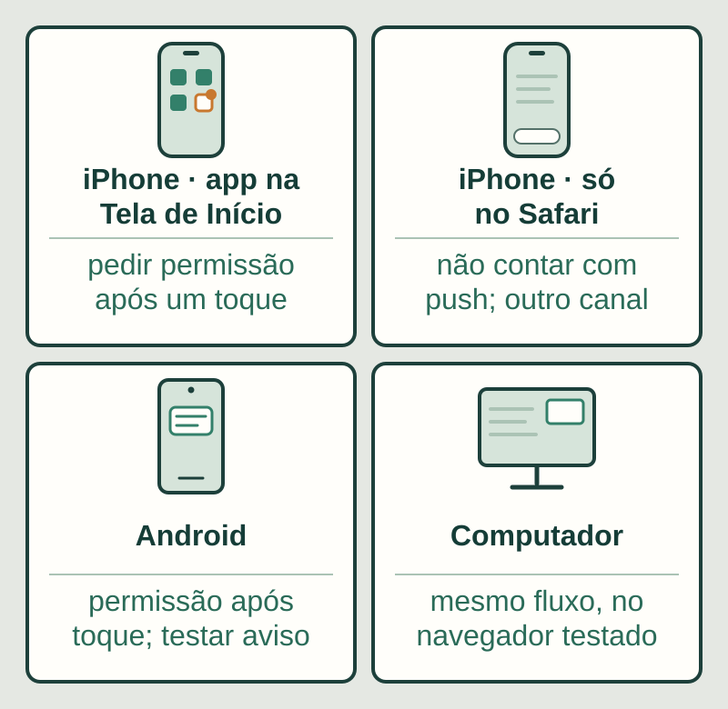
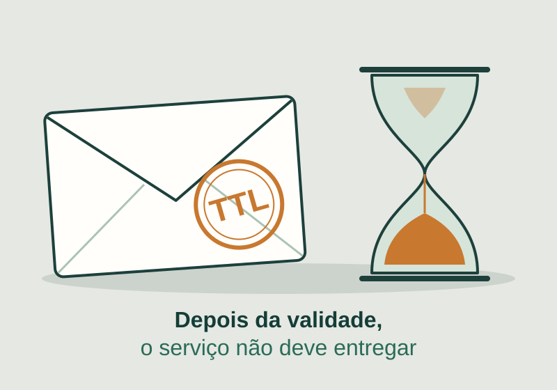

**Notificações push em um app web podem funcionar no celular, mas só com permissão do usuário, e nunca com entrega garantida.** No iPhone e no iPad, a documentação do WebKit descreve o suporte para web apps adicionados à Tela de Início. Para aceitar o recurso, combine quando a permissão é pedida, o que aparece se ela for negada, o que acontece se o aviso demorar ou expirar e qual canal alternativo cobre o que é crítico.

Este texto é para quem contrata um app web/PWA, portal ou ferramenta interna e quer avisos no celular. O objetivo é transformar “quero notificações” em cenários que você consegue conferir.

## No iPhone, PWA envia notificação?

Segundo o [WebKit](https://webkit.org/blog/13878/web-push-for-web-apps-on-ios-and-ipados/), um web app que foi adicionado à Tela de Início pode pedir permissão para receber notificações push. O post, de fevereiro de 2023, descreve o suporte no iOS e iPadOS 16.4, a integração com o Focus e o uso do serviço de push da Apple. Ele foi escrito para o beta daquela versão, então confirme o comportamento nos aparelhos e versões que você pretende suportar.

Na prática, isso muda o que você pede ao fornecedor. A documentação do WebKit descreve o suporte para web apps adicionados à Tela de Início; se a pessoa abre o sistema apenas numa aba do Safari, não conte com push e planeje outro caminho de aviso. O aceite deve incluir um passo para instalar o app na Tela de Início e uma tela que explique isso ao usuário antes de oferecer os avisos.

Para o aceite, vale ter uma matriz com quatro situações lado a lado: o iPhone com o app na Tela de Início, o iPhone com o site aberto no Safari, o Android e o computador.

*Ilustração original Torno Studio, 2026. Aparelhos e etiquetas são fictícios; não representam a interface de um sistema real.*

A [Push API](https://developer.mozilla.org/en-US/docs/Web/API/Push_API) exige um service worker ativo e uma assinatura criada pelo navegador, e a mesma página observa que ativá-lo para push pode aumentar o uso de recursos e de bateria. Peça ao fornecedor que explique o que roda em segundo plano e por quê.

## Quando e como pedir a permissão

O pedido de permissão é um recurso disponível apenas em contexto seguro (HTTPS) e deve ser feito em resposta a uma interação do usuário, como orienta o [MDN](https://developer.mozilla.org/en-US/docs/Web/API/Notification/requestPermission_static). O WebKit descreve a mesma lógica para o iOS: o pedido vem de um toque, por exemplo em um botão. Portanto, o aceite deve exigir um botão ou convite claro, e não um diálogo que aparece sozinho.

A [web.dev](https://web.dev/articles/push-notifications-permissions-ux) é direta: a pior coisa a fazer é mostrar o diálogo de permissão assim que a pessoa chega ao site. A orientação é pedir quando o benefício é óbvio, por exemplo depois de a pessoa ver que um aviso de nova ordem a ajudaria. E há um custo de errar: se o usuário bloqueia, o app não pode pedir de novo, e reverter depende da configuração do navegador.

A API descreve três estados. Defina o que o app mostra em cada um:

| Estado | O que significa | O que o app deve mostrar |
|---|---|---|
| `default` | A decisão do usuário é desconhecida; o app age como se a permissão tivesse sido negada | Um convite claro para ativar os avisos, sem insistência |
| `granted` | O usuário permitiu | Confirmação de que os avisos estão ativos e acesso às preferências |
| `denied` | O usuário bloqueou | Explicação de que o app não consegue pedir de novo, instrução de onde mudar no navegador ou aparelho e o canal alternativo |

O estado negado é fácil de esquecer na especificação. Peça que ele seja um cenário de aceite, com o texto aprovado por você.

## Push não é entrega garantida

O push passa por um serviço intermediário. A [especificação do protocolo (RFC 8030)](https://www.rfc-editor.org/rfc/rfc8030) define o TTL, valor que sugere por quanto tempo o serviço retém a mensagem (ele pode retê-la por menos tempo). Depois desse prazo, o serviço não pode tentar entregá-la. Com TTL zero e o aparelho indisponível, a mensagem expira e nunca é entregue. A especificação também prevê o cabeçalho de urgência, com os valores muito baixa, baixa, normal e alta. E o rascunho da [Push API do W3C](https://www.w3.org/TR/push-api/) registra que mensagens push costumam ter latência maior do que comunicações diretas.

Em termos simples: um aviso pode chegar tarde, ou nem chegar.

*Ilustração original Torno Studio, 2026. O envelope e o carimbo representam o tempo de vida (TTL) de uma mensagem; não mostram dados reais.*

Por isso, o aceite deve exigir três coisas que não dependem do push:

- **Central de avisos dentro do app**, com histórico, para quem perdeu ou bloqueou a notificação.
- **Validade definida por tipo de aviso.** Uma ordem urgente e um lembrete de baixa prioridade não têm o mesmo prazo útil; decida o TTL e a urgência de cada um, junto com o responsável técnico.
- **Canal alternativo para o que é crítico.** O [e-mail transacional](https://tornostudio.com/blog/emails-sistema-envio-entrega-falha/) e o [aviso por WhatsApp](https://tornostudio.com/blog/whatsapp-sistema-avisos-automaticos-aceite/) têm seus próprios limites e critérios; escolha o que combina com sua operação e não trate o push como único caminho.

## Preferências por tipo de aviso

Nem todo aviso precisa chegar a todo mundo. Antes do desenvolvimento, liste os tipos de aviso e, para cada um, quem recebe e se a pessoa pode desligá-lo. O rascunho do W3C prevê assinaturas userVisibleOnly, para mensagens com efeito visível ao usuário. Na prática, trate cada push como um aviso que a pessoa vê, com texto claro.

Peça uma tela de preferências onde a pessoa desligue um tipo de aviso sem desinstalar o app. Avisos de que a operação depende, como uma nova ordem de serviço, podem ser obrigatórios para certos perfis, desde que isso fique escrito e seja comunicado.

## Matriz de aceite por plataforma

Ajuste a tabela às plataformas que você realmente suporta. Ela é um modelo editorial, não a descrição de um produto existente. Registre sempre o aparelho, o sistema e o navegador usados em cada teste, porque o resultado depende deles.

| Plataforma ou situação | Resultado esperado | Evidência |
|---|---|---|
| iPhone com o app na Tela de Início | O app oferece os avisos em um toque; com a permissão concedida, a notificação de teste chega | Registro do aparelho e da versão do sistema, captura da permissão e da notificação recebida |
| iPhone com o site aberto só no Safari | O app não promete push; orienta a instalar na Tela de Início e mostra o canal alternativo | Captura da tela de orientação e do aviso recebido pelo canal alternativo |
| Android | Conforme o navegador testado, a permissão é pedida após um toque e a notificação de teste chega | Registro do aparelho, do navegador e da notificação |
| Computador (desktop) | Conforme o navegador testado, o mesmo fluxo de permissão e de notificação de teste | Registro do navegador e da notificação |
| Permissão negada | O app explica como mudar a configuração e oferece o canal alternativo; os avisos continuam na central | Captura da tela do estado negado e do item na central |
| Mensagem expirada com TTL curto em homologação | O push não aparece depois do prazo, mas o aviso continua na central e chega pelo canal alternativo, se for crítico | Horário de envio, TTL configurado, ausência da notificação e registro na central |

O último cenário mostra como o sistema lida com um aviso que expira. Faça-o no [ambiente de homologação](https://tornostudio.com/blog/ambiente-homologacao-conferir-antes-testar-sistema/), com dados fictícios, e use o [roteiro de critérios de aceite](https://tornostudio.com/blog/criterios-aceite-mvp/) para escrever o resultado esperado antes do teste.

**Exemplo inteiramente fictício:** uma ferramenta interna de manutenção avisa o técnico responsável quando uma nova ordem de serviço é atribuída a ele. O técnico abre o app instalado na Tela de Início do iPhone e toca em “Ativar avisos”; a permissão é concedida. Em homologação, o aviso da Ordem 118 é enviado com validade curta, enquanto o aparelho está desligado. Quando ele liga, a notificação não aparece, porque o prazo passou. A ordem, porém, está na central de avisos do app e, por ser crítica, também foi enviada por e-mail. **Fim do exemplo fictício.**

## Leve para o briefing

Reúna a lista de tipos de aviso, quem recebe cada um, as plataformas que importam e quais avisos são críticos. Peça ao fornecedor a matriz acima preenchida, a explicação do que acontece quando a permissão é negada e a evidência de cada cenário. Na [conversa de diagnóstico com Henrique](https://tornostudio.com/diagnostico/), eu ajudo a transformar esse material em requisitos e em critérios de aceite, sem prometer entrega garantida nem presumir uma implementação pronta.

## Perguntas frequentes

### O push funciona no iPhone se o usuário só abrir o site no Safari?

A documentação do WebKit descreve o suporte para web apps adicionados à Tela de Início. Se o uso previsto é apenas pela aba do Safari, não conte com push e defina o aviso pela central do app e por um canal alternativo.

### O que acontece se o usuário negar a permissão?

O app não pode pedir de novo; reverter depende da configuração do navegador, segundo a web.dev. Combine uma tela que explique isso, mantenha os avisos na central e ofereça um canal alternativo para o que é crítico.

### Dá para garantir que o aviso chegue?

Não. O serviço de push retém a mensagem no máximo pelo tempo de validade (TTL) e, depois disso, não pode tentar entregá-la; com TTL zero e o aparelho indisponível, ela nunca chega. Por isso o aceite deve incluir histórico no app e, para avisos críticos, outro canal.

*Fontes primárias consultadas em 4 de novembro de 2026. Tabelas, cenários e imagens são modelos editoriais fictícios.*
