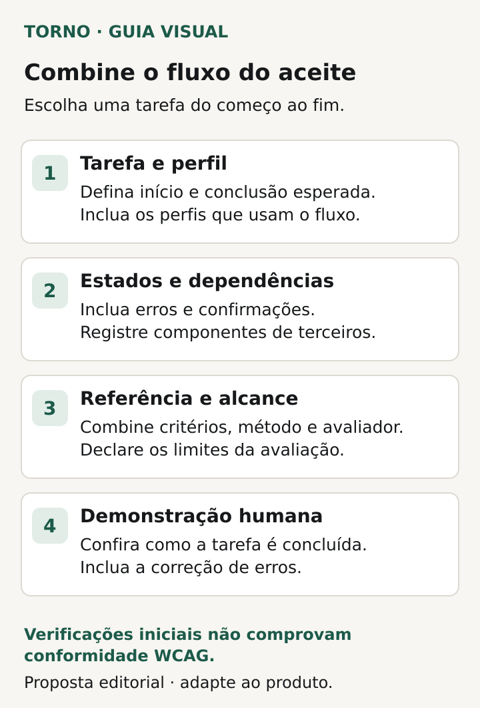
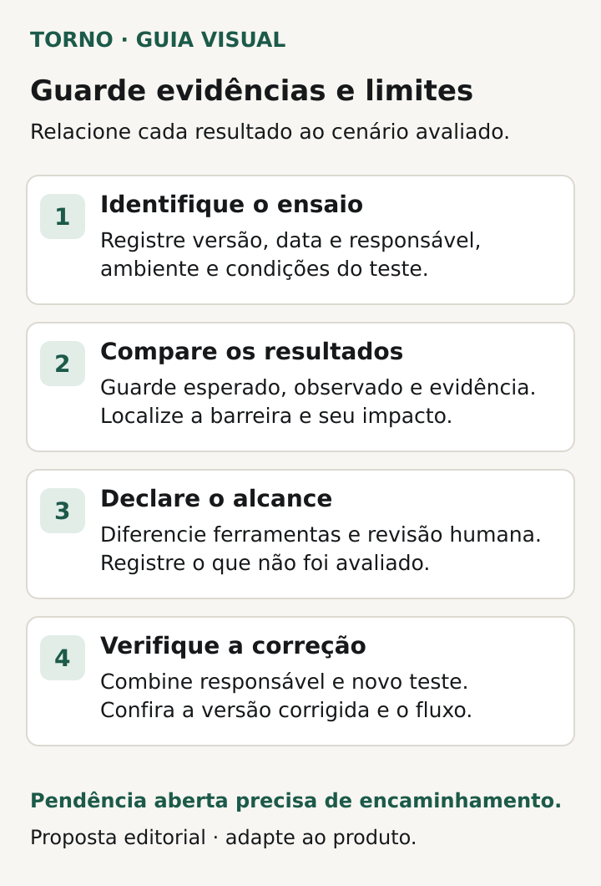

No aceite de um software sob medida, peça **um fluxo definido, testes de acessibilidade combinados e evidências do resultado**, com as barreiras e limitações registradas. “O sistema é acessível” precisa se tornar um acordo sobre o que será avaliado, por quem e em quais condições.

Para um comprador de portal, MVP ou ferramenta interna web, isso começa antes da demonstração final. Escolha a tarefa que uma pessoa precisa concluir, combine a referência de avaliação e peça que o fornecedor explique como verificará o comportamento. Os [critérios de aceite de MVP](https://tornostudio.com/blog/criterios-aceite-mvp/) organizam esse acordo geral; aqui o foco é a acessibilidade em software.

O roteiro é uma proposta editorial para preparar a contratação e conferir evidências. Uma seleção curta de verificações não comprova conformidade com WCAG nem atende, por si, a todas as necessidades de uso.

## Escolha uma tarefa do começo ao fim

Descreva uma tarefa como “entrar, localizar uma solicitação, corrigir um campo e confirmar o envio”. Inclua os estados que podem impedir a conclusão: erro de preenchimento, janela de confirmação, carregamento e mensagem final, conforme existirem. Uma tela de cadastro isolada pode deixar fora o ponto em que o usuário fica bloqueado.

Anote quais perfis executarão o fluxo. Uma pessoa autorizada a criar uma solicitação pode encontrar controles diferentes de quem a aprova. A [matriz de permissões de acesso](https://tornostudio.com/blog/permissoes-acesso-software-regras-negocio/) ajuda a nomear esses perfis e alcances. Neste aceite, a pergunta é se a tarefa permitida pode ser compreendida e executada nas condições avaliadas.

Identifique também componentes e conteúdos de terceiros: autenticação, calendário, pagamento, documento ou atendimento incorporado. Peça que o fornecedor registre onde começa e termina cada dependência e como ela participa da avaliação. A fronteira contratual precisa estar visível; excluir uma dependência do ensaio deixa uma limitação a resolver, se ela for necessária para concluir a tarefa.

## Especifique a referência e o alcance da avaliação

As [WCAG 2.2 do W3C](https://www.w3.org/TR/WCAG22/) apresentam critérios testáveis de acessibilidade. Se o contrato usar WCAG como referência, registre a versão, o nível pretendido, o escopo e quem avaliará o atendimento. Peça que o fornecedor diferencie uma verificação de critérios selecionados de uma avaliação de conformidade.

Os requisitos de conformidade incluem [páginas completas](https://www.w3.org/TR/WCAG22/#cc2) e [processos completos](https://www.w3.org/TR/WCAG22/#cc3). Portanto, aprovar alguns controles de uma tela não basta para declarar conforme todo o processo ou produto. O relatório precisa expressar o alcance real da conclusão.

Antes de fechar a entrega, resolva uma pergunta prática: quem tem a competência necessária para a avaliação prevista? A [orientação da WAI sobre avaliação e relatórios](https://www.w3.org/WAI/test-evaluate/conformance/) descreve conhecimentos especializados e um processo com definição de escopo, seleção de amostra, avaliação e registro dos achados. Se esse é o nível de evidência necessário, inclua o trabalho e o responsável no orçamento e no cronograma.

## Peça demonstrações humanas de situações concretas

O [Easy Checks da WAI](https://www.w3.org/WAI/test-evaluate/preliminary/) reúne verificações iniciais de teclado, foco, formulários, texto e alternativas. A própria orientação alerta que uma página pode passar por essa revisão e ainda conter barreiras importantes. Use esses tópicos para abrir a conversa com o fornecedor e combinar demonstrações pertinentes ao fluxo.

| Aspecto inicial | Demonstração a combinar no fluxo escolhido |
|---|---|
| Teclado e foco | Percorrer controles, acioná-los e sair deles sem depender do mouse, identificando onde está o foco |
| Campos e erros | Entender o que preencher, localizar o erro e corrigi-lo antes de continuar |
| Ampliação | Aumentar o texto ou o zoom nas condições definidas e conferir leitura e operação |
| Informação visual | Conferir contraste e se o significado depende apenas de cor |
| Alternativas | Verificar informação equivalente para imagens relevantes e mídia existente no escopo |

*Proposta editorial para definir o fluxo; verificações iniciais não comprovam conformidade WCAG. Crédito: Torno Studio, 2026.*

Esta é uma seleção inicial para o aceite, não a lista completa de critérios de acessibilidade. O responsável pela avaliação deve detalhar os cenários, as condições e os critérios aplicáveis. “Passou em cinco verificações” não sustenta uma declaração de conformidade WCAG.

Peça demonstração dos estados de falha, além do caminho sem erros. Se o envio exige uma informação que ficou faltando, o usuário consegue perceber o problema, encontrar o campo e retomar a tarefa? Combine o resultado esperado antes do ensaio. Isso evita aceitar apenas a existência de uma mensagem sem conferir se ela ajuda a prosseguir.

## Guarde o contexto do teste junto da evidência

Uma gravação ou relatório precisa permitir relacionar o resultado ao cenário avaliado. Use uma ficha como esta, adaptada pelo responsável técnico e por quem fará a avaliação:

| Campo | O que registrar |
|---|---|
| Identidade do ensaio | Versão, data, ambiente e responsável pela avaliação |
| Tarefa e perfil | Início, conclusão esperada, estados exercitados e permissão usada |
| Referência | Critérios avaliados e método empregado, com limites explícitos |
| Condições | Dispositivo, sistema, navegador, versões e configurações relevantes |
| Tecnologia assistiva | Recurso e versão utilizados, quando fizer parte do teste |
| Resultado | Esperado, observado, evidência e barreira encontrada |
| Encaminhamento | Responsável pela correção, próxima verificação e condição de encerramento |

*Relacione a evidência ao cenário avaliado e mantenha pendências com encaminhamento explícito. Crédito: Torno Studio, 2026.*

As condições escolhidas devem vir do plano de avaliação, considerando o uso previsto do produto. Uma combinação de navegador e leitor de tela não demonstra o comportamento de todas as outras. Se algo não foi avaliado, registre “não avaliado”, com a consequência para a decisão de entrega.

Cuide também da evidência compartilhada: use dados de teste e mantenha anexos no canal autorizado. Para discutir uma barreira, o comprador precisa localizar o problema e seu impacto, sem divulgar credenciais ou informações pessoais de usuários.

## Entenda o papel das ferramentas e das pessoas

A [WAI explica que ferramentas de avaliação não verificam automaticamente todos os aspectos da acessibilidade](https://www.w3.org/WAI/test-evaluate/tools/selecting/) e podem produzir resultados incorretos ou enganosos. Julgamento humano é necessário. Peça que o relatório mostre o que foi verificado automaticamente, o que foi revisto por uma pessoa e o que ficou sem avaliação.

Uma nota de ferramenta é uma evidência parcial. Pergunte quais telas e estados entraram na varredura, quais achados foram confirmados e onde estão as verificações humanas previstas no acordo. O fornecedor deve conseguir relacionar sua conclusão a um resultado observável do fluxo.

A [WAI também recomenda envolver pessoas com deficiência na avaliação](https://www.w3.org/WAI/test-evaluate/conformance/). Quando essa participação fizer parte do trabalho, combine recrutamento, condições e objetivos com quem conduz a pesquisa. Ela ajuda a conhecer a experiência real e pode revelar barreiras que o roteiro não antecipou; não substitui a avaliação técnica dos critérios de conformidade.

## Veja um exemplo de aceite com uma pendência visível

**Exemplo inteiramente fictício:** um portal permite solicitar manutenção de um equipamento. O escopo do ensaio inclui entrar com uma conta de solicitante, localizar o formulário, informar um problema, corrigir um campo obrigatório e receber a confirmação. O plano registra as condições do teste e as verificações previstas com teclado e tecnologia assistiva.

Na demonstração hipotética, o formulário é enviado normalmente quando os campos estão preenchidos. Ao deixar um campo obrigatório vazio, porém, a pessoa não consegue identificar o que precisa corrigir na condição avaliada. O relatório registra o ponto do fluxo, os passos, o resultado esperado e o observado. A frase “formulário funcionando” não encerra essa pendência.

O responsável combina uma correção e um novo teste do cenário que falhou, incluindo a retomada até a confirmação. A evidência de encerramento deve corresponder à versão corrigida e às condições combinadas. **Fim do exemplo fictício; não representa produto, cliente ou ensaio da Torno.**

Esse formato permite uma decisão concreta: o que foi demonstrado, qual barreira continua aberta e qual evidência falta para aceitar o cenário. Evite diluir o problema em uma anotação genérica como “melhorar experiência depois”.

## Combine como as barreiras serão corrigidas e verificadas

Para cada achado, registre a tarefa afetada, a condição em que ocorreu, o impacto observado, quem corrigirá e como será conferida a solução. Se a barreira impede um cenário incluído no aceite, mantenha esse cenário pendente até haver a evidência acordada. Qualquer decisão de liberar com limitação precisa estar explícita, com responsável e encaminhamento; ela não transforma uma falha em critério atendido.

Depois do lançamento, alterações de componentes, conteúdo ou fluxos precisam considerar as verificações afetadas. O roteiro para [priorizar mudanças de um MVP em uso](https://tornostudio.com/blog/mvp-pos-lancamento-priorizar-mudancas/) ajuda a registrar sinais e impacto. O histórico deve preservar a origem da pendência e o resultado da nova avaliação.

Para a [conversa inicial com Henrique](https://tornostudio.com/diagnostico/), leve o fluxo principal, os usuários previstos e a evidência que precisa receber no aceite. Isso permite discutir o escopo da solução e a necessidade de um especialista em acessibilidade. A conversa inicial não equivale a uma auditoria; avaliação especializada e execução precisam de escopo e contratação definidos.

*Fontes primárias consultadas em 22 de outubro de 2026. As fichas e o exemplo são propostas editoriais originais para adaptação ao produto.*
