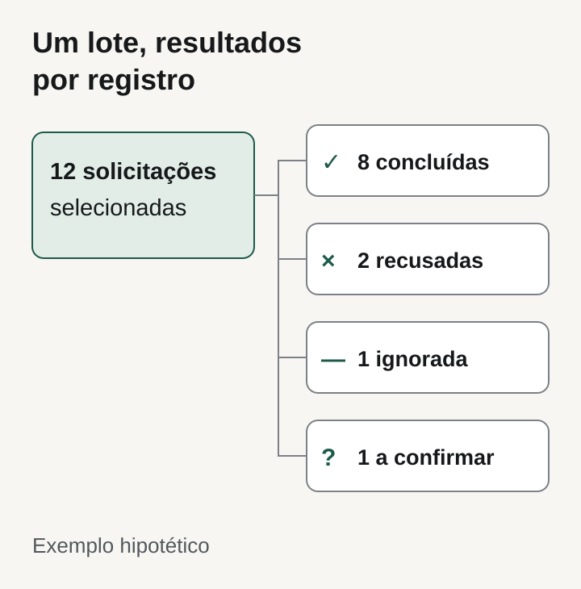
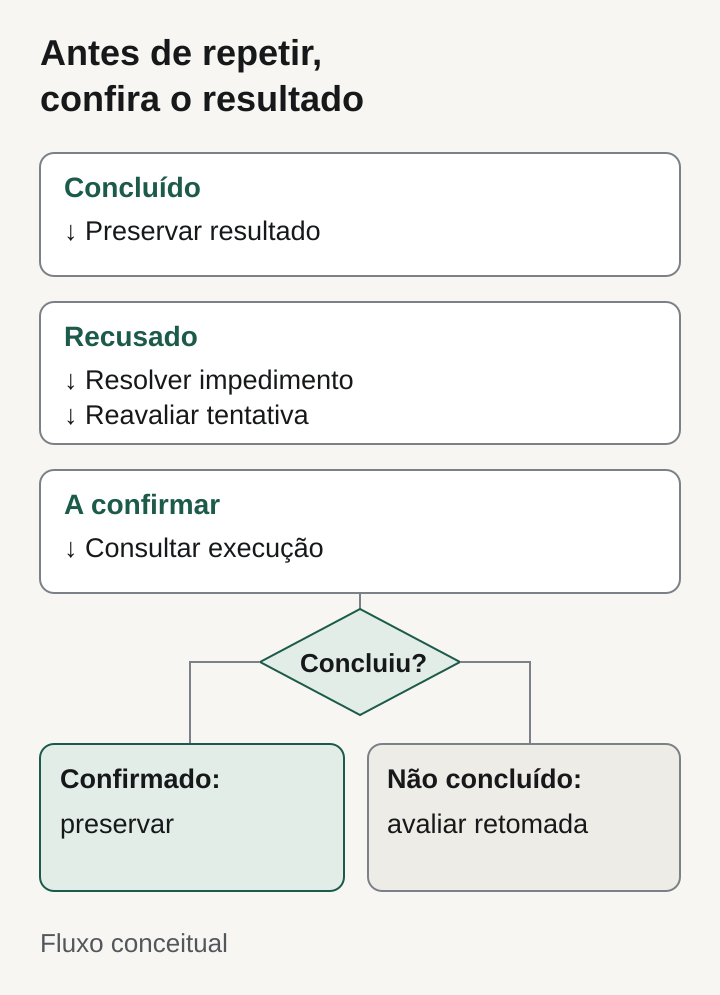

**Para aceitar uma ação em lote no sistema, exija uma seleção identificável, resultado por registro e uma forma de tratar pendências sem repetir os itens já concluídos.** Combine também se a operação admite sucesso parcial ou precisa concluir tudo junto. Uma mensagem de “processamento finalizado” não resolve essas decisões.

Neste artigo, proponho critérios para operações sobre registros que já existem, como atribuir responsáveis ou alterar situações. O foco é ajudar comprador e fornecedor a definir o que será entregue e demonstrado, antes de aprovar um botão de “aplicar a todos”.

## Defina quais registros entram na ação

“Todos” pode significar os registros visíveis na página, os selecionados manualmente ou tudo que corresponde ao filtro. Essa diferença precisa aparecer antes da confirmação, com quantidade e descrição da ação. Trocar de página ou ajustar o filtro não deve mudar silenciosamente o conjunto que o usuário acredita ter selecionado.

Peça ao fornecedor que explique quando a seleção é fixada. Se um registro deixar de atender ao filtro entre a escolha e a execução, ele ainda será alterado? Se a regra exigir conferir a situação atual, o resultado deve mostrar que aquele item foi ignorado ou recusado, com motivo compreensível.

A autorização também precisa ser conferida na execução. Ter visto um registro antes não prova que o usuário continua autorizado a alterá-lo. Na contratação, descreva um caso com permissão retirada ou situação modificada após a seleção e combine a resposta esperada.

## Escolha a unidade de sucesso

Uma ação em massa pode admitir resultados independentes. Atribuir um responsável a várias solicitações, por exemplo, pode permitir que uma solicitação bloqueada fique pendente enquanto as outras avançam. Em outro processo, alterar somente parte dos registros pode quebrar uma regra de negócio. Nesse caso, o requisito pode ser concluir tudo junto ou não efetivar nada.

Não deixe essa escolha implícita na implementação. Peça uma frase de aceite: “cada solicitação pode concluir separadamente” ou “este conjunto deve permanecer consistente como uma única operação”, seguida das exceções e dos efeitos externos envolvidos. Um e-mail já enviado, por exemplo, não desaparece quando uma alteração no banco é desfeita.

A documentação do [JSON batching do Microsoft Graph explica que um HTTP 200 do lote não prova o sucesso de cada requisição](https://learn.microsoft.com/en-us/graph/json-batching). Cada resposta individual tem seu próprio status. É um exemplo técnico delimitado de por que o comprador deve perguntar pelo resultado de cada item; não é uma obrigação de usar Microsoft Graph nem de copiar sua arquitetura.

*Distribuição hipotética para explicar a conferência por item. Ilustração original Torno Studio, 2026.*

## Mostre o resultado que a equipe consegue usar

O resumo precisa separar quantidade selecionada, concluída e pendente, sem esconder recusas dentro de um percentual. Quando houver execução em andamento, distinga itens ainda não processados daqueles que já receberam uma resposta. Ao abrir o detalhe, a equipe deve encontrar o identificador do registro, seu resultado e a providência possível.

Eu pediria, no mínimo, estes estados quando fizerem sentido para a operação:

- **Concluído:** alteração confirmada para aquele registro.
- **Recusado:** regra ou permissão impediu a alteração; há um motivo a resolver.
- **Ignorado:** uma condição prevista tornou a ação inaplicável, sem alteração.
- **A confirmar:** ainda não foi possível comprovar o resultado.

Esse último estado merece atenção. Se a conexão cair depois do envio, a tela pode não saber se o servidor concluiu a mudança. Marcar tudo como falha e oferecer “tentar novamente” pode repetir efeitos. O contrato deve prever como consultar a execução existente e quando encaminhar uma pendência para conferência.

## Combine a retomada antes de precisar dela

Retomar só o que falta exige saber o que já foi concluído. Pergunte como a operação é identificada, como o sistema reconhece uma tentativa repetida e o que acontece se o usuário clicar duas vezes ou fechar a página. Não é necessário aceitar uma aula de infraestrutura como evidência: peça uma demonstração com os resultados esperados.

A [documentação da AWS sobre erros no Lambda com SQS](https://docs.aws.amazon.com/lambda/latest/dg/services-sqs-errorhandling.html) descreve um comportamento padrão em que mensagens de um lote voltam a ficar visíveis após falha, inclusive as já processadas. Com respostas parciais configuradas, é possível informar quais mensagens falharam. O exemplo mostra que a retomada depende de comportamento e configuração explícitos; não significa que seu sistema precise de uma fila ou que essa opção resolva sozinha todos os efeitos repetidos.

Também diferencie repetir de corrigir. Uma permissão negada pode exigir outro responsável; um registro encerrado pode precisar ficar fora da operação; um resultado incerto exige consulta antes de nova tentativa. Para reconstruir o que aconteceu, combine o registro de usuário, ação, seleção, horários e resultados, conforme os [requisitos de uma trilha de auditoria](https://tornostudio.com/blog/trilha-auditoria-sistema-requisitos-negocio/).

## Exemplo hipotético: trocar o responsável de 12 solicitações

Imagine um gestor que seleciona 12 solicitações existentes para atribuí-las a outra pessoa. A regra acordada permite conclusão independente por solicitação. No ensaio, oito são alteradas, duas são recusadas por falta de permissão, uma é ignorada porque foi encerrada e uma fica com resultado a confirmar após uma interrupção.

O resumo precisa fechar a conta: 8 + 2 + 1 + 1 = 12. A equipe consulta a solicitação incerta antes de qualquer repetição. As duas recusadas seguem para um responsável autorizado. A encerrada permanece inalterada. Uma retomada não deve reenviar indiscriminadamente as oito alterações confirmadas.

Todos os números e acontecimentos deste exemplo são fictícios. O objetivo é transformar “funciona em lote” em uma evidência que o comprador consegue conferir.

*Fluxo conceitual de decisão, sem representar uma interface ou implementação existente. Ilustração original Torno Studio, 2026.*

## Checklist para aprovar a entrega

Faça os ensaios em um [ambiente de homologação preparado](https://tornostudio.com/blog/ambiente-homologacao-conferir-antes-testar-sistema/), com registros fictícios e resultados combinados previamente:

- [ ] A seleção informa a quantidade e distingue página atual, seleção manual e filtro completo.
- [ ] Um registro alterado entre seleção e execução recebe o tratamento acordado.
- [ ] O teste demonstra se o sucesso é independente ou exige o conjunto inteiro.
- [ ] Uma falha provocada aparece no resumo e no detalhe do registro correto.
- [ ] A soma dos estados corresponde ao conjunto selecionado, sem itens desaparecidos.
- [ ] Fechar e reabrir a tela permite consultar a execução, conforme o escopo contratado.
- [ ] Clique repetido e interrupção de conexão não geram efeitos repetidos nos cenários testados.
- [ ] A retomada respeita concluídos, recusados e resultados ainda incertos.
- [ ] O responsável recebe evidências da execução e sabe como tratar cada pendência.

Registre cenário, resultado esperado, resultado observado e decisão. Esses testes demonstram o comportamento ensaiado, não uma garantia contra toda falha futura. Vincule-os aos [critérios de aceite do sistema](https://tornostudio.com/blog/criterios-aceite-mvp/).

## Perguntas frequentes

### Uma falha parcial reprova a entrega?

Não necessariamente. Ela pode ser prevista e aceita quando os itens são independentes, os resultados ficam claros e existe tratamento para as pendências. Reprova quando contradiz a regra acordada ou impede identificar o que aconteceu.

### Basta exibir uma barra de progresso?

Não. Ela ajuda a acompanhar o andamento, mas o aceite precisa conferir o resultado por item e o destino das pendências. Chegar a 100% pode significar apenas que todas as tentativas terminaram.

### Preciso de um botão para desfazer tudo?

Depende da operação e de seus efeitos. Combine o que pode ser revertido, quem pode fazê-lo e quais consequências permanecem. Não prometa desfazer mensagens, integrações ou alterações posteriores sem verificar cada caso.

Para discutir uma ação concreta, leve a regra de seleção, o efeito desejado e um exemplo de falha para uma [conversa de diagnóstico com Henrique](https://tornostudio.com/diagnostico/).

*Fontes consultadas em 9 de novembro de 2026. O roteiro de contratação e os cenários são propostas editoriais; os exemplos técnicos se limitam aos serviços citados.*
