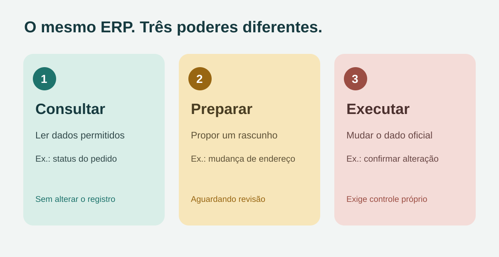
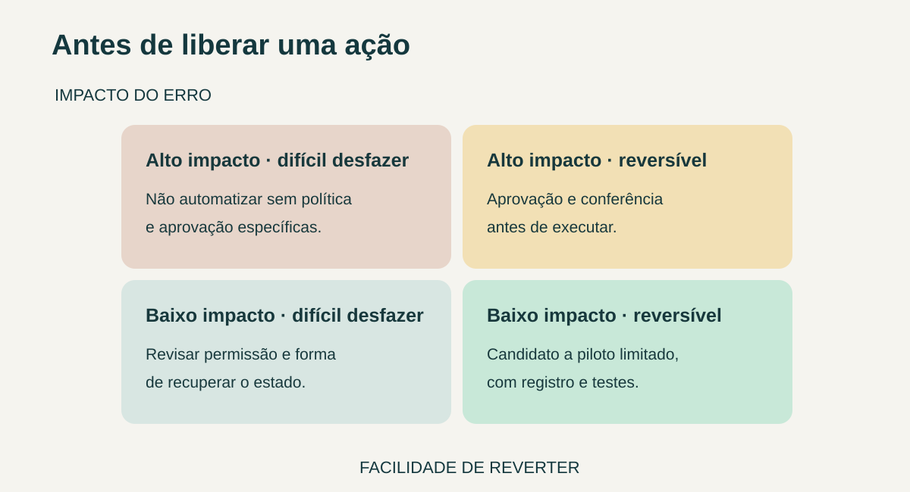

**Antes de integrar um agente de IA ao ERP, defina uma lista curta de ações permitidas.** Separar consulta, preparação de um rascunho e execução de uma mudança evita que “acessar o ERP” vire uma autorização genérica. Para cada ação, registre quais dados o agente enxerga, em nome de quem atua, quem aprova e como o resultado será conferido.

Isso vale tanto para um assistente interno quanto para um agente que recebe pedidos externos. O desenho depende do ERP, da operação e do impacto de cada ação; este artigo é um roteiro de contratação, não uma arquitetura pronta.

## Três níveis de ação que não devem ser confundidos

**Consultar** é ler um registro autorizado e devolver uma resposta. **Preparar** é montar uma proposta ou rascunho para revisão. **Executar** é criar, alterar, aprovar ou enviar algo que passa a valer no sistema. Uma pergunta simples pode exigir uma resposta; ela não autoriza automaticamente o terceiro nível.

| Pedido de exemplo | Comportamento a definir | Conferência no aceite |
|---|---|---|
| “Qual o status deste pedido?” | Consultar apenas pedidos visíveis ao usuário | O agente não revela pedidos de outra conta |
| “Prepare uma alteração de endereço” | Criar rascunho, sem gravar no cadastro oficial | A mudança aguarda revisão e não altera o pedido |
| “Aprove este pagamento” | Operação de alto impacto, sujeita a política própria | A ação não ocorre apenas pela resposta do modelo |

Os exemplos são fictícios. O terceiro pode simplesmente ficar fora do escopo inicial. A [OWASP classifica excesso de funções, permissões e autonomia como fontes de risco em agentes com LLM](https://genai.owasp.org/llmrisk/llm062025-excessive-agency/). Sua orientação é limitar as ferramentas ao necessário e exigir verificação independente para ações de alto impacto.

*Comparação editorial de níveis de ação; não representa uma interface ou implantação real. Ilustração original Torno Studio, 2026.*

## Faça uma ficha para cada ação

Em vez de conceder “acesso ao ERP”, descreva uma operação por vez. Uma ficha curta deve responder:

- **Quem pede?** Usuário autenticado, equipe interna ou evento externo?
- **O quê?** Qual recurso e quais campos podem ser lidos ou alterados?
- **De quem?** O acesso respeita cliente, unidade e perfil?
- **Com qual limite?** Há faixa de valores, quantidade ou horário que muda o tratamento?
- **Quem confirma?** A ação exige aprovação de alguém com permissão própria?
- **Qual evidência?** Como se relacionam pedido, aprovação, chamada ao ERP e resultado?

O [guia de privilégio mínimo da Microsoft para agentes](https://learn.microsoft.com/en-us/security/zero-trust/sfi/least-privilege-for-ai-agents) recomenda definir identidade, escopo, acesso a ferramentas e auditabilidade antes de ampliar a autonomia. Essas decisões devem ser aplicadas também na integração e no sistema de destino, não depender só de uma frase nas instruções do agente.

Uma conta técnica com permissão para alterar todos os clientes pode ultrapassar a autorização de quem fez o pedido. A implementação precisa verificar o usuário, o recurso e a ação no momento da execução. Se não for possível fazê-lo, reduza o escopo e documente o limite.

## Use impacto e reversibilidade para decidir aprovação

Um rascunho de texto e a mudança de um dado fiscal não pedem a mesma autonomia. Classifique cada ação pelo impacto de um erro e pela possibilidade de desfazê-la. A matriz abaixo é uma ferramenta de discussão, não uma regra universal de liberação.

*A classificação deve ser feita com o cliente e validada no seu processo. Ilustração original Torno Studio, 2026.*

Para ações sensíveis, decida quem aprova, o que essa pessoa verá e por quanto tempo a aprovação vale. Uma autorização para “atualizar o pedido 123” não deveria liberar a alteração de outro pedido ou uma operação diferente. A trilha deve registrar o que foi solicitado, o que foi efetivamente enviado ao ERP e a resposta obtida. Veja também [o que definir para uma trilha de auditoria útil](https://tornostudio.com/blog/trilha-auditoria-sistema-requisitos-negocio/).

## Como testar antes de colocar em operação

No ambiente autorizado, execute casos normais e tentativas fora do escopo. Teste com usuários de perfis diferentes, registros de clientes diferentes e uma ação que exija aprovação. Confira o ERP de destino, não apenas o texto devolvido pelo agente. Um “concluído” na conversa sem mudança confirmada não atende ao aceite; uma mudança realizada sem autorização também não.

Inclua falha e repetição: o que aparece quando o ERP não responde? Se o mesmo pedido for enviado outra vez, a operação duplica? Quem pode reprocessar? Quais dados aparecem nos registros técnicos? Essas perguntas cruzam segurança, continuidade e operação diária.

Uma implantação inicial pode limitar-se a **consultas e preparação de rascunhos**, caso isso já resolva uma tarefa valiosa. Só amplie o poder do agente após demonstrar confiabilidade no fluxo específico e revisar os controles. A OWASP descreve a aprovação humana como controle para ações de alto impacto, mas a escolha concreta de limites depende do processo.

## Perguntas frequentes

### Dar acesso de leitura ao agente é suficiente para começar?

Pode ser uma primeira delimitação, mas ainda é necessário definir quais registros cada usuário pode consultar e o que a resposta pode revelar. “Leitura” não significa acesso a todos os dados.

### A aprovação escrita no chat já autoriza a mudança?

Não por si só. A aplicação deve verificar a autoridade de quem aprovou, a ação exata e o recurso envolvido antes de executar no ERP.

### O agente pode usar a mesma conta de administrador de um funcionário?

Isso amplia o poder agregado e dificulta atribuir responsabilidade. O desenho deve prever identidade e permissões adequadas ao fluxo, conforme o princípio de privilégio mínimo documentado pela Microsoft.

Se sua empresa está avaliando uma integração, leve um exemplo de consulta, um de alteração desejada e os perfis envolvidos para uma [conversa de diagnóstico com Henrique](https://tornostudio.com/diagnostico/). A Torno pode avaliar o escopo técnico e os critérios de aceite sem pressupor que todo o ERP deva ficar acessível ao agente.

*Fontes consultadas em 30 de outubro de 2026. Cenários e matriz são exemplos editoriais, não casos de clientes.*
