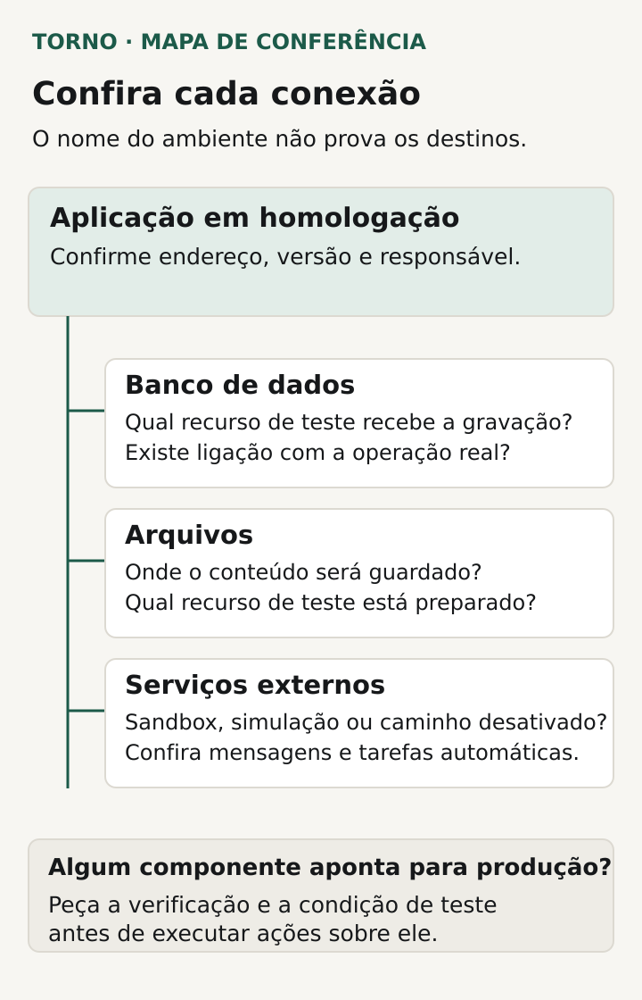
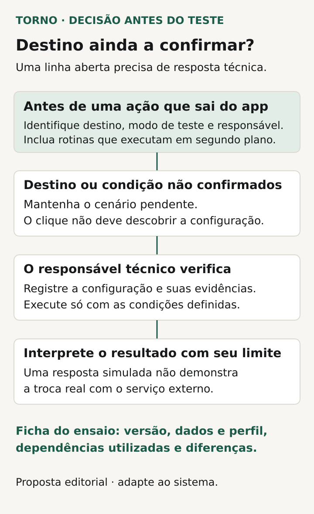

Antes de testar um sistema no ambiente de homologação, confirme **qual versão está disponível, quais dados serão usados, quem pode acessar e para onde as ações serão enviadas**. Registre também o que difere da produção. Essas respostas permitem começar o teste com condições conhecidas e interpretar corretamente o resultado.

Para o comprador, homologar é conferir o comportamento combinado com o fornecedor. O ambiente precisa permitir essa conferência sem misturar o ensaio com a operação real. Um endereço com “teste” no nome ajuda a identificar a aplicação, mas não demonstra quais bancos, arquivos e integrações ela utiliza.

Este roteiro é uma proposta editorial para preparar o primeiro teste de um portal, MVP, integração ou ferramenta interna web. A configuração e a verificação técnica cabem ao responsável pelo sistema; o gestor precisa conseguir relacionar as respostas ao fluxo que vai avaliar.

## Identifique ambiente, versão e responsável

Peça um ponto de entrada confirmado pelo fornecedor: endereço, forma de acesso e identificação visível de homologação. Combine como reconhecer a versão que será avaliada e onde consultar a data de sua disponibilização. Se o responsável usar um código técnico para a versão, peça uma referência que permita ligá-lo à entrega prevista.

Combine quem libera o início, recebe problemas e avisa sobre mudanças durante o período de teste. Se o fornecedor publicar uma correção, registre em qual versão os cenários serão repetidos. Evite reunir resultados de versões diferentes sob uma única conclusão sem essa identificação.

A [AWS recomenda usar múltiplos ambientes](https://docs.aws.amazon.com/wellarchitected/latest/framework/ops_dev_integ_multi_env.html) para desenvolver e testar, com controles progressivos no caminho até produção. É uma referência de engenharia; a pergunta do comprador continua concreta: qual ambiente está autorizado para este ensaio e quem confirma suas condições?

## Peça a separação de homologação e produção por componente

Solicite ao responsável técnico uma explicação simples sobre aplicação, banco de dados, arquivos e serviços externos. Para cada componente, pergunte qual recurso de teste será utilizado e se existe alguma ligação com produção. O desenho deve deixar visível o destino de uma gravação ou envio.

No contexto AWS, a [orientação de separação por contas](https://docs.aws.amazon.com/wellarchitected/latest/framework/sec_securely_operate_multi_accounts.html) trata a conta como um limite de isolamento. Outros produtos podem adotar mecanismos diferentes. O importante na conversa é pedir a justificativa da solução usada e a evidência da separação, sem concluir que um rótulo ou uma conta adicional resolveu todas as conexões.

Não peça valores de senhas ou chaves para preencher a ficha. Registre recurso, finalidade, ambiente e responsável, mantendo os segredos no mecanismo apropriado. Se um componente ainda aponta para a operação real, peça que o responsável explique o risco e prepare a condição de teste antes de executar ações sobre ele.

*Mapa editorial de perguntas ao responsável; não representa uma arquitetura real nem comprova isolamento. Crédito: Torno Studio, 2026.*

## Prepare dados fictícios que representem os cenários

Combine uma pequena massa de dados de teste com os estados necessários: rascunho, aprovado, cancelado ou outro estado pertinente. Use identificadores que o participante consiga reconhecer e resultados esperados definidos. Uma base vazia pode impedir a avaliação de busca, histórico, relatórios e permissões.

Na [documentação de branching do Supabase](https://supabase.com/docs/guides/deployment/branching), novas branches não começam, por padrão, com dados ou objetos de armazenamento do projeto de origem. Há opções para incluir dados. Esse exemplo mostra por que é preciso perguntar como o ambiente concreto foi preparado, em vez de presumir que ele já contém o conjunto necessário ou que nunca recebeu cópia de produção.

Para o roteiro proposto aqui, prefira registros inteiramente fictícios e contas de teste controladas. Não copie uma planilha de clientes para resolver uma demonstração. Se houver necessidade justificada de usar dados provenientes da operação, encaminhe a preparação e as autorizações aos responsáveis; isso exige uma decisão própria, fora da simples tarefa de preencher o ambiente.

Defina também como repetir o cenário. Quem pode recompor o estado inicial? Uma limpeza apagará evidências de outro participante? Combine a preservação dos resultados antes de reiniciar dados e informe os horários de manutenção. O comprador precisa saber quando uma ausência de registro é efeito da preparação, e não uma falha do produto.

## Confira integrações, mensagens e outros efeitos externos

Liste as ações que saem do sistema: envio ao ERP, cobrança, e-mail, mensagem, criação de tarefa ou emissão de documento. Para cada uma, registre se a integração em sandbox será usada, se haverá resposta simulada ou se o caminho ficará desativado. Informe quem consegue confirmar o resultado no destino autorizado.

A [Stripe documenta testes em sandbox com valores e chaves de teste](https://docs.stripe.com/testing), sem movimentar fundos, e orienta não usar dados reais de cartão. Essa garantia pertence àquele serviço e à configuração indicada. Um pagamento simulado não informa se o seu sistema também enviará um e-mail real ou acionará outra integração.

Confirme os destinatários controlados para mensagens e os recursos usados por rotinas automáticas. Uma tarefa executada em segundo plano também faz parte do fluxo. Se a integração não oferece ambiente de teste, peça uma alternativa técnica com alcance e limites explícitos antes de homologar aquele caminho.

O [briefing de integração com ERP](https://tornostudio.com/blog/integracao-erp-briefing-orcamento/) ajuda a localizar sistemas, acessos e responsáveis. Aqui o objetivo é conferir quais dessas dependências estão preparadas para o ensaio, inclusive o caminho das respostas que voltam ao seu sistema.

## Use uma ficha de prontidão antes de começar

Reúna as respostas numa ficha curta. Os anexos técnicos podem ficar com o responsável, desde que a conclusão seja rastreável. Esta tabela é uma proposta para adaptar ao risco e à arquitetura do produto.

| Conferência | Evidência a pedir | Pendência que precisa de resposta |
|---|---|---|
| Ambiente e versão | Endereço confirmado e identificação da entrega | Qual versão será testada? |
| Dados e arquivos | Recursos de teste identificados e massa preparada | De onde vieram os dados e como serão recompostos? |
| Acessos | Contas de teste com os perfis necessários | Quem concede, remove e acompanha o acesso? |
| Integrações | Destinos, credenciais de ambiente e modo de teste confirmados pelo técnico, sem expor segredos | Existe algum caminho para produção? |
| Efeitos externos | Destinatários e recursos controlados; simulações declaradas | O que será enviado, criado ou alterado fora do app? |
| Operação do ensaio | Contato, janela de teste e aviso de atualização | Quem resolve um impedimento para começar? |
| Limites | Diferenças relevantes e verificações excluídas | Qual conclusão ainda não poderá ser tirada? |

Uma linha marcada “a confirmar” continua aberta. Se ela envolve o destino de uma ação, não trate o clique do usuário como experimento para descobrir a configuração. Peça a verificação do responsável técnico e só execute o cenário quando suas condições estiverem definidas.

*O destino de uma ação deve ser confirmado antes do cenário; uma simulação não prova a troca real. Crédito: Torno Studio, 2026.*

## Veja um exemplo de preparação do fluxo

**Exemplo inteiramente fictício:** um portal permite criar um pedido e enviá-lo a um ERP. Antes da homologação, o fornecedor identifica a versão do portal, prepara pedidos fictícios e contas de solicitante e aprovador. O envio aponta para o ambiente de testes do ERP, com um destinatário controlado para o aviso por e-mail.

Ao revisar a ficha, surge uma lacuna: a rotina automática de atualização dos pedidos ainda não teve seu destino confirmado. O cenário de envio fica pendente enquanto o responsável confere essa rotina e registra a configuração de teste. Depois, o plano pode prever criar o pedido, aprová-lo, acompanhar o envio e conferir a resposta no ambiente autorizado.

Se o ERP for substituído por uma resposta simulada, a ficha deve dizer isso. O resultado permitirá avaliar o comportamento demonstrado do portal, com esse limite; não provará a troca real com o ERP. **Fim do exemplo fictício; não representa cliente, configuração ou ensaio da Torno.**

## Registre as diferenças que mudam a interpretação

Peça uma lista do que será diferente em produção: volume de dados, recursos de infraestrutura, autenticação, permissões, integrações e tarefas agendadas, conforme afetarem o cenário. Homologação não precisa reproduzir toda a operação para responder a uma pergunta delimitada, mas suas diferenças precisam aparecer na conclusão.

Não use uma conferência funcional com poucos registros como prova de capacidade. O roteiro de [evidências de teste de carga](https://tornostudio.com/blog/teste-carga-evidencias-liberar-sistema/) trata dessa avaliação específica. Limites e autorização para um teste funcional também não autorizam aumentar indiscriminadamente o volume de chamadas aos serviços externos.

Ao começar o ensaio, relacione cada evidência à versão, aos dados, ao perfil e às dependências utilizadas. Os [critérios de aceite](https://tornostudio.com/blog/criterios-aceite-mvp/) definem o comportamento que será conferido nessas condições. Depois, a publicação exige sua própria preparação, incluindo o [plano de rollback da atualização](https://tornostudio.com/blog/plano-rollback-atualizacao-sistema/) quando aplicável.

Para a [conversa inicial com Henrique](https://tornostudio.com/diagnostico/), traga o fluxo a homologar, as integrações envolvidas e as respostas que faltam na ficha. Isso permite discutir a preparação necessária e o escopo da entrega. A conversa inicial não substitui investigação técnica nem garante que um ambiente esteja pronto; configuração e verificação precisam estar incluídas no trabalho combinado.

*Fontes primárias consultadas em 22 de outubro de 2026. A ficha e o exemplo são propostas editoriais originais para adaptação ao sistema.*
