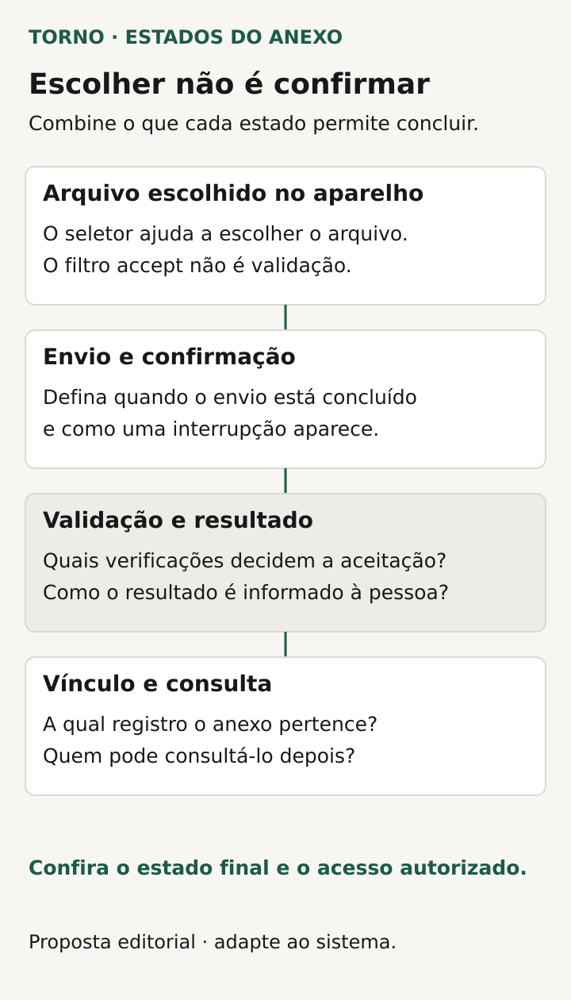
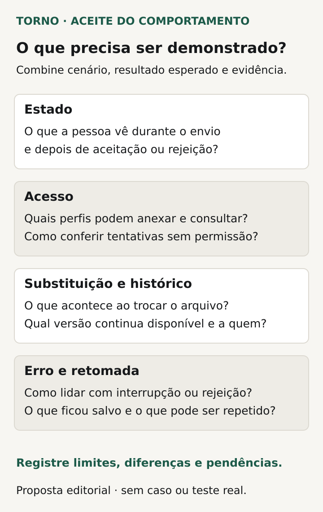

Antes de aceitar anexos no sistema, combine **qual documento pertence a qual registro, quando o envio é considerado concluído e quem poderá consultar, substituir ou remover o arquivo**. A demonstração precisa percorrer esse ciclo, além de mostrar um botão para escolher o documento.

Para o comprador de um portal ou ferramenta interna, um comprovante pode participar da aprovação de um pedido ou da análise de uma solicitação. Se o documento não estiver disponível para a pessoa correta, o trabalho pode continuar bloqueado mesmo depois de a tela anunciar sucesso.

Este roteiro propõe decisões e evidências para documentos anexados. A [importação de planilhas](https://tornostudio.com/blog/importacao-planilhas-sistema-tratar-erros/) interpreta linhas e campos para criar ou alterar dados; guardar um arquivo para consulta é outra funcionalidade. Também não equivale a contratar migração, backup ou exportação do sistema.

## Defina a finalidade e o vínculo do documento

Nomeie o arquivo que o processo precisa receber: comprovante, proposta ou imagem de uma ocorrência, por exemplo. Explique em qual pedido, cadastro ou solicitação ele ficará vinculado e quem usará seu conteúdo. “Aceitar qualquer anexo” deixa abertas escolhas de formato, capacidade e tratamento.

Combine se o documento é obrigatório para salvar um rascunho, para enviar a solicitação ou somente para uma etapa posterior. Defina também quantidade, categorias e identificação visível. Se houver vários arquivos, a pessoa precisa reconhecer qual deles atende a cada exigência do processo.

Peça ao fornecedor que explique a relação entre arquivo armazenado e registro do negócio. Se o envio termina antes de a solicitação ser salva, o que acontece quando o usuário desiste? Se o registro já existe, quando o novo documento passa a aparecer nele? São regras de ciclo de vida a definir no produto, sem presumir uma arquitetura específica.

## Combine formatos e limites com validação real

Escolha os tipos necessários e os limites relevantes: tamanho por arquivo, quantidade por registro e outras condições justificadas pelo uso. Peça mensagens que permitam corrigir a tentativa. Um usuário deve conseguir distinguir arquivo grande demais de formato não aceito ou falha de comunicação.

A [MDN explica que o atributo HTML accept apenas orienta o seletor de arquivos](https://developer.mozilla.org/en-US/docs/Web/HTML/Reference/Attributes/accept). Ele não valida o tipo enviado. Portanto, ver o navegador sugerir documentos de determinado formato não demonstra que o sistema verifica a exigência ao receber o conteúdo.

A [OWASP recomenda controles combinados para upload](https://cheatsheetseries.owasp.org/cheatsheets/File_Upload_Cheat_Sheet.html), incluindo tipos permitidos, limites, autorização e verificações apropriadas. Extensão e tipo declarado não são provas isoladas do conteúdo. Peça ao responsável técnico a explicação do tratamento proposto, de suas limitações e das verificações incluídas no escopo.

Se houver análise adicional do arquivo, combine quando ela ocorre e o que acontece enquanto o resultado está pendente. Não conclua que um documento é seguro porque foi aceito pelo formulário ou porque um mecanismo de análise foi contratado.

## Diga o que a confirmação realmente significa

Separe seleção do arquivo, transferência, confirmação do vínculo e disponibilidade para consulta. O produto pode usar estados diferentes, conforme o mecanismo escolhido, mas cada mensagem deve corresponder a uma condição verificável.

Uma barra de progresso concluída precisa ser interpretada no contexto: ela confirma a transferência ou também o registro e a disponibilidade? Peça ao fornecedor que demonstre a etapa que autoriza a tela a informar sucesso. Depois, reabra o registro com o perfil adequado e confira se o documento correto pode ser obtido.

Se houver interrupção, diga como o usuário descobrirá o estado antes de tentar novamente. Combine o tratamento de uma tentativa incompleta, de um documento ainda pendente e de um novo clique no envio. Evite deixar a pessoa deduzir o resultado pela ausência de mensagem.

*Etapas propostas para discutir a confirmação e a consulta do documento; os estados concretos dependem da solução. Diagrama original Torno Studio, 2026.*

## Trate envio e consulta como permissões separadas

Use a [matriz de permissões de acesso](https://tornostudio.com/blog/permissoes-acesso-software-regras-negocio/) para especificar quem pode anexar, visualizar, baixar, substituir e remover. Inclua o alcance dos registros: unidade, organização ou outro conjunto definido. Consultar o cadastro não responde automaticamente a todas essas ações.

Pergunte como o acesso funciona fora da tela. Se o produto gera um link, ele exige autenticação a cada consulta ou concede acesso por outras condições? Quem o possuir poderá usá-lo? Por quanto tempo? A resposta deve vir do mecanismo real, com seu alcance explicado.

A [documentação de URLs pré-assinadas do Amazon S3](https://docs.aws.amazon.com/AmazonS3/latest/userguide/using-presigned-url.html) oferece um exemplo: esses endereços concedem acesso temporário a quem os possui e podem ser usados repetidamente enquanto válidos. Isso não obriga seu sistema a usar S3, mas mostra por que “link temporário” não significa necessariamente uso único ou conferência da sessão do portal.

Combine o efeito esperado quando uma permissão muda. A implementação precisa demonstrar suas condições, inclusive para links já emitidos. Não prometa revogação instantânea sem verificar o mecanismo e os limites correspondentes.

## Defina substituição, remoção e histórico

Uma nova proposta substitui o documento anterior ou cria outra versão? O que acontece se dois anexos tiverem o mesmo nome? Quem pode ver o anterior e qual versão vale para uma aprovação já feita? Defina a decisão com o responsável pelo processo.

Separe retirada da lista, bloqueio de acesso e exclusão do arquivo. O comprador precisa saber o que a ação contratada faz, quando e para quais cópias. Retenção, exceções e obrigações aplicáveis exigem responsáveis e regras próprias; não escolha um período apenas porque a ferramenta tem um padrão.

Se for necessário registrar quem enviou, substituiu ou removeu, descreva os acontecimentos pertinentes. A [trilha de auditoria](https://tornostudio.com/blog/trilha-auditoria-sistema-requisitos-negocio/) aprofunda esse registro. Ter histórico de uma ação não significa conservar automaticamente o conteúdo anterior do documento.

## Faça uma ficha do ciclo do anexo

Use esta proposta para localizar decisões abertas antes da demonstração. O detalhe técnico pode ficar em documentação referenciada, desde que o comportamento seja compreensível para quem aceita a entrega.

| Decisão | Resultado a combinar |
|---|---|
| Finalidade e vínculo | Documento associado ao registro e à etapa corretos |
| Tipos e limites | Tentativas aceitas e recusadas com motivo compreensível |
| Confirmação | Condição que permite anunciar conclusão ou pendência |
| Consulta | Perfis e alcance autorizados, inclusive fora da tela |
| Substituição | Versão válida e tratamento do documento anterior |
| Remoção e histórico | Efeito da ação e evidência necessária para conferi-la |
| Falha e retomada | Estado conhecido e caminho para corrigir ou repetir |

## Veja um exemplo de solicitação com comprovante

**Exemplo inteiramente fictício:** a solicitação SOL-A exige um comprovante antes de seguir para análise. O acordo define um tipo de documento e um limite de tamanho, além dos perfis que enviam e consultam. O envio ainda pendente não satisfaz a exigência da etapa.

No cenário hipotético, a transferência é interrompida. A pessoa encontra a tentativa sem confirmação e segue o caminho de retomada combinado. Depois da conclusão, um analista autorizado abre SOL-A e confere o documento correto. Outro perfil, fora do alcance permitido, não deve obtê-lo pelos caminhos incluídos no teste.

Uma substituição posterior precisa seguir a política escolhida para o comprovante anterior e para a análise. **Fim do exemplo fictício; não representa cliente, implementação ou ensaio da Torno.**

## Confira o ciclo com dados fictícios em homologação

Prepare o [ambiente de homologação](https://tornostudio.com/blog/ambiente-homologacao-conferir-antes-testar-sistema/) com arquivos fictícios e contas dos perfis previstos. O responsável técnico deve definir como exercitar falhas e verificações sem usar documentos perigosos ou expor dados reais.

Transforme a ficha em [critérios de aceite](https://tornostudio.com/blog/criterios-aceite-mvp/): arquivo permitido, tentativa fora do limite, interrupção, consulta autorizada e negada, substituição e remoção previstas. Confira o resultado no registro, além das mensagens da tela. Se houver link com validade, inclua suas condições no ensaio autorizado.

*Conferências propostas para relacionar as regras do anexo ao resultado observado. Diagrama original Torno Studio, 2026.*

Guarde versão, perfil, arquivo de teste, sequência e resultado observado. Identifique o que foi simulado e o que não participou da avaliação. Essa evidência delimita o comportamento demonstrado; não equivale a uma auditoria de segurança.

Para a [conversa inicial com Henrique](https://tornostudio.com/diagnostico/), leve o fluxo, documentos fictícios representativos e as regras de quem pode enviá-los e consultá-los. Isso permite delimitar a funcionalidade, as dependências e a evidência da entrega antes de definir a solução técnica.

*Fontes consultadas em 27 de outubro de 2026. As fichas e o exemplo são propostas editoriais originais para adaptação ao produto.*
