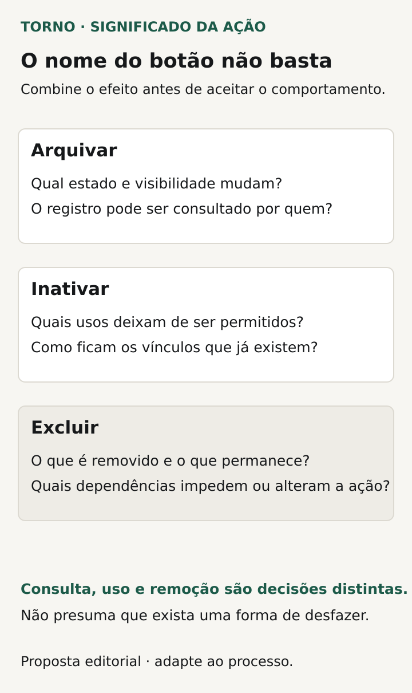
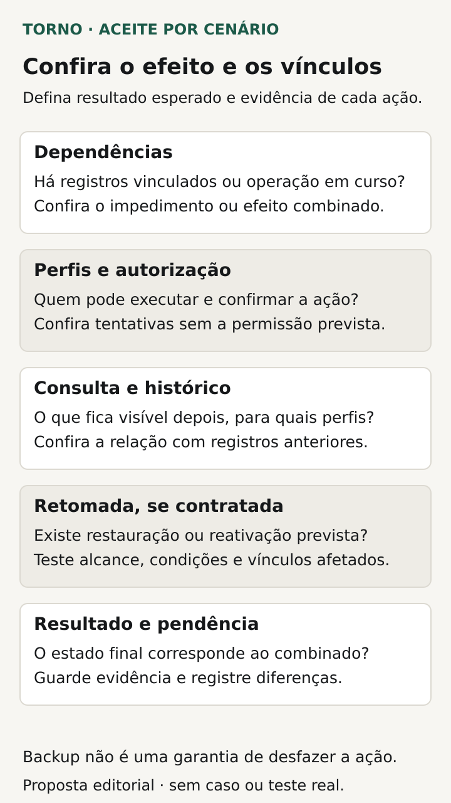

Antes de aceitar as ações de arquivar ou excluir registros no sistema, combine **o que muda no cadastro, nas novas operações e nos registros que já dependem dele**. Inclua quem pode agir, o que continuará consultável e se existe algum caminho de retomada contratado.

“Tirar da lista” não explica se o registro foi removido, apenas ficou oculto ou deixou de poder ser usado. Um cadastro pode desaparecer da busca de novos pedidos e continuar necessário para interpretar pedidos antigos. O comprador precisa definir esse efeito antes de avaliar o botão.

Este roteiro trata de registros de negócio num portal ou ferramenta interna. Não substitui decisões sobre exclusão de conta, obrigações de retenção ou cancelamento de uma operação. As fichas são propostas editoriais para a conversa de escopo, com implementação e limites definidos pelo responsável técnico.

## Dê um significado a cada ação

Nomeie os objetivos da operação. É preciso reduzir a lista do trabalho atual, impedir novos usos de um cadastro ou remover conteúdo? Arquivar, inativar e excluir podem ter significados diferentes entre produtos. Escreva o comportamento desejado em vez de confiar apenas no nome.

Para cada ação, registre o estado resultante e o que o usuário poderá fazer depois. Um cadastro inativo ainda pode ser consultado? Pode ser editado? Uma solicitação arquivada aparece num relatório? Se a ação for reversível, quem pode retomá-la e em quais condições?

Evite tratar uma mudança de visibilidade como prova de remoção. Peça ao fornecedor que explique o alcance da ação nos caminhos incluídos no escopo e como esse alcance será demonstrado. Se houver exigência legal ou contratual a interpretar, encaminhe-a ao responsável competente antes de transformá-la em regra do produto.

*Decisões propostas para esclarecer o efeito de cada ação, sem uma política universal. Diagrama original Torno Studio, 2026.*

## Liste os registros que dependem do cadastro

Escolha um exemplo importante: produto usado em pedidos, fornecedor vinculado a compras ou unidade associada a solicitações. Diga quais objetos precisam continuar compreensíveis depois da ação sobre o cadastro. Inclua o que aparece em detalhes, relatórios e consultas contratadas.

A [documentação do PostgreSQL 18](https://www.postgresql.org/docs/current/ddl-constraints.html) apresenta diferentes tratamentos de referências na exclusão, como impedir a ação ou remover registros dependentes. São mecanismos cuja escolha depende da relação entre os objetos. Ter um banco de dados não decide qual consequência atende ao negócio.

O [Microsoft Dataverse também apresenta o efeito sobre registros relacionados como uma decisão de modelagem](https://learn.microsoft.com/en-us/power-apps/maker/data-platform/create-edit-entity-relationships). Esse exemplo externo ajuda a formular a pergunta: ao agir no registro principal, quais outros registros serão preservados, alterados ou removidos? Não presume que seu produto use Dataverse.

Peça uma lista de dependências relevantes, validada pelo processo e pela investigação técnica. Se ainda faltar conhecimento sobre um vínculo, registre a pendência. Executar uma exclusão real para descobrir a consequência não deve ser o método de definição do escopo.

## Defina o tratamento das dependências

Uma política pode impedir a exclusão de cadastros que já foram usados. Outra pode permitir remover uma estrutura e seus componentes quando essa for a intenção legítima. Também pode haver necessidade de preservar uma referência ou informação histórica. O comprador precisa escolher o efeito necessário, com a justificativa técnica e os limites conhecidos.

Se a ação for impedida, combine a explicação e a próxima alternativa autorizada. “Não foi possível” deixa o usuário sem saber se precisa corrigir algo ou pedir ajuda. A mensagem deve permitir compreender a restrição sem expor detalhes de registros fora do seu alcance.

Quando houver impacto em dependentes, defina como a pessoa o conhecerá antes de confirmar. A confirmação precisa corresponder ao efeito real. Um aviso genérico não substitui a evidência de que o sistema realizou somente as alterações combinadas.

| Decisão | Resultado a combinar |
|---|---|
| Registro sem vínculos | Efeito permitido e informação de conclusão |
| Registro já utilizado | Impedimento ou tratamento explícito dos dependentes |
| Novas operações | Uso permitido ou negado após a mudança de estado |
| Consulta de operações anteriores | Conteúdo que precisa permanecer compreensível |
| Acesso à ação | Perfil autorizado e alcance dos registros envolvidos |
| Retomada, se contratada | Condições, efeitos e evidência da reversão |

## Confira consultas e novas operações separadamente

Inativar pode significar impedir a escolha num pedido novo e manter a consulta do histórico. Se essa for a regra, ela precisa valer nos caminhos pertinentes, não somente numa lista visual. Peça demonstração da tentativa de novo uso e da abertura de uma operação anterior.

Combine filtros iniciais e formas de localizar registros arquivados ou inativos. O roteiro de [busca e filtros](https://tornostudio.com/blog/busca-filtros-sistema-resultados/) ajuda a definir inclusões e exclusões. Uma busca vazia pode corresponder a um filtro ativo; ela não prova a remoção do registro.

A [matriz de permissões](https://tornostudio.com/blog/permissoes-acesso-software-regras-negocio/) complementa o acordo: quem pode executar a ação, consultar o resultado e eventualmente reativar? A pessoa autorizada a editar um cadastro não recebe automaticamente todas essas capacidades. Registre cada decisão relevante.

## Não presuma que haverá um botão Desfazer

Se o processo precisa recuperar um registro após uma ação indevida, inclua essa capacidade no escopo. Defina quem pode fazê-lo, quais registros e relações retornam e o que pode impedir a retomada. Um código reutilizado ou uma dependência alterada pode exigir decisão específica, conforme a solução.

A [Microsoft descreve um recurso de restauração de registros do Dataverse](https://www.microsoft.com/en-us/power-platform/blog/2026/03/25/restore-deleted-records/) associado a configurações de conservação e limpeza. Ele ilustra que recuperação depende de condições concretas. Não transfira sua janela ou seus recursos para outro produto sem confirmação.

Retomar um registro individual também difere de [restaurar um backup do sistema](https://tornostudio.com/blog/prova-restauracao-backup-software/). Pergunte ao fornecedor qual procedimento está sendo oferecido e que efeitos teria sobre o restante da operação. A existência de backup não demonstra um desfazer seletivo na interface.

Se houver registro da ação, use o roteiro de [trilha de auditoria](https://tornostudio.com/blog/trilha-auditoria-sistema-requisitos-negocio/) para definir o que precisa ser consultável. Saber que alguém excluiu não comprova que o conteúdo possa ser recuperado.

## Veja um exemplo de cadastro usado em pedidos

**Exemplo inteiramente fictício:** o cadastro PROD-A já participa de pedidos antigos. A operação deseja impedir novas seleções desse produto e continuar entendendo os pedidos existentes. O acordo hipotético escolhe inativar para esse caso e impedir a exclusão quando houver os vínculos definidos.

Depois da inativação, um perfil autorizado consulta o pedido antigo e encontra a informação necessária. Ao tentar escolher PROD-A num pedido novo, o resultado segue a regra de impedimento. A tentativa de exclusão apresenta a restrição pertinente, sem remover os pedidos relacionados.

Outro cadastro fictício, ainda sem os vínculos impeditivos, permite exercitar a política de exclusão escolhida. **Fim do exemplo fictício; não representa cliente, implementação ou ensaio da Torno.**

Esses dois casos deixam o aceite mais preciso. O primeiro demonstra tratamento de dependência; o segundo verifica uma condição diferente. Aprovar apenas o desaparecimento de uma linha da lista deixaria ambas as perguntas abertas.

## Demonstre os efeitos com registros fictícios

Prepare contas e dados relacionados no [ambiente de homologação](https://tornostudio.com/blog/ambiente-homologacao-conferir-antes-testar-sistema/). Identifique registros sem uso, com dependências e com os estados relevantes. Combine previamente o resultado de cada cenário e evite ensaiar exclusões em dados da operação real.

Transforme a ficha em [critérios de aceite](https://tornostudio.com/blog/criterios-aceite-mvp/). Uma seleção inicial para discutir é:

| Cenário | Evidência a conferir |
|---|---|
| Arquivar ou inativar conforme o acordo | Estado, consulta e elegibilidade para novo uso |
| Excluir com dependência impeditiva | Ação recusada e registros relacionados preservados |
| Excluir na condição permitida | Efeito limitado aos objetos definidos |
| Perfil sem autorização | Ação impedida nos caminhos avaliados |
| Consulta de histórico | Informação necessária ainda interpretável |
| Retomada contratada | Conteúdo e vínculos restaurados conforme as condições |

*Conferências propostas para verificar os efeitos e os limites das ações sobre registros. Diagrama original Torno Studio, 2026.*

Confira o estado final dos registros envolvidos, além da mensagem. Guarde versão, contas, sequência e limites da avaliação. Se algum vínculo externo não participou, registre o que continua pendente antes da conclusão correspondente.

Para a [conversa inicial com Henrique](https://tornostudio.com/diagnostico/), leve exemplos fictícios de cadastros, seus vínculos e o que precisa permanecer disponível. Isso permite delimitar ações, exceções e evidências da entrega sem presumir uma política pronta de exclusão ou recuperação.

*Fontes consultadas em 28 de outubro de 2026. A ficha e o exemplo são propostas editoriais originais para adaptação ao produto.*
