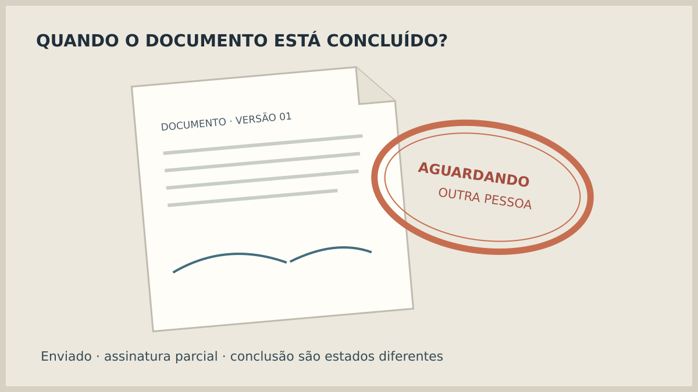
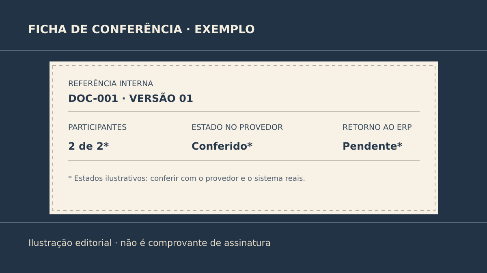

**Uma assinatura eletrônica integrada só deve avançar o processo interno quando o estado acordado for confirmado pelo provedor e registrado no sistema de origem.** Enviar um convite, abrir o link ou receber a assinatura de uma pessoa não significa, por si só, que o documento está concluído. Antes de construir a integração, defina o que “concluído” significa para aquele documento e qual evidência permitirá conferir essa decisão.

O tipo de assinatura adequado e seus efeitos jurídicos dependem do documento e do contexto. Essa escolha deve ser avaliada com quem responde por ela na empresa. Este roteiro trata do **comportamento do software**, não decide validade jurídica.

## Comece pelo documento e pelos responsáveis

Escolha um documento concreto. De onde vem o arquivo? Qual versão é enviada? Quem pode alterar os dados antes do envio? Quantas pessoas precisam assinar e em que ordem, se houver? Quem pode cancelar e reenviar? Essas respostas delimitam o fluxo melhor do que “integrar assinatura eletrônica ao ERP”.

Registre uma referência do documento no sistema de origem e outra na plataforma de assinatura. Assim, uma atualização recebida pode ser ligada ao arquivo e à versão corretos. Se o conteúdo mudar depois do envio, decida se o processo anterior será cancelado, mantido ou substituído; não deixe duas versões parecendo a mesma solicitação.

**Exemplo inteiramente fictício:** um portal gera um termo para duas pessoas assinarem. A primeira assina, mas a segunda ainda não. O portal deve mostrar a participação concluída da primeira sem liberar a etapa de trabalho que exige o termo inteiro. A referência do termo e a versão do arquivo permanecem visíveis para conferência. **Fim do exemplo fictício; não representa cliente ou produto da Torno.**

*Estados ilustrativos para discutir escopo; não reproduzem a interface de uma plataforma de assinatura. Ilustração original Torno Studio, 2026.*

## Não misture enviado, assinado por alguém e concluído

Na [explicação técnica da Docusign](https://www.docusign.com/blog/developers/dsdev-has-my-envelope-been-signed), um participante terminar sua assinatura é diferente de o envelope alcançar o estado de conclusão. O exemplo desse fornecedor inclui todos os signatários relevantes e outras etapas configuradas. Seu projeto deve verificar os nomes e as regras de estado da plataforma contratada, sem copiar a terminologia de outro serviço.

Defina o que o ERP, portal ou ferramenta interna mostrará em cada situação: preparado, enviado, aguardando outra pessoa, concluído, recusado, expirado ou cancelado, conforme as possibilidades do provedor escolhido. Associe cada estado a uma decisão: quem será avisado, qual tarefa fica disponível e qual ação ainda não pode ocorrer. Nem todo evento precisa produzir uma mudança no sistema de origem.

O artigo sobre [envio e entrega de e-mails do sistema](https://tornostudio.com/blog/emails-sistema-envio-entrega-falha/) aprofunda outra distinção útil: uma notificação enviada não comprova que seu destinatário concluiu uma ação. No fluxo de assinatura, a confirmação deve vir do estado do processo, não da entrega de um convite.

## Confira a informação na origem correta

Uma tela de retorno pode dizer “assinatura concluída” depois que uma pessoa fecha a página. Isso não basta para liberar automaticamente uma operação. A [Docusign alerta que o parâmetro de retorno do navegador pode ser falsificado](https://www.docusign.com/blog/developers/dsdev-has-my-envelope-been-signed) e orienta confirmar o estado por consulta ao seu serviço ou por uma notificação webhook. Trata-se de comportamento documentado para a Docusign; a integração real deve seguir os mecanismos oficiais e os controles do fornecedor usado.

Combine o que acontece se a plataforma informa conclusão, mas o ERP não consegue gravar a atualização. A pessoa verá “concluído no provedor, atualização pendente” ou uma mensagem equivalente? Quem recebe a pendência? Como ela é corrigida sem pedir outra assinatura? Um resultado correto em um sistema pode ainda estar ausente no outro.

O mesmo evento pode ser recebido de novo. A integração precisa reconhecer a referência e o estado já processados antes de executar efeitos repetidos. O guia sobre [eventos duplicados](https://tornostudio.com/blog/integracao-evento-duplicado-regra-negocio/) trata desse problema em mais detalhe. Também vale definir a ordem entre atualização de estado, cópia do arquivo final e avisos internos; uma etapa não deve parecer concluída se sua evidência obrigatória estiver faltando.

## Que evidências pedir no aceite?

Prepare o ensaio com documentos e signatários fictícios em ambiente autorizado. Registre a versão, os responsáveis, o estado esperado no provedor e no sistema de origem. Mostre um caminho normal e, no mínimo, uma recusa, uma ausência de resposta e uma falha de comunicação. A evidência deve permitir entender o que ocorreu sem guardar credenciais, links sensíveis ou dados pessoais desnecessários.

| Situação do ensaio | O que conferir no sistema de origem |
|---|---|
| Convite enviado | Pendente; nenhuma ação final liberada apenas pelo envio |
| Uma de duas pessoas assinou | Participação registrada; documento ainda pendente |
| Provedor confirmou conclusão | Versão, referência e arquivo/evidência acordada vinculados |
| Pessoa recusou ou prazo acabou | Estado próprio, sem conclusão presumida |
| Atualização do ERP falhou | Pendência identificável para correção sem novo envio indevido |

*A ficha mostra o que pedir na demonstração; não é comprovante de assinatura nem resultado de cliente. Ilustração original Torno Studio, 2026.*

Se houver exigência de guardar uma cópia final, registre quem tem acesso, onde ficará, por quanto tempo e como será localizada. A [trilha de auditoria](https://tornostudio.com/blog/trilha-auditoria-sistema-requisitos-negocio/) ajuda a formular quais ações e mudanças de estado precisam deixar evidências. O aceite de software verifica o fluxo contratado; ele não substitui análise jurídica do documento.

Para avaliar uma integração, leve um tipo de documento, os participantes, o sistema atual e a decisão que depende da conclusão para uma [conversa de diagnóstico com Henrique](https://tornostudio.com/diagnostico/). Isso permite delimitar o escopo antes de escolher a plataforma ou automatizar o próximo passo.

*Fonte técnica consultada em 2 de novembro de 2026. Os estados, cenários e figuras são exemplos editoriais; nenhuma integração real foi alegada.*
