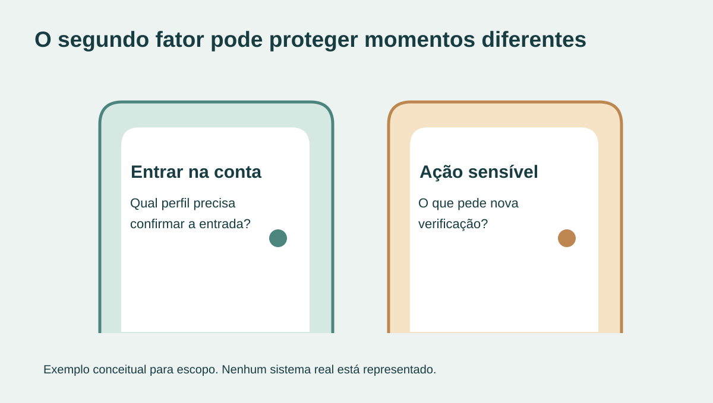
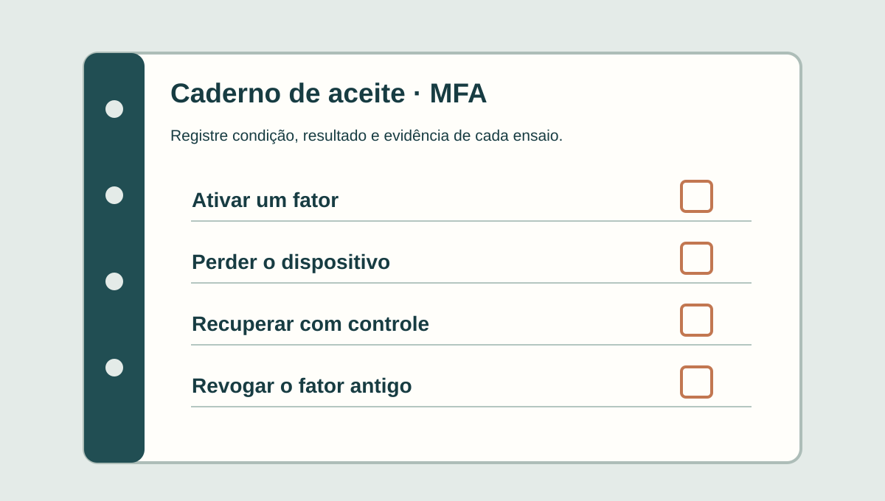

**Para contratar autenticação de dois fatores, comece pelo comportamento esperado, não pela tela do código.** Defina quais contas precisam de um segundo fator, em que momento ele será exigido, quais métodos o sistema oferecerá e como uma pessoa recuperará o acesso se perder o dispositivo. O aceite precisa demonstrar tanto a entrada normal quanto a tentativa de contornar o controle.

Neste artigo, MFA significa autenticação com mais de um fator, como algo que a pessoa sabe e algo que possui. Nem toda combinação de duas etapas constitui dois fatores diferentes. A [OWASP explica essa distinção e os métodos possíveis](https://cheatsheetseries.owasp.org/cheatsheets/Multifactor_Authentication_Cheat_Sheet.html). A escolha depende dos riscos, usuários, dispositivos e sistemas envolvidos.

## Defina quem precisa de MFA e em qual ação

Uma regra como “todos devem usar dois fatores” deixa perguntas importantes abertas. O acesso de um administrador pode expor informações ou permitir ações diferentes das de um usuário comum. Há contas de serviço que não entram por uma tela humana. Há ações específicas — como trocar permissões ou dados sensíveis — que podem exigir confirmação adicional.

Comece com uma lista curta de perfis e tarefas. Para cada uma, anote se a proteção vale na entrada, numa ação sensível ou nas duas situações. Não conclua que uma pessoa autenticada pode executar qualquer operação: a [autorização de acesso](https://tornostudio.com/blog/permissoes-acesso-software-regras-negocio/) deve ser verificada separadamente.

*As portas representam decisões de escopo, não telas ou um produto existente. Ilustração original Torno Studio, 2026.*

## Escolha métodos pensando também em perda e troca

Código por aplicativo, chave de segurança, passkey e mensagem de texto não têm as mesmas propriedades nem o mesmo custo de suporte. O [NIST SP 800-63B](https://pages.nist.gov/800-63-4/sp800-63b.html) distingue níveis de garantia e trata resistência a phishing como requisito de aplicações avaliadas no nível AAL2. Isso **não** significa que todo portal comercial deva declarar AAL2; a referência ajuda a fazer perguntas mais precisas sobre o risco e os métodos.

Pergunte ao responsável técnico o que acontece se a pessoa troca de celular, perde a chave ou deixa a empresa. A [OWASP alerta que a recuperação de MFA precisa devolver acesso legítimo sem abrir um atalho para invasores](https://cheatsheetseries.owasp.org/cheatsheets/Multifactor_Authentication_Cheat_Sheet.html). Um botão “esqueci meu segundo fator” sem verificação compatível pode anular o benefício do controle.

Combine também como o método é ativado e substituído. Quem pode iniciar a troca? Uma sessão já aberta basta? A pessoa recebe aviso? O método antigo deixa de valer quando o novo é confirmado? E como o suporte registra a intervenção sem pedir códigos secretos ao usuário?

## Especifique a recuperação antes de lançar

A recuperação de **senha** e a recuperação de **MFA** são problemas relacionados, mas distintos. Um link para redefinir senha não deve desativar automaticamente o segundo fator. O [guia sobre recuperação de senha](https://tornostudio.com/blog/recuperacao-senha-sistema-aceite/) cobre o primeiro fluxo; neste, combine como demonstrar o segundo.

Um cenário fictício ajuda a revelar lacunas: um colaborador perdeu o celular e precisa entrar para concluir uma tarefa. O suporte tem um procedimento de verificação e autorização, com responsáveis e registro. Outro colaborador tenta pedir a mesma liberação para uma conta que não é sua. O aceite precisa mostrar o resultado esperado dos dois pedidos, inclusive a recusa.

Contas de emergência podem ser necessárias em alguns ambientes, mas devem ter responsáveis, uso delimitado e revisão. Não deixe uma conta genérica sem MFA e com poder amplo como “solução” implícita para perda de dispositivos.

*Ficha de teste fictícia para discussão de critérios de aceite; não é prova de um sistema implementado. Ilustração original Torno Studio, 2026.*

## O que pedir na demonstração de aceite

Teste com contas fictícias e perfis representativos no ambiente autorizado. Registre versão, método, dispositivo e resultado esperado. No mínimo, confira:

- ativação do fator por quem tem permissão;
- entrada correta e tentativa com código incorreto;
- tentativa de acessar ação sensível sem a verificação exigida;
- troca e perda do dispositivo, incluindo pedido indevido de recuperação;
- revogação do fator antigo após a troca;
- acesso de usuários que precisam de suporte de acessibilidade;
- registros de quem pediu, aprovou ou executou mudanças de fator, sem armazenar códigos secretos nos logs.

Uma demonstração com um usuário feliz não cobre os caminhos de falha. E um teste local não é garantia contra todo ataque. Peça evidências das condições exercitadas e registre o que permanece fora do escopo.

## Perguntas frequentes

### MFA é o mesmo que pedir senha duas vezes?

Não. O objetivo é combinar fatores distintos; repetir a mesma senha em duas telas não cria um segundo fator.

### SMS e passkey são equivalentes?

Não. Os métodos têm resistências e dependências diferentes. A seleção deve considerar o contexto de risco, a disponibilidade para os usuários e a recuperação prevista.

### Se o login tem MFA, ainda preciso de regras de permissão?

Sim. Autenticar a identidade não define quais dados ou ações aquela identidade pode acessar.

Para conversar sobre um portal ou ferramenta interna, leve os perfis, as tarefas sensíveis e o sistema de identidade já usado pela empresa ao [diagnóstico com Henrique](https://tornostudio.com/diagnostico/). Isso permite estimar escopo e aceite sem presumir a construção de um provedor próprio.

*Fontes consultadas em 30 de outubro de 2026. As figuras e o cenário são exemplos editoriais.*
