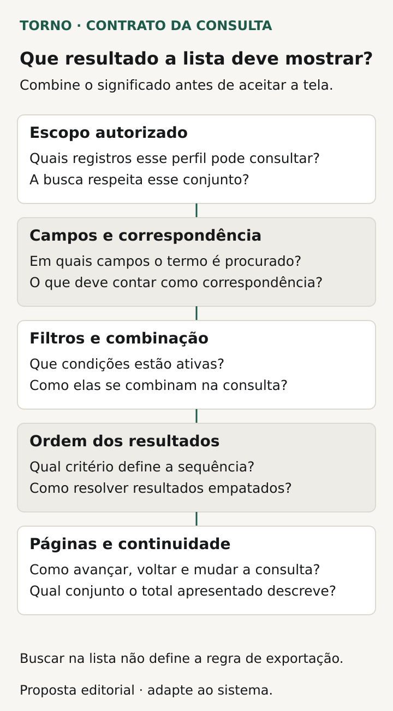
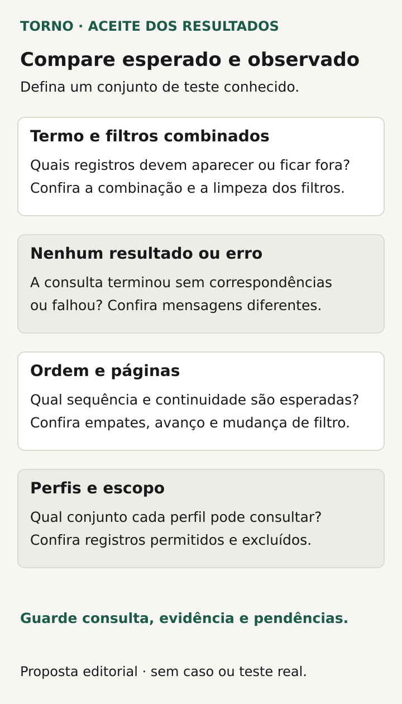

Para aceitar a busca e os filtros no sistema, defina **quais campos serão consultados, como as condições se combinam e qual conjunto deve aparecer para a pessoa autorizada**. Acrescente ordem, navegação entre páginas e tratamento de ausência de resultados. Um campo de pesquisa funcionando numa demonstração não explica todas essas regras.

O comprador de um portal ou ferramenta interna precisa partir de uma tarefa: encontrar uma solicitação pelo código, revisar pedidos de determinado estado ou localizar registros sob sua responsabilidade. Cada tarefa pode exigir um comportamento diferente, com resultados esperados que a operação consiga conferir.

Este roteiro propõe decisões e evidências para essa conversa. O responsável técnico escolhe a implementação e apresenta suas limitações; o responsável pelo processo valida o significado do resultado.

## Especifique onde e como o termo será procurado

Diga quais campos participam da busca. Um termo será procurado no código, no nome, na descrição ou em vários campos? Para cada um, combine se a correspondência é exata, começa pelo texto digitado ou encontra um trecho. Não deixe “busca inteligente” substituir exemplos do que deve aparecer.

Inclua convenções que afetam a tarefa: maiúsculas, acentos, espaços e pontuação, quando relevantes. Um código com zero inicial pode precisar de tratamento diferente de uma descrição. Peça exemplos positivos e negativos, sem presumir que um mecanismo escolhido ofereça todas as opções.

Defina quando a consulta acontece: ao confirmar, ao parar de digitar ou por outra interação contratada. Combine também o comportamento de termo vazio e de entrada que não atende às condições previstas. O usuário precisa entender se está vendo uma pesquisa aplicada, a lista inicial ou uma consulta que ainda não foi concluída.

## Delimite o alcance antes de combinar filtros

Identifique os registros que o perfil pode consultar. A [matriz de permissões](https://tornostudio.com/blog/permissoes-acesso-software-regras-negocio/) ajuda a decidir esse alcance. Aqui, a conferência verifica se a consulta opera dentro dele, inclusive ao pesquisar um código conhecido de outra unidade ou organização.

Um filtro selecionado na tela não deve ser tomado como prova da autorização. Peça ao responsável técnico que explique e demonstre os caminhos pertinentes com contas de teste. Não é necessário expor dados reais para conferir que uma consulta não traz registros fora do conjunto permitido.

Se houver contagem ou sugestões de preenchimento, inclua-as na conversa de alcance. Elas fazem parte do que a pessoa observa, mesmo antes de abrir um item. O resultado esperado deve dizer quais informações podem aparecer nesses caminhos.

## Escreva a combinação das condições

Para cada filtro, descreva o campo, os valores possíveis e o efeito de não selecionar nada. Depois, combine as relações. Selecionar dois estados pode significar aceitar qualquer um deles; combinar estado e unidade pode exigir que ambas as condições sejam satisfeitas. Escreva a regra em linguagem da operação.

Defina como o texto de busca participa dessa combinação. Se uma pessoa pesquisa um código e mantém um filtro antigo, o sistema continuará aplicando os dois? Mostre como reconhecer filtros ativos e como removê-los. Isso evita atribuir à ausência do registro um significado que a consulta não sustenta.

Para um período, nomeie o campo de data e as fronteiras. “Pedidos de hoje” pode depender de criação, aprovação ou recebimento. O roteiro de [datas e fusos](https://tornostudio.com/blog/datas-fusos-sistema-prazos-relatorios/) aprofunda essa decisão, que deve permanecer explícita na especificação da consulta.

| Decisão da consulta | Pergunta a responder |
|---|---|
| Campo pesquisado | Onde o termo será procurado e qual correspondência vale? |
| Alcance | Quais registros e informações o perfil pode consultar? |
| Filtros | Que condições são exigidas juntas e quais são alternativas? |
| Ordem | Qual critério prevalece e como os empates são resolvidos? |
| Páginas | Qual parte do conjunto aparece e como continuar? |
| Estado da tela | Como distinguir consulta concluída, vazia, pendente e falha? |

*Defina o significado da consulta e o conjunto que cada resultado representa; busca e exportação têm regras distintas. Diagrama original Torno Studio, 2026.*

## Combine uma ordem que permita navegar

Escolha a ordenação inicial e as opções necessárias ao trabalho. Se dois registros tiverem a mesma data ou prioridade, peça um desempate definido. A operação precisa conseguir explicar a sequência sem depender de uma ordem casual da demonstração.

A [documentação do PostgreSQL 18 sobre LIMIT e OFFSET](https://www.postgresql.org/docs/current/queries-limit.html) mostra que selecionar partes de um resultado exige uma ordem previsível e única para evitar subconjuntos inconsistentes. É uma referência técnica, não uma exigência de usar PostgreSQL no produto.

Para o comprador, a evidência é percorrer um conjunto conhecido e conferir a sequência, incluindo empates. Peça que o fornecedor indique o comportamento ao mudar a ordenação ou os filtros: a navegação recomeça, a seleção de itens permanece ou é limpa? Essas escolhas precisam corresponder à tarefa prevista.

## Diga o que acontece entre uma página e outra

Uma página mostra parte de um resultado. Combine como continuar, como perceber o fim e o significado de uma contagem, se ela existir. Distingua quantidade visível de total correspondente à consulta. Se o total for aproximado ou indisponível, a interface precisa refletir essa condição.

O [Microsoft Graph documenta referências para obter páginas seguintes](https://learn.microsoft.com/en-us/graph/paging) e esclarece que o suporte e o comportamento variam entre APIs. Esse exemplo reforça a necessidade de conferir o percurso completo, sem importar parâmetros ou tamanhos de página de outro serviço como regra do seu sistema.

Inclua mudanças durante a navegação. Uma solicitação pode mudar de estado enquanto alguém percorre a lista. A [documentação do Elasticsearch](https://www.elastic.co/docs/reference/elasticsearch/rest-apis/paginate-search-results) descreve situações em que atualizações alteram a ordem entre páginas e apresenta mecanismos próprios para preservar o estado consultado. Seu fornecedor precisa explicar a política escolhida e demonstrar seus efeitos, sem presumir uma fotografia imutável de toda busca.

Se houver exportação, o arquivo tem um contrato próprio de conjunto e referência. O artigo sobre [exportação de dados](https://tornostudio.com/blog/exportacao-dados-sistema-aceite/) ajuda a definir essa saída. Não conclua que ela contém apenas a página visível ou toda a consulta sem conferir o acordo.

## Diferencie nenhum resultado de erro

Uma consulta concluída sem correspondências deve ter um estado diferente de uma falha que impediu a consulta. Se houver dados antigos na tela durante uma nova tentativa, combine como essa condição será identificada. A mensagem deve permitir compreender o que está sendo exibido.

Defina as ações disponíveis para corrigir filtros ou repetir a tentativa. “Nenhum resultado” não prova que um objeto não existe em todo o sistema; descreve a consulta realizada dentro do alcance conhecido. Peça que os textos da interface não transmitam uma conclusão mais ampla.

## Veja um exemplo com resultados conhecidos

**Exemplo inteiramente fictício:** um portal lista solicitações de uma unidade. O acordo define busca pelo código exato, filtro de estados que aceita qualquer estado selecionado e ordenação por criação, com desempate pelo código. O filtro de unidade permanece dentro do alcance permitido ao perfil.

A base de teste inclui uma solicitação pendente, uma aprovada e outra de unidade não autorizada. Uma consulta pelo código da primeira, com o filtro limitado a aprovadas, não deve trazê-la. Ao remover esse filtro, o registro deve aparecer. A solicitação fora do alcance continua excluída dos caminhos avaliados.

Outro conjunto fictício contém registros suficientes para percorrer mais de uma página e empates de data. A evidência compara a sequência observada com a esperada. **Fim do exemplo fictício; não representa cliente, implementação ou teste da Torno.**

## Confira a consulta com uma matriz de aceite

Prepare registros e perfis no [ambiente de homologação](https://tornostudio.com/blog/ambiente-homologacao-conferir-antes-testar-sistema/). Transforme as decisões em [critérios de aceite](https://tornostudio.com/blog/criterios-aceite-mvp/), identificando os itens que devem entrar e os que devem ficar fora de cada cenário.

| Cenário | Evidência a conferir |
|---|---|
| Termo e campo conhecidos | Correspondências e exclusões conforme a regra |
| Filtros isolados e combinados | Conjunto esperado e condições ativas reconhecíveis |
| Perfil com alcance restrito | Ausência dos registros e informações não autorizados |
| Ordem com empate e várias páginas | Sequência e continuação conforme o contrato |
| Alteração durante a navegação | Resultado coerente com a política de atualização |
| Consulta vazia e falha exercitada | Estados distintos e caminho de correção ou repetição |

*Compare esperado e observado com um conjunto de teste conhecido e preserve evidências e pendências. Diagrama original Torno Studio, 2026.*

Guarde versão, conta usada, condições da consulta, base preparada e resultado observado. Se uma fonte externa foi simulada ou parte do conjunto não participou do ensaio, registre o limite. Uma demonstração pequena não prova desempenho com qualquer volume.

Para a [conversa de escopo com Henrique](https://tornostudio.com/diagnostico/), leve a tarefa de consulta, exemplos fictícios e os resultados que precisam ser encontrados ou excluídos. Isso permite discutir regras e evidências antes de definir a solução técnica, sem presumir um motor de busca já implementado.

*Fontes consultadas em 27 de outubro de 2026. A ficha e o exemplo são propostas editoriais originais para adaptação ao produto.*
