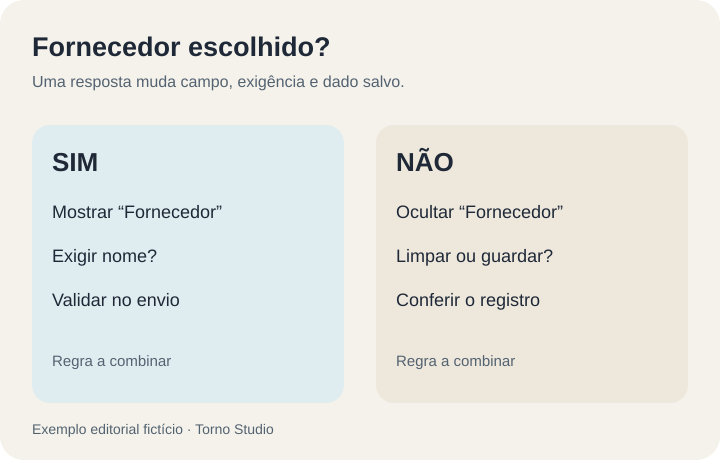
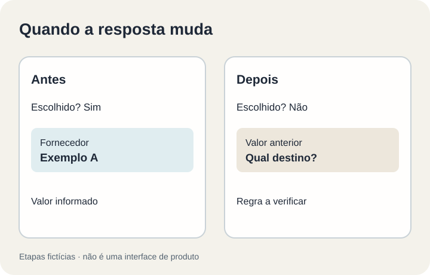

**Um campo condicional só deve aparecer quando a resposta anterior o torna pertinente; a regra também precisa dizer se ele é obrigatório e o que acontece com um valor já preenchido quando a resposta muda.** Para aceitar um formulário interno, teste cada caminho até o registro final. Esconder um campo na tela não basta para decidir o que será salvo.

**Exemplo fictício:** um pedido de compra pergunta “Há fornecedor escolhido?”. Se a resposta é “sim”, abre o campo “Fornecedor”. Se é “não”, o campo não aparece. A organização deve decidir se “Fornecedor” se torna obrigatório no primeiro caso, se a resposta pode mudar depois e se o nome antigo deve ser apagado, preservado como histórico ou sinalizado para revisão. Não há uma regra universal para todos os formulários.

## Escreva a condição em uma frase testável

Uma especificação vaga, como “mostrar os campos necessários”, deixa decisões escondidas na implementação. Prefira uma matriz com **pergunta anterior, resposta, campo exibido, obrigatoriedade, destino do valor antigo e mensagem de erro**. Ela deve incluir o caminho em que a pessoa volta e troca a resposta.

*Matriz de requisitos inventada para discussão, sem representar um formulário existente. Ilustração original Torno Studio, 2026.*

O [tutorial de formulários acessíveis do W3C](https://www.w3.org/WAI/tutorials/forms/) orienta associar instruções e rótulos aos controles e explicar erros de entrada. Em um campo condicional, isso significa que a pessoa deve entender **por que** a nova informação é pedida e como corrigir uma pendência; cor ou um asterisco isolado podem não bastar. A regra de negócio sobre o fornecedor, porém, vem da organização, não do W3C.

## O que acontece quando a resposta muda?

Imagine que a pessoa escolhe “sim”, digita “Fornecedor A” e depois muda para “não”. Há pelo menos três decisões separadas: o campo deixa de aparecer? O valor anterior continua no rascunho? O envio ao servidor aceita ou ignora esse valor? Defina o resultado para não reabrir um pedido com informação contraditória nem salvar silenciosamente um dado que já não se aplica.

A [MDN descreve validações que combinam diferentes campos](https://developer.mozilla.org/en-US/docs/Web/HTML/Guides/Constraint_validation). Isso ajuda a implementar a experiência no navegador, mas a validação da interface não é prova suficiente do dado gravado: o teste de aceite deve consultar o registro resultante no sistema e verificar a regra acordada.

*Duas etapas fictícias da mesma solicitação; não reproduzem tela real nem comprovam comportamento implementado. Ilustração original Torno Studio, 2026.*

## Quatro cenários de aceite

Use dados fictícios e registre entrada, estado da tela, mensagem e resultado salvo:

1. **Resposta que exige campo:** selecione “sim”, deixe “Fornecedor” vazio e tente enviar. O formulário deve apontar a pendência de modo compreensível, conforme a regra combinada.
2. **Resposta que dispensa campo:** selecione “não” e conclua sem preencher fornecedor. Confirme que nenhum valor antigo foi tratado como fornecedor ativo, conforme a política combinada.
3. **Mudança após preenchimento:** escolha “sim”, preencha o nome e mude para “não”. Confira o destino definido para o valor anterior, inclusive depois de salvar e reabrir.
4. **Volta ao caminho anterior:** mude novamente para “sim”. Confira se o valor reaparece ou se é solicitado de novo, de acordo com a política acordada, sem presumir que um dado antigo ainda é válido.

Se houver anexo, valor, tipo de solicitação ou várias condições encadeadas, repita o roteiro com as combinações relevantes. Não transforme toda combinação possível em um clique manual sem priorizar risco e frequência. O [guia de acessibilidade no aceite](https://tornostudio.com/blog/acessibilidade-software-sob-medida-aceite/) ajuda a ampliar o teste para teclado, leitura e mensagens de erro. O [fluxo de aprovação](https://tornostudio.com/blog/fluxo-aprovacao-sistema-regras/) começa depois que os dados necessários foram enviados; sua regra de decisão é outra pergunta.

## Perguntas frequentes

### Um campo oculto pode continuar salvo?

Pode, se essa for uma política explícita e fizer sentido para o processo. O ponto do aceite é verificar o destino combinado do valor antigo e evitar contradição no registro final.

### O navegador pode ser a única validação?

Não conte apenas com a mensagem da tela. Confira o resultado gravado e teste o caminho de envio permitido pelo sistema, especialmente se houver API ou importação.

Se você está definindo um formulário interno, a Torno pode ajudar a transformar essas condições em cenários verificáveis numa [conversa de diagnóstico](https://tornostudio.com/diagnostico/).
