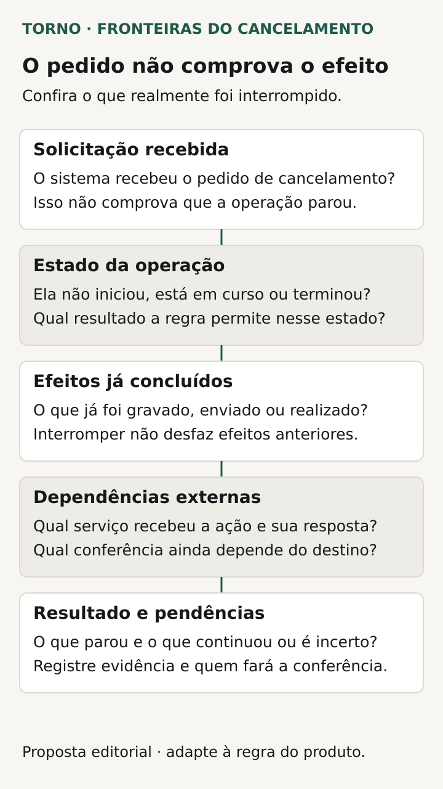
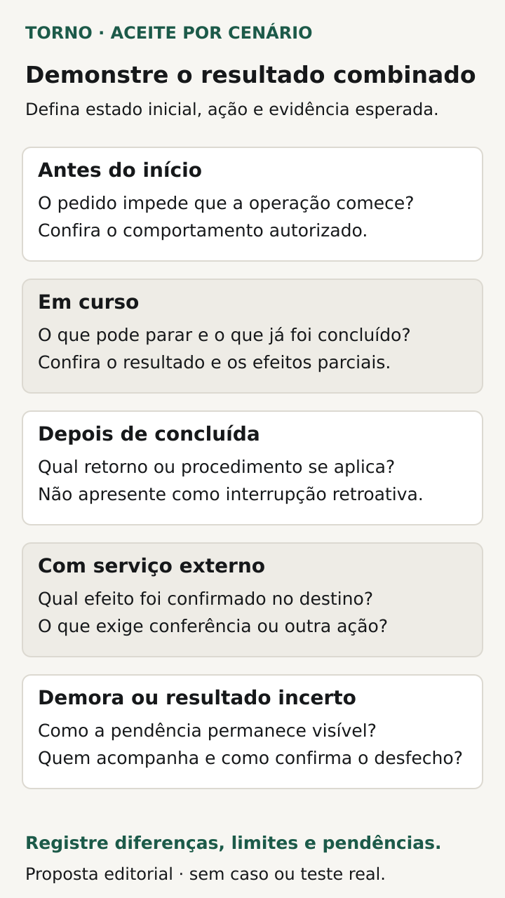

Para aceitar o cancelamento no sistema, combine **quando ele pode ser solicitado, qual evidência confirma a interrupção e o que acontece com os efeitos já concluídos**. Receber um pedido de cancelamento não demonstra, por si só, que a operação parou ou que tudo voltou ao estado anterior.

Essa diferença importa em portais, integrações e ferramentas internas com trabalho em espera ou processamento. Uma ação pode envolver várias etapas. No momento em que alguém seleciona Cancelar, parte delas talvez já tenha terminado e outra parte ainda dependa de resposta.

Este roteiro propõe decisões e evidências para o comprador. Não define direitos legais, política de reembolso ou uma arquitetura universal. O responsável pelo processo valida o resultado de negócio; o técnico explica como demonstrá-lo e quais limites existem.

## Identifique exatamente o que será cancelado

Escolha uma operação concreta: uma geração de arquivo, uma tarefa de processamento ou uma solicitação enviada a outro serviço. Nomeie seu início, suas etapas e o que significa concluir. “Cancelar o pedido” pode se referir à intenção do usuário, à execução interna ou a um efeito externo; esses objetos precisam ficar distinguíveis.

Separe também a ação de [arquivar ou excluir um registro](https://tornostudio.com/blog/arquivar-excluir-registros-sistema/). Tirar algo da lista não demonstra que o trabalho em segundo plano foi interrompido. O registro da operação pode continuar necessário para consultar o resultado e as pendências.

Se a operação depende de aprovação, indique onde a execução começa. O [fluxo de aprovação](https://tornostudio.com/blog/fluxo-aprovacao-sistema-regras/) responde quem autoriza e quais condições permitem avançar. Aqui, a decisão é o que fazer quando o trabalho pode já estar em andamento.

## Defina em quais estados a ação é permitida

Liste os estados relevantes: aguardando início, em execução, concluído ou outro estado do produto. Para cada um, diga se o cancelamento pode ser solicitado e qual resultado é possível. A condição deve refletir o processo real, não apenas a presença do botão na tela.

A [API da Stripe documenta estados específicos em que um PaymentIntent pode ser cancelado](https://docs.stripe.com/api/payment_intents/cancel). Ela também prevê erro para objetos já cancelados ou não canceláveis. É um exemplo de dependência do estado; não transfira suas regras para outros objetos ou provedores.

Combine a mensagem quando a operação já passou do ponto permitido. O usuário precisa entender a condição atual e o caminho disponível, se existir. Ocultar o botão pode ajudar na interface, mas a evidência deve conferir o comportamento da ação nos caminhos previstos pelo responsável técnico.

## Separe pedido recebido de resultado confirmado

Peça ao fornecedor que explique os estados intermediários. “Cancelamento solicitado” pode ser uma confirmação legítima de recebimento, desde que não seja apresentado como prova de interrupção. Defina como o usuário acompanhará o resultado e reconhecerá uma pendência.

A [documentação de cancelamento da .NET](https://learn.microsoft.com/en-us/dotnet/standard/threading/cancellation-in-managed-threads) distingue quem pede a interrupção das operações responsáveis por perceber e responder ao pedido. Esse modelo cooperativo é específico daquela tecnologia. Para o comprador, ele ilustra uma pergunta de aceite: qual informação confirma que a parte relevante realmente respondeu?

Inclua a situação em que a operação termina enquanto o cancelamento é solicitado. O contrato precisa dizer como esse resultado será informado e quais ações ainda podem existir. Não trate uma corrida entre conclusão e pedido como se a escolha feita na tela garantisse o desfecho.

*Fronteiras propostas para conferir o efeito do pedido de cancelamento. Diagrama original Torno Studio, 2026.*

## Liste o que já aconteceu e o que continua pendente

Peça uma conferência por etapa ou unidade relevante. Se a operação processa itens independentes, quais foram concluídos, quais não começaram e quais precisam de avaliação? O resultado agregado deve permitir compreender os efeitos que importam para a operação.

Quando houver serviço externo, pergunte até onde o sistema consegue confirmar o estado. Uma resposta atrasada ou uma comunicação interrompida pode exigir conferência antes de outra ação. Combine quem fará essa avaliação e quais referências permitem localizar a execução.

| Decisão | Pergunta de aceite |
|---|---|
| Elegibilidade | Em qual estado é permitido pedir cancelamento? |
| Recebimento | Qual evidência mostra que o pedido foi registrado? |
| Interrupção | O que confirma que o trabalho pertinente parou? |
| Efeitos concluídos | O que permanece e qual tratamento foi contratado? |
| Resultado desconhecido | Quem confere e como acompanha a pendência? |
| Nova tentativa | O que acontece se a mesma solicitação for repetida? |
| Encerramento | Qual resultado permite concluir o atendimento do pedido? |

Essa ficha é uma proposta editorial. Os estados e as informações disponíveis precisam ser definidos com o responsável técnico. Não é necessário expor credenciais ou conteúdo de usuários reais para localizar a execução no ensaio.

## Trate o que precisa ser desfeito como outra ação

Interromper etapas futuras não desfaz automaticamente as anteriores. Se o processo exige corrigir um efeito concluído, defina a ação apropriada, quem a autoriza e como será conferida. Algumas consequências podem ser irreversíveis ou depender de um terceiro.

O [padrão de transação compensatória do Azure Architecture Center](https://learn.microsoft.com/en-us/azure/architecture/patterns/compensating-transaction) descreve tratamentos específicos do negócio para efeitos de etapas concluídas. A referência ressalta que a compensação pode falhar e não necessariamente repõe o estado inicial. É uma opção para certos processos, não uma obrigação de implementar esse padrão em toda operação.

Na conversa de escopo, peça que o fornecedor diferencie interrupção, correção e eventual compensação. Se alguma dessas capacidades estiver fora da entrega, mantenha a exclusão explícita. Uma confirmação genérica de “cancelado” não deve esconder uma consequência ainda sem tratamento.

## Defina o acompanhamento e a repetição

Combine quem consulta um cancelamento pendente, quando a situação exige avaliação e qual procedimento orienta a próxima ação. O roteiro de [alertas para o fluxo crítico](https://tornostudio.com/blog/monitoramento-software-alertas-fluxo-critico/) ajuda a definir o encaminhamento, se ele fizer parte do escopo. Ter um estado pendente não cria automaticamente cobertura contínua do fornecedor.

Pergunte também o que acontece com um novo clique ou uma solicitação repetida. O resultado pode depender de o pedido já ter sido aceito, concluído ou recusado. O artigo sobre [eventos duplicados em integrações](https://tornostudio.com/blog/integracao-evento-duplicado-regra-negocio/) aprofunda o efeito que deve permanecer único diante de repetições.

Para o usuário, a resposta precisa permitir continuar sem adivinhar se outra operação foi criada. Registre a identificação e o resultado conhecido, com os detalhes técnicos acessíveis ao responsável autorizado.

## Veja um exemplo de processamento em etapas

**Exemplo inteiramente fictício:** um portal processa uma remessa de tarefas independentes. O acordo permite solicitar interrupção durante a execução, preservando as tarefas que já terminaram e informando o destino das restantes. O usuário inicia o cancelamento quando parte da remessa já foi processada.

No cenário hipotético, o sistema registra o pedido e depois confirma o ponto de interrupção. A evidência identifica as tarefas concluídas e as que não foram executadas. Uma etapa cujo resultado depende de um serviço externo permanece sinalizada para conferência, sem ser apresentada como desfeita.

Se a regra exigir corrigir um efeito anterior, essa ação terá sua própria autorização e evidência. **Fim do exemplo fictício; não representa cliente, implementação ou ensaio da Torno.**

O caso demonstra por que o total de tarefas interrompidas não basta para encerrar toda dúvida. O comprador precisa conhecer o estado das partes que afetam a operação e o tratamento das pendências.

## Demonstre cenários antes de aceitar o botão

Prepare operações fictícias no [ambiente de homologação](https://tornostudio.com/blog/ambiente-homologacao-conferir-antes-testar-sistema/). O responsável técnico deve definir como posicionar a execução nas condições desejadas, sem interromper trabalho real ou disparar efeitos externos indevidos.

Transforme a ficha em [critérios de aceite](https://tornostudio.com/blog/criterios-aceite-mvp/). Para cada cenário, registre estado inicial, pedido e resultado esperado antes da execução.

| Cenário | Evidência a conferir |
|---|---|
| Antes do início | Tratamento do trabalho ainda não executado |
| Durante a execução | Pedido registrado e interrupção confirmada no alcance previsto |
| Depois da conclusão | Resposta coerente com o estado e com as alternativas disponíveis |
| Efeito externo já concluído | Consequência identificada e tratamento contratado explícito |
| Resposta atrasada ou falha exercitada | Pendência visível e encaminhamento definido |
| Solicitação repetida | Resultado reconhecível, sem efeito adicional indevido |

*Perguntas propostas para conferir resultados, efeitos e pendências em cada cenário. Diagrama original Torno Studio, 2026.*

Confira o estado final e os efeitos pertinentes, além da mensagem exibida. Guarde versão, sequência, dados de teste e resultados. Se uma dependência foi simulada, registre o limite da conclusão; esse ensaio não prova que o serviço real atenderá a qualquer pedido de cancelamento.

Para a [conversa inicial com Henrique](https://tornostudio.com/diagnostico/), leve uma operação representativa, o ponto em que precisa pará-la e os efeitos que já podem ter ocorrido. Isso permite delimitar comportamento, dependências e evidências da entrega sem prometer interrupção instantânea ou reversão universal.

*Fontes consultadas em 28 de outubro de 2026. A ficha e o exemplo são propostas editoriais originais para adaptação ao produto.*
