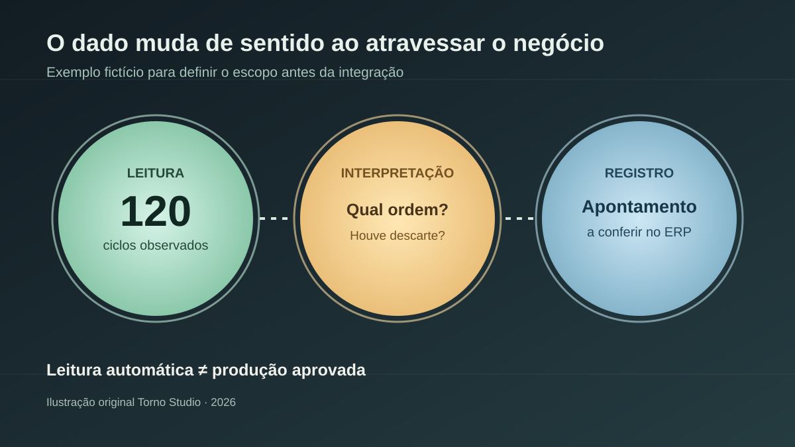
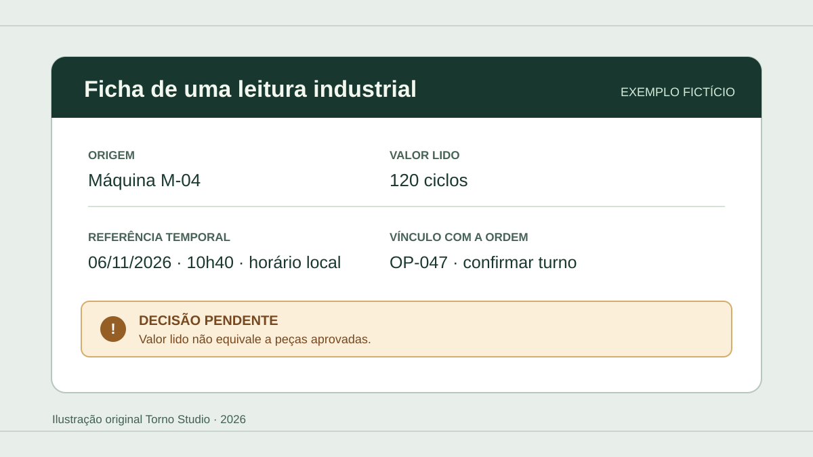

*Leitura estimada: 7 minutos.*

**Para levar dados de uma máquina ao ERP, comece pelo registro que a operação precisa produzir, não pelo protocolo.** Identifique qual acontecimento importa, quem confirma seu significado, onde ele será guardado e o que fazer quando a leitura faltar ou chegar errada. Só então verifique se o equipamento fornece o dado necessário e como obtê-lo com segurança.

Imagine que a fábrica queira registrar automaticamente o início e o término de uma ordem de produção. Uma contagem de ciclos pode ajudar, mas não identifica sozinha qual ordem estava ativa, se cada peça foi aprovada ou se houve retrabalho. A integração precisa ligar o sinal da máquina a uma decisão de negócio verificável.

## Escolha um resultado operacional antes de escolher o conector

Escreva uma frase observável: “ao terminar uma ordem, o gestor precisa ver no ERP a quantidade confirmada, o horário e a origem da informação”. Depois defina quem confirma a quantidade e como corrigir um registro equivocado. Isso evita contratar uma coleção de números que não responde à pergunta da operação.

Separe três camadas:

| Camada | Pergunta de compra | Exemplo fictício |
|---|---|---|
| Leitura | O que o equipamento informa? | Estado e contador de ciclos |
| Interpretação | O que esse valor significa no processo? | Ciclos ligados à ordem A, com descarte separado |
| Registro | Qual ação o sistema de negócio executa? | Criar um apontamento pendente de conferência |

O verbo **“pendente”** é deliberado. Se a informação de qualidade ou a ordem ativa está em outro lugar, a máquina não deve declarar produção aprovada por conta própria.

*As lentes representam perguntas para o projeto, não uma interface pronta nem uma arquitetura industrial. Ilustração original Torno Studio, 2026.*

## Descubra o que a máquina realmente oferece

Peça ao responsável pela automação o modelo do equipamento, controlador, software, interfaces disponíveis, documentação do fabricante e condições de acesso. Confirme também se já existe um supervisório, historiador ou MES que reúne esses dados. Muitas vezes o ponto de integração útil é esse sistema existente, não uma conexão nova diretamente ao controlador.

O [OPC UA é um padrão para trocar e modelar informações entre sistemas](https://reference.opcfoundation.org/specs/OPC-10000-1/1). Uma [especificação para máquinas-ferramenta](https://reference.opcfoundation.org/specs/OPC-40501-1/1) descreve dados de monitoramento e trabalhos e menciona sistemas como MES e ERP como possíveis consumidores. Isso **não significa** que toda máquina fale OPC UA, implemente o mesmo modelo ou exponha a variável exigida pelo seu processo. Tampouco significa que o ERP tenha uma entrada pronta para ela.

No levantamento, anote para cada dado: nome, unidade, significado, frequência, identificador da máquina, momento da medição e comportamento quando houver perda de comunicação. Um contador que volta a zero após reinício, por exemplo, precisa ser interpretado de forma diferente de um total acumulado persistente. O fornecedor deve demonstrar esse comportamento no equipamento real ou em um ambiente representativo, sem presumir a resposta pela documentação genérica do protocolo.

Para pedir orçamento, inclua essa lista no [briefing de integração com ERP](https://tornostudio.com/blog/integracao-erp-briefing-orcamento/), junto dos sistemas e responsáveis envolvidos.

## Mantenha leitura de dados e comando à máquina em escopos separados

Ler estado e registrar um apontamento no ERP não é o mesmo que mudar parâmetro, iniciar operação ou enviar uma ordem ao controlador. A segunda categoria pode afetar o processo físico e exige análise e autorização próprias. Para um primeiro projeto de software, proponho começar com **leitura delimitada**, sem capacidade de comando, e revisão humana dos registros que dependem de interpretação.

O [NIST trata segurança de tecnologia operacional](https://csrc.nist.gov/pubs/sp/800/82/r3/final) levando em conta desempenho, confiabilidade e segurança física. Isso é um motivo para envolver quem responde pela automação e segurança da planta antes de abrir qualquer caminho entre a rede industrial e a corporativa. O guia não substitui o desenho da rede local nem autoriza conectar um equipamento à internet.

Se houver OPC UA, registre quais aplicações e identidades podem se conectar e quais informações cada uma pode ler. A [especificação do OPC UA descreve autenticação por certificado e listas de confiança](https://reference.opcfoundation.org/specs/OPC-10000-2/4.10), mas a existência desses mecanismos não prova que estejam configurados corretamente. Peça evidência da configuração efetiva; não aceite “o protocolo é seguro” como teste.

## Combine falhas e correções antes de automatizar o registro

**Exemplo fictício:** o contador da máquina indica 120 ciclos para uma ordem. A rede cai por quinze minutos e volta. O ERP já tem uma entrada manual de 90 peças. O sistema não pode simplesmente acrescentar 120 ao total sem saber se o contador inclui os mesmos itens ou se é acumulado desde o início do turno.

Combine com o fornecedor:

1. Qual identificador liga leitura, máquina, turno e ordem?
2. A leitura é um total, um evento ou uma amostra? Ela pode ser repetida?
3. O que fica pendente durante a falha e como se reconhece a recuperação?
4. Quem pode ajustar o apontamento e que evidência da alteração fica guardada?
5. Qual número aparece no ERP até a reconciliação?

Se haverá painel, aplique também os critérios do guia [por que dashboard e ERP mostram números diferentes](https://tornostudio.com/blog/dashboard-erp-numeros-divergentes-aceite/). A divergência pode ser legítima por período, filtro ou estágio de conferência; ela precisa ser explicável.

*Ficha ilustrativa com dados inventados. Não representa tela, equipamento ou projeto de cliente. Ilustração original Torno Studio, 2026.*

## Peça uma demonstração que atravesse o fluxo inteiro

Num [ambiente de homologação](https://tornostudio.com/blog/ambiente-homologacao-conferir-antes-testar-sistema/) autorizado, use dados fictícios ou um teste controlado aprovado pela operação. O aceite pode ser curto, mas deve atravessar origem, interpretação e destino:

| Cenário | Evidência esperada |
|---|---|
| Leitura normal | Valor, unidade, origem, horário e ordem associados corretamente |
| Leitura ausente | Pendência visível; nenhum número estimado apresentado como confirmado |
| Dado repetido ou após reconexão | Resultado no ERP sem contagem indevida, segundo regra acordada |
| Ordem ou máquina trocada | Associação correta ou recusa para revisão |
| Correção humana | Valor anterior, novo valor, motivo e responsável registrados conforme o escopo |
| Acesso não autorizado | Tentativa recusada e registrada nos limites combinados |

Peça também uma explicação do que **não** foi testado: modelos de máquina adicionais, novos turnos, dados de qualidade, comando remoto e falhas prolongadas podem ficar fora do primeiro contrato. Essa delimitação torna o preço e a entrega mais honestos.

## Perguntas frequentes

### Ter OPC UA significa que a integração com meu ERP está pronta?

Não. É preciso confirmar que o equipamento fornece os dados certos, que seus significados estão claros e que existe um caminho autorizado para transformá-los em registros aceitos pelo ERP.

### Preciso comprar hardware novo?

Não dá para responder sem inventariar máquina, controlador, redes e sistemas já instalados. O primeiro diagnóstico deve verificar o que existe antes de orçar gateway ou sensor.

### Posso usar IA para decidir quando a máquina terminou a ordem?

Uma inferência pode ser investigada, mas não substitui a regra de negócio nem as evidências de aceite. Comece com dados observáveis e revisão quando houver dúvida; não delegue comando ou confirmação de produção a um modelo sem um projeto específico de segurança e operação.

Se você está avaliando essa conexão, leve a documentação do equipamento, o fluxo atual e um exemplo de registro esperado para uma [conversa de diagnóstico com Henrique](https://tornostudio.com/diagnostico/). É o suficiente para delimitar um primeiro escopo sem prometer integração universal nem interferir na máquina antes de conhecer a planta.

*Fontes consultadas em 6 de novembro de 2026. O exemplo e as fichas são propostas editoriais fictícias; as decisões técnicas e de segurança dependem do equipamento e do ambiente reais.*
