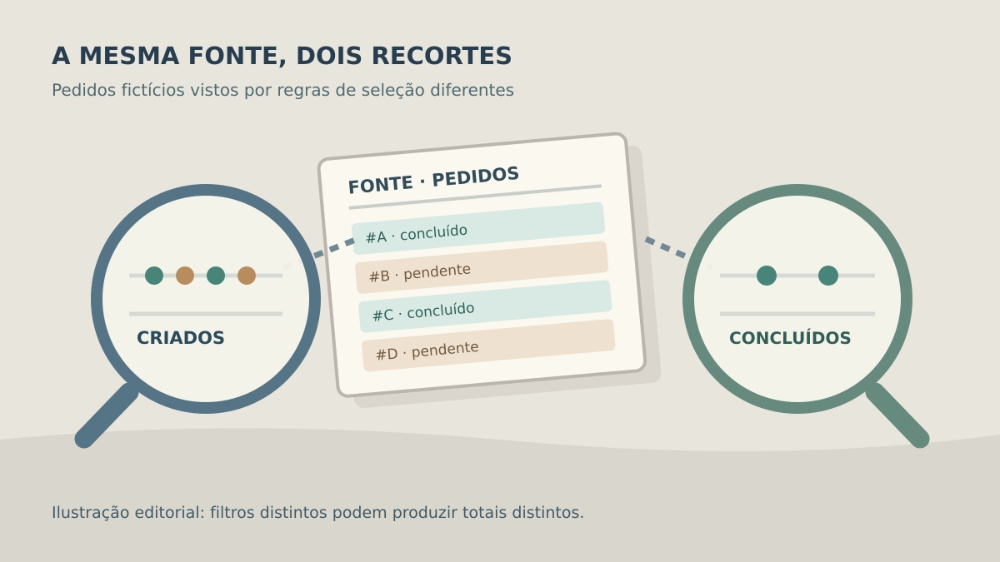

**Se um dashboard e o ERP mostram números diferentes, compare primeiro a regra de cada número, o recorte usado e a hora da última atualização.** A divergência pode revelar filtros ou períodos distintos, dados ainda não atualizados ou um defeito. Antes de aceitar o painel, peça uma forma de reproduzir o cálculo com registros conhecidos e de explicar qualquer diferença remanescente.

Um gráfico elegante não define o que “vendas do mês” significa. Para quem contrata o software, a entrega útil é um indicador que responde uma pergunta de gestão com fonte, regra e limite claros. Este guia trata da conferência do painel; não é uma auditoria contábil ou garantia de que o ERP de origem esteja correto.

## Comece por uma decisão, não pela tela

Escolha uma pergunta concreta: “Quantos pedidos concluídos precisam de expedição hoje?” é melhor que “quero dez KPIs”. Registre quem vai usar a resposta, que ação tomará e qual sistema guarda o fato original. O mesmo pedido pode aparecer no ERP, na planilha da operação e em uma ferramenta de atendimento, cada uma com outro momento de atualização.

Para cada indicador, escreva uma ficha curta: **nome, unidade, fonte, quais registros entram, quais saem, período, fuso, filtros permitidos e responsável pela regra**. “Valor vendido” pode incluir ou excluir cancelamentos, devoluções e pedidos ainda não faturados. Não escolha essas regras pelo visual do gráfico; peça ao responsável pelo processo que as confirme antes do desenvolvimento.

A [documentação do Looker mostra que uma medida agregada pode ter filtros próprios](https://docs.cloud.google.com/looker/docs/reference/param-field-filters). É um exemplo técnico de por que dois cartões chamados “pedidos” podem calcular populações diferentes. Não significa que o sistema em avaliação use Looker ou que toda divergência seja esperada.

*As lentes mostram a importância de declarar o filtro; não representam relatório ou cliente real. Ilustração original Torno Studio, 2026.*

## Compare o mesmo período e a mesma população

Antes de comparar totais, alinhe as condições: mesma empresa, unidade, situação do pedido, moeda, data de referência e intervalo. Um relatório que usa **data de criação** não necessariamente baterá com um painel que usa **data de conclusão**. A diferença pode ser legítima se ambas as regras forem explícitas; também pode mostrar que o painel foi configurado de modo errado.

**Exemplo inteiramente fictício:** o ERP lista 120 pedidos criados em outubro. Desses mesmos 120 pedidos, o painel mostra 112 concluídos até o fechamento do mês. Os outros oito ainda estão pendentes. Se a pergunta de gestão era “quantos foram concluídos?”, os 112 podem estar coerentes. Se o cartão se chama “pedidos criados”, a descrição ou o cálculo precisa ser corrigido. Os números são inventados apenas para demonstrar a conciliação; não representam resultado da Torno ou de um cliente. **Fim do exemplo fictício.**

Se o corte do dia ou o fuso também mudou, anote-o. O roteiro sobre [datas e fusos em sistemas](https://tornostudio.com/blog/datas-fusos-sistema-prazos-relatorios/) aprofunda esse ponto. Para valores, confira se soma e arredondamento acontecem por linha ou só no total, conforme o guia de [valores monetários](https://tornostudio.com/blog/valores-monetarios-arredondamento-sistema/).

## Quando os dados chegaram ao painel?

“Automático” não quer dizer “instantâneo”. Pergunte se o painel consulta a origem no momento da abertura, recebe eventos ou atualiza uma cópia em horários definidos. Se existir atualização periódica, mostre **última tentativa, último sucesso e período dos dados exibidos**. Uma tela com números antigos sem data pode parecer um erro de cálculo quando a carga falhou.

A [documentação do Power BI separa agenda, conexão, credenciais e histórico de atualização](https://learn.microsoft.com/en-us/power-bi/connect-data/refresh-scheduled-refresh), além de alertar que o início de uma atualização agendada pode atrasar. Esse é um exemplo de ferramenta, não uma promessa de prazo para o painel contratado. O critério de aceite deve dizer qual atraso máximo é aceitável para a decisão do comprador e como a pessoa será avisada se ele for ultrapassado.

*A fotografia e o relógio ilustram a idade da informação, sem prometer atualização em tempo real. Ilustração original Torno Studio, 2026.*

## Como provar o resultado no aceite?

Escolha um intervalo pequeno e um conjunto de pedidos fictícios ou autorizados cujo estado possa ser conferido no ERP. Execute o mesmo recorte no painel e na fonte. Guarde filtros, data da consulta, data da atualização, versão da regra e lista dos registros que formam o total. Um print isolado não permite repetir a comparação.

| Ensaio | O que demonstrar |
|---|---|
| Pedido muda de pendente para concluído | Indicador muda conforme a regra e no prazo combinado |
| Pedido cancelado ou devolvido | Inclusão ou exclusão corresponde à ficha da métrica |
| Filtro de unidade ou período | Total e registros subjacentes mudam de modo verificável |
| Atualização da origem falha | Painel informa idade do dado, sem afirmar que está atual |
| Pessoa sem acesso a uma unidade | Indicador não expõe dados fora do seu perfil |

Se a diferença persistir, registre os IDs de teste e o cálculo esperado, sem copiar dados pessoais em documentos públicos. Trate a divergência como pendência até explicar se ela vem da origem, da transformação, de uma regra de negócio ou da tela. O [briefing de integração com ERP](https://tornostudio.com/blog/integracao-erp-briefing-orcamento/) ajuda a reunir acesso e documentação antes de estimar esforço.

Para [conversar com Henrique sobre um painel](https://tornostudio.com/diagnostico/), leve uma decisão que hoje depende de planilha, dois relatórios que deveriam concordar e um exemplo de divergência. Isso ajuda a definir o primeiro indicador e sua prova de aceite antes de pedir dezenas de gráficos.

*Fontes técnicas consultadas em 4 de novembro de 2026. Números, ensaios e figuras são editoriais; nenhuma implantação ou resultado de cliente foi alegado.*
