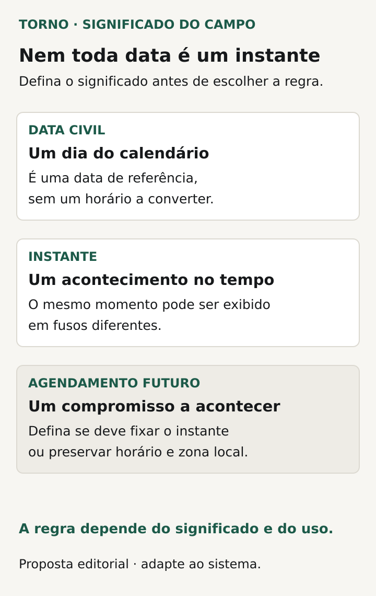
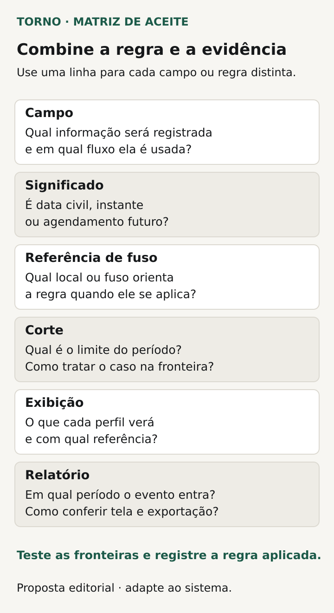

Antes de definir o fuso horário no sistema, esclareça **o que cada data significa, qual referência decide o prazo e em que período o registro deve entrar**. “Data do pedido” pode ser o dia escolhido pelo usuário, o momento de criação ou a confirmação enviada por outro sistema. Esses significados podem produzir resultados diferentes, mesmo com valores tecnicamente válidos.

Para o comprador de um portal, integração ou ferramenta interna, o trabalho é transformar essa ambiguidade em regra verificável. O responsável técnico define a representação e as conversões; quem conhece o processo precisa validar o efeito nos prazos, nas telas e nos relatórios.

O roteiro abaixo é uma proposta editorial para essa conversa. Ele trata do significado das datas no negócio e das evidências para aceitar a entrega, sem prescrever uma arquitetura única.

## Diga se o campo representa um dia, um instante ou um agendamento

Uma **data civil** identifica um dia do calendário, como uma data de nascimento ou uma competência escolhida. A regra pode exigir que o dia permaneça o mesmo para todos os usuários. Acrescentar um horário por conveniência técnica não deve mudar esse significado sem decisão explícita.

Um **instante** identifica um acontecimento na linha do tempo: a confirmação de recebimento ou a aprovação, por exemplo. Ele pode ser apresentado com horários locais diferentes sem representar acontecimentos diferentes. Já um **agendamento futuro** precisa explicar a intenção: executar num instante fixado ou manter certo horário local numa zona definida.

Use uma ficha por campo importante. Nomeie o evento ou a decisão que produz o valor, quem o informa e quem pode alterá-lo. Se o prazo depende de outro campo, registre qual é a referência. Isso evita que “criação”, “recebimento” e “aprovação” sejam usados como equivalentes durante a implementação.

| Significado a combinar | Pergunta para o responsável pelo processo |
|---|---|
| Dia do calendário | O dia deve permanecer igual ao mudar o local de visualização? |
| Acontecimento | Qual evento fixa o instante e qual sistema o informa? |
| Agendamento | A intenção preserva um instante ou um horário local? |
| Prazo | Qual início, duração, calendário e condição encerram a contagem? |
| Período do relatório | Qual campo e qual referência determinam a inclusão? |

*Perguntas propostas para definir o significado dos campos e a referência do negócio. Diagrama original Torno Studio, 2026.*

## Diferencie UTC, offset e zona de referência

O [RFC 3339](https://datatracker.ietf.org/doc/html/rfc3339) define uma representação para timestamps, incluindo a relação entre horário local, UTC e offset numérico. No formato, `Z` indica offset UTC zero. Um offset como `-03:00` informa a diferença numérica em relação a UTC naquele valor; não basta para nomear uma localidade ou suas regras ao longo do tempo.

O [RFC 9557](https://datatracker.ietf.org/doc/html/rfc9557), que atualiza o RFC 3339, permite informações adicionais, incluindo zona. Isso ajuda a distinguir a referência geográfica do deslocamento numérico. Não significa que toda API aceite esse formato estendido: confira o contrato do provedor.

Para a decisão do comprador, pergunte qual referência governa cada operação: organização, unidade, usuário ou regra do serviço externo? Defina quem pode alterá-la e o efeito sobre dados já existentes. Mudar a forma de exibição e mudar o enquadramento de um prazo são decisões diferentes e precisam de resultados esperados próprios.

O [PostgreSQL 18](https://www.postgresql.org/docs/current/datatype-datetime.html) oferece um exemplo técnico: `timestamp with time zone` é guardado internamente em UTC e não conserva a zona original; a saída é convertida conforme a configuração. Esse comportamento mostra por que o nome do tipo não substitui a especificação do produto. Se a regra depende da zona escolhida, peça ao responsável que explique como essa informação será preservada.

## Escreva o início, o fim e o corte do período

Para um prazo no sistema, combine o acontecimento inicial, a duração e o calendário aplicável. “Um dia” significa o próximo dia civil, um período de horas ou o próximo dia de operação? Quem fornece feriados ou exceções, se existirem? Encaminhe a interpretação de obrigações legais ou contratuais a quem tem essa responsabilidade.

No corte diário do relatório, registre o campo usado, a zona de referência e os limites de inclusão. Diga o que acontece exatamente na fronteira entre períodos. O fornecedor deve conseguir demonstrar que um registro do limite entra no período combinado, sem aparecer duas vezes ou desaparecer entre consultas consecutivas.

Considere recebimentos atrasados e correções. Se um evento de ontem chega hoje, o relatório será revisto, manterá o fechamento ou exibirá um ajuste separado? Essa é uma escolha do processo. Registre quem pode decidir e como uma nova emissão será identificada para que dois arquivos de épocas diferentes não sejam comparados como se tivessem o mesmo conteúdo.

## Veja um exemplo próximo da meia-noite

**Exemplo inteiramente fictício:** para um relatório de pedidos, o acordo escolhe o instante da confirmação e define, somente para este exemplo, uma referência fixa de UTC−03:00. O dia 23 corresponde ao intervalo entre o início desse dia e o início do dia 24 nessa referência, incluindo o início e excluindo o limite final.

Uma confirmação representada por `2026-10-24T02:30:00Z` corresponde a `2026-10-23T23:30:00-03:00`. São duas representações do mesmo instante. Pela regra hipotética, o pedido entra no relatório do dia 23, embora a representação em UTC já mostre o dia 24.

Um usuário que veja a confirmação em outra referência pode encontrar uma data diferente na tela. O relatório continua obedecendo ao corte acordado. A interface e a exportação precisam permitir entender essa diferença. **Fim do exemplo fictício; não representa cliente, implementação ou teste da Torno, nem recomenda um offset fixo para qualquer operação.**

Esse caso serve para conferir a regra sem escolher uma cidade como padrão universal. O resultado esperado deve vir da referência da sua operação, documentada antes do teste.

## Preserve o significado entre integração, tela e arquivo

Para datas em integrações, peça ao fornecedor que confira o significado e a representação de cada campo recebido ou enviado. Um valor sem offset exige uma referência contratada para ser interpretado como instante. Se ela estiver ausente ou houver conflito entre informações, combine como a pendência será identificada e resolvida.

O [briefing de integração com ERP](https://tornostudio.com/blog/integracao-erp-briefing-orcamento/) ajuda a localizar os responsáveis por essas definições. A especificação precisa ligar o campo de origem ao de destino, incluindo conversões e precisão relevante. Reduzir a precisão pode afetar uma comparação no limite do prazo; peça que esse efeito seja discutido no cenário aplicável.

Na tela, combine como a referência fica identificável. Na exportação, informe se o conteúdo representa data civil, horário local ou instante com informação de offset. Depois, confira a reimportação quando ela fizer parte do fluxo: o mesmo dia, instante ou agendamento precisa manter o significado acordado.

O roteiro de [importação de planilhas](https://tornostudio.com/blog/importacao-planilhas-sistema-tratar-erros/) trata modelo e erros de arquivo. Aqui a questão permanece mesmo com o arquivo legível e a data válida: o sistema interpretou o valor como o negócio pretendia?

## Trate agendamentos futuros como uma decisão própria

Se o produto agenda uma ação para determinado horário local, pergunte o que deve ser preservado quando as regras da zona mudarem. O [RFC 9557 explicita limites do seu escopo para horários futuros sujeitos a essas mudanças](https://datatracker.ietf.org/doc/html/rfc9557); adotar uma representação não resolve toda a política do agendamento.

Quando as zonas atendidas tiverem transições que repetem ou eliminam horários locais, combine o tratamento com o responsável técnico e pelo processo. Inclua os casos pertinentes na avaliação. Registre quem acompanha atualizações das regras e quem decide sobre agendamentos afetados, sem presumir que o software já ofereça esse mecanismo.

## Peça evidências nos limites da regra

Transforme a ficha em [critérios de aceite](https://tornostudio.com/blog/criterios-aceite-mvp/). Use dados fictícios com valores conhecidos e confira os resultados do fluxo completo. Esta seleção é uma proposta para adaptar ao produto:

| Cenário | Resultado a demonstrar |
|---|---|
| Mesmo instante, representações diferentes | Comparação e período coerentes com a regra |
| Instante antes, no e depois do corte | Inclusão exatamente no período definido |
| Data civil vista em outra referência | Preservação do dia conforme o significado contratado |
| Exportação e reimportação previstas | Significado preservado ao completar o percurso |
| Evento recebido com atraso | Tratamento acordado do período e do fechamento |
| Agendamento sujeito a ambiguidade, quando aplicável | Decisão explícita e comportamento correspondente |

*Roteiro ilustrativo para conferir regras temporais nos limites relevantes do processo. Diagrama original Torno Studio, 2026.*

Guarde versão, referências usadas, valores de entrada, resultado esperado e observado. A [trilha de auditoria](https://tornostudio.com/blog/trilha-auditoria-sistema-requisitos-negocio/) ajuda a localizar acontecimentos; a regra deste artigo explica como eles afetam o prazo ou o relatório.

Para a [conversa de escopo com Henrique](https://tornostudio.com/diagnostico/), traga um prazo real, um relatório divergente e as regras conhecidas dos provedores envolvidos. Isso permite delimitar quais significados precisam ser decididos e quais evidências a entrega deve apresentar, antes de definir a solução técnica.

*Fontes primárias consultadas em 23 de outubro de 2026. As fichas e o exemplo são propostas editoriais originais para adaptação ao produto.*
