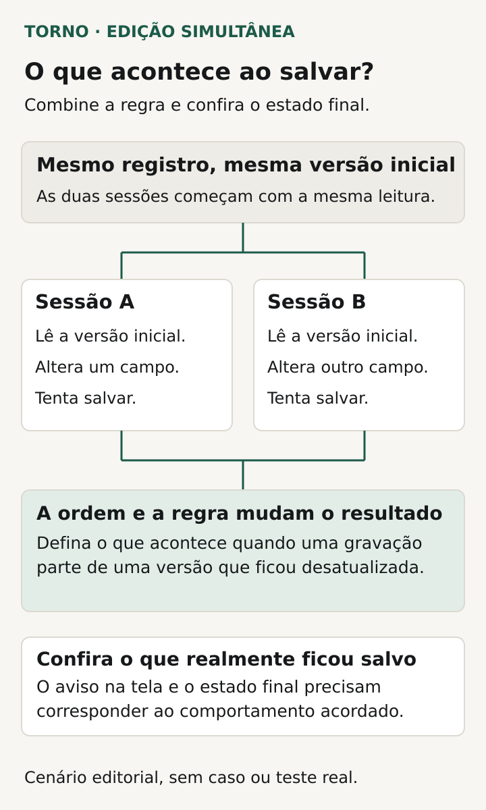
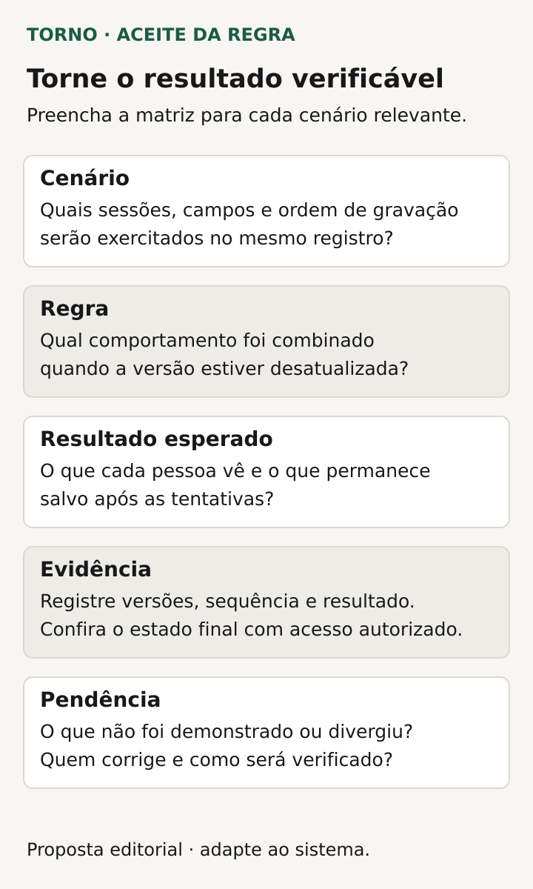

Na edição simultânea no sistema, combine **o que acontece quando alguém tenta salvar uma alteração sobre um registro que mudou desde que foi aberto**. O acordo precisa dizer qual mudança será aceita, como o conflito será apresentado e o que acontecerá com o trabalho ainda não salvo.

Duas pessoas podem estar autorizadas a editar o mesmo cadastro e fazer alterações legítimas. Se ambas partem de uma versão antiga, a gravação posterior pode apagar uma decisão anterior sem que isso seja percebido. Para o comprador de um portal ou ferramenta interna, a pergunta é qual resultado o processo exige nessa situação.

Este roteiro propõe decisões de negócio e evidências de aceite. O responsável técnico escolhe os mecanismos de controle de concorrência e explica seus limites; nenhuma abordagem resolve, sozinha, toda situação de edição compartilhada.

## Comece por um conflito que a operação reconheça

Escolha um registro importante e descreva as duas alterações possíveis. Pode ser uma solicitação cujo prazo e responsável são modificados por pessoas diferentes, um cadastro compartilhado ou um pedido revisado enquanto alguém o aprova. Identifique quais informações não podem desaparecer sem uma decisão explícita.

O problema não exige cliques no mesmo milissegundo. Uma pessoa pode deixar a tela aberta, outra salvar uma mudança e a primeira tentar gravar minutos depois. Inclua essa situação na conversa: o que a tela mostra pode estar diferente do estado atual do registro.

Isso também difere da [reentrega do mesmo evento numa integração](https://tornostudio.com/blog/integracao-evento-duplicado-regra-negocio/). Aqui existem duas intenções de mudança. Impedir que uma operação se repita não decide como tratar duas alterações distintas sobre o mesmo objeto.

## Defina a unidade da decisão

Pergunte se a regra considera o cadastro inteiro, um conjunto de campos ou uma etapa do processo. Alterar telefone e observação pode permitir um tratamento diferente de alterar quantidade e valor negociado. Campos separados na tela podem participar da mesma decisão de negócio.

Não presuma que juntar automaticamente campos diferentes seja sempre correto. O responsável pelo processo precisa explicar as relações: uma alteração de prazo pode invalidar uma aprovação; uma troca de responsável pode exigir nova conferência. Peça exemplos do que pode coexistir e do que precisa de revisão.

O [RFC 9110, seção 13](https://datatracker.ietf.org/doc/html/rfc9110#section-13) descreve requisições condicionais para evitar sobrescritas acidentais entre clientes atuando em paralelo. É uma referência de mecanismo. A decisão sobre qual conjunto de informações deve ser protegido e como o usuário prossegue pertence ao contrato do produto.

## Combine o resultado ao tentar salvar

Peça ao fornecedor que apresente uma política compreensível para cada cenário relevante. Entre as possibilidades a discutir estão impedir temporariamente outra edição, recusar a gravação baseada numa versão anterior ou encaminhar uma comparação para decisão. Se algum caso aceitar a mudança posterior, explicite qual informação poderá ser substituída e por que isso atende ao processo.

Uma mensagem de conflito precisa corresponder ao que aconteceu. Ela deve permitir distinguir “sua alteração foi salva” de “há uma mudança que exige revisão”. Evite aceitar um aviso genérico sem conferir o estado efetivamente gravado e a possibilidade de retomar a tarefa.

Na [documentação do EF Core](https://learn.microsoft.com/en-us/ef/core/saving/concurrency), um exemplo de controle otimista compara uma referência de versão e comunica o conflito à aplicação. A aplicação trata a situação. O exemplo não prescreve EF Core para o seu projeto e não define o texto ou as escolhas que a pessoa verá.

*Cenário editorial para combinar o resultado das gravações e conferir o estado final, sem impor um mecanismo. Diagrama original Torno Studio, 2026.*

## Explique o destino do trabalho pendente

Se a gravação for recusada, o usuário perderá o que digitou? Conseguirá comparar sua proposta com os dados atuais? Quais informações pode consultar sem ultrapassar suas permissões? Defina a experiência necessária e peça uma demonstração, sem presumir que toda tela manterá um rascunho automaticamente.

Combine também o caminho para desistir ou refazer. Recarregar o registro pode trazer a versão atual e descartar o conteúdo local; isso precisa ser entendido antes da ação. Se houver preservação temporária, registre o alcance e o que acontece ao sair da tela ou encerrar a sessão.

Uma nova tentativa precisa considerar o estado atualizado. “Tentar de novo até salvar” pode esconder uma decisão que a pessoa deveria rever. A [documentação do PostgreSQL 18 sobre isolamento](https://www.postgresql.org/docs/current/transaction-iso.html) mostra casos técnicos em que uma transação precisa ser repetida. Essa repetição é uma responsabilidade da aplicação e não equivale, por si, a autorizar o reaproveitamento de qualquer decisão feita sobre dados antigos.

## Use uma ficha de comportamento por fluxo

Registre as decisões antes da implementação ou da revisão da funcionalidade. A tabela é uma proposta editorial para adaptar com os responsáveis técnico e de negócio.

| Decisão | Pergunta que precisa de resposta |
|---|---|
| Objeto e alcance | Quais campos ou estados participam do mesmo conflito? |
| Momento da conferência | Em que situação a tentativa de salvar encontrará uma versão diferente? |
| Resultado da gravação | O que pode ser aceito, recusado ou encaminhado à revisão? |
| Trabalho pendente | O que acontece com o conteúdo ainda não salvo? |
| Mensagem e escolhas | Como a pessoa entende o resultado e qual ação pode tomar? |
| Nova tentativa | Quais dados devem ser revistos e quem decide a alteração? |
| Efeitos adicionais | O que acontece com aprovação, mensagem ou integração vinculada? |

Se uma gravação produz efeitos externos, peça que o fornecedor inclua seu tratamento na explicação. A tentativa recusada pode ter um registro de ocorrência sem representar uma alteração concluída. A conferência deve mostrar o efeito que o contrato prevê, incluindo o que não deveria ter sido executado.

## Veja um exemplo de duas mudanças legítimas

**Exemplo inteiramente fictício:** duas pessoas autorizadas abrem a solicitação SOL-A. A primeira muda o prazo e salva. A segunda, que ainda vê o prazo anterior, troca o responsável e tenta salvar. A regra hipotética considera prazo e responsável parte de uma decisão conjunta e exige revisão se o registro mudou desde a abertura.

O resultado esperado é preservar a primeira gravação e informar à segunda pessoa que sua tentativa precisa de revisão. O acordo também prevê que ela consiga consultar a proposta ainda não salva e os dados atuais, com acesso apropriado. Depois de revisar o novo prazo, poderá decidir se mantém a troca de responsável e submetê-la novamente.

Essa é uma política possível, escolhida apenas para o exemplo. Outra operação pode exigir um tratamento diferente. **Fim do exemplo fictício; não representa cliente, implementação ou teste da Torno.**

A evidência precisa conferir mais do que a mensagem: qual prazo e qual responsável ficaram gravados, o que a segunda pessoa conseguiu recuperar e qual foi o resultado da tentativa posterior.

## Teste duas sessões e inverta a ordem

Prepare um ensaio no [ambiente de homologação](https://tornostudio.com/blog/ambiente-homologacao-conferir-antes-testar-sistema/), com dados fictícios e sessões identificadas. Faça ambas abrirem o estado inicial, execute a primeira alteração e mantenha a outra tela sem atualização para exercitar a gravação posterior. O responsável técnico define como coordenar o cenário com segurança.

Transforme as decisões em [critérios de aceite](https://tornostudio.com/blog/criterios-aceite-mvp/). Para cada caso, escreva o estado inicial e o resultado esperado antes de executar. Esta seleção pode orientar a conversa:

| Cenário | Evidência a conferir |
|---|---|
| Duas alterações no mesmo campo | Valor final e tratamento da proposta que não prevaleceu |
| Alterações em campos diferentes | Coerência com a unidade de decisão combinada |
| Tela antiga após uma gravação | Detecção e retomada conforme a política |
| Ordem de gravação invertida | Comportamento explicado também na sequência oposta |
| Revisão e nova tentativa | Dados atuais considerados e resultado final correto |
| Mudança de estado durante a edição | Tratamento da ação que deixou de ser válida, quando aplicável |

*Descreva o resultado de cada cenário e preserve evidências do que ficou salvo e do que continua pendente. Diagrama original Torno Studio, 2026.*

Registre versão, sessões, sequência, resultado observado e limites do ensaio. Se processos automáticos também alteram o registro, inclua os caminhos relevantes no escopo. Duas contas humanas não demonstram o comportamento de uma integração que grava por outro caminho.

## Encerre pela regra demonstrada

Um histórico pode ajudar a localizar alterações, mas não substitui o tratamento do conflito. O artigo sobre [trilha de auditoria](https://tornostudio.com/blog/trilha-auditoria-sistema-requisitos-negocio/) trata dessa rastreabilidade. Neste aceite, a conclusão deve dizer qual sobrescrita foi evitada ou permitida, como a pessoa foi informada e como conseguiu prosseguir.

Mantenha pendências de campos, estados ou caminhos não avaliados com responsável e próxima verificação. Uma demonstração de um cadastro não comprova o controle de concorrência de todo o produto.

Para a [conversa de escopo com Henrique](https://tornostudio.com/diagnostico/), leve o fluxo compartilhado, exemplos de duas mudanças legítimas e os campos que não podem perder-se. Isso permite discutir a regra de conflito, a retomada necessária e as evidências da entrega antes de definir a solução técnica.

*Fontes primárias consultadas em 26 de outubro de 2026. A ficha e o exemplo são propostas editoriais originais para adaptação ao produto.*
