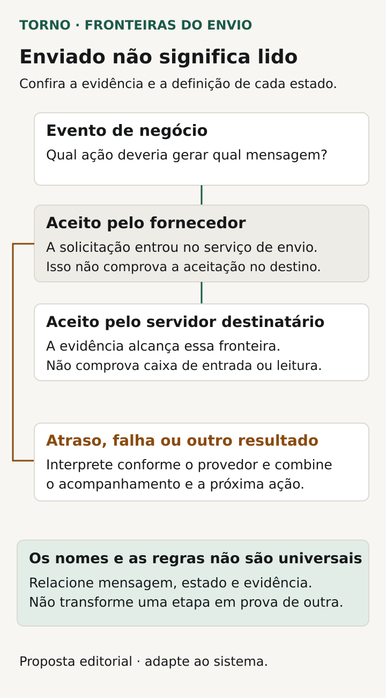
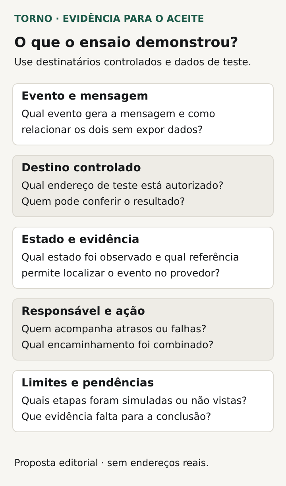

Para aceitar os e-mails transacionais de um sistema, combine **qual evento gera a mensagem, quem deve recebê-la, quais estados serão conhecidos e o que acontece quando o envio falha**. A demonstração precisa ligar uma operação do produto à mensagem correspondente, com evidências do alcance real do resultado.

Uma confirmação de pedido ou aviso de aprovação pode participar de uma tarefa importante para o usuário. “E-mail enviado” precisa ter um significado definido: solicitação criada, aceita pelo fornecedor ou recebida pelo servidor de destino? Essas etapas não demonstram que a pessoa leu a mensagem.

Este roteiro é uma proposta editorial para compradores de portais, integrações e ferramentas internas. Trata de notificações do sistema relacionadas ao negócio, com responsáveis e limites a combinar no escopo.

## Comece pelo evento e pela necessidade do destinatário

Descreva o que deve acontecer antes da mensagem: pedido confirmado, solicitação aprovada ou documento disponibilizado, por exemplo. Diga qual mudança gera o aviso e quais tentativas ou estados ainda não devem gerá-lo. O responsável técnico precisa de uma regra para relacionar o disparo ao resultado do produto.

Defina o destinatário por uma regra verificável. É quem criou o pedido, o responsável atual ou um endereço informado para aquela operação? O que acontece se o cadastro não tiver endereço utilizável ou se ele mudar entre a solicitação e o envio? Encaminhe essas decisões a quem conhece o processo.

Combine também a finalidade do conteúdo: confirmar algo já concluído ou pedir uma ação. Se houver um link, identifique seu destino e as condições necessárias para usá-lo. A mensagem não deve substituir a autorização prevista no sistema nem levar o usuário a agir sobre uma situação que já mudou sem tratamento definido.

## Nomeie as etapas sem prometer leitura

O [RFC 5321](https://datatracker.ietf.org/doc/html/rfc5321) descreve a transferência de responsabilidade quando um servidor aceita uma mensagem por SMTP. Podem existir falhas posteriores, que também precisam de tratamento. Aceitar a mensagem numa etapa não significa que todo o percurso terminou.

No [SendGrid, o evento processed indica aceitação pelo fornecedor, enquanto delivered indica entrega ao servidor destinatário](https://www.twilio.com/docs/sendgrid/for-developers/tracking-events/event). A [documentação do Amazon SES](https://docs.aws.amazon.com/ses/latest/dg/event-publishing-retrieving-sns-contents.html) também relaciona Delivery ao servidor de e-mail do destinatário. São definições desses serviços, não nomes obrigatórios para qualquer integração.

Peça ao fornecedor um mapeamento entre os eventos disponíveis e os estados apresentados no produto. Se a tela mostrar “entregue”, explique a qual fronteira isso corresponde. A evidência de aceitação pelo servidor de destino não demonstra posição na caixa de entrada nem leitura humana.

*Fronteiras propostas para discutir estados e evidências; os eventos disponíveis dependem do provedor. Diagrama original Torno Studio, 2026.*

## Peça uma referência por mensagem e destinatário

Quando alguém disser que não recebeu o aviso, o responsável precisa localizar a tentativa pertinente. Combine uma identificação que relacione o evento de negócio, a mensagem e o destinatário, com acesso apropriado. Se houver mais de um destinatário, um resultado agregado pode deixar dúvidas sobre cada envio.

A documentação do SES descreve identificadores e destinatários associados aos eventos. Isso exemplifica uma fonte técnica possível de evidência; o sistema concreto precisa demonstrar como suas referências serão relacionadas ao fluxo do usuário.

Não é necessário copiar corpo completo, tokens ou anexos privados para uma ficha de aceite. Registre o contexto necessário, quem pode consultar o detalhe e como localizar o resultado. O fornecedor deve explicar o que ficará disponível no produto e o que exigirá acesso ao serviço externo.

| Informação a combinar | Pergunta que precisa de resposta |
|---|---|
| Evento e objeto | Qual operação gerou esta notificação? |
| Mensagem e destino | Qual tentativa corresponde a qual destinatário? |
| Estado conhecido | O que foi confirmado e por qual fonte? |
| Momento | Quando ocorreu a etapa, com referência temporal clara? |
| Falha ou pendência | Qual informação disponível explica a interrupção? |
| Próxima ação | Quem pode conferir, corrigir ou autorizar uma tentativa? |

Essa ficha é uma proposta de conversa. O mecanismo e o alcance da consulta precisam ser delimitados na entrega, sem presumir que qualquer histórico esteja disponível por tempo indefinido.

## Defina o efeito da falha no fluxo do produto

Se o aviso não chegar ao destino, o pedido continuará confirmado? Uma aprovação dependerá de outra ação? O usuário conseguirá consultar o resultado no portal? O comprador precisa decidir como o negócio prossegue, em vez de deixar a regra implícita na configuração de e-mail.

Separe o estado da operação do estado da mensagem. Um pedido concluído e um aviso com falha podem coexistir se esse for o acordo. A interface deve permitir entender essa situação. Uma falha de comunicação não deve ser interpretada automaticamente como cancelamento ou como sucesso de outra ação.

Peça que o fornecedor explique atrasos e recusas conforme o serviço escolhido. O [SendGrid documenta deferred como recusa temporária e distingue tipos de bounce](https://www.twilio.com/docs/sendgrid/for-developers/tracking-events/event). O [SES publica eventos de atraso, rejeição e bounce](https://docs.aws.amazon.com/ses/latest/dg/event-publishing-retrieving-sns-contents.html). Cada provedor tem regras e informações próprias; o tratamento do produto deve mostrar a correspondência adotada.

Combine quando uma pendência exige atenção, quem pode revisar o endereço e qual caminho o usuário terá enquanto isso. Ter registro de falha não define, por si só, quem o acompanha ou em qual horário.

## Trate o reenvio como uma ação delimitada

Pergunte quais tentativas são feitas pelo próprio serviço e quais podem ser iniciadas pela aplicação ou por uma pessoa. Isso evita aceitar um botão de reenvio sem entender se outra tentativa já está em andamento. Não há uma política universal de repetição para aplicar a qualquer provedor ou mensagem.

Defina quem pode solicitar novo envio, para qual endereço e com qual conteúdo. Uma confirmação antiga pode deixar de representar o estado atual do pedido. Se houver conteúdo ou link com validade, o fornecedor precisa explicar o comportamento pertinente ao fluxo contratado.

Reenviar um aviso também não significa executar novamente a operação que o originou. O roteiro sobre [eventos duplicados em integrações](https://tornostudio.com/blog/integracao-evento-duplicado-regra-negocio/) aprofunda o efeito de negócio que deve permanecer único quando há repetição. Aqui, a evidência deve distinguir nova mensagem de novo pedido, aprovação ou outra mudança.

## Veja um exemplo de confirmação com falha

**Exemplo inteiramente fictício:** um portal confirma a solicitação SOL-A e prepara um aviso ao solicitante. O acordo prevê que a solicitação continue confirmada mesmo se a mensagem falhar, permitindo consultar seu estado no portal. O responsável autorizado consegue localizar a tentativa de notificação.

Num cenário hipotético de teste, o serviço informa uma falha documentada. A evidência mostra SOL-A confirmada e a notificação com o estado correspondente, sem afirmar leitura ou recebimento humano. O procedimento encaminha a conferência do endereço e a decisão sobre nova tentativa à pessoa indicada.

Depois da correção autorizada, um novo envio deve ficar relacionado à mesma solicitação, conforme a regra do produto. A conferência verifica que o reenvio não criou outra SOL-A. **Fim do exemplo fictício; não representa cliente, configuração ou ensaio da Torno.**

## Demonstre cenários com destinos controlados

Prepare o [ambiente de homologação](https://tornostudio.com/blog/ambiente-homologacao-conferir-antes-testar-sistema/) antes do ensaio: contas, endereços e efeitos externos autorizados. O responsável técnico deve propor uma forma segura de exercitar os estados, incluindo simuladores ou eventos de teste do provedor quando disponíveis.

Transforme o acordo em [critérios de aceite](https://tornostudio.com/blog/criterios-aceite-mvp/). Para cada execução, registre o que será real, o que será simulado e qual resultado poderá ser concluído.

| Cenário | Evidência a conferir |
|---|---|
| Evento válido | Mensagem vinculada ao objeto e ao destinatário previstos |
| Aceitação pelo fornecedor | Estado apresentado correspondente à confirmação disponível |
| Aceitação no servidor de destino | Evidência da fronteira, sem atribuir leitura humana |
| Atraso ou falha exercitados | Operação e mensagem com estados coerentes e próxima ação definida |
| Reenvio autorizado | Nova tentativa identificada, sem repetir indevidamente o efeito de negócio |
| Evento que não deve notificar | Ausência do envio conforme o cenário combinado |

*Campos propostos para relacionar a mensagem ao resultado observado e às pendências. Diagrama original Torno Studio, 2026.*

Uma caixa de teste que captura a mensagem pode demonstrar conteúdo e disparo, deixando sem avaliação o percurso real de entrega. Registre esse limite. Guarde versão, ambiente, referência da mensagem e resultados observados, com as pendências necessárias à conclusão.

Se a falha precisar avisar quem mantém o sistema, use o roteiro de [alertas para o fluxo crítico](https://tornostudio.com/blog/monitoramento-software-alertas-fluxo-critico/) para definir esse encaminhamento operacional. É uma responsabilidade a combinar separadamente do aviso ao usuário.

Para a [conversa inicial com Henrique](https://tornostudio.com/diagnostico/), leve o evento que precisa notificar, os destinatários e o que a operação deve fazer quando houver atraso ou falha. Isso permite delimitar a funcionalidade e suas evidências, com as regras do provedor conhecido, sem presumir acompanhamento contínuo ou garantia de entrega e leitura.

*Fontes primárias consultadas em 26 de outubro de 2026. A ficha e o exemplo são propostas editoriais originais para adaptação ao produto.*
