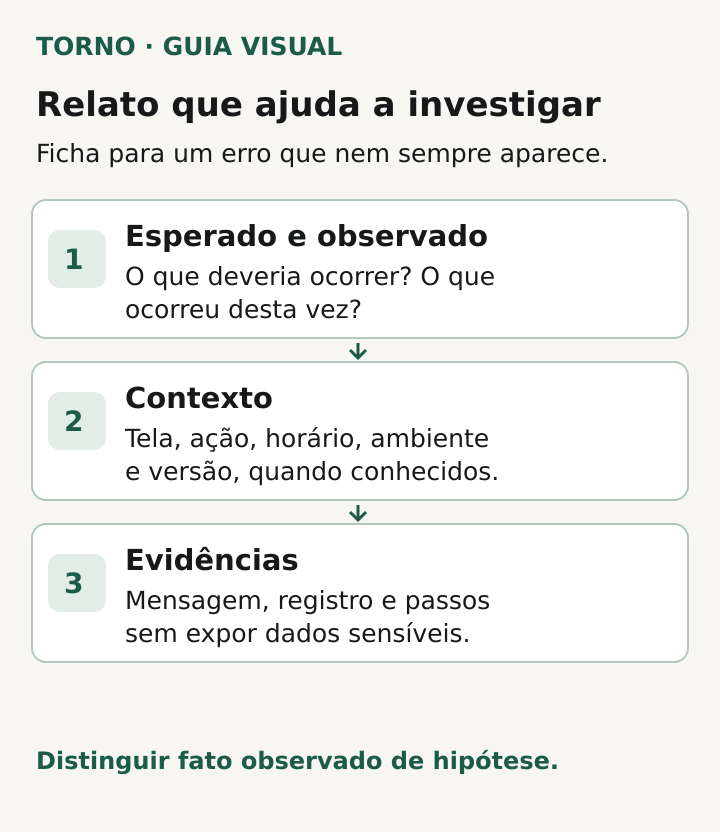
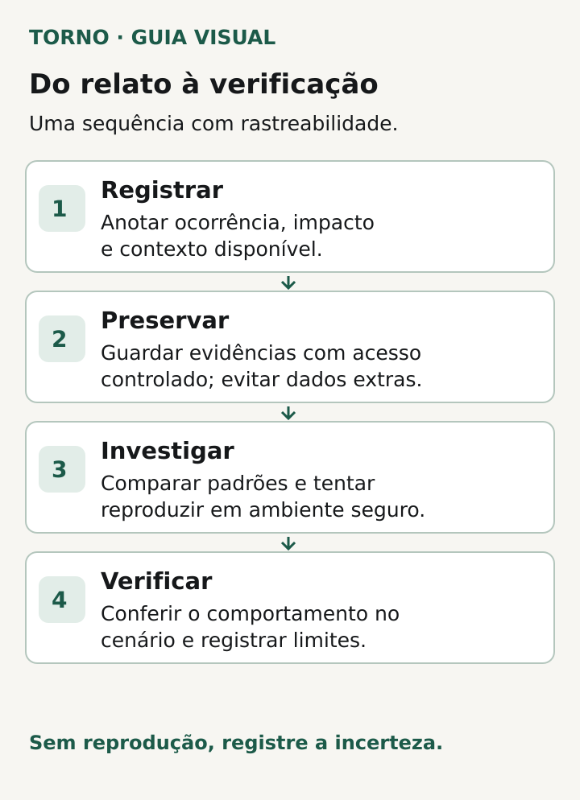

Quando uma falha aparece só às vezes, registre **o que tentou fazer, quando ocorreu, o que esperava ver e o que de fato apareceu**. Acrescente o contexto que pode variar entre tentativas: conta ou perfil de acesso, aparelho, navegador, rede, volume de dados e etapa do fluxo, conforme for relevante e seguro compartilhar. Uma descrição observável ajuda a começar a investigação mesmo quando ninguém consegue repetir o erro na primeira tentativa.

Não é preciso adivinhar a causa. “O banco caiu” é uma hipótese; “ao salvar, a tela mostrou uma mensagem de erro e o registro não apareceu na lista” é uma observação. O [guia do GitHub para relatar bugs](https://docs.github.com/en/issues/tracking-your-work-with-issues/learning-about-issues/quickstart) pede passos, resultado esperado e resultado observado. As [orientações de escrita do Mozilla Bugzilla](https://bugzilla.mozilla.org/page.cgi?id=bug-writing.html) também distinguem falhas reproduzidas sempre, ocasionalmente e ainda não reproduzidas. São referências de método, não um formulário obrigatório para todo produto.

## Comece por um fato delimitado

Dê um título que indique ação e resultado, como “Pedido some da lista após salvar em uma tentativa ocasional”, em vez de “sistema quebrado”. Registre data e horário com fuso, ambiente em que ocorreu e versão ou data do último deploy **se você souber**. Não invente versão para completar a ficha. Se uma operação ficou impedida, diga qual e para quem; se houve um caminho alternativo testado, registre o que ele permitiu fazer.

A frequência precisa refletir as tentativas observadas. “Aconteceu uma vez nesta manhã e não voltou nas duas tentativas seguintes” é mais útil que “acontece sempre”, quando isso não foi visto. Se a falha não é reproduzível sob demanda, mantenha esse estado explícito. O [Mozilla Bugzilla orienta dar contexto adicional quando o problema é ocasional](https://bugzilla.mozilla.org/page.cgi?id=bug-writing.html), justamente porque passos perfeitos podem não existir.

## Use uma ficha que outra pessoa consiga investigar

Preencha só o que você observou. Deixe campos desconhecidos como “não verificado”; isso separa lacunas de conclusões.

| Campo | Pergunta a responder |
|---|---|
| Ação e local | Em qual tela e em qual etapa o problema apareceu? |
| Horário e ambiente | Quando ocorreu, com qual fuso, em produção ou em teste? |
| Contexto relevante | Qual perfil, dispositivo, navegador ou condição parecia diferente? |
| Passos tentados | Que sequência você seguiu, na ordem observada? |
| Esperado e observado | O que deveria acontecer e o que apareceu, com a mensagem exata se houver? |
| Frequência | Em quantas tentativas ocorreu e em quantas não ocorreu? |
| Impacto | Qual tarefa ficou bloqueada, atrasada ou exigiu outro caminho? |
| Evidências | Quais registros, horários ou imagens podem ser consultados com acesso apropriado? |
| Próxima verificação | Quem investigará, qual hipótese será testada e onde ficará o resultado? |

A ficha é um modelo editorial. O responsável técnico pode pedir outros dados conforme a arquitetura. O primeiro relato não precisa conter diagnóstico nem uma coleta irrestrita de logs.

*Campos para separar fatos observados de hipóteses num relato de erro intermitente. Diagrama original Torno Studio, 2026.*

## Veja um relato hipotético completo

**Exemplo fictício, sem relação com cliente ou produto real:** em um portal de pedidos, uma pessoa com perfil de atendimento abre um pedido, altera o campo de observação e seleciona “Salvar”. Na primeira tentativa, a tela volta à lista sem mensagem e a alteração não aparece ao reabrir o pedido. Nas duas tentativas seguintes, a alteração aparece normalmente. O relato informa horário e fuso, ambiente, navegador, perfil, sequência de cliques, resultado esperado e observado. O identificador do pedido é guardado apenas no canal interno autorizado; uma versão fictícia do dado basta para discutir o problema fora dele.

Esse relato **não prova** que o banco de dados falhou, que o navegador causou o problema ou que houve perda definitiva. Para investigar, o responsável pode comparar a hora informada com registros do sistema, conferir se houve resposta da operação de salvar e observar se uma nova tentativa reproduz a falha. São possibilidades de investigação, não diagnósticos deste exemplo.

Se mais de um erro diferente aparecer, abra relatos separados e vincule-os quando houver evidência de relação. A [orientação do Mozilla Bugzilla](https://bugzilla.mozilla.org/page.cgi?id=bug-writing.html) recomenda separar problemas diferentes; isso permite conferir a correção de cada comportamento.

## Revise anexos antes de compartilhar

Capturas de tela e trechos de log podem ajudar, mas também podem mostrar nomes, mensagens privadas, tokens ou dados de pagamento. Antes de enviar algo ao fornecedor, verifique quem terá acesso, qual trecho é necessário e se há dados que podem ser ocultados sem destruir a evidência. Se precisar preservar o original para investigação, mantenha-o no sistema autorizado e combine com o responsável técnico como consultá-lo. Aplicar esse cuidado a prints e anexos é uma **adaptação editorial**: o [guia da OWASP](https://cheatsheetseries.owasp.org/cheatsheets/Logging_Cheat_Sheet.html) trata especificamente de dados que devem ser excluídos ou protegidos em logs, incluindo senhas, tokens, chaves e informações pessoais sensíveis.

Evite colocar credenciais em uma issue, enviar uma base completa para mostrar uma única falha ou publicar um link que dê acesso irrestrito ao ambiente. Se houver indício de vazamento ou acesso indevido, siga o procedimento de segurança da organização; um relato de bug comum não substitui a resposta a incidente.

## Peça uma investigação com resultado verificável

Depois do relato, combine quem receberá a tarefa, qual evidência será procurada e quando haverá uma atualização. “Não reproduzimos” descreve o estado da investigação, mas não prova que o problema desapareceu. O responsável pode registrar a tentativa, o ambiente, o resultado e o próximo teste útil. Se houver correção, confira o fluxo que falhou e os fluxos próximos que poderiam ser afetados, com critério acordado para encerrar a demanda.

*Sequência ilustrativa de captura e verificação, com registro da incerteza quando o erro não se reproduz. Diagrama original Torno Studio, 2026.*

Uma falha em uso é diferente dos [critérios de aceite definidos antes de contratar um MVP](https://tornostudio.com/blog/criterios-aceite-mvp/). Ela também não basta, isoladamente, para decidir [refazer o sistema](https://tornostudio.com/blog/antes-de-refazer-sistema-evidencias/). Se a equipe ou o fornecedor mudar durante a investigação, mantenha o relato e a pendência no [inventário de passagem técnica](https://tornostudio.com/blog/troca-fornecedor-software-passagem-tecnica/) para que o contexto não se perca.

A entrega mais útil para começar é uma ficha honesta: fato observado, condições conhecidas, frequência, impacto e evidência acessível com segurança. A causa vem da investigação.

*Fontes técnicas consultadas em 19 de outubro de 2026. A ficha e o portal descrito são exemplos editoriais originais; devem ser adaptados ao sistema e à política de acesso da organização.*
