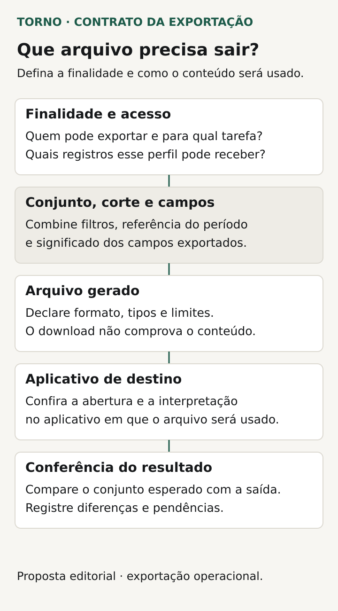
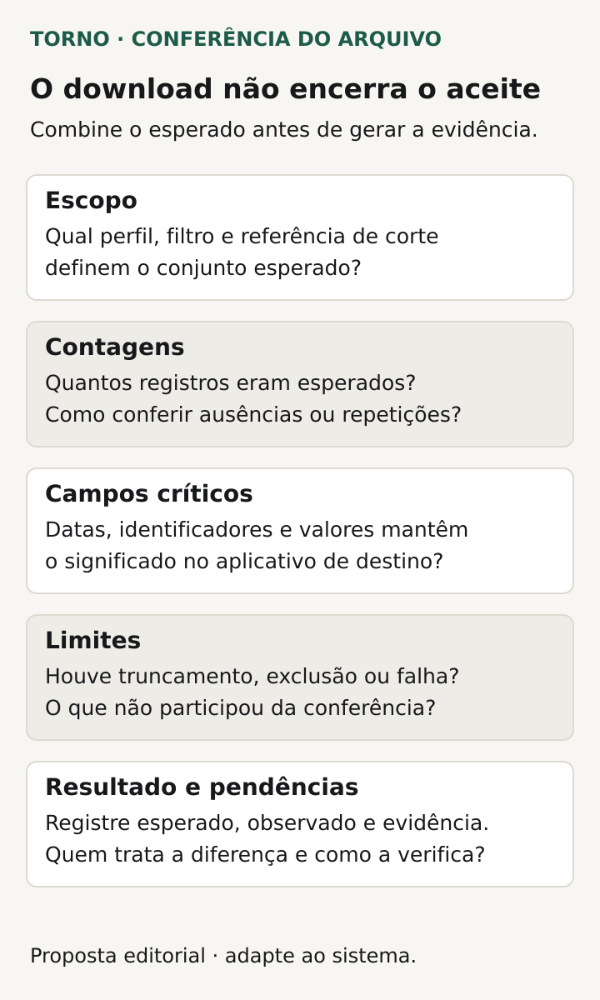

Para aceitar uma exportação de dados, confira **quais registros devem sair, quais campos o arquivo precisa conter e como os valores serão interpretados no destino**. O download demonstra que um arquivo foi entregue. O aceite precisa mostrar que seu conteúdo atende ao uso combinado.

Este roteiro é para uma função recorrente de um portal ou ferramenta interna: gerar um relatório para análise, enviar uma relação operacional ou preparar dados para um processamento definido. Não trata de backup nem de uma extração única para migrar de sistema.

O comprador define a finalidade e o resultado esperado. O responsável técnico propõe a geração e explica os limites. As fichas abaixo são propostas editoriais para organizar essa conversa antes da demonstração final.

## Descreva o uso antes de escolher o formato

Escreva quem usará o arquivo, em qual aplicativo ou serviço e para concluir qual tarefa. “Abrir no Excel para conferir pedidos” e “enviar ao sistema que calcula comissões” podem exigir contratos diferentes. Identifique o destino efetivo, incluindo as condições relevantes de abertura ou importação.

Peça um modelo fictício com os campos esperados. Diga se o arquivo será lido por pessoas, processado automaticamente ou ambos. Se o mesmo conteúdo precisar atender a dois usos, o fornecedor deve explicar como verificará cada um e se serão necessárias saídas distintas.

Evite usar “exportar tudo” como especificação. Ela deixa abertas as escolhas de acesso, relacionamentos, formato e significado. Comece pelo conjunto necessário à tarefa e registre as dúvidas que ainda dependem do responsável pelo processo.

## Defina o conjunto, os filtros e o momento de referência

Combine se a exportação considera toda a seleção ou apenas o que aparece na página atual da tela. Registre filtros, estados, unidade ou organização e a regra que determina a inclusão de cada registro. A indicação de quantidade deve se referir ao conjunto definido, não a uma expectativa implícita de quem clicou.

Esclareça o momento usado para selecionar os dados. Se a geração demora e um pedido muda de estado durante o processamento, qual resultado será esperado? A regra e sua implementação precisam ser explicadas pelo fornecedor. Não presuma que um arquivo extenso represente automaticamente uma fotografia única e consistente.

Para períodos, indique o campo de data, o corte e a referência de fuso. O artigo sobre [datas e fusos no sistema](https://tornostudio.com/blog/datas-fusos-sistema-prazos-relatorios/) aprofunda essas decisões. Aqui, o aceite deve permitir conferir quais registros entram e quais ficam fora do arquivo exportado.

## Faça um contrato dos campos e dos valores

A [recomendação CSVW do W3C](https://www.w3.org/TR/tabular-data-model/) descreve dados tabulares e metadados que ajudam a interpretá-los. A consequência para a conversa do comprador é definir mais do que nomes de colunas. O valor precisa ter significado conhecido para o uso previsto.

| Decisão | O que combinar no modelo |
|---|---|
| Unidade da linha | Um pedido, um item de pedido ou outro objeto definido |
| Identificadores | Código completo e tratamento de zeros à esquerda |
| Valores numéricos | Unidade, moeda, precisão e regra de arredondamento |
| Datas | Significado, representação e referência temporal pertinente |
| Ausência de informação | Diferença entre vazio, zero e valor não informado |
| Relacionamentos | Como representar objetos com vários itens ou responsáveis |
| Colunas e ordem | Cabeçalhos, sequência e estabilidade exigida pelo destino |

Se uma linha representa um item, um pedido pode aparecer mais de uma vez. Isso pode estar correto, desde que a unidade esteja definida. Peça que totais e contagens sejam interpretados conforme essa unidade, evitando comparar quantidade de linhas com quantidade de pedidos como se fossem iguais.

*Decisões propostas para definir o arquivo recorrente antes do aceite. Diagrama original Torno Studio, 2026.*

## Confira o formato no aplicativo combinado

O [RFC 4180](https://datatracker.ietf.org/doc/html/rfc4180) descreve um formato comum de CSV, incluindo cabeçalho, campos, aspas e quebras de linha. É um documento informativo, não um padrão obrigatório universal. O contrato precisa indicar as convenções efetivamente usadas pelo arquivo e aceitas pelo destino.

Se o formato for CSV, combine separador, codificação e representação dos valores. Se for XLSX, defina as abas e o conteúdo esperado. São formatos distintos; aceitar um não implica que o outro esteja incluído. Confira códigos, acentos, valores decimais e campos com quebras de linha nas condições reais de uso previstas.

Inclua o tratamento de conteúdo que veio de usuários. A [OWASP descreve o risco de conteúdo não confiável ser interpretado como fórmula ao abrir um CSV em uma planilha](https://community.owasp.org/attacks/CSV_Injection). A fonte alerta que não há uma estratégia universal segura para todos os aplicativos e consumidores, e que salvar e reabrir no Excel pode afetar proteções.

Peça que o responsável técnico proponha o tratamento para o destino contratado e uma verificação controlada. Não transforme uma correção de apresentação em alteração silenciosa do significado do dado. Se houver um percurso de salvar, reabrir ou importar, inclua esse percurso no escopo do teste, sem executar conteúdo perigoso na operação.

## Combine quem pode gerar e obter o arquivo

Consultar uma informação na tela não decide automaticamente o direito de exportá-la. O roteiro de [permissões de acesso](https://tornostudio.com/blog/permissoes-acesso-software-regras-negocio/) ajuda a definir perfil, ação e alcance. No ensaio, confira os registros e campos permitidos para o perfil usado.

Se o arquivo ficar disponível depois da geração, pergunte quem poderá obtê-lo, por quanto tempo e o que acontece quando o acesso muda. Um endereço de download também precisa do tratamento de acesso combinado. Registre os mecanismos e limites que o responsável técnico apresentará, sem presumir que todo arquivo tenha a mesma política.

## Diferencie geração concluída de resultado parcial

Se houver processamento em segundo plano, combine estados que o usuário consiga entender: solicitado, em geração, concluído ou falhou, conforme o produto. Explique como localizar a solicitação e reconhecer o arquivo correspondente. Um novo clique deve ter comportamento definido, sem deixar dúvida sobre qual saída foi produzida.

Peça a regra para limites de volume, interrupção e ausência de resultados. O sistema recusará uma seleção excessiva, produzirá partes identificadas ou oferecerá outra opção contratada? Qualquer saída parcial precisa estar explícita. Um arquivo que termina antes do conjunto esperado não deve ser apresentado como completo sem essa informação.

Combine também como a operação receberá uma explicação útil de falha e poderá repetir a geração. Isso delimita o trabalho necessário sem prometer qualquer tamanho de arquivo ou prazo universal.

## Veja um exemplo de conferência do conteúdo

**Exemplo inteiramente fictício:** um portal gera uma relação de pedidos aprovados de uma unidade num período definido. O acordo escolhe uma linha por pedido, campos de código, estado e valor, e leitura num aplicativo de planilha especificado para o ensaio.

A base de teste contém um pedido aprovado dentro do período, um cancelado e outro de uma unidade diferente. O resultado esperado inclui somente o primeiro. O responsável confere seus campos, o total correspondente e a preservação do código completo ao abrir o arquivo pelo caminho combinado.

Outra execução usa um período sem pedidos elegíveis. O contrato deve explicar como essa ausência aparece. **Fim do exemplo fictício; não representa cliente, implementação ou teste da Torno.**

O mesmo modelo permite adicionar casos de fronteira e registros com campos ausentes. A evidência precisa relacionar os dados preparados ao conteúdo obtido, permitindo localizar uma inclusão ou exclusão indevida.

## Encerre com cenários e evidências rastreáveis

Prepare dados fictícios no [ambiente de homologação](https://tornostudio.com/blog/ambiente-homologacao-conferir-antes-testar-sistema/) e transforme o contrato em [critérios de aceite](https://tornostudio.com/blog/criterios-aceite-mvp/). Para cada execução, combine o resultado antes de gerar o arquivo.

| Cenário | Evidência a conferir |
|---|---|
| Conjunto com filtros conhecidos | Inclusões, exclusões e quantidade pela unidade definida |
| Perfil com alcance limitado | Registros e campos autorizados no arquivo |
| Conteúdo com tipos distintos | Códigos, números, ausências e datas interpretados corretamente |
| Uso no aplicativo de destino | Abertura ou processamento pelo caminho combinado |
| Ausência de dados ou limite atingido | Resultado e mensagem coerentes com o contrato |
| Mudança durante a geração | Comportamento correspondente ao momento de referência |

*Roteiro ilustrativo para conferir o conteúdo e o uso do arquivo, além do download. Diagrama original Torno Studio, 2026.*

Guarde versão, perfil, filtros, referência temporal, arquivo e resultado observado. Se a reimportação fizer parte da entrega, use também o roteiro de [tratamento de erros de importação](https://tornostudio.com/blog/importacao-planilhas-sistema-tratar-erros/), com os limites dessa etapa registrados.

Para a [conversa de escopo com Henrique](https://tornostudio.com/diagnostico/), leve um modelo fictício, o uso pretendido e uma divergência que precisa ser detectada. Isso permite delimitar a exportação e a evidência da entrega com base na operação, antes de escolher a solução técnica.

*Fontes primárias consultadas em 26 de outubro de 2026. As fichas e o exemplo são propostas editoriais originais para adaptação ao produto.*
