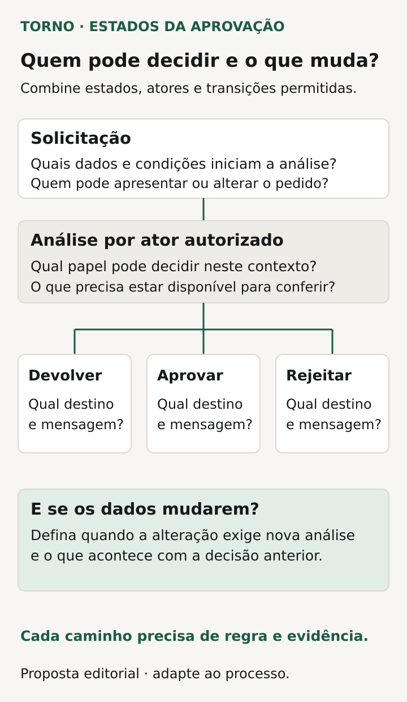
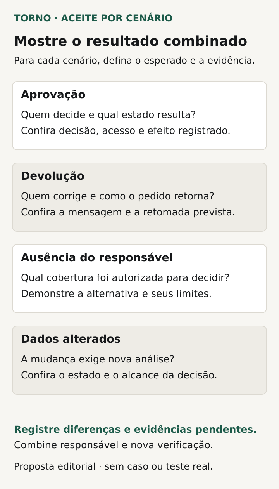

Antes de aceitar um fluxo de aprovação no sistema, defina **o que está sendo aprovado, quem decide em cada etapa, quais mudanças de estado são permitidas e qual efeito a decisão produz**. O botão Aprovar é uma parte da interface; o acordo precisa explicar também devoluções, rejeições e situações em que a decisão deixa de valer.

Para o comprador de um portal ou ferramenta interna, o problema costuma aparecer numa solicitação concreta: alguém envia, outra pessoa analisa e a operação depende do resultado. “Gestor aprova” ainda não informa quando ele pode agir, sobre quais dados ou o que acontece se precisar de uma correção.

Este roteiro propõe decisões de negócio e evidências de aceite. O responsável pelo processo valida as regras; o responsável técnico explica a implementação e seus limites.

## Nomeie o objeto e o efeito da aprovação

Escolha um pedido ou uma solicitação e diga o que a decisão autoriza. Aprovar significa liberar execução, encaminhar a outra análise ou apenas registrar concordância? Separe o ato de aprovar da tarefa que pode acontecer depois, como criar uma ordem ou enviar dados a outro sistema.

Defina também quais informações precisam ser conhecidas na decisão: itens, valor, prazo, destinatário ou documento, conforme o processo. Evite deixar “aprovar o cadastro” sem indicar o alcance. A pessoa precisa compreender o que sua escolha fará avançar.

A [OWASP, em Transaction Authorization](https://cheatsheetseries.owasp.org/cheatsheets/Transaction_Authorization_Cheat_Sheet.html), trata da relação entre dados apresentados, autorização e execução. É uma orientação de segurança para transações. Neste roteiro, a pergunta ao comprador é uma adaptação: a decisão está vinculada às informações e à consequência que o aprovador deveria avaliar?

## Escreva estados e caminhos, incluindo os retornos

Nomeie estados que a operação consiga distinguir. Rascunho, submetido, devolvido para correção, aprovado e rejeitado são possibilidades, não uma lista obrigatória. Cada estado precisa de significado, ações disponíveis e condição para sair dele.

Devolução e rejeição podem exigir tratamentos diferentes. Devolver pode permitir corrigir e reenviar o mesmo pedido; rejeitar pode encerrar aquela solicitação, conforme a política. Diga se o motivo é obrigatório, quem o consulta e o que fica pendente para a próxima pessoa.

Considere também o cancelamento por desistência ou perda de finalidade. Defina quem pode solicitá-lo, até qual etapa e qual efeito produz sobre tarefas já encaminhadas. Cancelar um pedido ainda em análise pode exigir tratamento diferente de desfazer algo que já foi autorizado e executado.

O [exemplo de aprovação do Microsoft Learn](https://learn.microsoft.com/en-us/power-automate/modern-approvals) relaciona solicitação, encaminhamento da decisão e atualização do registro. Ele ilustra um processo numa plataforma específica. Seu sistema precisa ter os próprios estados e resultados definidos, sem presumir Power Automate ou seus recursos.

| Transição a discutir | Pergunta de negócio |
|---|---|
| Rascunho para submetido | Quais dados e condições tornam o pedido pronto para análise? |
| Submetido para devolvido | O que deve ser corrigido e quem pode fazê-lo? |
| Devolvido para nova análise | Qual etapa recebe o reenvio e quais decisões anteriores valem? |
| Em análise para aprovado | Quem decide e qual consequência é autorizada? |
| Em análise para rejeitado | A solicitação termina ou existe um caminho explícito de revisão? |

*Caminhos propostos para discutir estados e decisões; não representam um fluxo já implementado. Diagrama original Torno Studio, 2026.*

## Defina quem atua e em qual ordem

Identifique o responsável por cada etapa e como ele é escolhido: unidade, tipo de pedido ou outra regra. O roteiro de [permissões de acesso](https://tornostudio.com/blog/permissoes-acesso-software-regras-negocio/) ajuda a definir quem pode executar a ação. Aqui, acrescente quando essa ação é válida e o que ela faz com a solicitação.

Se houver mais de um aprovador, diga se as decisões ocorrem em sequência, independentemente ou por outra política. É necessário que todos concordem? Uma rejeição encerra o fluxo? Quem recebe o próximo passo? Essas respostas precisam de exemplos concretos.

O [tutorial de aprovação sequencial da Microsoft](https://learn.microsoft.com/en-us/power-automate/sequential-modern-approvals) apresenta uma pré-aprovação antes da decisão final. É um exemplo útil de dependência entre etapas, não uma exigência para toda empresa. Defina somente as etapas justificadas pelo processo e como demonstrar que não podem ser puladas indevidamente.

## Combine o efeito de uma alteração nos dados

Pergunte o que acontece se alguém mudar o valor, o prazo ou um anexo depois da submissão. A edição fica bloqueada? A solicitação volta à análise? Algumas alterações preservam a decisão anterior e outras a invalidam? Nomeie os campos e as condições relevantes.

A [OWASP recomenda proteger os dados durante a autorização e descreve medidas que podem reiniciar o processo quando eles mudam](https://cheatsheetseries.owasp.org/cheatsheets/Transaction_Authorization_Cheat_Sheet.html). Não se trata de aplicar uma solução única a qualquer pedido administrativo. A adaptação para o contrato é explicitar quais mudanças exigem uma nova decisão e como o produto impede a execução com uma autorização que já não corresponde aos dados.

Inclua a tela antiga: o aprovador abre a solicitação, outra pessoa a altera e só depois ele decide. O artigo sobre [edição simultânea](https://tornostudio.com/blog/edicao-simultanea-sistema-conflitos/) aprofunda esse conflito. No fluxo de aprovação, a evidência precisa mostrar sobre qual estado a decisão foi aceita e qual consequência ficou autorizada.

## Resolva ausência e demora sem criar aprovação implícita

Se o aprovador sair de férias ou mudar de função, quem assume? Diga quem pode substituir ou reatribuir a tarefa, em quais condições e como a decisão fica identificada. Receber uma notificação não concede automaticamente poder para aprovar.

Combine prazos de acompanhamento, lembretes e escalonamento quando forem necessários. Escalonar pode significar avisar outra pessoa ou transferir a responsabilidade; escreva qual efeito foi escolhido. O simples decorrer do tempo não deve ser confundido com aprovação se essa não for a regra expressamente definida.

Peça também o tratamento do pedido que permanece parado: quem consegue localizá-lo, que informação vê e qual ação pode iniciar. Essas são capacidades a incluir no escopo, sem presumir acompanhamento contínuo pelo fornecedor.

## Veja um exemplo de devolução e nova análise

**Exemplo inteiramente fictício:** uma solicitação de compra passa por análise da unidade antes da decisão final. O solicitante envia os itens e um valor. A primeira análise devolve o pedido porque falta uma justificativa exigida pela regra hipotética.

O solicitante corrige a justificativa e altera o valor. O acordo deste exemplo determina que a mudança de valor exige nova análise da unidade antes de chegar à etapa final. O resultado esperado inclui solicitação reenviada ao responsável correto e ausência de liberação antecipada para execução.

Se o responsável estiver indisponível, uma pessoa autorizada pode reatribuir a análise conforme uma regra registrada. A substituição não equivale a aprovar o pedido. **Fim do exemplo fictício; não representa cliente, implementação ou ensaio da Torno.**

Esse caso permite conferir o caminho de retorno, a mudança dos dados e a responsabilidade atual. A mensagem “reenviado” precisa corresponder ao estado e à etapa efetivamente encontrados no sistema.

## Peça uma demonstração dos caminhos permitidos e impedidos

Transforme as decisões em [critérios de aceite](https://tornostudio.com/blog/criterios-aceite-mvp/). Prepare solicitações fictícias, contas e efeitos externos no [ambiente de homologação](https://tornostudio.com/blog/ambiente-homologacao-conferir-antes-testar-sistema/). Para cada cenário, escreva estado inicial, ação e resultado esperado antes de executar.

| Cenário | Evidência a conferir |
|---|---|
| Submissão válida | Etapa e responsável corretos, com dados necessários disponíveis |
| Tentativa antes da etapa prevista | Ação impedida conforme a regra, sem liberar a consequência |
| Devolução e reenvio | Motivo localizável e retorno ao caminho combinado |
| Rejeição | Estado e possibilidade de revisão coerentes com o contrato |
| Dados alterados durante a análise | Decisões mantidas ou invalidadas conforme os campos definidos |
| Aprovador ausente | Reatribuição ou encaminhamento autorizado, sem decisão presumida |

*Conferências propostas para relacionar estados, responsáveis e consequências observadas. Diagrama original Torno Studio, 2026.*

Confira o registro final e os efeitos da decisão, além da mensagem exibida. Guarde versão, contas usadas, sequência e limites do teste. Se uma integração posterior foi simulada, registre o que essa simulação permite concluir.

A [trilha de auditoria](https://tornostudio.com/blog/trilha-auditoria-sistema-requisitos-negocio/) ajuda a definir o histórico de decisões e tentativas. Esse histórico não substitui a regra que permite ou impede a transição; são evidências complementares.

Para a [conversa de escopo com Henrique](https://tornostudio.com/diagnostico/), leve uma solicitação representativa, os responsáveis por etapa e exemplos de devolução, alteração e ausência. Isso permite delimitar o fluxo e suas exceções, com evidências de entrega que respondam ao processo real.

*Fontes consultadas em 27 de outubro de 2026. A ficha e o exemplo são propostas editoriais originais para adaptação ao produto.*
