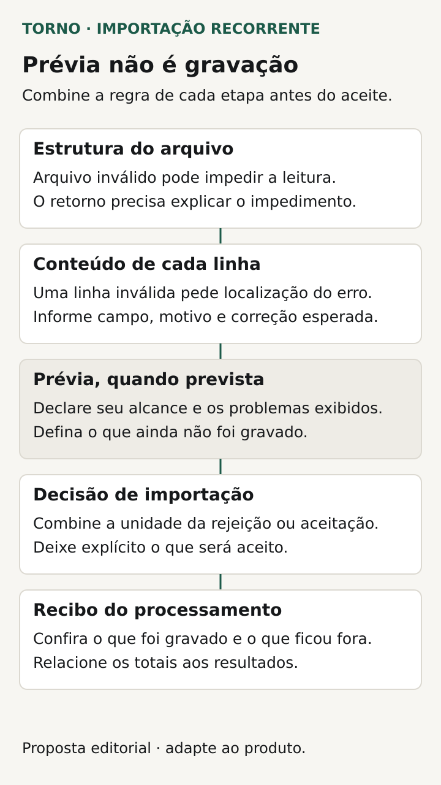
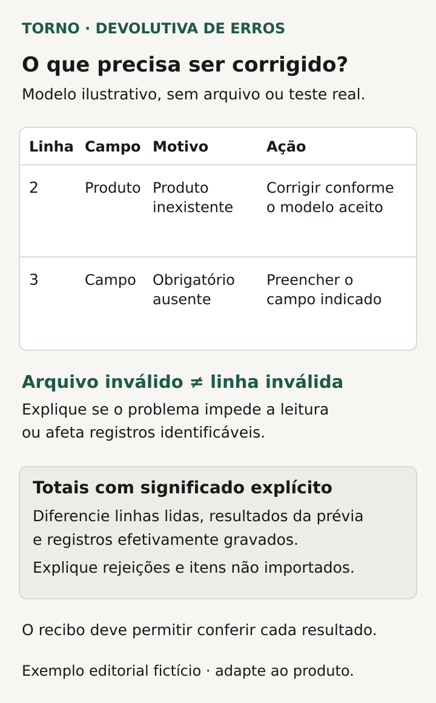

Antes de contratar a importação de planilhas no sistema, defina **qual arquivo será aceito, quais regras cada registro precisa cumprir, o que será gravado quando houver erro e como o usuário corrigirá e reenviará o conteúdo**. O aceite precisa mostrar o resultado no sistema, além da mensagem de upload concluído.

Este roteiro é para quem já decidiu construir uma funcionalidade de envio recorrente de arquivos de pedidos ou cadastros. O problema é tratar cada remessa durante a operação. A [validação de uma migração de dados para trocar de sistema](https://tornostudio.com/blog/migracao-dados-validacao-troca-sistema/) envolve outra decisão e tem roteiro próprio.

As fichas abaixo são propostas editoriais para a conversa com o fornecedor. O comprador define o efeito de negócio; o responsável técnico propõe a implementação e demonstra seu comportamento.

## Comece por um modelo e um mapeamento explícitos

Entregue um arquivo fictício com os campos previstos e descreva o significado de cada coluna. Identifique obrigatórios, valores permitidos, referências a cadastros existentes e formatos de data, número e código. Defina o que um campo vazio significa: ausência permitida, valor a preservar ou erro, conforme o caso.

Combine o mapeamento entre arquivo e sistema. As colunas serão reconhecidas pelo nome ou pela posição? Uma coluna extra será ignorada ou impedirá o envio? Se houver XLSX, qual aba será lida e como fórmulas serão tratadas? Se houver CSV, registre separador, codificação, cabeçalho e convenções aceitas. CSV e XLSX são formatos distintos; contratar um não implica suporte ao outro.

O [RFC 4180 descreve um formato comum de CSV](https://datatracker.ietf.org/doc/html/rfc4180), com regras para campos, cabeçalhos e aspas. É um documento informativo, de outubro de 2005, e não impõe uma norma obrigatória. Use a referência para discutir o contrato do arquivo, sem presumir que qualquer exportação de planilha seguirá a mesma convenção.

A [Microsoft orienta caminhos específicos para abrir CSV UTF-8 no Excel](https://support.microsoft.com/en-us/excel/opening-csv-utf-8-files-correctly-in-excel), conforme a presença de BOM. Isso ajuda a lembrar que a forma de abertura merece conferência. Ver o arquivo corretamente no Excel não demonstra como seu sistema o interpretará; peça um ensaio com o arquivo efetivamente enviado.

## Separe arquivo ilegível de registro inválido

Há uma diferença entre não conseguir interpretar o arquivo e conseguir lê-lo, mas encontrar um valor que viola uma regra. Peça mensagens e encaminhamentos correspondentes às duas situações.

Um cabeçalho incompatível pode impedir o mapeamento. Já um código de produto inexistente pode ser localizado num registro identificado. No primeiro caso, o usuário pode precisar corrigir o modelo; no segundo, corrigir o código ou resolver uma referência com quem administra o cadastro. A resposta deve indicar qual ação é necessária, dentro do que o sistema consegue determinar.

Defina também quem decide regras ambíguas. Uma data fora do período permitido deve ser rejeitada ou precisa de autorização? Um cadastro inativo pode receber novo pedido? Registre a regra e o responsável antes da implementação. Transformar uma dúvida de processo em uma conversão automática pode produzir um dado legível e ainda assim incorreto para o negócio.

Se houver uma prévia antes de confirmar, especifique seu alcance: ela apenas mostra as colunas ou já executa as validações combinadas? Diga em qual etapa os dados são gravados e quais alterações ainda são possíveis. O botão de confirmação precisa corresponder a uma decisão que o usuário consegue entender.

## Escolha o comportamento quando parte do arquivo tem erro

Combine se a remessa será rejeitada por inteiro ou se registros válidos poderão ser importados separadamente. Se houver dependência entre registros, descreva a unidade da decisão: arquivo, pedido completo, grupo ou registro individual. “Importação parcial” precisa explicar o que pode ficar separado.

O [comando COPY do PostgreSQL 18](https://www.postgresql.org/docs/current/sql-copy.html) exemplifica opções técnicas distintas: em certas condições de erro de conversão, pode parar ou descartar o registro e continuar. Essas opções têm alcance específico; não resolvem automaticamente as regras do produto. Cabe ao fornecedor explicar como a solução contratada realizará o comportamento escolhido.

Para o comprador, a conferência é simples de formular: depois de um erro conhecido, quais objetos deverão existir no sistema e quais não deverão ter sido criados? Peça evidência desse estado. Se importar um pedido também dispara integração ou mensagem, inclua o tratamento desses efeitos no escopo.

*Roteiro ilustrativo da importação; a política de gravação depende do acordo do produto. Diagrama original Torno Studio, 2026.*

## Peça um recibo que permita localizar e corrigir

Defina o resultado exibido depois do processamento: identificação da remessa, estado final, quantidades pertinentes e indicação do que exige correção. Se algo foi ignorado por uma regra, isso precisa ser distinguível de conteúdo efetivamente importado.

| Informação do recibo | Pergunta que deve responder |
|---|---|
| Remessa e modelo | Qual envio foi processado e qual versão do modelo foi usada? |
| Resultado | O arquivo foi recusado, concluído ou processado parcialmente? |
| Registro afetado | Como localizar o item no arquivo original? |
| Campo e motivo | Qual regra falhou e qual correção é necessária? |
| Efeito no sistema | O que foi criado, atualizado, rejeitado ou ignorado? |
| Próxima ação | O que reenviar e quem pode resolver uma pendência? |

Combine o significado de “linha”. O [RFC 4180 permite que um campo entre aspas contenha quebras de linha](https://datatracker.ietf.org/doc/html/rfc4180); portanto, linha física e registro podem não coincidir. Peça uma referência que o usuário consiga localizar, com a convenção de numeração explicitada e, quando apropriado, o identificador do registro.

O recibo deve conter o necessário para corrigir, com acesso adequado. Não é preciso repetir todo o conteúdo do arquivo para explicar um campo inválido. Combine quem pode consultar ou baixar o relatório e onde fica a evidência usada no aceite.

## Defina correção, reenvio e repetição

Explique se o usuário reenviará o arquivo inteiro ou apenas os registros rejeitados. Se parte já foi importada, combine o tratamento dos itens que voltam a aparecer. O nome do arquivo, sozinho, não explica se uma remessa é repetida ou contém uma alteração legítima.

Escolha o identificador que permite reconhecer o objeto de negócio e defina o efeito esperado: rejeitar repetição, preservar o registro existente ou atualizar campos autorizados, conforme a regra. O artigo sobre [eventos duplicados na integração](https://tornostudio.com/blog/integracao-evento-duplicado-regra-negocio/) aprofunda essa distinção entre repetição e nova mudança.

Se o envio for interrompido, o usuário precisa conseguir conferir o estado antes de tentar novamente. Peça que o responsável mostre como localizar a remessa e seu resultado conhecido. Um arquivo aceito para processamento ainda pode estar pendente; o texto exibido precisa corresponder à etapa real.

## Veja um exemplo com erros conhecidos

**Exemplo inteiramente fictício:** um arquivo contém os pedidos PED-A, PED-B e PED-C. O primeiro cumpre as regras, o segundo referencia um produto inexistente e o terceiro não informa um campo obrigatório. O contrato hipotético permite processar pedidos independentes e prevê identificação de cada pedido no recibo.

O resultado esperado é PED-A criado e os outros dois rejeitados, com motivos localizáveis. Depois das correções, o operador reenvia o arquivo completo. A regra combinada deve explicar o tratamento de PED-A nessa repetição e permitir conferir que os pedidos corrigidos foram processados como previsto.

Se o acordo fosse rejeitar o arquivo inteiro, o resultado inicial esperado seria outro: nenhum dos três pedidos criado. **Fim do exemplo fictício; não representa cliente, sistema ou ensaio realizado pela Torno.**

*Campos propostos para conferir o resultado e orientar a correção, com dados fictícios. Diagrama original Torno Studio, 2026.*

## Transforme as regras em evidência de aceite

Monte um conjunto pequeno de arquivos fictícios: um válido, um com estrutura incompatível, um com erros de valores conhecidos e outro para repetir a remessa. Acrescente os casos relevantes do processo, como registros dependentes ou referências inativas. Cada caso precisa de um resultado esperado definido previamente.

Prepare o [ambiente de homologação](https://tornostudio.com/blog/ambiente-homologacao-conferir-antes-testar-sistema/) e os destinos de eventuais efeitos externos. Depois de cada execução, confira o recibo e os registros no sistema. Relacione a evidência à versão, ao arquivo, ao modelo e à política aplicada. Os [critérios de aceite de MVP](https://tornostudio.com/blog/criterios-aceite-mvp/) ajudam a organizar essa conferência.

Para a [conversa de escopo com Henrique](https://tornostudio.com/diagnostico/), traga um modelo fictício, os campos e regras e um arquivo com erros conhecidos. Isso oferece uma base concreta para delimitar a funcionalidade e a evidência da entrega. Novos formatos e regras precisam ser avaliados no escopo, sem presumir que qualquer arquivo será aceito.

*Fontes primárias consultadas em 23 de outubro de 2026. As fichas e o exemplo são propostas editoriais originais para adaptação ao processo.*
