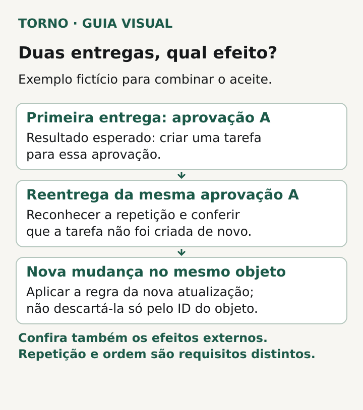
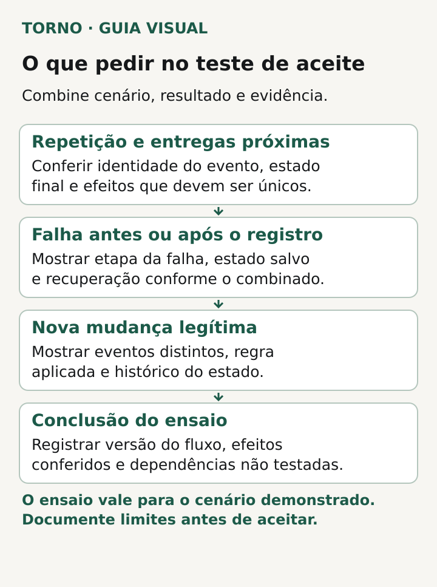

Se uma integração recebe **a mesma notificação duas vezes**, a segunda entrega não deveria criar de novo o efeito de negócio que a primeira já concluiu. Para contratar e aceitar esse comportamento, descreva **qual evento pode se repetir, como ele será reconhecido, que resultado deve aparecer e como o fornecedor demonstrará isso**. A resposta depende das regras dos sistemas envolvidos; “não duplica” sem um cenário de teste é vaga demais.

Uma reentrega pode ocorrer mesmo que o sistema de origem tenha feito uma única mudança. A [documentação do Asaas informa que seus webhooks usam entrega *at least once*](https://docs.asaas.com/docs/como-implementar-idempotencia-em-webhooks): o mesmo evento pode ser enviado mais de uma vez. A [Stripe também descreve a possibilidade de um endpoint receber o mesmo evento repetido](https://docs.stripe.com/webhooks). Esses são comportamentos documentados desses provedores, não prova de que a integração da sua empresa usa Asaas, Stripe ou o mesmo formato de evento.

## Descreva a ação que não pode acontecer duas vezes

**Exemplo inteiramente fictício:** um sistema envia a confirmação de que uma solicitação foi aprovada. O outro sistema cria uma tarefa para atendê-la. A confirmação volta a chegar, com a mesma identidade de evento. O efeito combinado pode ser: **uma tarefa para aquela aprovação**, com a segunda entrega reconhecida como repetição. Se também houver aviso por e-mail ou outra alteração, decida se esse efeito deve ocorrer uma vez e como será conferido. O exemplo é fictício; não descreve um cliente nem uma integração da Torno.

Comece pela linguagem do negócio. “Receber duas vezes” é uma condição técnica; “abrir duas tarefas para a mesma aprovação” é o erro que a pessoa responsável reconhece. Escreva o estado esperado depois da primeira entrega e depois da repetição. Inclua o que o usuário vê e eventuais ações externas, como aviso ou criação de registro em outro serviço. É possível evitar duplicação na tabela principal e ainda repetir um efeito lateral.

*Exemplo fictício de resultado a combinar: conferir o efeito da repetição e distinguir uma atualização legítima. Crédito: Torno Studio.*

Essa discussão complementa o [briefing de integração com ERP](https://tornostudio.com/blog/integracao-erp-briefing-orcamento/), que levanta sistemas, campos, responsabilidades e limites antes do orçamento. Aqui a pergunta é mais estreita: qual comportamento será aceito quando a entrega se repetir?

## Pergunte como a repetição será identificada

Peça ao fornecedor que mostre qual identificador o sistema de origem fornece e o que ele significa. No Asaas, a [documentação indica que uma reentrega mantém o mesmo `id` do evento](https://docs.asaas.com/docs/como-implementar-idempotencia-em-webhooks). A Stripe orienta [registrar IDs de eventos já processados](https://docs.stripe.com/webhooks) e explica que, em certos casos, dois objetos de evento distintos podem representar a mesma ocorrência; para esse caso específico, recomenda olhar também o ID do objeto associado e o tipo do evento. **A regra da sua integração deve vir da documentação e dos dados reais do provedor escolhido.**

Não confunda **a mesma entrega repetida** com **uma nova mudança legítima no mesmo cadastro ou pedido**. Se o objeto recebeu outra atualização, uma regra ampla que descarta tudo com o mesmo ID de objeto pode perder informação. Registre qual combinação de identidade, tipo e estado diferencia as duas situações. A [AWS Well-Architected alerta para o uso inconsistente de chaves e para chaves baseadas em horário](https://docs.aws.amazon.com/wellarchitected/latest/framework/rel_prevent_interaction_failure_idempotent.html). O responsável técnico escolhe e justifica o mecanismo; o comprador define o efeito que precisa conferir.

## Faça uma ficha de aceite que inclua falha e nova mudança

Uma ficha curta permite negociar o teste antes da entrega. Em cada linha, combine quem fornece o evento de teste, o estado inicial, o resultado esperado, a evidência e quem vai conferir. A tabela abaixo é um modelo editorial; adapte nomes e ações ao fluxo real.

| Cenário | Resultado de negócio esperado | Evidência a pedir |
|---|---|---|
| Primeira entrega válida | A mudança combinada acontece uma vez. | Registro do evento e estado final do objeto de negócio. |
| Mesma entrega repetida | O estado final permanece correto; ações que deveriam ser únicas não se repetem. | Identificador da repetição, resultado do processamento e conferência dos efeitos. |
| Duas entregas próximas do mesmo evento | O efeito único combinado permanece, ainda que ambas sejam recebidas quase juntas. | Execução controlada e estado final, incluindo efeitos externos relevantes. |
| Falha antes ou depois de registrar o evento | O tratamento e a possibilidade de retomada seguem o combinado, sem perda silenciosa ou repetição indevida. | Etapa em que a falha ocorreu, estado persistido e recuperação demonstrada. |
| Nova mudança no mesmo objeto | A atualização legítima é considerada conforme a regra; não é descartada como cópia da anterior. | Dois eventos distintos, regra aplicada e histórico do estado. |

A [AWS Well-Architected recomenda testar pedidos bem-sucedidos, falhos e duplicados](https://docs.aws.amazon.com/wellarchitected/latest/framework/rel_prevent_interaction_failure_idempotent.html), além de considerar concorrência entre operações. O [Asaas propõe testar duas entregas com o mesmo ID e conferir que a regra de negócio se execute uma vez](https://docs.asaas.com/docs/como-implementar-idempotencia-em-webhooks). Os cenários extras da ficha traduzem essas referências para perguntas do contratante; não são certificação de uma integração específica.

*O teste de aceite reúne cenários, evidências e limites do que foi demonstrado. Crédito: Torno Studio.*

## Registre o que ficou fora do ensaio

Peça uma conclusão precisa: **qual evento, qual versão do fluxo, quais efeitos foram conferidos e quais dependências não entraram no teste**. Ver dois pedidos com a mesma resposta não demonstra sozinho que um e-mail externo, um lançamento financeiro ou uma fila posterior não repetiu a ação. Também não prova que eventos diferentes cheguem em ordem. A [Stripe informa que a entrega de eventos não tem ordem garantida](https://docs.stripe.com/webhooks); o [Asaas observa que idempotência não define a ordem](https://docs.asaas.com/docs/como-implementar-idempotencia-em-webhooks). Se a ordem importa, abra essa decisão como requisito próprio.

Não coloque chaves, segredos ou dados reais de usuários na ficha pública de aceite. Identificadores de teste, estados e evidências protegidas devem bastar para a conversa, com o detalhe técnico guardado no ambiente autorizado. Se ainda não há documentação do evento ou acesso a ambiente de teste, registre a pendência antes de prometer o comportamento.

Os [critérios de aceite de MVP](https://tornostudio.com/blog/criterios-aceite-mvp/) mostram como transformar uma frase vaga em comportamento verificável. Se uma duplicação já ocorreu ocasionalmente no produto em uso, o roteiro para [registrar um erro intermitente](https://tornostudio.com/blog/erro-intermitente-software-evidencias/) ajuda a preservar o relato sem presumir causa.

Na Torno, Henrique é o fundador e responsável técnico pela conversa de escopo. Traga o nome do evento, o efeito que não pode se repetir e a evidência disponível; isso permite delimitar um teste e as dependências antes de estimar a integração. Nenhuma regra genérica substitui a confirmação do contrato de eventos do sistema concreto.
