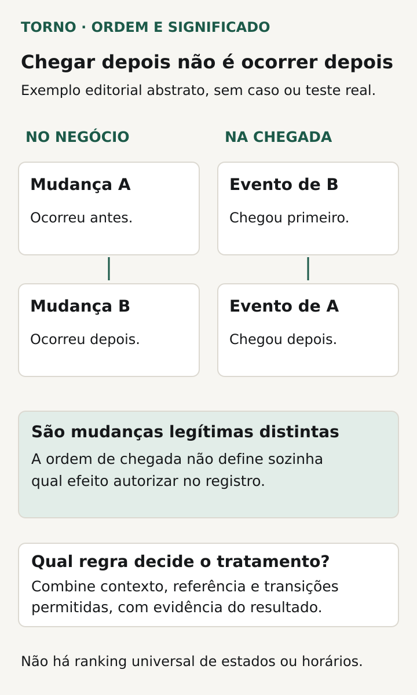
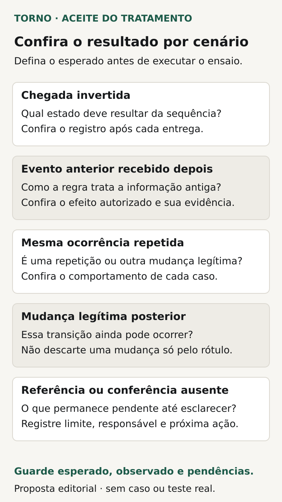

Para aceitar eventos fora de ordem na integração, combine **como o sistema decidirá se uma mudança recebida ainda deve alterar o registro e o que fará quando não houver informação suficiente**. A última mensagem recebida não é necessariamente a que representa o estado atual do negócio.

O problema aparece quando mudanças diferentes sobre o mesmo objeto chegam numa sequência distinta da que interessa ao processo. Uma notificação anterior pode chegar depois de uma confirmação mais recente. Aplicar seu conteúdo sem a regra adequada pode recolocar o registro num estado que já não corresponde à operação.

Este roteiro propõe decisões e evidências para compradores de software sob medida. O responsável técnico avalia os dados disponíveis e escolhe o mecanismo; o responsável pelo processo valida o resultado esperado e o tratamento das dúvidas.

## Separe ordem de chegada, mudança e repetição

Uma duplicata é a reentrega da mesma ocorrência, conforme a identidade definida pelo provedor. Um evento anterior recebido tarde pode ser uma ocorrência diferente, ainda que se refira ao mesmo pedido. São perguntas distintas para o contrato da integração.

O roteiro de [eventos duplicados](https://tornostudio.com/blog/integracao-evento-duplicado-regra-negocio/) aprofunda o efeito que não deve se repetir. Aqui, o foco é decidir o tratamento de mudanças diferentes. Uma regra que descarta tudo após o primeiro evento de um objeto pode impedir atualizações legítimas.

A [Stripe informa que não garante a ordem de entrega dos eventos](https://docs.stripe.com/webhooks). O [Amazon S3](https://docs.aws.amazon.com/AmazonS3/latest/userguide/notification-how-to-event-types-and-destinations.html) e o [Azure Event Grid](https://learn.microsoft.com/en-us/azure/event-grid/delivery-and-retry) também documentam ausência dessa garantia em seus serviços. São exemplos reais de por que consultar o contrato da origem; não implicam que sua integração use esses fornecedores.

## Escolha a fonte de referência para cada decisão

Nomeie o objeto e os campos que a integração mantém: estado de uma solicitação, disponibilidade de um documento ou outro resultado. Pergunte qual sistema responde pela informação e se a mensagem descreve uma ocorrência, uma versão do objeto ou um retrato dos dados naquele momento.

O [briefing de integração com ERP](https://tornostudio.com/blog/integracao-erp-briefing-orcamento/) ajuda a localizar sistemas e responsáveis. Para esta decisão, acrescente qual referência permite interpretar a precedência e o alcance de cada mudança. Um identificador de evento pode reconhecer a ocorrência sem informar sua posição na evolução do cadastro.

Peça ao fornecedor que mostre a documentação e exemplos do provedor, sem expor segredos ou dados reais. Se a API permitir consultar o estado atual, explique o que essa consulta confirma e quais limites existem. Se não houver uma referência suficiente, registre a lacuna e o procedimento necessário antes de prometer o resultado.

## Não transforme horário em regra universal de precedência

Pergunte o que cada data significa: geração do evento, ocorrência no negócio, atualização do objeto ou recebimento local. Esses momentos não devem ser considerados equivalentes sem confirmação. O roteiro de [datas e fusos](https://tornostudio.com/blog/datas-fusos-sistema-prazos-relatorios/) trata dessa semântica temporal.

A [Stripe alerta que eventos snapshot distintos podem compartilhar o mesmo created em segundos](https://docs.stripe.com/webhooks) e orienta não usar esse campo para decidir sua ordem. Essa limitação pertence ao contrato documentado. Ela ilustra por que “comparar a data e ficar com a maior” não pode ser aceito como explicação universal.

O responsável técnico deve justificar a referência usada no sistema concreto. Pode haver versões, sequências com alcance definido, consulta autorizada ou outro mecanismo apropriado. O comprador precisa de exemplos que demonstrem a decisão, não de uma lista de tecnologias.

## Defina quais transições são legítimas

Escreva o resultado esperado para um evento que representa uma condição já superada. A integração preservará o estado atual, fará uma conferência adicional ou manterá o item pendente? Combine também o destino de informações úteis do evento que não devem ser confundidas com uma alteração válida do estado.

Evite criar uma escala universal em que alguns estados sempre vencem os outros. Uma nova mudança legítima pode cancelar, reabrir ou corrigir algo, se o processo permitir. O contrato precisa distinguir essa mudança de uma notificação antiga, sem bloquear a operação por uma regra ampla demais.

Inclua os efeitos associados: mensagem, liberação de tarefa ou chamada a outro serviço. Preservar o campo principal não basta se a notificação antiga ainda dispara uma consequência indevida. Peça ao fornecedor que relacione a decisão sobre o evento aos efeitos que serão conferidos.

| Decisão | Pergunta para o acordo |
|---|---|
| Objeto e origem | A qual registro e sistema a mudança pertence? |
| Significado | A mensagem descreve ocorrência, versão ou retrato? |
| Referência | Qual informação sustenta a decisão sobre o estado? |
| Evento anterior | O que deve permanecer e o que pode ser aplicado? |
| Mudança legítima posterior | Como distingui-la de uma condição superada? |
| Informação insuficiente | Qual pendência será registrada e quem poderá resolvê-la? |
| Efeitos | Que ações adicionais podem ou não acontecer? |

*Ordem de ocorrência e ordem de chegada são perguntas distintas para o contrato da integração. Diagrama original Torno Studio, 2026.*

## Veja um exemplo de solicitação atualizada

**Exemplo inteiramente fictício:** a origem registra uma solicitação SOL-A como recebida e, depois, confirmada. A integração recebe primeiro a confirmação e só mais tarde a notificação anterior de recebimento. As duas mensagens são diferentes e se referem à mesma solicitação.

O acordo hipotético prevê usar a referência definida no contrato da origem para reconhecer a condição anterior. O resultado esperado é manter SOL-A confirmada e não executar uma consequência que só faria sentido ao entrar no estado de recebimento. A evidência precisa mostrar o registro final e os efeitos relevantes.

Outro cenário traz uma nova mudança válida de cancelamento, admitida pela regra do processo. Ela não deve ser descartada simplesmente porque a solicitação já foi confirmada. **Fim do exemplo fictício; não representa cliente, implementação ou teste da Torno.**

O exemplo não exige que a origem forneça um campo específico nem escolhe um algoritmo. Se os dados reais não permitirem sustentar a distinção, o fornecedor deve apresentar a alternativa e seus limites, em vez de afirmar que o comportamento já está garantido.

## Mantenha a dúvida visível até a conferência

Combine o que acontece quando falta informação, há referências incompatíveis ou uma consulta necessária está indisponível. O sistema precisa apresentar um estado coerente com o conhecimento disponível. Uma pendência não deve ser anunciada como confirmação de que o evento era antigo ou de que seu conteúdo foi aplicado corretamente.

Defina quem pode investigar, qual informação consulta e como registra a conclusão. O roteiro de [alertas para o fluxo crítico](https://tornostudio.com/blog/monitoramento-software-alertas-fluxo-critico/) ajuda a encaminhar o problema quando houver necessidade de ação humana. Esse acompanhamento precisa de responsabilidade e cobertura combinadas.

Se houver reprocessamento, peça que o procedimento considere o estado encontrado naquele momento e os efeitos já conhecidos. A revisão de uma pendência não autoriza reenviar indiscriminadamente mensagens ou executar novamente ações externas.

## Teste sequências diferentes com resultado esperado explícito

Prepare eventos fictícios no [ambiente de homologação](https://tornostudio.com/blog/ambiente-homologacao-conferir-antes-testar-sistema/), com origem, destinos e efeitos autorizados. O responsável técnico deve definir como variar a ordem de forma controlada, sem interferir na operação real.

Transforme as decisões em [critérios de aceite](https://tornostudio.com/blog/criterios-aceite-mvp/). Registre o estado inicial, as referências disponíveis e o resultado esperado antes de cada execução.

| Cenário | Evidência a conferir |
|---|---|
| Mudanças na sequência prevista | Estado e efeitos correspondentes ao contrato |
| Mudança anterior recebida depois | Tratamento da condição superada sem efeito indevido |
| Mesma ocorrência repetida | Comportamento distinto da análise de precedência |
| Mudança legítima posterior | Atualização permitida conforme a regra do processo |
| Referência ausente ou insuficiente | Pendência e encaminhamento explícitos |
| Conferência externa indisponível | Resultado conhecido separado da avaliação ainda aberta |

*Perguntas propostas para conferir resultados, efeitos autorizados e pendências em cada cenário. Diagrama original Torno Studio, 2026.*

Compare o resultado de sequências que o contrato considera equivalentes. Guarde versão, dados de teste, ordem de recebimento, decisões e efeitos observados. Se a origem foi simulada, registre o limite: testar o tratamento não comprova todo o comportamento do provedor real.

Para a [conversa inicial com Henrique](https://tornostudio.com/diagnostico/), leve os eventos documentados, o estado que precisa ser preservado e uma sequência que produz dúvida. Isso permite delimitar regras, dependências e evidências da entrega sem prometer ordenar todas as mensagens ou escolher uma tecnologia antes de conhecer o fluxo.

*Fontes consultadas em 29 de outubro de 2026. A ficha e o exemplo são propostas editoriais originais para adaptação ao produto.*
