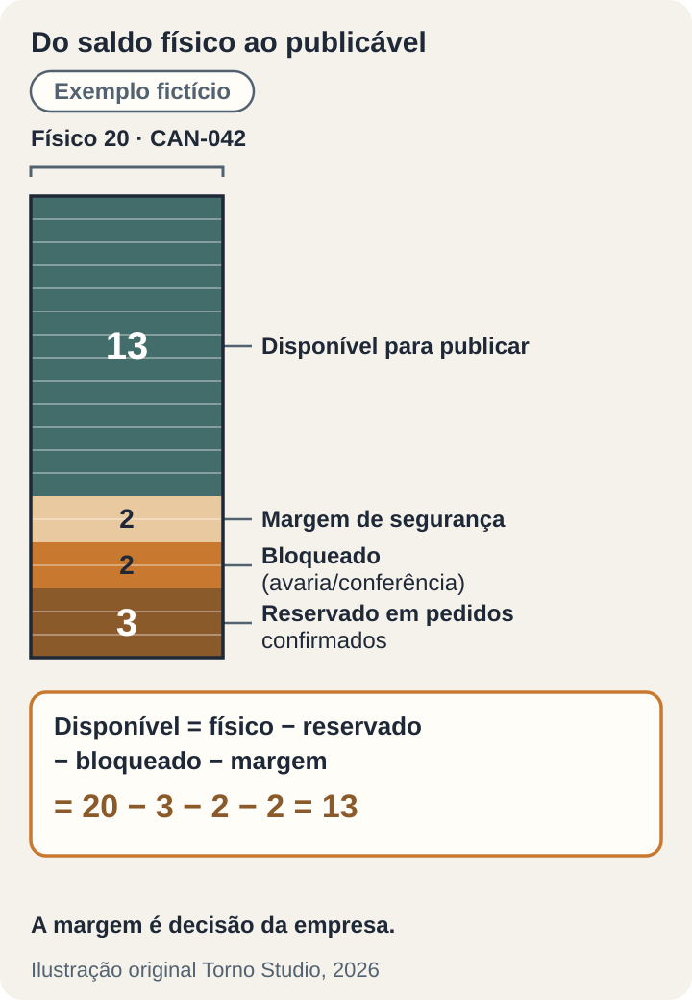

*Leitura estimada: 10 minutos.*

**Antes de aceitar a integração do seu sistema com um marketplace, defina quem é o dono do estoque, como o sistema calcula o saldo que pode ser publicado, em que momento um pedido reserva e em que momento baixa, e o que acontece quando dois canais vendem a última unidade.** No aceite, peça para ver, em ambiente de teste, um pedido fictício entrar por notificação, reservar, ser cancelado, voltar ao estoque e ter o anúncio pausado e reativado, com o registro de cada passo.

**Este artigo não recomenda hub, ERP nem integrador.** Os exemplos usam o Mercado Livre porque a documentação para desenvolvedores é pública; as regras citadas vêm dessa documentação, consultada em 09/11/2026. Várias páginas não têm data ou estão em versões de outros países; confirme o comportamento atual com a documentação e com a sua conta antes de especificar.

## Primeiro: quem é o dono do estoque

Uma integração de estoque entre sistema e marketplace sem dono definido vira duas planilhas brigando. Escolha uma fonte da verdade, em geral o seu sistema, porque é ele que vê o balcão, a loja própria e o depósito. O marketplace recebe um número calculado e devolve pedidos.

A exceção é o estoque guardado no armazém do marketplace. No Mercado Livre, o estoque Full aparece como `meli_facility`, é gerido pelo Fulfillment e, segundo a [página de convivência entre Full e Flex](https://developers.mercadolivre.com.br/en_us/full-and-flex-coexistence), não pode ser alterado pela API. A [documentação de estoque distribuído](https://developers.mercadolibre.com.ar/en_us/distributed-stock) (versão argentina, 22/04/2026) acrescenta que esse saldo só aumenta com o envio de mercadoria pelo painel do marketplace. Para esse estoque, o seu sistema é leitor, não dono; o contrato precisa dizer isso e o relatório precisa mostrá-lo separado.

## As camadas do saldo: o que pode ser publicado

O número que vai para o anúncio não é o estoque físico. Uma forma de organizar é separar cinco camadas, com nomes que o seu time reconheça:

- **Físico**: o que está na prateleira, contado.
- **Reservado**: unidades de pedidos já confirmados, em qualquer canal, ainda não expedidas.
- **Bloqueado**: avaria, conferência, mostruário, peça separada para troca.
- **Margem de segurança**: unidades que a empresa decide não publicar para absorver o atraso entre uma venda e a atualização do outro canal.
- **Disponível para publicar**: físico menos reservado, bloqueado e margem.

*Exemplo fictício: SKU e saldos imaginários; as camadas são uma proposta de modelagem, não termos do marketplace. Ilustração original Torno Studio, 2026.*

A margem é decisão de negócio, não técnica. Ela pode ser zero para itens com muito estoque e maior para itens que acabam rápido. Defina quem a altera e se ela vale por SKU, por categoria ou por canal.

O sistema envia o disponível com `PUT /items/{id}` no campo `available_quantity`, segundo a [página de sincronização de anúncios](https://developers.mercadolivre.com.br/en_us/products-sync-listings). Exija que todo movimento que altere qualquer camada recalcule e envie o número, e que o envio fique registrado com o valor e o horário.

## Quando reservar e quando baixar

Pela [página de gestão de vendas](https://developers.mercadolivre.com.br/en_us/manage-sales), `confirmed` é o status inicial do pedido, **mesmo sem pagamento**, e o campo `date_closed` é preenchido quando o pedido passa pela primeira vez a `confirmed` ou `paid` e o item é descontado do estoque do anúncio. Ou seja: o marketplace já tirou a unidade do anúncio antes de o dinheiro entrar.

O seu sistema precisa espelhar isso. Uma regra comum é:

- Pedido `confirmed` → reservar a unidade (sai do disponível, continua no físico).
- Pedido pago e expedido → baixar do físico e da reserva.
- Pedido `cancelled` ou `invalid` → liberar a reserva.

A mesma página descreve a tag `fraud_risk_detected`: o pedido marcado não deve ser enviado e deve ser cancelado. Defina que esse pedido trava a expedição na hora, mesmo que já esteja separado. A separação entre estado do pedido e estado do pagamento está detalhada no artigo sobre [status de pagamento no pedido](https://tornostudio.com/blog/integracao-pagamentos-status-pedido-aceite/).

## A última unidade vendida em dois canais

Sobrou uma unidade do SKU fictício CAN-042, publicado neste caso sem margem de segurança. Um cliente compra no balcão às 14h02min10s; um segundo depois, alguém compra no marketplace, porque o anúncio ainda mostrava 1. Não existe integração que zere esse intervalo; existe regra para ele.

*Exemplo fictício: SKU, horário e canais imaginários. Ilustração original Torno Studio, 2026.*

As opções, que podem ser combinadas:

1. **Reservar no primeiro pedido confirmado.** O registro que chega primeiro ao sistema leva a unidade; o segundo vira exceção.
2. **Publicar com margem.** Com margem de 1, o anúncio já estaria em zero e a corrida não aconteceria; o custo é deixar de vender aquela unidade no marketplace.
3. **Cancelar e avisar.** Se a corrida acontecer, alguém cancela um dos pedidos e avisa o comprador. Defina quem, em quanto tempo e por qual canal; confira nas regras do marketplace o efeito de cancelar uma venda na sua conta.

O raciocínio é o mesmo de uma agenda que não pode aceitar dois clientes no mesmo horário; veja [sistema de agendamento sem reserva dupla](https://tornostudio.com/blog/sistema-agendamento-reserva-dupla-aceite/).

## Carrinho com vários pedidos

Um comprador pode levar vários itens de uma vez. O campo `pack_id` identifica o carrinho e a tag `pack_order` marca o pedido que pertence a um, segundo a [página de carrinho](https://developers.mercadolivre.com.br/en_us/shopping-cart-order-handling); a [página de packs](https://developers.mercadolibre.com.ar/en_us/packs-management) (versão argentina, 11/03/2025) diz que um pack pode ter um ou vários pedidos.

Para o estoque, cada pedido reserva os seus itens. Para a operação, o sistema deve mostrar os pedidos do mesmo carrinho juntos, para separar e expedir de uma vez. A documentação consultada não descreve o cancelamento de só um pedido do carrinho, então trate isso como cenário a testar: um pedido cancelado libera só a sua reserva, e os outros seguem.

## Estoque zero, pausa e reativação

Pela página de sincronização, enviar `available_quantity` igual a 0 deixa o anúncio `paused` com sub-status `out_of_stock` (para item novo e anúncio que não seja gratuito), e enviar um valor maior que zero o reativa. Isso é útil, mas tem um efeito colateral: se a margem ou um bloqueio levar o disponível a zero, o anúncio pausa mesmo com mercadoria na prateleira. Defina se isso é desejado e mostre, na tela do produto, por que o anúncio está pausado.

Se a conta usa User Products, a [página do recurso](https://developers.mercadolivre.com.br/en_us/user-products) diz que os anúncios ligados ao mesmo produto compartilham o estoque. Ela é de 2024 e previa ativação progressiva no Brasil em 2025; confira o estado da sua conta. O mesmo vale para o estoque distribuído, cuja edição pela API a página argentina indica só para Argentina e Chile; a disponibilidade no Brasil não foi verificada para este artigo. Nesse modelo, cada alteração exige a versão da última consulta (cabeçalho `x-version`) e uma versão desatualizada retorna 409; o sistema precisa consultar de novo e recalcular, não repetir o envio.

## Cancelamento e devolução: quando o item volta

Cancelamento antes da expedição libera a reserva. Devolução é outra coisa: a mercadoria precisa chegar e ser conferida. Reclamações e devoluções chegam pelo tópico `claims`; pela [documentação de devoluções](https://developers.mercadolibre.com.ar/en_us/ml-returns) (versão argentina, 25/03/2024), quando a devolução vai a armazém e o produto é classificado como `saleable`, a reposição do estoque é automática; para `unsaleable` e `discard`, a página não indica reposição. Esse contexto parece ser o do estoque guardado pelo marketplace, e a página tem mais de dois anos.

Para o estoque do vendedor, uma regra possível: item devolvido entra como **bloqueado** e só passa a disponível depois da conferência, por uma pessoa com permissão para isso.

## Notificações: o aviso traz o endereço, não o dado

Pela [página de notificações](https://developers.mercadolivre.com.br/en_us/products-receive-notifications) (atualizada em 23/06/2026), há tópicos como `orders_v2`, `items`, `items_prices`, `shipments`, `claims` e `stock_locations`. O aviso traz identificadores (`resource`, `topic`, `user_id`, `attempts`, horários em UTC), não o pedido completo. A orientação é confirmar o recebimento e consultar o recurso indicado.

Três exigências saem daí:

- **Responder rápido e processar depois.** O endereço de retorno deve responder HTTP 200 em até 500 milissegundos. Sem isso, a notificação é reenviada dentro de uma janela de 1 hora e depois descartada, e os tópicos podem ser desativados. Processar o pedido dentro dessa resposta é pedir para perder avisos.
- **Recuperar perdidos.** A página indica a consulta `/missed_feeds` para notificações não entregues.
- **Reconciliar.** Uma rotina periódica compara pedidos, anúncios e saldos do sistema com o marketplace e aponta divergências, porque aviso perdido não gera alerta sozinho.

Aviso repetido não pode baixar estoque duas vezes, e aviso fora de ordem não pode reabrir um pedido cancelado; esses dois casos estão em [eventos duplicados](https://tornostudio.com/blog/integracao-evento-duplicado-regra-negocio/) e [eventos fora de ordem](https://tornostudio.com/blog/integracao-eventos-fora-ordem/).

## Preço, tokens e limite de requisições

**Preço** segue a mesma lógica do estoque: defina quem é o dono. Se alguém altera o preço no painel do marketplace, o sistema sobrescreve na próxima sincronização ou registra a divergência? A lista de tópicos de notificação inclui `items_prices`; confirme na documentação o que ele avisa antes de depender dele.

**Tokens.** Pela [página de autenticação](https://developers.mercadolivre.com.br/en_us/authentication-and-authorization), o `access_token` tem validade curta, e a própria página indica prazos diferentes no texto e no exemplo; o sistema deve usar o `expires_in` devolvido, não um número fixo. O `refresh_token` é de uso único: cada renovação devolve um novo, que precisa ser guardado antes de qualquer outra coisa, e ele expira em 6 meses. Se a renovação falhar, a integração para em silêncio; isso pede alerta, como em [monitoramento do fluxo crítico](https://tornostudio.com/blog/monitoramento-software-alertas-fluxo-critico/).

**Excesso de requisições.** O erro 429 `local_rate_limited` indica requisição recusada temporariamente por excesso de chamadas. Não especifique um número de chamadas por minuto a partir de blogs; especifique o comportamento: esperar, tentar de novo e não perder a atualização. O detalhe está em [limites de API](https://tornostudio.com/blog/limites-api-integracao-cota/).

## Critérios de aceite com dados fictícios

**Início do exemplo fictício.** Uma loja de utilidades vende no balcão, na loja própria e no Mercado Livre. O SKU CAN-042 tem físico 20, reservado 3, bloqueado 2 e margem 2; o disponível publicado é 13. Os ensaios rodam no [ambiente de teste](https://tornostudio.com/blog/ambiente-homologacao-conferir-antes-testar-sistema/), com conta e anúncios de teste.

| Cenário | Resultado esperado | Evidência |
|---|---|---|
| Saldo inicial do CAN-042 | Anúncio mostra 13 | Registro do envio com valor e horário |
| Venda de 2 no balcão | Disponível vai a 11 e é enviado | Registro do movimento e do novo envio |
| Pedido `confirmed` sem pagamento no marketplace | Reserva de 1; disponível 10; nada expedido | Pedido no sistema com estado e reserva |
| Mesmo aviso de pedido recebido duas vezes | Uma reserva só | Registro do aviso repetido ignorado |
| Pedido cancelado antes da expedição | Reserva liberada; disponível volta | Histórico do pedido e do saldo |
| Pedido com `fraud_risk_detected` | Expedição bloqueada; pedido marcado para cancelamento | Tela do pedido e alerta ao responsável |
| Carrinho com dois pedidos, um cancelado | Só a reserva do cancelado é liberada; os dois aparecem ligados pelo `pack_id` | Tela do carrinho e saldos |
| Última unidade vendida no balcão e no marketplace | Regra combinada aplicada; exceção aberta para o segundo pedido | Registro da exceção com responsável |
| Disponível chega a 0 | Anúncio pausado por falta de estoque; tela mostra o motivo | Estado do anúncio e registro do envio |
| Reposição de 10 unidades | Anúncio reativado com o novo disponível | Estado do anúncio e registro do envio |
| Devolução recebida | Item entra como bloqueado até conferência | Movimento e usuário que liberou |
| Preço alterado no painel do marketplace | Regra combinada aplicada (sobrescrever ou registrar divergência) | Registro da alteração |
| Endereço de retorno fora do ar por 2 horas | Pedidos do período recuperados pela reconciliação ou por `/missed_feeds` | Relatório de divergências |
| Renovação de token falha | Alerta ao responsável; nenhuma atualização perdida após a correção | Alerta e reenvio registrado |

*Fim do exemplo fictício. Loja, SKU, saldos e critérios são um modelo editorial, não um teste executado em sistema real.*

## Perguntas frequentes

### Basta sincronizar o estoque a cada poucos minutos?

Não resolve sozinho. Entre uma sincronização e outra, os dois canais podem vender a mesma unidade. A sincronização frequente reduz o intervalo; a margem e a regra para a última unidade decidem o que acontece dentro dele.

### O pedido do marketplace pode ser expedido quando chega?

Não necessariamente. Ele nasce `confirmed` mesmo sem pagamento. Defina em que estado ele libera a separação e a expedição.

### Posso controlar pelo meu sistema o estoque que está no Full?

Pela API, não: segundo a documentação, esse estoque é gerido pelo marketplace e não pode ser alterado por ela. O sistema pode consultá-lo e mostrá-lo separado.

Para transformar a regra de estoque da sua empresa em requisitos e cenários de teste, leve à [conversa de diagnóstico com Henrique](https://tornostudio.com/diagnostico/) a lista de canais em que vende, como o estoque é contado hoje e os casos que já geraram venda sem mercadoria, sem dados reais de clientes.

*Fontes consultadas em 9 de novembro de 2026, na documentação do Mercado Livre Developers. Este artigo não recomenda hub, ERP, integrador nem marketplace; loja, SKU, saldos, pedidos e ilustrações são modelos editoriais fictícios.*
