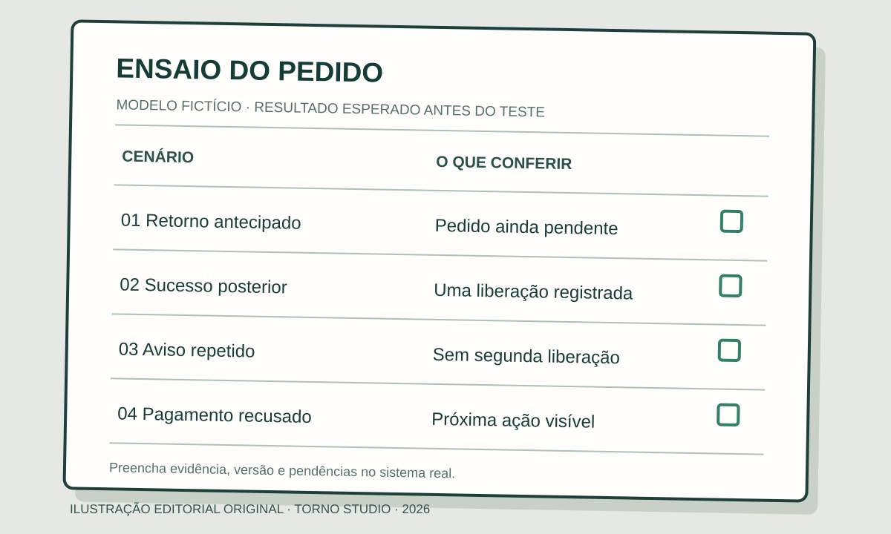

**Um pedido não deve ser apresentado como pago só porque o cliente chegou à tela de retorno do checkout.** Para aceitar a integração, combine qual confirmação do provedor muda o estado do pedido, o que aparece enquanto a resposta está pendente e como a equipe encontra pagamentos que precisam de conferência.

Este guia é para quem contrata um portal, MVP ou ferramenta interna com pagamentos. Ele ajuda a transformar “integrar o checkout” em resultados verificáveis. Os nomes dos estados e as ações finais devem ser definidos para o seu processo e para a documentação do provedor escolhido.

## Separe estado do pedido de estado do pagamento

O sistema pode ter um pedido **recebido** antes de saber se haverá pagamento. O provedor pode ter uma tentativa **em processamento**, **aprovada** ou **recusada**, conforme o produto. A [documentação do Mercado Pago distingue, por exemplo, `approved`, `authorized` à espera de captura e `in_process`](https://www.mercadopago.com.br/developers/pt/docs/checkout-api-payments/response-handling/query-results). Esses termos não são sinônimos e tampouco formam uma tabela universal para todo provedor.

Escreva duas colunas no escopo: o estado informado pelo provedor e o estado que o usuário verá no seu sistema. Para cada relação, pergunte se a equipe pode separar estoque, liberar acesso, iniciar atendimento ou emitir uma confirmação. Uma autorização sem captura, por exemplo, não deve ser chamada automaticamente de pagamento concluído só porque seu fluxo mostra uma tela de sucesso.

*Ilustração original Torno Studio, 2026. Pedido e carimbos são fictícios; não representam a interface de um provedor.*

O critério de aceite precisa declarar o resultado esperado para cada combinação relevante. “Pedido confirmado” deve corresponder a uma regra escrita, não ao nome de uma página que o comprador viu uma vez.

## Defina a fonte da confirmação

O retorno do navegador pode falhar, ser fechado ou chegar antes da conclusão do pagamento. A [Stripe orienta tratar eventos assíncronos para concluir pedidos, inclusive quando o sucesso ocorre depois](https://docs.stripe.com/checkout/fulfillment.md?ui=full-page). O [Mercado Pago documenta notificações de criação e mudança de estado](https://www.mercadopago.com.br/developers/pt/docs/checkout-pro-preferences/payment-notifications) em uma de suas integrações. São exemplos de capacidades documentadas por provedores, não evidência de que qualquer sistema já esteja integrado.

Peça ao responsável técnico que indique, para o produto escolhido, qual informação é consultada ou recebida, como a origem é validada e como a atualização é vinculada ao pedido correto. O comprador não precisa escolher a arquitetura sozinho, mas deve conseguir verificar a regra de negócio: **qual evento ou consulta autoriza cada mudança de estado?**

Se uma confirmação chegar duas vezes, o pedido deve conservar o resultado combinado sem duplicar uma liberação ou outra ação. O artigo sobre [eventos duplicados em integrações](https://tornostudio.com/blog/integracao-evento-duplicado-regra-negocio/) aprofunda essa questão; aqui, a pergunta específica é se a repetição do aviso de pagamento produz uma segunda consequência no pedido.

## Planeje o intervalo em que nada foi confirmado

Quando o comprador conclui sua ação, mas a confirmação ainda não chegou, mostre uma situação compreensível: “pagamento em análise”, “aguardando confirmação” ou outra frase aprovada para aquele método. Não use “pago” como sinônimo de “solicitação enviada”. Defina também onde o usuário poderá consultar o pedido depois de sair da página.

Estabeleça o que acontece se a notificação atrasar ou não for processada. O sistema oferecerá uma consulta de estado? A equipe verá uma pendência com identificador? Quem pode investigar e qual evidência deve guardar? Essas são decisões de escopo; nenhum prazo de confirmação pode ser presumido sem o contrato e o método de pagamento concreto.

O [guia de ambiente de homologação](https://tornostudio.com/blog/ambiente-homologacao-conferir-antes-testar-sistema/) ajuda a separar ensaios de operação real. Use dados fictícios e o modo de teste documentado pelo provedor; uma simulação de resposta verifica apenas o caminho que de fato percorreu.

## Escreva um pequeno contrato de estados

Uma tabela simples torna o pedido de orçamento mais preciso. Ajuste-a ao método de pagamento e à operação antes de usá-la como critério de aceite.

| Situação observada | Estado visível proposto | Ação a verificar |
|---|---|---|
| Pedido criado, sem confirmação | Aguardando pagamento | Não liberar a etapa dependente de pagamento |
| Provedor informa processamento | Confirmação pendente | Preservar pedido e indicar onde acompanhar |
| Provedor confirma o estado acordado para sucesso | Pago ou confirmado, conforme regra | Executar uma vez a ação autorizada |
| Provedor informa recusa | Pagamento não concluído | Explicar próxima ação sem marcar como pago |
| Resultado ainda desconhecido após falha de comunicação | Pendente de conferência | Localizar tentativa e reconciliar com o provedor |

Esta é uma **proposta editorial**, não uma descrição de um produto existente. Para alguns fluxos, “autorizado” pede captura posterior; para outros, reembolso ou contestação traz estados adicionais. Inclua-os somente quando fizerem parte do processo contratado e confirme os significados na documentação do provedor.

## Teste com pedidos fictícios e resultados observáveis

**Exemplo inteiramente fictício:** um portal recebe o Pedido 042. A pessoa chega ao checkout e volta ao portal antes de o pagamento ser confirmado. O pedido aparece como “aguardando confirmação”. Mais tarde, o ambiente de teste entrega o resultado de sucesso. O portal o mostra como confirmado e libera uma única vez a próxima etapa combinada. Um segundo envio do mesmo aviso não cria outra liberação. **Fim do exemplo fictício.**

*Folha de ensaio original Torno Studio, 2026. Os pedidos são fictícios e não comprovam teste executado.*

No aceite, peça evidências para o retorno antes da confirmação, sucesso posterior, recusa e repetição do aviso. Acrescente uma falha controlada de comunicação e confira como a equipe encontra a situação pendente. Para cada cenário, guarde identificador fictício, estado no provedor de teste, estado na aplicação e ação executada. O [roteiro de critérios de aceite](https://tornostudio.com/blog/criterios-aceite-mvp/) ajuda a escrever o resultado esperado antes do ensaio.

Não basta apresentar um print da tela final. A demonstração deve permitir comparar o pedido ao registro do provedor no ambiente autorizado, inclusive quando a resposta ainda não é conclusiva. Se uma etapa depender de outra integração, registre o que foi testado e o que ficou fora.

## Leve as decisões para o briefing

Antes de contratar, reúna o método de pagamento pretendido, os estados que importam para a operação, as ações dependentes de confirmação e quem acompanhará pendências. Peça ao fornecedor que explique limites, tratamento de falha e evidências que usará no aceite. Na [conversa de diagnóstico com Henrique](https://tornostudio.com/diagnostico/), esse material ajuda a delimitar o fluxo e estimar a integração sem presumir uma implementação pronta.

## Perguntas frequentes

### A tela de sucesso do checkout confirma que o pedido está pago?

Ela confirma a navegação do usuário até aquela tela; a regra de confirmação do pagamento depende do estado verificado no provedor e do método contratado. Teste o retorno antecipado e a confirmação posterior.

### E se o aviso de pagamento chegar duas vezes?

Combine o resultado esperado antes do desenvolvimento e teste o mesmo aviso repetido. A segunda chegada não deve repetir a ação de negócio que já foi concluída para aquele pedido.

### O que mostrar enquanto o pagamento está pendente?

Uma situação clara, um identificador do pedido e um caminho para acompanhar ou obter ajuda. Evite chamar a pendência de pagamento concluído.

*Fontes primárias consultadas em 4 de novembro de 2026. Tabelas, pedidos e imagens são modelos editoriais fictícios.*
