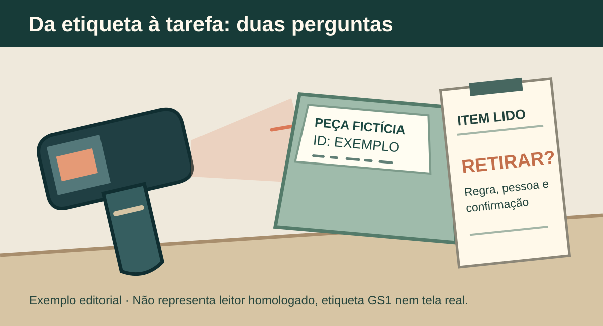

**Para integrar um leitor de código de barras ao sistema, comece pela tarefa que acontecerá depois da leitura.** Identificar um produto, confirmar uma retirada e registrar o recebimento de um lote são ações diferentes. O leitor fornece dados; a aplicação precisa reconhecer esses dados, conferir a regra da operação e mostrar o que foi efetivamente registrado.

Antes de comprar equipamentos ou pedir um orçamento de software, reúna etiquetas reais e descreva uma atividade que a equipe executa hoje. Isso permite testar compatibilidade e comportamento sem pressupor que qualquer scanner servirá para qualquer código.

## O que a etiqueta identifica?

O [GTIN identifica um item comercial; o código de barras é uma representação que pode ser lida por equipamento](https://www.gs1br.org/solicitar-codigo-de-barras), segundo a GS1 Brasil. Esse número pode ajudar a encontrar o cadastro correspondente, mas não informa sozinho que uma unidade saiu do estoque, quem a retirou ou para onde foi.

Pergunte qual dado a operação precisa. Basta identificar o tipo de produto? É necessário distinguir **lote, número de série, validade ou unidade física**? A [GS1 usa Identificadores de Aplicação para representar atributos adicionais](https://ref.gs1.org/ai/) além do GTIN, incluindo lote e série. A existência desse padrão não faz essas informações aparecerem automaticamente: é preciso conferir quais etiquetas estão realmente em uso e quais dados cada uma contém.

Pode haver também códigos internos da empresa. Separe-os dos padrões GS1 e documente quem mantém o cadastro que relaciona cada código ao item. Uma leitura tecnicamente bem-sucedida pode retornar um valor que o sistema ainda não conhece.

*A leitura identifica dados; o movimento depende da regra e da confirmação acordadas. Exemplo ilustrativo, sem equipamento ou cliente real. Ilustração original Torno Studio, 2026.*

## Defina onde a leitura entra no trabalho

**Exemplo inteiramente fictício:** um técnico retira uma peça do almoxarifado para atender uma ordem de serviço. Ele lê a etiqueta, confere a descrição e informa a quantidade. O sistema verifica a ordem e pede confirmação. Só então registra a retirada e mostra uma referência para consulta posterior.

Nesse cenário, o código não deveria concluir a movimentação apenas porque alguém apontou o leitor para a peça. É preciso decidir o que ocorre quando a ordem está fechada, a peça não está cadastrada, a quantidade não está disponível ou o mesmo código é lido duas vezes. Um erro claro, que permita corrigir a pendência, é parte da entrega.

**Fim do exemplo fictício.** Não descreve um cliente, dispositivo ou sistema desenvolvido pela Torno.

Faça a mesma descrição para recebimento, conferência ou inventário, se essas tarefas também entrarem no projeto. Cada uma pode pedir campos e regras diferentes. Evite contratar “leitura em todas as telas” sem especificar em quais ações ela melhora o trabalho.

## Teste o equipamento com o aplicativo escolhido

O modo de entregar a leitura à aplicação varia. Como exemplo de fabricante, o [DataWedge 14 da Zebra pode enviar os dados processados como uma sequência de teclas](https://techdocs.zebra.com/datawedge/14-0/guide/output/keystroke/), simulando digitação, e permite configurar caracteres como Enter ou Tab. Essa documentação descreve um modo específico de um produto Zebra; não comprova que o navegador, aparelho e sistema do seu projeto funcionarão da mesma maneira.

Registre modelo do leitor, dispositivo que executa o sistema, tipo de etiqueta e local de uso. Leve amostras de etiquetas legíveis e difíceis de ler. Confira se o valor chega completo ao campo certo, se a aplicação não dispara uma ação por engano e o que acontece quando há duas leituras rápidas. O teste deve usar o conjunto que a operação adotará, não apenas um código demonstrativo impresso para a reunião.

Se o trabalho será feito com conexão instável, especifique o comportamento separadamente. Guardar uma leitura no aparelho não significa que a retirada chegou ao servidor; o [guia sobre uso sem internet](https://tornostudio.com/blog/sistema-sem-internet-dados-sincronizacao/) ajuda a formular essa condição.

## Combine um ensaio de aceite antes da compra

Uma folha curta pode registrar etiqueta, equipamento, tarefa, resultado esperado e resultado observado. Inclua pelo menos um caso normal e casos de erro: código desconhecido, leitura parcial ou ilegível, item incorreto e repetição. Teste também quem tem permissão para confirmar a ação e como ela aparece no sistema de destino.

*O ensaio compara dados capturados e resultado operacional esperado; símbolos ilustrativos não são códigos válidos. Ilustração original Torno Studio, 2026.*

O ensaio não precisa cobrir todos os produtos no primeiro dia, mas deve incluir os tipos de etiqueta e as condições críticas para a atividade contratada. O artigo sobre [erros na importação de planilhas](https://tornostudio.com/blog/importacao-planilhas-sistema-tratar-erros/) trata de outra entrada de dados com princípio semelhante: identificar o item problemático e orientar a correção, sem registrar silenciosamente um valor errado.

No orçamento, distinga o preço dos leitores, etiquetas e eventual infraestrutura do trabalho de integração, cadastro e testes. Reúna também o [briefing dos sistemas envolvidos](https://tornostudio.com/blog/integracao-erp-briefing-orcamento/) para verificar quem controla as contas e como a movimentação chegará ao ERP, caso ele participe.

Se você precisa ligar leitura física a uma ferramenta interna, leve uma tarefa, três etiquetas representativas e o sistema de destino para uma [conversa de diagnóstico com Henrique](https://tornostudio.com/diagnostico/). O objetivo é delimitar o fluxo e o aceite antes de escolher equipamento ou prometer automação.

*Fontes consultadas em 2 de novembro de 2026. Exemplos e figuras são editoriais; nenhuma implantação de cliente foi alegada.*
