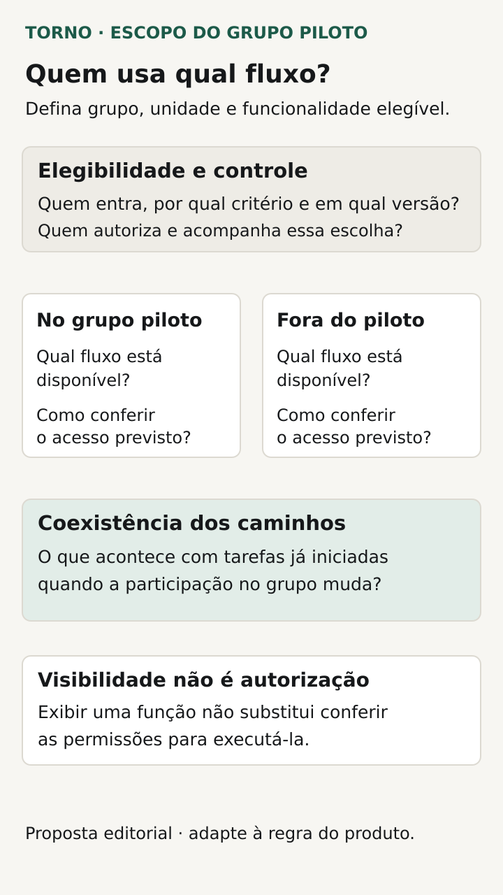
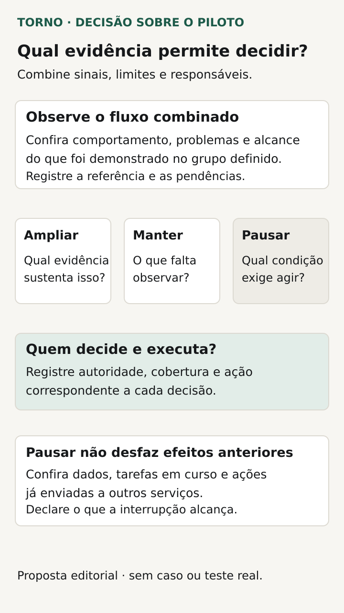

Antes de uma liberação gradual de funcionalidade, combine **quem receberá a mudança, o que acontecerá com quem continuar no fluxo anterior e quais evidências permitirão ampliar ou interromper o piloto**. Um grupo pequeno delimita o alcance inicial; não demonstra, sozinho, que a mudança está pronta ou que suas consequências são reversíveis.

O comprador de um portal ou ferramenta interna precisa reconhecer a tarefa que será modificada e a decisão que pretende tomar com o piloto. “Liberar para alguns usuários e observar” deixa abertas a seleção, a responsabilidade e a interpretação do resultado.

Este roteiro trata de uso delimitado em produção. A [homologação](https://tornostudio.com/blog/ambiente-homologacao-conferir-antes-testar-sistema/) prepara o ensaio em condições conhecidas; os [critérios de aceite](https://tornostudio.com/blog/criterios-aceite-mvp/) descrevem o comportamento esperado. O piloto exige também um acordo sobre o uso real e a convivência durante a mudança.

## Descreva a mudança e a pergunta do piloto

Nomeie o fluxo, a parte que muda e o que precisa ser observado. Uma nova etapa de preenchimento, por exemplo, pode exigir conferir se a pessoa conclui a solicitação, se os dados ficam corretos e se a próxima etapa consegue usá-los. Não escolha apenas uma contagem de acessos como substituta dessa tarefa.

Defina o que já precisa ter sido demonstrado antes da entrada em produção e quais dúvidas justificam acompanhar o grupo inicial. Se uma condição essencial ainda não foi verificada, registre a pendência correspondente. O piloto deve ter uma pergunta delimitada, não absorver toda incerteza do projeto sem decisão explícita.

Combine ainda o que fica fora da mudança. Isso permite relacionar um problema observado à versão e ao fluxo disponíveis, sem atribuir qualquer ocorrência ao piloto por suposição.

## Escolha uma unidade de liberação coerente com o trabalho

O grupo será definido por pessoa, conta, unidade ou outro objeto do produto? Se duas pessoas trabalham na mesma solicitação, uma verá o novo caminho e outra o anterior? A seleção precisa considerar as relações que a operação realmente usa.

A [documentação de targeting do Azure App Configuration](https://learn.microsoft.com/en-us/azure/azure-app-configuration/howto-targetingfilter) exemplifica públicos definidos por usuários, grupos ou entidades identificáveis. É uma possibilidade técnica de uma plataforma, não uma regra para seu sistema. O responsável técnico deve explicar como a unidade escolhida será identificada e mantida nos caminhos pertinentes.

Registre inclusões, exclusões e quem pode alterar o grupo. Peça evidência de uma conta elegível e outra fora do alcance. Separe essa condição das [permissões de acesso](https://tornostudio.com/blog/permissoes-acesso-software-regras-negocio/): receber a funcionalidade não concede automaticamente autorização para consultar ou modificar qualquer dado.

## Combine a convivência dos caminhos

Descreva o que acontece quando um registro criado no fluxo novo é aberto por alguém que permanece no anterior. Inclua tarefas em andamento, integrações e processos automáticos relevantes. Uma mudança visual pode produzir dados ou estados que outro caminho ainda precisa interpretar.

Pergunte também se o grupo terá uma experiência estável entre sessões e pontos de entrada. Se a pessoa sair, voltar ou usar outro dispositivo, qual comportamento será esperado? O fornecedor precisa justificar a solução e seus limites, em vez de pressupor que a seleção se manterá automaticamente.

A [AWS AppConfig documenta estratégias e condições específicas para liberação por entidades](https://docs.aws.amazon.com/appconfig/latest/userguide/appconfig-creating-deployment-strategy.html). Esse exemplo mostra que estabilidade de configuração depende da implementação. Não transfira suas capacidades para o contrato da Torno sem definição e evidência próprias.

| Decisão de escopo | Pergunta a responder |
|---|---|
| Mudança | Qual tarefa e qual parte do fluxo serão diferentes? |
| Unidade | Quem ou o que determina a elegibilidade? |
| Grupo | Quais inclusões e exclusões estão autorizadas? |
| Convivência | Como os caminhos tratam os mesmos dados e tarefas? |
| Continuidade | O que acontece com sessões e registros em andamento? |
| Controle | Quem pode alterar o alcance e onde fica a decisão? |

*Combine quem recebe a mudança, qual fluxo fica disponível e o destino das tarefas em andamento. Diagrama original Torno Studio, 2026.*

## Defina evidência que represente o grupo avaliado

Combine como reconhecer quem recebeu a mudança e qual versão estava disponível. O resultado observado precisa permitir relacionar tarefa, grupo e condições de uso. Um indicador agregado do produto pode não responder à pergunta sobre aquela funcionalidade.

Peça sinais de conclusão da tarefa e de falhas relevantes, além de um caminho para receber relatos. O roteiro de [monitoramento do fluxo crítico](https://tornostudio.com/blog/monitoramento-software-alertas-fluxo-critico/) ajuda a definir sinais, destinatários e ação inicial. Registre quem acompanha e em qual cobertura, sem inferir plantão do acesso a uma ferramenta.

Inclua os limites da evidência: pouco uso, situações não exercitadas ou dependências excluídas podem deixar perguntas abertas. Ausência de reclamação não demonstra que a tarefa foi realizada nem que todos os cenários foram atendidos. Peça uma conclusão ligada ao uso conhecido.

## Combine quem decide ampliar, manter ou pausar

Escreva as condições que sustentam cada decisão e quem pode tomá-la. Ampliar pode exigir tarefa concluída, falhas tratadas e convivência demonstrada, conforme o risco do fluxo. Manter o alcance pode ser a resposta quando ainda falta evidência. Pausar precisa de um significado operacional claro.

A [AWS descreve parâmetros de evolução e observação das liberações](https://docs.aws.amazon.com/appconfig/latest/userguide/appconfig-creating-deployment-strategy.html). Os valores e automatismos dessa plataforma pertencem ao seu mecanismo. No seu acordo, duração, tamanho do grupo e critérios precisam ser justificados pelo uso esperado, sem percentual ou prazo padrão.

Se houver automação da ampliação, pergunte quais sinais a controlam e como alguém pode intervir. Se a decisão for humana, defina quem recebe a evidência e onde registra a conclusão. Evite uma expansão sem responsável apenas porque o calendário avançou.

## Esclareça o que pausar ou desligar realmente faz

Parar de incluir novas pessoas, retirar a função do grupo atual e voltar uma versão são ações diferentes. Defina quais estarão disponíveis e o efeito sobre trabalho já iniciado. Nenhuma delas prova, por si só, que dados gravados ou ações externas foram desfeitos.

O [plano de rollback](https://tornostudio.com/blog/plano-rollback-atualizacao-sistema/) trata a reversão de uma atualização e seus limites. Para o piloto, acrescente o destino dos registros produzidos pela funcionalidade e a continuidade da tarefa se o novo caminho deixar de estar disponível.

Peça a regra de retomada depois de uma pausa. A [LaunchDarkly informa que uma nova liberação progressiva pode alcançar contextos diferentes da anterior](https://launchdarkly.com/docs/home/releases/progressive-rollouts). É um comportamento específico, útil para lembrar que “retomar o piloto” precisa explicar também quem voltará a receber a mudança.

*Relacione evidências e pendências à decisão, com responsável e alcance da ação definidos. Diagrama original Torno Studio, 2026.*

## Veja um exemplo de grupo piloto em produção

**Exemplo inteiramente fictício:** um portal acrescenta uma etapa de revisão antes de enviar solicitações. O acordo escolhe uma unidade como grupo inicial porque pessoas diferentes da unidade trabalham nos mesmos registros. Outras unidades permanecem no caminho anterior.

Antes de ampliar, o responsável precisa conferir a conclusão de solicitações, os dados recebidos na etapa seguinte e a consulta dos registros pelos perfis previstos. O plano também define o que acontece com uma solicitação em revisão se o acesso ao caminho novo for retirado.

Se ainda não houver uso suficiente para responder à pergunta combinada, a decisão pode manter o grupo e registrar a lacuna. **Fim do exemplo fictício; não representa cliente, implementação ou piloto realizado pela Torno.**

## Prepare a conferência e guarde a decisão

Demonstre previamente a seleção do público e os caminhos relevantes num ambiente autorizado, com dados fictícios. Para o uso em produção, registre a liberação e as condições acordadas. A avaliação deve permitir conferir o alcance e os efeitos reais sem expor informações pessoais desnecessárias.

| Conferência | Evidência a pedir |
|---|---|
| Elegível e não elegível | Funcionalidade disponível conforme o grupo definido |
| Sessões e pontos de entrada | Continuidade coerente com a regra contratada |
| Dados entre caminhos | Leitura e uso previstos durante a convivência |
| Tarefa e falhas | Resultados ligados à versão e ao grupo conhecido |
| Pausa e retomada | Efeito sobre público, tarefas e registros conforme o plano |
| Ampliação | Decisor, justificativa, pendências e próximo alcance documentados |

Guarde o que foi demonstrado e o que continua incerto. Uma conclusão favorável para o grupo inicial não comprova qualquer volume ou contexto futuro; a próxima ampliação precisa considerar os limites conhecidos.

Para a [conversa inicial com Henrique](https://tornostudio.com/diagnostico/), leve a mudança prevista, quem trabalha no mesmo fluxo e quais evidências sustentariam ampliar seu uso. Isso permite delimitar implementação, responsabilidades e critérios sem presumir uma plataforma de liberação já pronta ou acompanhamento contínuo incluído.

*Fontes consultadas em 29 de outubro de 2026. A ficha e o exemplo são propostas editoriais originais para adaptação ao produto.*
