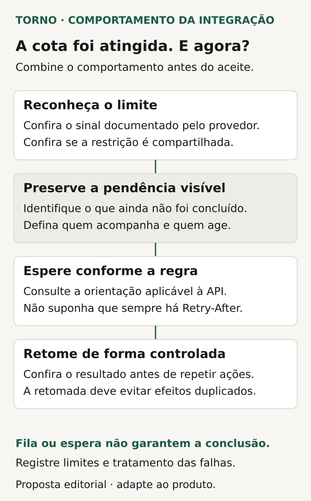
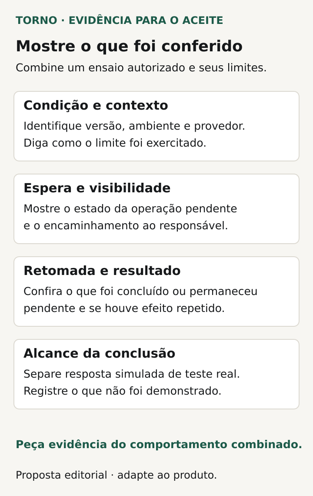

Ao atingir um limite de API, a integração precisa ter um comportamento combinado: **identificar a restrição, preservar o estado da operação, informar o que ficou pendente e retomar conforme a regra do provedor**. Para o comprador, a pergunta de aceite é o que acontece com o pedido, a atualização ou a consulta enquanto o serviço externo restringe novas chamadas.

“O sistema tenta de novo” deixa decisões abertas. Quanto tempo espera? O que o usuário vê? Quem percebe uma pendência que não se resolve? Como conferir o resultado quando o processamento volta? Essas respostas precisam fazer parte do escopo.

Este roteiro propõe perguntas e evidências para uma integração concreta. O levantamento amplo de sistemas e necessidades pertence ao [briefing de integração com ERP](https://tornostudio.com/blog/integracao-erp-briefing-orcamento/). Aqui, o foco é o tratamento da restrição depois que ela acontece.

## Confirme qual limite foi atingido

Frequência de chamadas, quantidade disponível numa janela e número de operações simultâneas podem ter regras diferentes. Peça ao fornecedor que identifique os limites aplicáveis ao caminho que será integrado e mostre como a resposta será interpretada.

O [RFC 6585 define o código HTTP 429](https://www.rfc-editor.org/rfc/rfc6585) para requisições excessivas em um período. A resposta pode incluir `Retry-After`, mas isso não é obrigatório. A forma de contar as requisições e o alcance do limite dependem da implementação.

A [documentação do Asaas distingue frequência, cota e concorrência](https://docs.asaas.com/reference/rate-e-quota-limit) e descreve tratamentos conforme a resposta. Já a [Stripe documenta que um 429 também pode estar ligado a um bloqueio temporário de acesso ao objeto](https://docs.stripe.com/rate-limits). Portanto, peça o vínculo entre a resposta do provedor e a ação prevista; o código isolado não resolve todo o diagnóstico.

A [REST API do GitHub pode responder 403 ou 429 quando um limite é excedido](https://docs.github.com/en/rest/using-the-rest-api/rate-limits-for-the-rest-api). Isso não torna qualquer 403 um erro de cota. O tratamento precisa reconhecer a resposta documentada, com as informações que distinguem aquele caso.

Registre onde está a documentação consultada e quem confirma a regra para a conta utilizada. Se a restrição for compartilhada com outras aplicações ou rotinas, essa dependência precisa aparecer na explicação técnica e nas condições da retomada.

## Defina o estado da operação durante a espera

Escolha termos que a operação consiga interpretar: aguardando processamento, concluído, falhou ou requer conferência, conforme o produto. O comprador precisa saber qual estado significa que o efeito externo foi confirmado e qual indica somente que a solicitação foi guardada para processamento posterior.

Se houver uma fila, peça que o responsável explique o que ela preserva, como o item é identificado e como uma interrupção será tratada. A fila é um mecanismo possível. Sua existência não demonstra, sozinha, que o item sobreviverá a uma falha, que será retomado ou que terminará no prazo necessário.

Combine o que o usuário pode fazer enquanto aguarda. Ele pode corrigir dados, cancelar ou consultar a situação? Um novo clique cria outra operação? Como fica a ação se o item já foi enviado? Essas decisões pertencem ao fluxo de negócio e precisam de resultados observáveis.

Evite usar “concluído” para representar apenas a entrada na fila. Se a confirmação depende do serviço externo, peça que a interface e os registros permitam distinguir as etapas pertinentes. Isso ajuda a operação a escolher o próximo passo sem presumir que a integração terminou.

## Combine a espera conforme o provedor

Peça uma política de novas tentativas que identifique quais respostas permitem repetição, a orientação de espera utilizada e a condição que exige intervenção. O responsável técnico escolhe o mecanismo e explica seus limites; o comprador valida a consequência da demora para a operação.

O [Microsoft Graph orienta respeitar `Retry-After` quando fornecido](https://learn.microsoft.com/en-us/graph/throttling) e recomenda espera progressiva quando ele não está presente. No [Asaas, respostas 429 não incluem esse header](https://docs.asaas.com/reference/rate-e-quota-limit); a documentação descreve mensagens e informações próprias para o tratamento. São exemplos de por que a política deve seguir a API efetivamente contratada.

A [Stripe recomenda espaçar novas tentativas progressivamente e adicionar aleatoriedade](https://docs.stripe.com/rate-limits), reduzindo a concentração de chamadas. Para a conversa de aceite, peça evidência de que a integração interrompe a repetição imediata e aplica a regra escolhida. Não existe um tempo de espera universal para copiar entre provedores.

Combine também o que acontece se a restrição continuar. A operação precisa de um ponto para reavaliar a pendência, com responsável e ação prevista. Uma estimativa de processamento deve deixar explícitas as condições de que depende, inclusive a disponibilidade e as regras do serviço externo.

*Proposta editorial de comportamento ao atingir a cota; fila e espera não garantem conclusão. Crédito: Torno Studio, 2026.*

## Use uma ficha de comportamento e responsabilidade

A tabela abaixo é uma proposta editorial para transformar a discussão em algo verificável. Preencha com o fornecedor antes de aceitar a entrega e mantenha o detalhe técnico em documentação apropriada.

| Decisão | Resposta a registrar |
|---|---|
| Restrição | Qual regra e resposta do provedor serão reconhecidas? |
| Estado preservado | Que operação permanece pendente e como pode ser localizada? |
| Visibilidade | O que usuário e responsável pela operação conseguem consultar? |
| Espera | Qual orientação do provedor controla a próxima tentativa? |
| Retomada | Como identificar o item e conferir seu resultado após o reenvio? |
| Intervenção | Quando alguém precisa agir e quem pode autorizar a ação? |
| Evidência | Qual cenário demonstrará cada etapa e quais limites terá o ensaio? |

Inclua onde ficará o histórico das tentativas e quem pode consultá-lo. Não é necessário expor tokens, credenciais ou conteúdo de clientes para demonstrar uma regra. Referências de teste e evidências com acesso controlado devem permitir relacionar o item, a restrição e o resultado.

## Confira a retomada e os resultados parciais

Pergunte como o sistema distingue uma operação ainda não concluída de outra já confirmada. Para ações que criam pedidos, cobranças ou registros, uma tentativa posterior precisa respeitar o efeito combinado. O artigo sobre [eventos duplicados em integrações](https://tornostudio.com/blog/integracao-evento-duplicado-regra-negocio/) aprofunda essa regra de negócio.

Considere também conjuntos parcialmente processados. O [Microsoft Graph documenta que requisições individuais de um lote podem receber 429 mesmo quando o lote responde HTTP 200](https://learn.microsoft.com/en-us/graph/throttling). Esse comportamento pertence àquele serviço, mas oferece uma pergunta útil: o relatório da sua integração confere cada resultado necessário ou resume tudo pela resposta do conjunto?

Peça que o fornecedor mostre quais itens terminaram, quais aguardam e quais precisam de revisão. A conclusão deve permitir verificar o efeito externo relevante. Se o resultado de uma chamada ficar desconhecido por outro motivo, registre esse cenário separadamente e combine a conferência antes de autorizar uma nova tentativa.

## Peça um ensaio controlado, sem saturar a API

Transforme a ficha em [critérios de aceite](https://tornostudio.com/blog/criterios-aceite-mvp/). Combine ambiente, dados fictícios, respostas que serão exercitadas e resultados esperados. O responsável técnico deve propor uma simulação ou outro mecanismo autorizado para demonstrar o tratamento, sem provocar bloqueios no serviço real.

Confira a preparação no roteiro de [ambiente de homologação](https://tornostudio.com/blog/ambiente-homologacao-conferir-antes-testar-sistema/). Ter sandbox disponível não autoriza exceder seus limites. Registre quais dependências participaram e quais respostas foram simuladas; testar a reação ao limite não demonstra a capacidade total da integração em produção.

Peça evidência do item antes da restrição, durante a espera e depois da retomada. Inclua uma restrição que persiste, um conjunto parcialmente concluído quando aplicável e o encaminhamento para intervenção. Guarde versão, ambiente, condição exercitada, esperado, observado e pendências.

*Peça evidências antes, durante e depois da restrição, declarando o que não foi demonstrado. Crédito: Torno Studio, 2026.*

## Veja um exemplo de pedido aguardando processamento

**Exemplo inteiramente fictício:** um portal envia pedidos a um serviço externo. Durante um ensaio autorizado, uma resposta simulada representa o limite aplicável. O pedido permanece identificado como aguardando envio; a tela não informa conclusão externa. O registro permite localizar a resposta e a próxima ação prevista.

Na continuação hipotética, a integração aplica a espera combinada e retoma o item quando as condições do teste permitem. O responsável confere o resultado no destino de teste. Outra parte do ensaio mantém a restrição, verificando se a pendência continua visível e chega à pessoa indicada para avaliação.

O relatório distingue a política demonstrada da disponibilidade real do provedor. Se o destino foi inteiramente simulado, essa limitação aparece na conclusão. **Fim do exemplo fictício; não representa cliente, implementação ou teste da Torno.**

## Feche as pendências com alguém que possa agir

Combine quem acompanha itens parados, quem trata mudanças do provedor e quem pode decidir sobre correção ou cancelamento. Use o roteiro de [alertas para o fluxo crítico](https://tornostudio.com/blog/monitoramento-software-alertas-fluxo-critico/) para definir sinais, destinatários e cobertura, quando esse encaminhamento fizer parte do escopo.

Para a [conversa inicial com Henrique](https://tornostudio.com/diagnostico/), traga os sistemas envolvidos, a regra oficial da API, o volume conhecido e o impacto do atraso na ação afetada. Isso permite delimitar implementação e evidências, com dependências conhecidas. Acompanhamento contínuo, prazos de resposta e responsabilidades operacionais precisam de acordo próprio; não decorrem automaticamente da entrega da integração.

*Fontes primárias consultadas em 23 de outubro de 2026. A ficha e o exemplo são propostas editoriais originais para adaptação ao sistema e à documentação do provedor.*
