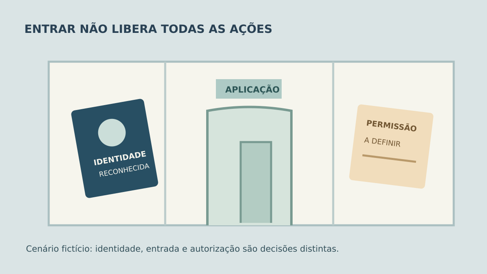

**Login único (SSO) permite usar uma identidade corporativa para entrar no sistema, mas o escopo da integração não termina na tela de entrada.** Antes de contratar, defina quem pode abrir a aplicação, como uma conta existente será reconhecida, o que acontece quando a pessoa muda de função ou sai da empresa e como conferir a perda de acesso. Sem essas decisões, um login que funciona na demonstração pode deixar dúvidas na operação.

Este roteiro trata de um sistema interno com identidade corporativa. A [Microsoft descreve o SSO do Entra ID](https://learn.microsoft.com/en-us/entra/identity/enterprise-apps/what-is-single-sign-on) como entrada com um conjunto de credenciais para acessar aplicações atribuídas sem autenticar de novo; isso não garante que qualquer sistema esteja pronto para SSO.

## Quem entra e como a conta é vinculada?

Identifique qual sistema será integrado, quem administra a identidade corporativa, quem precisa entrar e se há contas locais. Especifique como vincular uma conta antiga à identidade corporativa. Um e-mail igual pode ajudar a localizar o cadastro, mas não deve bastar, sozinho, para conceder acesso.

Defina também o que aparece para alguém que consegue autenticar na empresa, mas **não foi autorizado** a usar aquela aplicação. Autenticação responde quem é a pessoa; autorização responde o que ela pode ver e fazer. O guia de [permissões no software](https://tornostudio.com/blog/permissoes-acesso-software-regras-negocio/) aprofunda a segunda pergunta. Ao planejar o SSO, a lista de usuários e os papéis do sistema devem ter donos identificados.

Não confunda login único com segundo fator. A empresa pode exigir uma etapa adicional na identidade corporativa, mas o comportamento deve ser especificado e conferido conforme as políticas adotadas. Veja o roteiro separado de [autenticação de dois fatores](https://tornostudio.com/blog/autenticacao-dois-fatores-sistema-requisitos-aceite/).

*A porta representa uma decisão de acesso, não uma tela ou controle de segurança real. Ilustração original Torno Studio, 2026.*

## Login único cria e remove usuários automaticamente?

Não necessariamente. A [documentação Microsoft distingue o SSO federado, com SAML ou OpenID Connect, do provisionamento](https://learn.microsoft.com/en-us/entra/id-governance/identity-governance-applications-integrate). O segundo trata de sinalizar criação, atualização ou remoção de acesso à aplicação quando houver suporte e configuração para isso. A [página de provisionamento do Entra](https://learn.microsoft.com/en-us/entra/identity/app-provisioning/user-provisioning) descreve essas tarefas. Não inclua criação ou desativação automáticas no escopo só porque o fornecedor disse “tem login com Microsoft”.

Combine quem cadastra uma pessoa nova, qual função ela recebe, como uma mudança de área afeta suas permissões e quem desativa a conta da aplicação quando ela deixa a empresa. Se não houver provisionamento automático, documente o procedimento manual, seu responsável e a evidência de conclusão. O mesmo vale para contas técnicas e usuários locais que continuarão existindo: eles precisam de regra própria de acesso.

**Exemplo inteiramente fictício:** Júlia usa a conta corporativa para abrir um portal de pedidos. Ela já tinha um cadastro local com pedidos antigos. O projeto precisa definir como vincular o cadastro sem criar outro histórico. Meses depois, Júlia muda de área: sua identidade continua válida, mas a permissão para aprovar pedidos antigos deve ser revista. Quando sai da empresa, a equipe desativa sua entrada e verifica também se uma sessão do portal permanece ativa. **Fim do exemplo fictício; não representa cliente ou sistema da Torno.**

## O que ocorre com a sessão que já estava aberta?

Desabilitar uma conta no provedor de identidade pode impedir novos logins, mas não significa encerrar imediatamente uma sessão criada pela própria aplicação. A [Microsoft explica essa diferença para o Entra ID](https://learn.microsoft.com/en-us/entra/identity/users/users-revoke-access): a aplicação controla o token de sessão que ela emitiu e o tempo até a perda efetiva de acesso depende de seu comportamento. Por isso, registre qual resultado a empresa exige para desligamento, encerramento de sessão e revalidação de acesso; o responsável técnico deve mostrar como o sistema cumpre o combinado.

Pergunte também o que a pessoa vê se o serviço de identidade estiver indisponível. Uma tela de erro, uma tentativa posterior ou um procedimento de contingência são decisões de produto e operação. Não prometa entrada offline nem uma conta alternativa sem definir quem poderá usá-la e como será controlada. Para contas locais que permanecerem no sistema, a [recuperação de senha](https://tornostudio.com/blog/recuperacao-senha-sistema-aceite/) tem requisitos próprios; ela não deve ser confundida com recuperação da conta corporativa.

*Crachá e relógio são símbolos de um ensaio de desligamento, sem representar uma configuração técnica real. Ilustração original Torno Studio, 2026.*

## Quais ensaios pedir antes do aceite?

Peça um ambiente autorizado com usuários e dados fictícios. Demonstre o que aparece para cada perfil e registre o resultado no sistema, não apenas uma captura da tela do provedor de identidade.

| Ensaio | O que conferir |
|---|---|
| Pessoa atribuída à aplicação | Entra na conta correta e vê só as ações previstas |
| Pessoa autenticada, sem acesso à aplicação | Entrada negada de forma compreensível, sem dados expostos |
| Conta local existente | Vínculo preserva o histórico correto, sem fusão indevida |
| Mudança de função | Permissões no sistema refletem a regra acordada |
| Desligamento com sessão aberta | Nova entrada bloqueada e sessão existente tratada no prazo definido |
| Provedor indisponível | Mensagem e procedimento de contingência correspondem ao combinado |

Registre quem mantém a configuração da identidade e trata mudanças de domínio, grupos ou responsáveis. Escolha um fluxo e demonstre entrada, trabalho e saída completos.

Para [conversar com Henrique sobre o projeto](https://tornostudio.com/diagnostico/), reúna a aplicação, o provedor de identidade atual, a lista de perfis, a existência de contas locais e o prazo esperado para cortar o acesso de quem sai. Isso permite discutir um escopo verificável antes de implementar o login.

*Fontes técnicas consultadas em 3 de novembro de 2026. Cenário e imagens são editoriais; nenhuma integração ou resultado de cliente foi alegado.*
