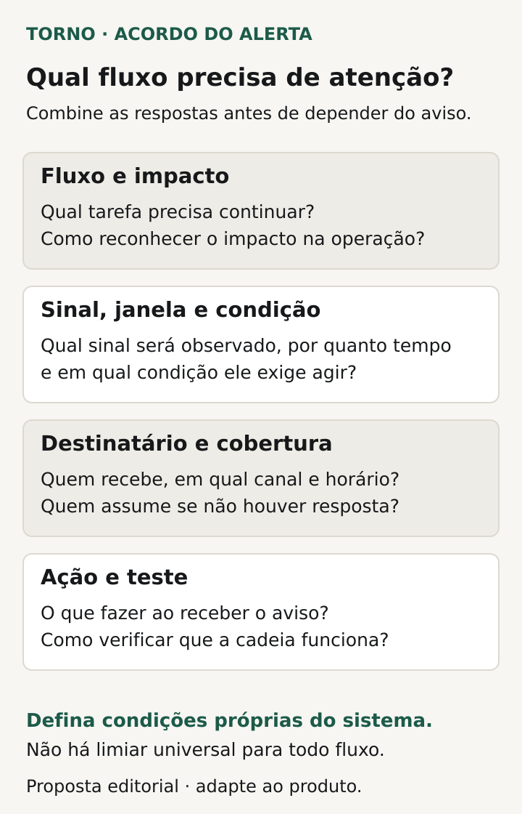
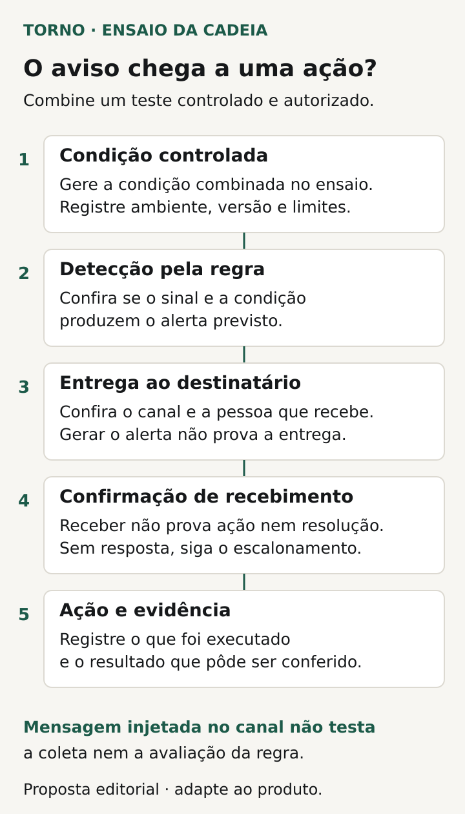

No monitoramento de software, combine **qual condição do fluxo crítico precisa ser percebida, quem receberá o alerta e o que essa pessoa poderá fazer**. Acrescente como a regra será testada e em quais horários existe resposta acordada. Uma ferramenta instalada ou um painel disponível não encerra essas decisões.

Para o comprador de um portal, MVP, integração ou ferramenta interna, o ponto de partida é a tarefa que sustenta a operação: concluir um pedido, aprovar uma solicitação, atualizar um estoque ou processar uma cobrança. O responsável técnico traduz essa necessidade em sinais e regras; o gestor valida o impacto e as responsabilidades.

O roteiro abaixo é uma proposta editorial para esse acordo. Não pressupõe operação contínua, prazo de atendimento ou serviço gerenciado incluído na entrega inicial.

## Escolha o fluxo e descreva o efeito da falha

Nomeie a tarefa, quem depende dela e o que significa concluí-la. “Portal disponível” pode significar que a página abre, enquanto o envio do pedido continua sem terminar. Peça ao fornecedor que mostre qual etapa será observada e o resultado de negócio que ela representa.

O [Google SRE distingue sinais internos do sistema e verificações do comportamento visto externamente](https://sre.google/sre-book/monitoring-distributed-systems/). Essa distinção ajuda a discutir a cobertura. Métricas de infraestrutura e observação do fluxo podem responder a perguntas diferentes; o responsável deve explicar como as evidências escolhidas se relacionam à operação.

Registre também a consequência de não perceber a falha: pedidos acumulados, processamento atrasado ou pessoas impedidas de trabalhar, por exemplo. Essa descrição orienta a prioridade da notificação e a conversa sobre cobertura. A [AWS recomenda ligar alertas ao impacto de negócio ou operacional](https://docs.aws.amazon.com/wellarchitected/latest/framework/ops_workload_observability_create_alerts.html), em vez de reunir notificações sem relevância definida.

## Separe sinal, condição e resposta

Para organizar a conversa, chame de **sinal** a informação observada; de **condição** a regra que exige atenção; e de **resposta** o encaminhamento previsto. São termos de trabalho para a ficha, a adaptar ao vocabulário do fornecedor.

Um sinal pode ser a idade do pedido pendente mais antigo. A condição precisa dizer quando essa idade exige atenção e em qual conjunto de pedidos. A resposta indica quem verifica o caso e qual procedimento consulta. O limite deve vir do comportamento esperado e do impacto tolerável daquela operação.

Peça a origem e a unidade de cada medida. Uma porcentagem precisa informar o conjunto contado e o período; uma duração precisa esclarecer início e fim. Se a regra ainda depende de observar o uso real, registre a hipótese, quem acompanhará e quando será revista. Não copie um número de exemplo de ferramenta como meta do seu sistema.

## Monte uma matriz que permita agir

Use uma linha para cada condição com resposta distinta. Não é necessário colocar detalhes de consulta ou configuração na ficha do gestor; eles podem ficar em documentação técnica referenciada. A matriz abaixo propõe os campos do acordo.

| Campo | Pergunta que precisa de resposta |
|---|---|
| Fluxo e impacto | Qual tarefa ou resultado está em risco? |
| Sinal e origem | O que é medido e onde a informação é produzida? |
| Condição e janela | Qual limite, por quanto tempo e sobre qual conjunto exige atenção? |
| Destinatário e cobertura | Quem recebe, por qual canal e em quais horários acompanha? |
| Ação inicial | O que conferir primeiro e onde está o procedimento autorizado? |
| Escalonamento | Quem acionar se o primeiro responsável não confirmar ou não puder resolver? |
| Teste e evidência | Como demonstrar detecção, entrega e encaminhamento? |
| Encerramento | Qual evidência mostra recuperação e quais pendências permanecem? |

A [orientação da AWS sobre processo por alerta](https://docs.aws.amazon.com/wellarchitected/latest/operational-excellence-pillar/ops_event_response_process_per_alert.html) inclui resposta definida, responsabilidade e escalonamento. Para conferir seu acordo, peça que cada alerta de sistema aponte para esse procedimento e para uma pessoa ou função com cobertura real.

Evite usar apenas “avisar o técnico” como destinatário. Registre o canal confirmado, quem o acompanha e a alternativa prevista. Se alguém receber uma mensagem fora do horário contratado, isso não cria automaticamente obrigação de atendimento. O documento precisa retratar a disponibilidade combinada.

*Proposta editorial de acordo por alerta, com condições próprias do sistema e cobertura combinada. Crédito: Torno Studio, 2026.*

## Trate ausência de dados e dependências explicitamente

Pergunte o que acontece se a coleta parar. “Nenhum erro registrado” pode vir acompanhado de uma lacuna de informação; o fornecedor deve explicar como distinguir essas condições no mecanismo utilizado. Registre qual evidência confirma que o sinal continua sendo produzido e qual encaminhamento existe quando ele desaparece.

Considere também os períodos de pouca atividade. A falta de pedidos pode ser normal fora do expediente ou exigir investigação num horário de operação. Peça que a regra considere o contexto pertinente, sem transformar qualquer silêncio em falha ou em sucesso.

Para uma integração, identifique até onde vai a observação: envio, recebimento, processamento ou confirmação final. A resposta do primeiro serviço pode deixar etapas posteriores sem avaliação. Se uma dependência externa não fornece informação suficiente, registre o limite e o procedimento de conferência disponível. Monitoramento de fluxo de negócio precisa de uma fronteira descrita para que sua conclusão seja compreensível.

## Teste a cadeia do sinal à pessoa responsável

Antes de aceitar a configuração, combine um ensaio controlado com ambiente, dados, destinatários e efeitos autorizados. O responsável técnico deve escolher uma forma de exercitar a regra sem provocar indisponibilidade ou operações indevidas. Identifique a execução como teste para quem a receber.

Peça evidência de etapas separadas: a condição foi produzida ou simulada; a regra a reconheceu; a notificação saiu; o canal recebeu; o responsável confirmou; e o encaminhamento foi registrado. Um teste que injeta diretamente uma mensagem pode verificar o canal, deixando sem demonstração a coleta e a avaliação da regra. Essa limitação deve constar do resultado.

O [guia de incidentes do Google](https://sre.google/resources/practices-and-processes/incident-management-guide/) trata alertas e organização da resposta como parte da preparação. Na ficha proposta aqui, testar o contato e localizar o procedimento ajuda a mostrar quem consegue agir nas condições contratadas.

Guarde versão da regra, ambiente, data, resultado esperado e observado. Se houver escalonamento, combine como demonstrá-lo e preservar a evidência. “Alerta configurado” deve permitir localizar o que foi efetivamente testado e o que ficou pendente.

*Registre cada etapa demonstrada e seus limites; receber o aviso não comprova ação ou resolução. Crédito: Torno Studio, 2026.*

## Veja um exemplo com pedido pendente

**Exemplo inteiramente fictício:** um portal recebe pedidos e aguarda a confirmação de um sistema externo. O comprador identifica o risco de um pedido permanecer pendente sem que a operação perceba. O responsável técnico propõe observar a idade das pendências e os retornos recebidos.

As partes ainda precisam combinar quais pedidos entram na regra, como o horário de funcionamento interfere, qual condição exige aviso e quem acompanha o canal. O procedimento inicial permite consultar o pedido e o estado da integração com acesso autorizado. Reenviar o pedido depende da regra própria do produto; o alerta não concede essa autorização.

No ensaio hipotético, uma condição de teste é detectada e a mensagem chega ao canal previsto. O destinatário confirma o recebimento e localiza o procedimento. O relatório registra que a consulta ao serviço externo não participou do ensaio, deixando essa conferência pendente antes da conclusão correspondente. **Fim do exemplo fictício; não representa cliente, implementação ou teste da Torno.**

Esse formato deixa claro o que já foi demonstrado. A entrega de uma notificação não comprova que o problema foi investigado, que uma ação de correção foi executada ou que o fluxo se recuperou.

## Revise ruído, lacunas e mudanças de responsável

A [AWS recomenda reduzir alertas sem relevância e revisar as configurações](https://docs.aws.amazon.com/wellarchitected/latest/framework/ops_workload_observability_create_alerts.html). Para essa revisão, reúna ocorrências que geraram aviso sem ação útil e problemas conhecidos que passaram sem detecção. Discuta com o responsável se falta contexto, se a regra precisa mudar ou se o assunto pede acompanhamento por outro caminho.

Se a operação observou uma falha não explicada, use o roteiro de [evidências de erro intermitente](https://tornostudio.com/blog/erro-intermitente-software-evidencias/) para preservar o relato. A [trilha de auditoria](https://tornostudio.com/blog/trilha-auditoria-sistema-requisitos-negocio/) atende à pergunta sobre acontecimentos e ações registradas. Esses materiais podem apoiar a investigação, com finalidades distintas do aviso que exige atenção.

Se um alerta surgir após uma atualização, a decisão de voltar uma versão precisa seguir o [plano de rollback](https://tornostudio.com/blog/plano-rollback-atualizacao-sistema/). Ao trocar quem mantém o produto, inclua regras, canais, acessos e procedimentos na [passagem técnica do fornecedor](https://tornostudio.com/blog/troca-fornecedor-software-passagem-tecnica/) e confira os novos contatos.

Para a [conversa inicial com Henrique](https://tornostudio.com/diagnostico/), leve o fluxo crítico, o impacto de uma falha e a cobertura que sua operação precisa. Isso permite avaliar o escopo técnico e as responsabilidades necessárias. Configurar monitoramento de aplicação e contratar acompanhamento contínuo são decisões que precisam aparecer expressamente no acordo, sem presumir plantão ou atendimento 24 horas.

*Fontes primárias consultadas em 22 de outubro de 2026. A matriz, o roteiro e o exemplo são propostas editoriais originais para adaptação ao sistema.*
