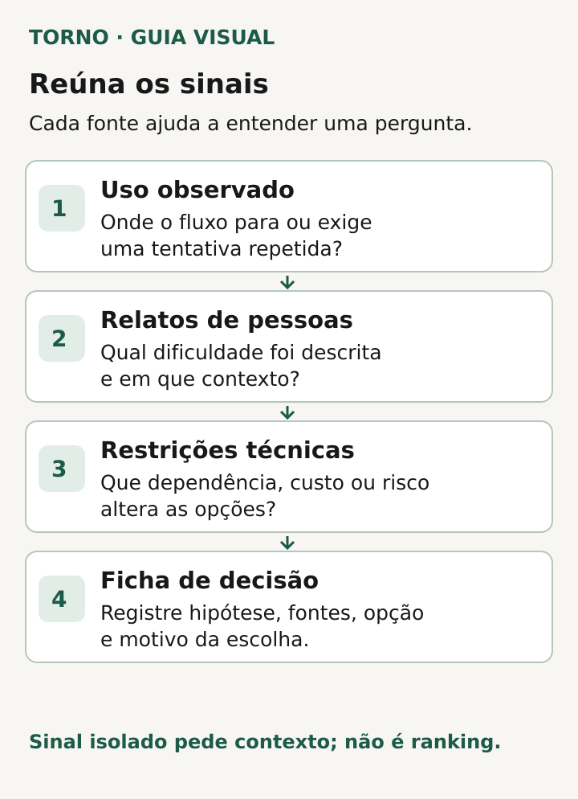
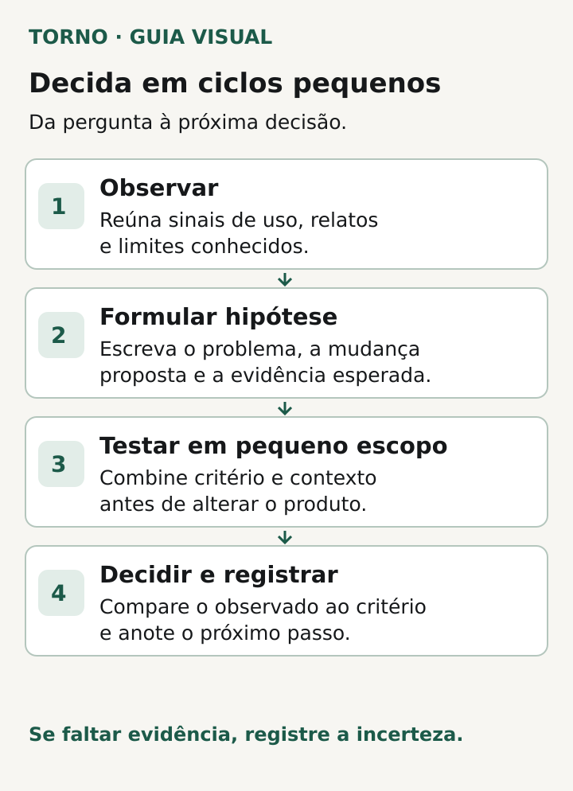

Depois que um MVP entra em uso, a próxima mudança deve responder a uma pergunta concreta: **qual dificuldade observada vale enfrentar agora, com as informações que temos?** Reúna sinais do percurso de uso, relatos de quem tentou realizar a tarefa e restrições técnicas. Registre também o que continua desconhecido. Uma lista de pedidos, sozinha, não mostra qual mudança trará mais valor.

Os [critérios de aceite do MVP](https://tornostudio.com/blog/criterios-aceite-mvp/) ajudam a verificar o que foi contratado e entregue. Esta decisão vem depois: o produto existe e seu uso real pode revelar obstáculos que o planejamento inicial não mostrava. Falhas que impedem o funcionamento combinado precisam de tratamento próprio; o [roteiro para relatar erro intermitente](https://tornostudio.com/blog/erro-intermitente-software-evidencias/) ajuda a registrar o ocorrido antes de investigar.

## Defina a pergunta antes de abrir o backlog

Descreva a tarefa que o produto deveria permitir e onde há incerteza. “Adicionar dashboard” já escolhe uma solução. “Por que gestores não conseguem confirmar o pedido sem pedir ajuda?” é uma pergunta que permite observar o fluxo antes de construir outra tela.

Identifique quem usa o trecho, o que a pessoa tenta concluir e que evidência indicaria melhora. O [GOV.UK Service Manual recomenda partir da finalidade do serviço e das necessidades de usuários para definir medidas](https://www.gov.uk/service-manual/measuring-success/how-to-set-performance-metrics-for-your-service). A orientação foi escrita para serviços públicos britânicos; o princípio de explicitar o objetivo ajuda também em um MVP privado. As métricas obrigatórias para aquele governo não são obrigação do seu produto.

## Reúna sinais de fontes diferentes

Escolha informações proporcionais ao tamanho e ao estágio do MVP. Se houver dados de uso confiáveis, observe onde uma tarefa começa, onde termina e onde pessoas desistem, com o período e o público registrados. Se a medição não existe, não invente um percentual: relatos de atendimento, entrevistas e observação de uma tarefa ainda ajudam a formular a próxima hipótese.

Converse com quem realmente tenta usar o produto. Pergunte o que procurava fazer, o que aconteceu e qual caminho usou quando ficou difícil. Separe a dificuldade relatada da solução sugerida. “Preciso exportar tudo” pode significar exigência de prestação de contas, falta de uma informação na tela ou uma integração ausente. Cada causa pede investigação diferente.

O [GOV.UK Service Manual orienta combinar métricas e pesquisa com usuários](https://www.gov.uk/service-manual/measuring-success/how-to-set-performance-metrics-for-your-service), além de usar fontes como feedback e atendimento. Outro texto do manual [distingue transações de percursos completos](https://www.gov.uk/service-manual/measuring-success/measuring-the-success-of-your-service): uma etapa pode parecer funcionar isoladamente enquanto a tarefa inteira continua difícil. Esta é uma adaptação editorial para software sob medida, não uma validação externa de um MVP específico.

Inclua as restrições técnicas que mudam a decisão: dependências de integrações, qualidade dos dados, permissões, operação e possibilidade de verificar uma mudança sem interromper usuários. O responsável técnico deve confirmar essas restrições no produto concreto. Evite classificar uma ideia como “fácil” antes dessa conferência.

*Modelo para reunir contexto antes de decidir uma mudança no MVP. Diagrama original Torno Studio, 2026.*

## Coloque as opções na mesma ficha

Uma ficha curta deixa visível o que sustenta cada proposta e o que falta saber. Use uma linha por dificuldade ou hipótese; não dê pontuações precisas a evidências fracas.

| Campo | O que registrar |
|---|---|
| Tarefa e dificuldade | O que a pessoa tenta concluir e onde o percurso falha ou exige esforço? |
| Sinal observado | O que foi visto, quando, em qual versão e com qual cobertura? |
| Fonte e contexto | Uso medido, conversa, atendimento ou teste; de qual público e situação? |
| Hipótese | O que pode explicar a dificuldade, separado do fato observado? |
| Opções | Corrigir, simplificar, testar uma mudança, observar mais ou manter como está. |
| Dependência e risco | O que precisa ser verificado tecnicamente antes de mudar? |
| Decisão e dúvida aberta | O que será feito agora, quem assume a decisão e o que poderá mudá-la? |

A ficha é um modelo editorial. Ela não é um algoritmo que calcula prioridade. Se uma opção afeta acesso, segurança ou a operação essencial, trate essa restrição explicitamente antes de compará-la com melhorias convenientes. Se a fonte do sinal é uma única conversa, identifique isso; não escreva “usuários pedem” como se a frequência fosse conhecida.

## Escolha o menor passo que responda à dúvida relevante

Quando o problema está claro e o risco é conhecido, pode fazer sentido delimitar a mudança e seus critérios de verificação. Quando a causa ainda é incerta, prefira uma observação adicional ou um teste controlado que ajude a distinguir hipóteses. Por exemplo, acompanhar a conclusão de uma tarefa em ambiente autorizado pode revelar um obstáculo de linguagem antes que se contrate uma nova integração. O exemplo é uma possibilidade de método, não relato de cliente nem promessa de resultado.

Escreva antes o que pretende aprender e como saberá se aprendeu. Depois compare a observação com o estado anterior, lembrando que volume pequeno, público diferente ou mudança simultânea em várias partes do produto limita a conclusão. O [GOV.UK Service Manual recomenda dar contexto às medidas e estabelecer uma linha de base](https://www.gov.uk/service-manual/measuring-success/how-to-set-performance-metrics-for-your-service). Use isso como disciplina de decisão, sem tomar um número isolado como prova de causalidade.

Se a proposta cria trabalho recorrente, separe o investimento na mudança do [custo de manter o software após o lançamento](https://tornostudio.com/blog/custo-manutencao-software-apos-lancamento/). Isso ajuda a decidir quem operará a solução depois, sem pressupor que uma nova funcionalidade entre no suporte já contratado.

*Sequência ilustrativa de decisão após uso real, sem pontuação ou resultado presumido. Diagrama original Torno Studio, 2026.*

## Registre por que decidiu e quando revisará

A decisão pode ser construir, investigar, adiar ou não fazer. Em todos os casos, guarde a pergunta original, as fontes consultadas, a versão do produto, a restrição principal e a condição que levaria a rever a escolha. Assim, uma sugestão recusada hoje pode voltar com informação nova, sem recomeçar a conversa do zero.

O MVP no ar oferece uma vantagem: observar tarefas reais. Use-a com cuidado. Uma boa próxima mudança nasce de uma dificuldade definida, evidência com limites claros e uma forma de verificar o efeito. A ficha ajuda o comprador e o responsável técnico a discutir escopo com a mesma informação diante deles.

*Fontes de método consultadas em 19 de outubro de 2026. A ficha e a sequência de decisão são síntese editorial original; adapte-as ao produto e às pessoas que o usam.*
