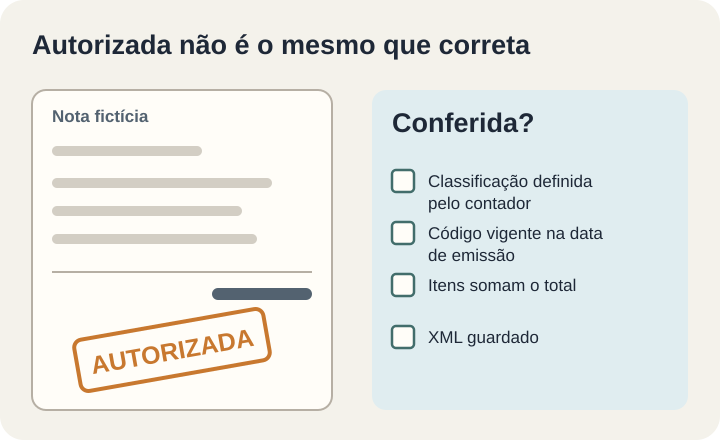

**Uma NF-e autorizada não é, por si só, uma NF-e correta.** Desde 3 de agosto de 2026, NF-e e NFC-e devem trazer os campos de IBS e CBS (Simples Nacional e alguns casos têm datas posteriores). A validação que rejeitaria a nota sem eles foi adiada, mas a obrigação de adequação continua. Para aceitar o sistema que emite suas notas, peça três garantias: cada item sai com a classificação definida pelo seu contador, o código usado está vigente na data de emissão e o sistema guarda evidência do que foi enviado.

Este texto é para quem contrata ou mantém um sistema próprio que emite NF-e/NFC-e ou se integra a um emissor. **Não é consultoria tributária.** Qual CST e qual cClassTrib se aplicam a cada produto ou operação é decisão do contador ou da assessoria tributária. O papel do sistema é implementar essa decisão, validar o que pode ser validado e registrar o resultado.

## Linha do tempo: o que é regra e o que foi anúncio

O [Ato Conjunto RFB/CGIBS nº 4, de 30/07/2026](https://www.cgibs.gov.br/upload/arquivos/202607/31091735-20260730-16h30-ato-conjunto-rfb-cgibs-na-c2-ba-4-260731-090909.pdf), fixou quando os campos de IBS e CBS passam a ser obrigatórios, por fato gerador:

- **03/08/2026:** NF-e e NFC-e.
- **01/12/2026:** NF-e de quem é sujeito passivo de IBS/CBS, mas não é contribuinte do ICMS.
- **01/01/2027:** empresas do Simples Nacional, NF-e com tributação monofásica e importação via Duimp.

*Datas segundo o Ato Conjunto RFB/CGIBS nº 4/2026; adiamento da validação segundo o CGIBS em 06/08/2026. Ilustração original Torno Studio, 2026.*

O caso mostra por que a data da fonte importa. Em 15/06/2026, o CGIBS [anunciou rejeição automática a partir de 03/08](https://www.cgibs.gov.br/novo-marco-da-reforma-tributaria-inicia-em-03-de-agosto-com-preenchimento-obrigatorio-dos-campos-relativos-ao-ibs-e-a-cbs) e alíquotas de teste de 1% (0,1% de IBS e 0,9% de CBS). Em 06/08/2026, Receita Federal e CGIBS [esclareceram o adiamento](https://www.cgibs.gov.br/receita-federal-e-comite-gestor-do-ibs-esclarecem-adiamento-das-regras-de-validacao-dos-documentos-fiscais-eletronicos): a falta dos campos, “neste momento”, não gera rejeição, e o adiamento “não afasta a obrigação de adequação”. A mesma publicação informa que, em 04/08/2026, 88% dos documentos de contribuintes obrigados já traziam IBS e CBS. Conteúdo escrito antes de 06/08 pode ainda falar em rejeição; o anúncio não é a regra vigente.

### Por que preencher se a nota não é rejeitada?

Porque, segundo Receita Federal e CGIBS, a dispensa de recolhimento em 2026 vale para quem cumpre as obrigações acessórias. Como isso se aplica à sua empresa é pergunta para o contador. O [Comunicado Conjunto da Receita Federal](https://www.gov.br/receitafederal/pt-br/assuntos/noticias/2025/dezembro/comunicado-conjunto) dispensa o recolhimento do IBS e da CBS para quem emitir os documentos “observando as normas e notas vigentes”, e o [CGIBS reforçou](https://www.cgibs.gov.br/comite-gestor-do-ibs-e-receita-federal-divulgam-orientacoes-sobre-a-entrada-em-vigor-da-cbs-e-do-ibs-em-1-de-janeiro-de-2026) que a dispensa vale para quem cumprir as obrigações acessórias.

Além disso, o [Ato Conjunto RFB/CGIBS nº 5, de 12/08/2026](https://www.gov.br/sped/pt-br/assuntos/documentos-fiscais/dere/atos-conjuntos/ato-conjunto-rfb_cgibs-no-5-de-12-de-agosto-dee-2026.pdf/@@display-file/file), criou o Programa Nacional de Conformidade Tributária (PNCT 2026). Quem ainda não cumpre as obrigações acessórias permanece no programa se atender a quatro critérios:

1. aumento contínuo e progressivo da quantidade de notas com IBS e CBS corretos;
2. resposta no prazo às intimações;
3. correção, até 31/12/2026, das inconsistências comunicadas;
4. indicação de um profissional de contabilidade responsável.

O primeiro e o terceiro critérios dependem diretamente do sistema: ele precisa emitir certo e mostrar que está emitindo certo.

## Quem decide o quê

Boa parte dos problemas de adequação nasce de uma pergunta sem dono. Uma divisão possível, para ajustar ao seu caso:

| Decisão ou tarefa | Contador ou assessoria tributária | Fornecedor do sistema | Operação da empresa |
|---|---|---|---|
| CST e cClassTrib de cada produto e operação | Define e registra | Implementa o cadastro e as regras | Mantém o cadastro de produtos atualizado |
| Leiaute da nota conforme a NT vigente | Confirma a interpretação quando houver dúvida | Implementa e testa | Acompanha o cronograma |
| Novas versões de NT e tabelas | Avalia o impacto fiscal | Atualiza, testa em homologação e publica | Aprova a data de troca |
| Notas com problema | Orienta a correção | Mostra quais notas e por quê | Corrige o cadastro ou reemite |

O sistema pode sugerir uma classificação a partir de um cadastro aprovado, mas não deve inventar uma.

## Critérios de aceite testáveis

Um critério útil diz o que foi testado e qual evidência ficou. Estes são um ponto de partida, sempre em ambiente de teste e com dados fictícios:

1. **Cada item com IBS e CBS conforme a classificação definida.** Monte uma lista de produtos de teste com a classificação aprovada pelo contador e confira, no XML, o CST e o cClassTrib de cada item.
2. **Código vigente na data de emissão.** Pelo [Informe Técnico 2025.002 v1.60](https://www.reformatributaria.com/wp-content/uploads/2026/06/IT-2025.002-v.1.60-Tabelas-de-Classificacao-do-IBS-e-da-CBS-2026_06_22.pdf) (cópia não oficial da versão de 22/06/2026), o cClassTrib tem 6 dígitos, os 3 primeiros são o CST do IBS/CBS, e cada código tem data de início e de fim. Teste uma emissão com código fora da vigência: o sistema deve bloquear ou alertar, não enviar em silêncio.
3. **A soma dos itens bate com os totais.** Base e valores de IBS e CBS por item devem fechar com os totais da nota, inclusive com descontos e várias linhas. Para 2026, o mesmo Informe Técnico indica CBS de 0,9%, IBS estadual de 0,1% e IBS municipal zero; confirme com o contador antes de usar como referência.
4. **Homologação para cada regime que se aplica.** Se a empresa tem filiais em regimes diferentes, ou vai emitir em um dos casos de 01/12/2026 ou 01/01/2027, teste cada um no ambiente de homologação da SEFAZ. Antes, vale [conferir se o ambiente de teste está mesmo separado da produção](https://tornostudio.com/blog/ambiente-homologacao-conferir-antes-testar-sistema/).
5. **Devolução e nota complementar.** Trate-as como cenários próprios, conforme a nota técnica vigente — confira a versão no [Portal da NF-e](https://www.nfe.fazenda.gov.br/portal/), porque as regras desses casos podem mudar entre versões.
6. **Rotina para novas versões de NT e tabelas.** Combine quem acompanha as publicações, em quanto tempo uma nova versão é avaliada e como a troca é testada antes de entrar em produção, com um [plano de volta atrás](https://tornostudio.com/blog/plano-rollback-atualizacao-sistema/) se algo falhar.
7. **Relatório de notas com os campos.** O sistema deve mostrar, por período, quantas notas saíram com IBS e CBS preenchidos e quais saíram sem. Esse número ajuda a demonstrar o “aumento contínuo e progressivo” que o PNCT exige de quem ainda não cumpre as obrigações.
8. **Log e XML guardados.** Guarde o XML enviado e o retorno, e registre quem alterou a classificação de um produto e quando. O artigo sobre [trilha de auditoria](https://tornostudio.com/blog/trilha-auditoria-sistema-requisitos-negocio/) detalha esse registro.

*Exemplo fictício: a nota não contém dados reais. O carimbo de autorização não substitui a ficha de conferência. Ilustração original Torno Studio, 2026.*

## Emissor terceirizado ou sistema próprio

**Se o seu sistema chama um emissor de terceiros**, o leiaute tende a ficar com o emissor (confirme no contrato), mas a classificação de cada item ainda sai do seu cadastro. Pergunte qual versão da NT o emissor suporta, onde o cClassTrib é informado (no seu sistema ou no painel do emissor), quem atualiza as tabelas, se há ambiente de homologação e se o XML autorizado volta para o seu sistema.

**Se o seu sistema monta a nota**, tudo fica com você: leiaute, validações, tabelas e evidência. Nesse caso, a rotina de atualização (critério 6) deixa de ser detalhe e passa a ser parte do contrato de manutenção.

Nos dois casos, o teste é o mesmo: emitir em homologação e conferir o XML item a item.

## Perguntas frequentes

### Se a nota foi autorizada sem os campos, está tudo certo?

Não necessariamente. Segundo o CGIBS, a falta dos campos não gera rejeição neste momento, mas a obrigação de adequação continua, e a dispensa de recolhimento foi condicionada a emitir conforme as normas vigentes.

### O sistema pode escolher o cClassTrib sozinho?

Ele pode aplicar uma regra aprovada, mas a escolha é do contador. Peça que o sistema registre a origem da classificação e quem a alterou.

### Preciso corrigir notas já emitidas?

Depende da orientação do seu contador. O PNCT prevê correção até 31/12/2026 das inconsistências comunicadas; um relatório das notas sem os campos ajuda a responder.

Se você mantém um sistema que emite NF-e e quer transformar essa lista em escopo e cenários de teste para o seu caso, a Torno pode ajudar numa [conversa de diagnóstico](https://tornostudio.com/diagnostico/). A decisão tributária continua com o seu contador.

*Fontes oficiais consultadas em 5 de novembro de 2026. Este artigo não é consultoria tributária; tabela, nota e ficha de conferência são modelos editoriais fictícios.*
