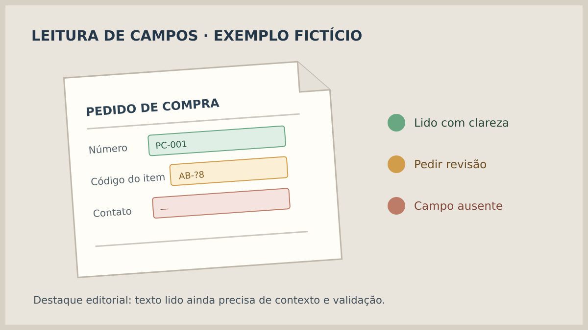
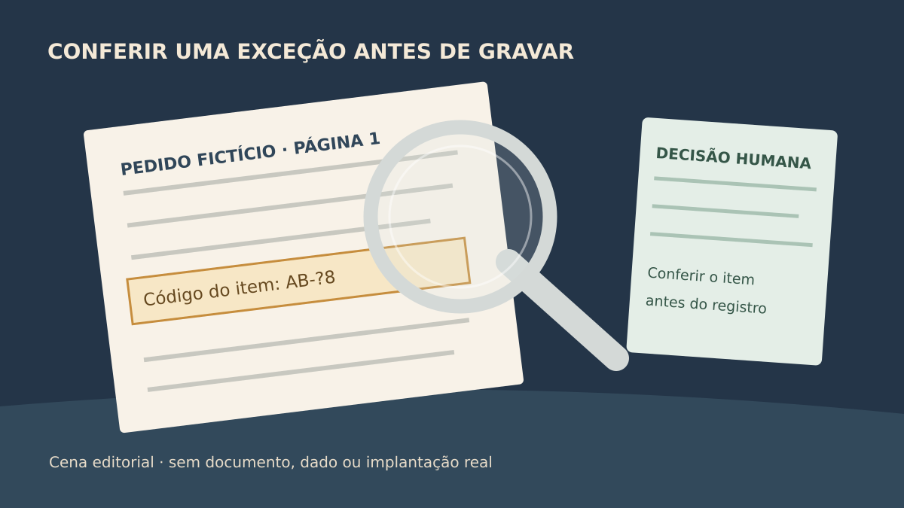

**Para usar dados lidos de um PDF no sistema, defina primeiro o que acontece entre a leitura e a gravação.** Um OCR pode reconhecer texto; outra etapa precisa encontrar os campos desejados, conferir regras do negócio e decidir se alguém deve revisar o resultado. O teste de aceite deve demonstrar essas decisões, inclusive quando o documento é ruim ou contém dados contraditórios.

Este roteiro serve para pedidos, formulários e outros arquivos recebidos repetidamente. Ele não presume que qualquer PDF seja legível, que toda informação extraída esteja correta nem que uma pontuação técnica dispense a conferência do processo.

## Qual documento entra e quais campos precisam sair?

Comece por **um tipo de documento e uma tarefa**. Um pedido de compra enviado por fornecedores, por exemplo, pode ter número, emissor, data, itens e valor total. Especifique quais desses campos serão usados de fato e qual sistema os receberá. Se o dado não gera ação ou consulta útil, talvez não precise entrar na primeira versão.

Reúna amostras autorizadas com variações reais de layout, páginas, digitalização e qualidade. A [documentação do Amazon Textract](https://docs.aws.amazon.com/textract/latest/dg/textract-best-practices.html) cita PDF e formatos de imagem como entradas de seu produto e recomenda arquivos legíveis, inclusive imagem de boa qualidade. Isso ajuda a formular o ensaio, mas não garante que o fornecedor escolhido aceite os mesmos formatos ou leia todas as amostras.

Defina também o que acontece com um arquivo protegido por senha, ilegível, incompleto ou repetido. A resposta pode ser recusar o envio, abrir uma pendência ou pedir um novo arquivo. “Upload concluído” só mostra que um arquivo chegou. O guia de [anexos no sistema](https://tornostudio.com/blog/anexos-sistema-envio-consulta-arquivos/) trata desse armazenamento; aqui a decisão é se os **dados interpretados** podem seguir adiante.

*O documento ilustrativo mostra que campos de uma mesma página podem pedir tratamentos diferentes. Não representa um pedido real nem resultado de ferramenta. Ilustração original Torno Studio, 2026.*

## Texto encontrado não é campo validado

Se um serviço lê “1.800”, o sistema ainda precisa saber se aquilo é quantidade, preço ou número do pedido. Mesmo quando um extrator retorna “valor total”, compare o dado com o contexto necessário: formato, campo obrigatório, fornecedor cadastrado e relação entre itens e total, conforme as regras escolhidas para a operação.

O [Google Document AI descreve pontuações de confiança para entidades extraídas](https://docs.cloud.google.com/document-ai/docs/custom-extractor-overview) e a possibilidade de usá-las para encaminhar campos de baixa confiança à revisão. A [AWS também recomenda considerar a pontuação e a sensibilidade do uso](https://docs.aws.amazon.com/textract/latest/dg/textract-best-practices.html). São exemplos de recursos de fornecedores, não uma escala universal nem prova de exatidão. Um campo com nota alta ainda pode divergir do documento ou da regra de negócio.

Escreva o destino de cada resultado: **aceito após validação**, **aguardando revisão** ou **não processado**. Escolha quem revisa, o que essa pessoa vê da fonte, quais campos pode corrigir e quando confirma a gravação. Se a operação tiver consequência financeira ou de atendimento, deixe claro qual ação fica bloqueada enquanto houver dúvida. O limiar e as validações devem ser acordados para o caso concreto, sem copiar um número genérico de outro projeto.

## Exemplo fictício: um pedido recebido por PDF

Uma empresa fictícia recebe um pedido de compra de duas páginas. O sistema identifica número, fornecedor e três itens. O valor total aparece legível, mas um item tem código parecido com outro produto cadastrado. A regra acordada é **não criar o pedido definitivo enquanto esse item estiver pendente**. Uma pessoa compara o trecho do PDF com os candidatos, corrige o código se necessário e confirma a operação.

Depois da confirmação, a tela mostra a versão do arquivo, os campos usados e o estado final. Se o mesmo documento for enviado novamente, a aplicação identifica a referência e informa o que já foi processado antes de criar outro pedido. **Fim do exemplo fictício:** não é um caso de cliente nem uma função já entregue pela Torno.

*A cena ilustra a decisão de revisar uma exceção antes de gravar dados. Ilustração original Torno Studio, 2026.*

## O que demonstrar no aceite?

Use documentos fictícios ou amostras autorizadas sem dados pessoais desnecessários. Compare o arquivo de entrada, os campos extraídos, as correções e o registro final no sistema de destino. Ao menos estes cenários merecem uma demonstração:

| Ensaio | Evidência esperada |
|---|---|
| Arquivo legível com campos completos | Dados correspondem à fonte e à regra antes da gravação |
| Campo ausente ou ambíguo | Pendência visível; não inventa valor nem conclui a tarefa |
| Correção por pessoa autorizada | Valor corrigido e ação confirmada aparecem no resultado |
| Arquivo repetido | Sistema informa o resultado anterior e evita efeito duplicado indevido |
| Falha ao gravar no destino | Pendência identificável, sem mensagem de sucesso enganosa |

Combine também o que será medido no piloto: tipos de arquivo aceitos, erros por campo, casos enviados à revisão e tempo gasto na conferência. Esses números só terão sentido quando medidos com amostras do processo; não há taxa de acerto universal a prometer. Se o destino for um ERP, o roteiro de [briefing de integração](https://tornostudio.com/blog/integracao-erp-briefing-orcamento/) ajuda a reunir acessos e regras. Para fontes já estruturadas, a [importação de planilhas](https://tornostudio.com/blog/importacao-planilhas-sistema-tratar-erros/) exige outra forma de validação e tratamento de erros.

Para [conversar com Henrique sobre o escopo](https://tornostudio.com/diagnostico/), leve um tipo de documento, algumas amostras autorizadas, os campos necessários, o sistema de destino e o custo de corrigir um dado errado. A primeira decisão pode ser automatizar só a triagem e a revisão, antes de permitir uma gravação automática.

*Fontes técnicas consultadas em 3 de novembro de 2026. Exemplos e figuras são editoriais; não alegam implantação ou desempenho da Torno.*
