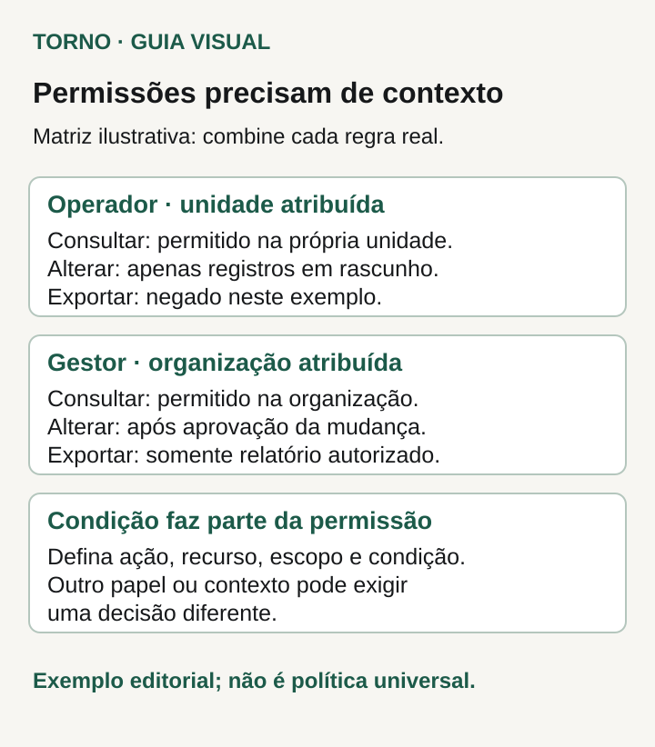
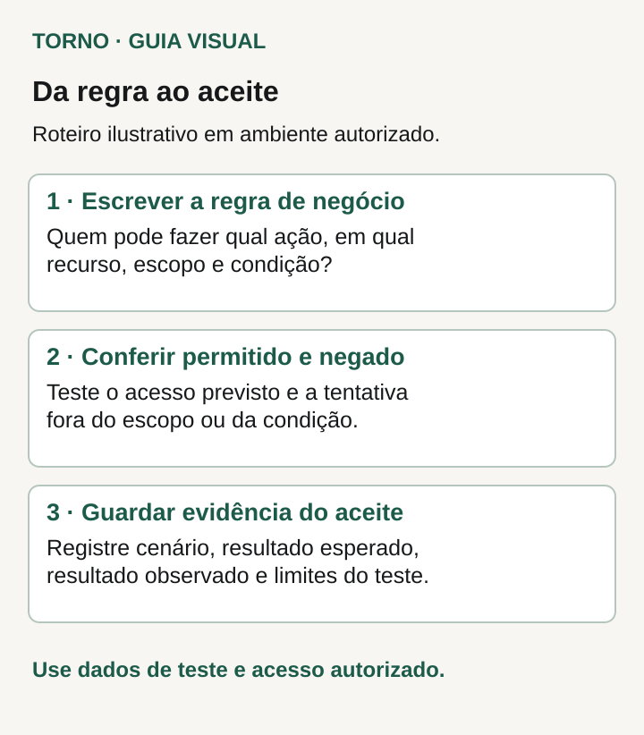

Antes de desenvolver um software, defina **quem pode fazer qual ação, sobre quais dados e em quais condições**. Registre também quem decide cada regra. “Ter perfil de gestor” ainda deixa perguntas abertas: gestor de qual unidade, autorizado a consultar ou também a exportar, com poder de alterar qualquer registro ou apenas alguns estados?

Uma matriz de permissões torna essas decisões discutíveis antes de virarem comportamento do produto. Ela permite pedir cenários de demonstração para o que deve ser permitido e para o que deve ser negado. A proposta abaixo ajuda o comprador a preparar essa conversa; a arquitetura e a verificação técnica dependem do sistema.

## Separe identificação de permissão

A [OWASP distingue autenticação de autorização](https://cheatsheetseries.owasp.org/cheatsheets/Authorization_Cheat_Sheet.html): identificar uma pessoa não determina todas as ações que ela poderá executar. A mesma referência recomenda acesso limitado ao necessário, negação por padrão e conferência das permissões em cada requisição.

Para começar a especificação, escreva as tarefas que cada pessoa precisa concluir. “Operador registra um pedido” é um ponto de partida mais concreto que “operador tem acesso básico”. Em seguida, decomponha a tarefa: consultar, criar, alterar, aprovar, excluir e exportar podem precisar de decisões diferentes.

Converse com quem conhece o processo de trabalho. O comprador pode indicar um responsável por validar as regras de pedidos e outro por relatórios, por exemplo. O desenvolvedor precisa saber a quem levar uma dúvida; um nome de perfil não resolve uma decisão de negócio que ninguém assumiu.

## Descreva o alcance dos dados

Duas pessoas com o mesmo perfil podem atuar em conjuntos diferentes de dados. A [documentação do Acesso Cidadão, mantida pelo PRODEST](https://docs.developer.acessocidadao.es.gov.br/AutorizacaoUsuarios/Autorizacao/), apresenta perfis vinculados a órgãos ou unidades e distingue ações como visualizar e exportar. É um exemplo público de modelagem, não uma regra que todo software deva copiar.

No seu projeto, esclareça o significado de “próprio”: registro criado pela pessoa, registro atribuído a ela, conjunto da unidade ou dados de toda a organização? Se o software atende empresas diferentes, diga também a qual empresa o acesso se refere. Use termos que o responsável pelo processo consiga conferir em exemplos.

Considere o que acontece quando alguém muda de unidade ou acumula funções. Pergunte quem pode conceder e remover acesso, quando a alteração passa a valer e qual registro permite conferir a decisão. Se essa parte ainda não foi decidida, marque a pendência na especificação, com responsável.

## Monte a matriz por ação, escopo e condição

Use uma linha para cada regra que possa produzir uma decisão diferente. Acrescente o recurso envolvido: “alterar” um rascunho de pedido e “alterar” o cadastro de uma unidade não são a mesma permissão.

**Matriz inteiramente hipotética de um sistema de registros.** As regras abaixo servem para discutir o formato. Não representam cliente, produto ou configuração da Torno. A regra concreta cabe ao comprador.

| Perfil | Recurso e ação | Escopo | Condição ou resultado esperado | Quem valida a regra |
|---|---|---|---|---|
| Operador da unidade | Consultar registros | Própria unidade | Consulta permitida dentro desse alcance | Responsável pelo processo da unidade |
| Operador da unidade | Alterar registro | Própria unidade | Somente enquanto estiver em rascunho | Responsável pelo processo da unidade |
| Operador da unidade | Exportar registros | Qualquer conjunto | Exportação negada | Responsável pela política de relatórios |
| Gestor da organização | Consultar registros | Conjunto da organização | Consulta permitida nesse alcance | Responsável pelo processo da organização |
| Gestor da organização | Alterar registro | Organização | Alteração permitida após aprovação prevista na regra | Responsável pelo fluxo de aprovação |
| Gestor da organização | Exportar relatório | Organização | Somente o relatório autorizado | Responsável pela política de relatórios |

*Matriz ilustrativa; papéis, escopos e condições precisam ser definidos para o software real. Crédito: Torno Studio.*

Nesta hipótese, o operador consulta a própria unidade, altera rascunhos e não exporta. O gestor consulta o conjunto da organização, altera após aprovação e exporta o relatório autorizado. **Fim da matriz hipotética.**

A matriz ainda precisa de detalhamento antes da implementação. O que conta como aprovação? Quem aprova? Qual é o relatório autorizado e quais campos ele contém? Em vez de deixar “após aprovação” como interpretação livre, registre o evento ou estado que torna a ação permitida. Se não houver acordo, aquela linha continua pendente.

## Trate consulta e exportação como decisões separadas

Ver dados em uma tela e gerar um arquivo são ações diferentes. A autorização de consulta não responde automaticamente se a pessoa pode obter um arquivo com todos os registros, com quais campos ou dentro de qual alcance. Peça que essa decisão apareça expressamente na matriz.

Faça perguntas sobre os caminhos que o produto realmente terá: lista, detalhe, busca, anexo e relatório. Um arquivo anexado pode precisar de regra própria. Um relatório pode reunir informações que não aparecem juntas na tela. A especificação deve nomear esses recursos para que o responsável técnico defina os controles correspondentes.

A OWASP orienta que a autorização seja conferida no lado confiável da aplicação, e não dependa apenas de controles na interface. Para o comprador, a consequência prática é pedir evidência da regra funcionando nos caminhos relevantes. Um botão oculto, sozinho, não demonstra que a operação está impedida.

## Escreva um cenário permitido e outro negado

Os [critérios de aceite de MVP](https://tornostudio.com/blog/criterios-aceite-mvp/) ajudam a transformar uma intenção em uma conferência da entrega. Para permissões, descreva o perfil, os dados de teste, a ação e o resultado esperado. Inclua os casos em que o sistema precisa negar a ação.

**Exemplo inteiramente fictício, continuando a matriz anterior:** em ambiente de teste autorizado, existem registros de duas unidades da mesma organização. Um operador está vinculado somente à primeira. Ele consulta um registro dessa unidade e altera um rascunho; as duas ações são permitidas. Ao tentar consultar um registro da outra unidade, a consulta é negada. Ao tentar exportar, a exportação é negada, mesmo para os registros que ele pode consultar.

Em outra sessão de teste, o gestor consulta o conjunto da organização. A alteração sem a aprovação exigida é negada; depois de satisfeita essa condição, a alteração prevista é permitida. Ele exporta apenas o relatório autorizado. O responsável confere o alcance dos registros e os campos do arquivo, além da mensagem exibida na tela. **Fim do exemplo fictício; não representa ensaio realizado pela Torno.**

*Roteiro ilustrativo para verificar regras de acesso em ambiente autorizado, com dados de teste. Crédito: Torno Studio.*

Essa sequência pede uma regra explícita, um cenário permitido, um cenário negado e uma evidência que o responsável consiga relacionar à regra. Registre versão, ambiente, perfil usado, condição dos dados, resultado esperado, resultado observado e limites do teste. O responsável técnico deve definir como demonstrar as verificações com segurança; essa ficha não substitui testes técnicos ou avaliação de segurança.

## Feche as dúvidas antes de aceitar a construção

Reúna as linhas ainda ambíguas e encaminhe cada uma ao responsável pela decisão. Evite tratar “administrador pode tudo” como resposta suficiente: especifique o alcance e as ações administrativas necessárias. Combine também como registrar exceções e como aprovar futuras mudanças de permissão.

Quando houver isolamento entre empresas e uma arquitetura compatível, o [guia técnico de RLS multiempresa](https://tornostudio.com/guias/rls-multiempresa/) aprofunda uma parte da implementação. A matriz deste artigo vem antes: explica o comportamento que precisa ser construído, independentemente da tecnologia escolhida.

Para conversar com Henrique sobre o escopo, traga os perfis previstos, as ações principais e exemplos de acesso que devem ser permitidos ou negados. Com isso, as dúvidas sobre permissão podem entrar na definição da entrega e nas evidências de aceite, com responsáveis identificados.
