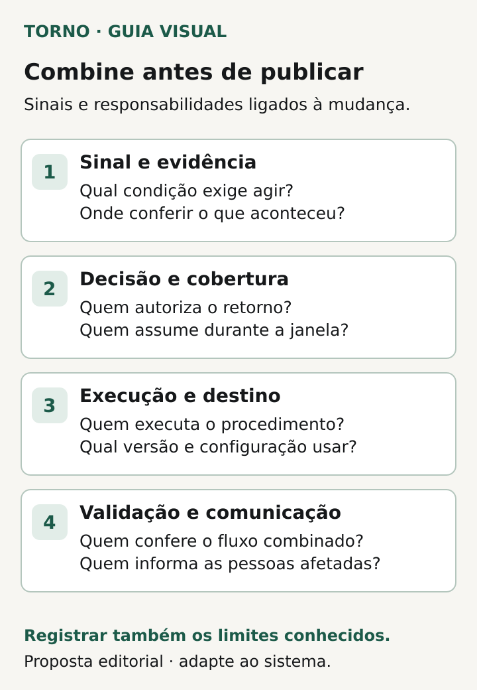
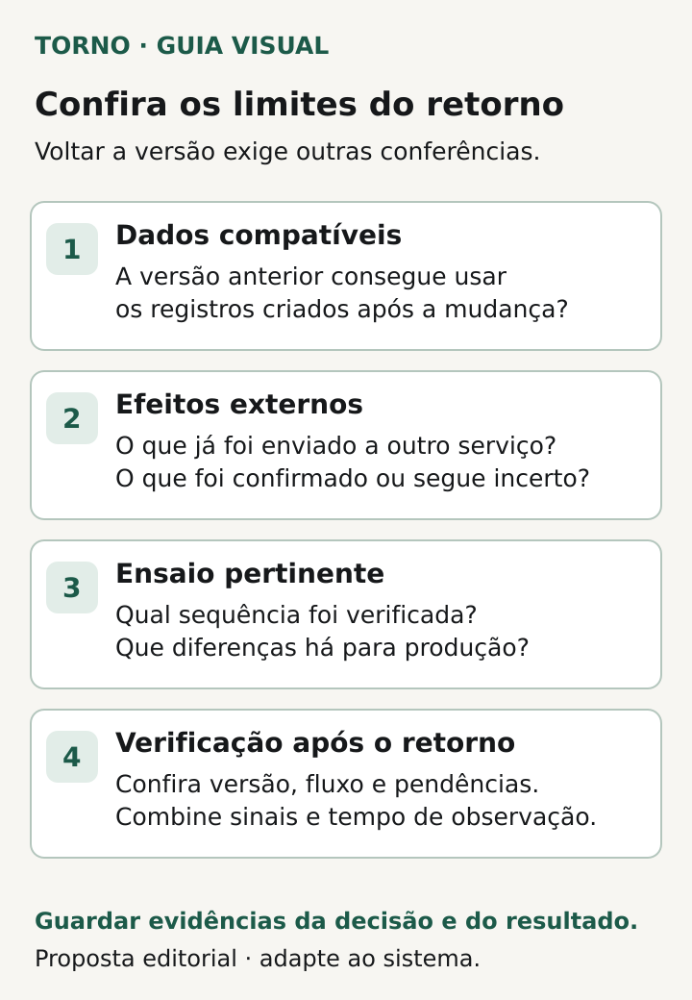

Antes de publicar uma atualização, combine **qual sinal exige interromper a mudança, quem decide, para qual versão é possível voltar e como conferir que a operação ficou utilizável**. Esse é o núcleo de um plano de rollback de software: um procedimento de reversão da atualização com condições e limites conhecidos.

“Se der problema, voltamos” deixa perguntas abertas justamente quando a operação precisa de uma decisão. O gestor pode pedir respostas verificáveis sem conhecer os comandos de publicação. O responsável técnico define e executa o procedimento; o responsável pela operação explica quais tarefas precisam continuar e valida o resultado combinado.

O roteiro abaixo é uma proposta editorial para preparar essa conversa antes da liberação. Não pressupõe que toda mudança seja reversível nem que voltar o código recupere dados ou desfaça ações externas.

## Defina o problema que justifica voltar

Comece pelo fluxo afetado: entrar no portal, aprovar uma solicitação, concluir um pedido ou emitir um documento. Escreva o comportamento esperado e a condição que exige ação. Um critério pode depender de um alerta técnico, de uma conferência operacional ou de ambos. Precisa permitir reconhecer o problema e localizar a evidência.

A [orientação de rollback da AWS](https://docs.aws.amazon.com/wellarchitected/latest/devops-guidance/dl.ads.2-implement-automatic-rollbacks-for-failed-deployments.html) associa a decisão a alarmes de métricas relevantes e recomenda observação após a publicação. A escolha dos indicadores e limites pertence ao sistema avaliado. Não há um número universal de erros ou minutos que sirva para qualquer operação.

Peça ao fornecedor que relacione cada sinal à sua consequência: continuar observando, interromper a ampliação da atualização, desativar uma função ou iniciar a reversão. Registre também quem recebe o aviso. Um alerta sem alguém disponível para agir deixa o procedimento incompleto.

## Separe decisão, execução e validação

Registre quem pode autorizar a reversão e quem tem acesso para executá-la. Se houver automatismo, pergunte quais condições o acionam e quem acompanha o resultado. Se a decisão for humana, defina quem assume quando a pessoa principal estiver indisponível durante a janela combinada.

O decisor precisa conhecer os limites antes da publicação. Em uma mudança com tratamento delicado de dados, a ordem “volte agora” pode exigir uma avaliação diferente da troca de uma página estática. O plano deve mostrar essa diferença com linguagem que a operação compreenda.

Combine ainda quem confirma o retorno do fluxo e quem comunica a situação aos usuários afetados. Executar o procedimento, verificar a operação e encerrar a ocorrência são etapas com evidências próprias. O nome de uma pessoa no documento precisa corresponder à disponibilidade acordada para aquela liberação.

## Peça uma ficha curta, ligada à atualização concreta

Use esta ficha para conferir o plano apresentado pelo fornecedor. Referências a documentos técnicos podem completar as respostas; não é necessário copiar detalhes de infraestrutura para o documento do gestor.

| Campo | Resposta a combinar antes da publicação |
|---|---|
| Mudança e alcance | Versão, fluxos, usuários e componentes envolvidos |
| Sinal para agir | Condição observável, evidência e ação correspondente |
| Responsáveis | Quem decide, executa, valida e comunica; cobertura da janela |
| Destino de retorno | Identificação da versão e configuração compatíveis |
| Dados | Alterações realizadas, compatibilidade e limites da reversão |
| Efeitos externos | Operações enviadas, pendências e forma de conferência |
| Ensaio | Ambiente, sequência verificada, resultado e diferenças para produção |
| Confirmação | Fluxo a testar após o retorno, observação e pendências para encerramento |

*Proposta editorial para ligar sinais de ação às responsabilidades antes da publicação. Diagrama original Torno Studio, 2026.*

Pergunte também quanto tempo o responsável estima para executar e verificar o procedimento e em que evidência baseia essa estimativa. Diferencie tempo medido em ensaio de expectativa ainda não verificada. Isso ajuda a operação a preparar uma alternativa temporária proporcional ao impacto.

## Confirme que a versão anterior consegue trabalhar com os dados atuais

Uma atualização pode alterar a estrutura do banco, transformar valores ou começar a gravar informações em outro formato. Voltar a aplicação não prova que a versão anterior consegue usar esse estado. A [AWS Builders Library](https://aws.amazon.com/builders-library/ensuring-rollback-safety-during-deployments/) demonstra esse risco com formatos de dados e descreve testes explícitos de atualização e reversão.

Para a decisão do gestor, a pergunta é concreta: **a versão escolhida para o retorno consegue ler e alterar os registros produzidos desde a atualização?** Peça a evidência do cenário pertinente. Quando não houver compatibilidade demonstrada, o plano precisa apresentar a alternativa técnica e suas condições antes da liberação.

Pode ser necessário dividir a mudança em etapas compatíveis, preparar uma correção ou prever outro procedimento de recuperação. Cabe ao responsável técnico propor o caminho. Evite transformar a existência de um botão de rollback em autorização para qualquer retorno.

Restaurar uma cópia anterior do banco é outra operação e exige avaliar o que aconteceria com os registros posteriores à cópia. A [prova de restauração de backup](https://tornostudio.com/blog/prova-restauracao-backup-software/) trata dessa capacidade de recuperação. No plano de atualização, registre se ela seria necessária e quem avaliaria seus efeitos; a palavra “backup” sozinha não resolve a decisão.

## Liste as ações que já saíram do sistema

Pergunte o que a atualização pode enviar para fora: pedidos ao ERP, solicitações de cobrança, mensagens ou comandos a outro serviço. Para cada fluxo relevante, combine como localizar operações concluídas, pendentes e com resultado ainda desconhecido.

Como proposta de planejamento, peça uma resposta para três situações: o serviço confirmou a ação; a ação falhou; a comunicação foi interrompida sem confirmação. O tratamento precisa respeitar a regra do produto e do serviço externo. Reverter a aplicação não equivale a cancelar uma cobrança, recolher uma mensagem ou eliminar um pedido já recebido.

Se houver necessidade de cancelar ou compensar uma operação, registre quem autoriza, quem executa e como confere o resultado. Não inclua reenvio em massa como resposta automática a uma situação desconhecida. O artigo sobre [eventos duplicados em integrações](https://tornostudio.com/blog/integracao-evento-duplicado-regra-negocio/) aprofunda o acordo de negócio para repetições.

## Veja como a ficha muda uma decisão

**Exemplo inteiramente fictício:** uma atualização altera a aprovação de pedidos num portal. O plano prevê retornar à versão anterior se o fluxo de aprovação deixar de concluir o cenário combinado. Antes de publicar, o fornecedor demonstra em teste que essa versão lê os pedidos gravados pela nova versão e identifica qual configuração precisa acompanhá-la.

Há uma ressalva: pedidos já enviados ao ERP continuarão existindo lá. A operação fica responsável por conferir a lista de envios e seus resultados, com acesso autorizado, antes de liberar novas tentativas. O plano distingue retorno do portal e tratamento dos pedidos externos. Se essa conferência ainda não estiver definida, há uma pendência concreta para resolver antes de liberar o fluxo correspondente. **Fim do exemplo fictício; não representa cliente nem teste da Torno.**

Esse registro permite discutir o risco da atualização com fatos e lacunas visíveis. Também evita que alguém conclua que tudo voltou ao estado anterior apenas porque a versão exibida mudou.

## Ensaie o retorno e delimite o encerramento

Peça evidência de um ensaio pertinente à mudança: versões envolvidas, dados representativos, sequência executada, resultado do fluxo e limitações do ambiente. A Builders Library descreve [verificações de avanço e retorno entre versões](https://aws.amazon.com/builders-library/ensuring-rollback-safety-during-deployments/); a evidência do seu fornecedor precisa corresponder ao seu cenário, inclusive ao estado criado durante a atualização.

A [Microsoft descreve exposição progressiva e feature flags](https://learn.microsoft.com/en-us/devops/operate/safe-deployment-practices) para controlar a liberação de funcionalidades. Pergunte se essas opções existem no produto e o que efetivamente interrompem. A possibilidade de desligar uma função precisa ser demonstrada e ter seus limites registrados, inclusive para tarefas em andamento.

Depois de uma reversão, confira a versão em uso, o fluxo combinado e as pendências de dados e integrações. Defina por quanto tempo e por quais sinais o resultado será observado, considerando o funcionamento da operação. Uma tela inicial que abre não demonstra, sozinha, que o pedido pode ser concluído.

Guarde o registro da decisão, da execução e da verificação. A próxima tentativa de publicar a mudança deve considerar o que falhou e qual evidência adicional passou a ser necessária. Os [critérios de aceite](https://tornostudio.com/blog/criterios-aceite-mvp/) ajudam a manter explícito o comportamento esperado da entrega.

*Proposta editorial para conferir os limites do retorno e guardar evidências da decisão e do resultado. Diagrama original Torno Studio, 2026.*

Esse plano responde à publicação de uma mudança concreta. Para decidir se o produto precisa de correções mais amplas ou reconstrução, reúna as [evidências antes de refazer um sistema](https://tornostudio.com/blog/antes-de-refazer-sistema-evidencias/). Uma atualização problemática é um dado para essa análise; a decisão precisa considerar o restante do produto e da operação.

Se uma atualização faz parte da retomada de um software travado, a [oferta de recuperação de projeto](https://tornostudio.com/recuperacao-de-projeto/) explica como a Torno avalia um escopo delimitado. Para conversar com Henrique, traga a mudança prevista, o fluxo afetado e o plano disponível. A conversa inicial serve para entender o contexto e o próximo passo; investigação técnica e execução dependem do escopo contratado.

*Fontes primárias consultadas em 21 de outubro de 2026. A ficha e o exemplo são propostas editoriais originais para adaptação ao sistema.*
