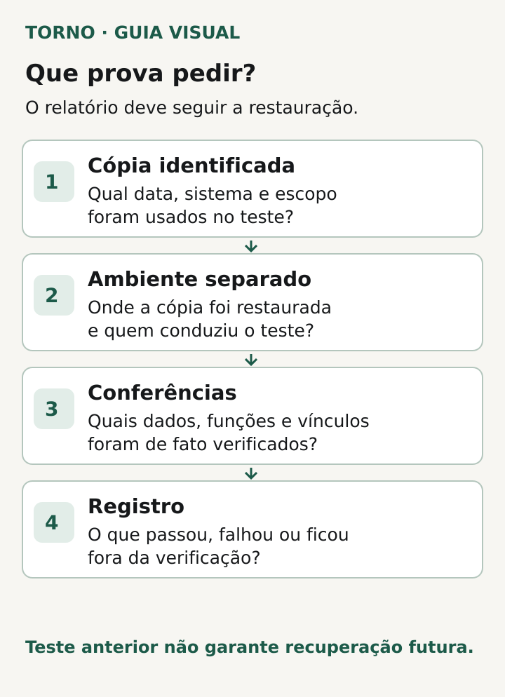
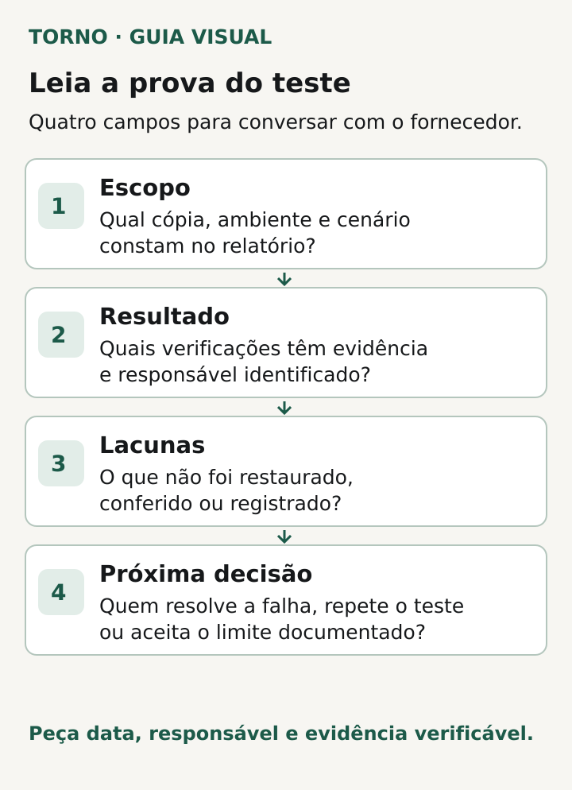

“Temos backup” responde apenas que existe uma cópia ou um processo para criá-la. Para quem contrata e depende do software, a pergunta útil é outra: **qual cópia foi restaurada, em que condições, o que foi conferido e o que ficou fora?** Um relatório que permita responder a isso vale mais do que uma captura de tela com o aviso “backup concluído”.

Não é preciso pedir ao fornecedor que execute uma restauração no sistema em produção para demonstrar controle. Peça uma **restauração planejada em ambiente separado**, com escopo e critérios combinados. A frequência e o ambiente adequados dependem do produto, dos dados e do risco operacional; este texto ajuda a ler a evidência, não substitui o plano técnico.

## Antes do relatório, combine o que precisa voltar

Escreva o que “voltar a funcionar” significa para sua operação. Pode envolver não só os registros do banco, mas arquivos anexados, configurações, integrações e uma tarefa essencial que precisa funcionar após a recuperação. Uma cópia de apenas uma dessas partes não comprova que o serviço inteiro voltaria.

Pergunte também qual **ponto dos dados** e qual **tempo de retorno** a empresa aceita para aquele serviço. Em continuidade, esses limites costumam ser chamados de RPO, a perda máxima de dados tolerada em tempo, e RTO, o tempo máximo definido para recuperar a operação. Não há um número universal: os objetivos precisam ser combinados conforme o impacto real de ficar sem o software ou perder alterações recentes.

A [AWS Well-Architected recomenda testar a recuperação e confrontar o resultado com os objetivos de tempo e de perda de dados estabelecidos](https://docs.aws.amazon.com/wellarchitected/latest/framework/rel_backing_up_data_periodic_recovery_testing_data.html). Essa é uma referência técnica para formular a pergunta ao fornecedor, mesmo quando a infraestrutura não é AWS. Ela não estabelece metas obrigatórias para todo produto.

## Peça evidência da consulta, não só do trabalho concluído

Um trabalho de restauração pode terminar com sucesso na ferramenta e ainda deixar uma dúvida: os dados restaurados foram abertos, conferidos e usados em uma tarefa do produto? A [AWS aponta como erro restaurar sem consultar ou recuperar dados para verificar se o resultado é utilizável](https://docs.aws.amazon.com/wellarchitected/latest/framework/rel_backing_up_data_periodic_recovery_testing_data.html). A [documentação do AWS Backup separa o trabalho de restauração da validação opcional do resultado](https://docs.aws.amazon.com/pt_br/aws-backup/latest/devguide/restore-testing.html). Seu fornecedor pode usar outra tecnologia, mas deve conseguir explicar essa distinção.

Peça uma demonstração ou relatório com a **origem da cópia**, a **data e hora do ponto recuperado**, o **destino isolado**, o **início e fim da operação**, o **critério de conferência** e o **resultado observado**. O registro não precisa conter senhas, tokens nem dados pessoais em claro. Uma amostra controlada, contagens, identificadores protegidos ou outro método definido pelo responsável técnico podem demonstrar a verificação sem circular informações sensíveis desnecessárias.

*Peça evidências do teste controlado, das conferências e dos limites encontrados. Diagrama original Torno Studio, 2026.*

## Leia o relatório em quatro perguntas

| Pergunta do contratante | O que procurar na resposta | O que continua sem prova se faltar |
|---|---|---|
| **Qual cópia e qual escopo?** | Identificação do ponto recuperado e dos componentes incluídos: banco, arquivos, configurações e dependências pertinentes. | Não se sabe se o teste cobre os dados e a operação que importam. |
| **O que funcionou depois?** | Conferência do conteúdo restaurado e execução de uma tarefa essencial no ambiente de teste, com resultado e falhas registrados. | “Job concluído” pode demonstrar apenas que a ferramenta criou um recurso. |
| **Quanto tempo levou e qual ponto foi recuperado?** | Tempo observado até a validação e distância entre o ponto recuperado e o momento do teste, comparados aos objetivos combinados. | Não se sabe se os limites aceitos pela empresa foram atendidos naquele ensaio. |
| **O que ficou de fora?** | Componentes, integrações, acessos e cenários não exercitados; pendências, responsável e novo teste previsto. | Um resultado parcial pode ser lido como cobertura completa. |

Essas perguntas são uma **ficha editorial para ler a evidência**, não um formulário universal de auditoria. Peça ao responsável técnico que explique o que cada verificação realmente demonstra para a arquitetura do seu produto.

*Use escopo, resultado, lacunas e responsável para ler o relatório de restauração. Diagrama original Torno Studio, 2026.*

### Exemplo fictício: o que um “sucesso” ainda não diz

**Exemplo inteiramente hipotético:** o fornecedor apresenta o registro “restauração concluída” de uma cópia do banco em ambiente separado. O relatório traz horário de início e fim, mas não informa se foram restaurados os arquivos anexados, se os registros foram consultados ou se a aplicação abriu uma tarefa essencial. O contratante pode aceitar que **o trabalho de restauração do banco foi executado naquele ensaio** e pedir, como próximo passo, validação de conteúdo, anexos e função crítica. Não é correto concluir, a partir desse registro, que o serviço completo estava recuperável. **Este exemplo é fictício e não descreve um cliente ou teste da Torno.**

## Termine com uma decisão verificável

Se a evidência cobre o escopo combinado, registre **data do teste, versão ou ponto da cópia, resultado e limite do que foi verificado**. Se há lacunas, peça um plano com responsável, critério de aceite e nova demonstração. Se o teste falhou, trate a falha como pendência operacional: defina o impacto e o que precisa mudar antes de repetir. Evite escrever “backup validado” quando só uma etapa foi observada.

Um teste bem documentado aumenta a confiança naquele mecanismo e naquele momento, mas não garante o resultado de um incidente futuro. Mudanças de infraestrutura, volume de dados, permissões ou dependências podem alterar o cenário. O [NIST publica um guia de planejamento de contingência para sistemas federais dos EUA](https://csrc.nist.gov/pubs/sp/800/34/r1/upd1/final) que inclui testar e exercitar planos; aqui isso serve como princípio de revisão periódica, não como obrigação para uma empresa brasileira.

Se você está **trocando de fornecedor**, a [passagem técnica e os acessos de operação](https://tornostudio.com/blog/troca-fornecedor-software-passagem-tecnica/) exigem um aceite próprio. Se está **mudando para outro sistema**, confira a [validação da migração de dados](https://tornostudio.com/blog/migracao-dados-validacao-troca-sistema/). E, ao definir quem executa e repete esses testes, inclua a responsabilidade no [escopo de manutenção após o lançamento](https://tornostudio.com/blog/custo-manutencao-software-apos-lancamento/).

Na Torno, a conversa sobre continuidade começa pelo produto concreto e pelo que o contratante precisa comprovar. Traga o relatório existente ou a lista do que ainda não foi testado; isso permite delimitar a próxima verificação sem fingir que uma cópia concluída equivale a serviço recuperado.
