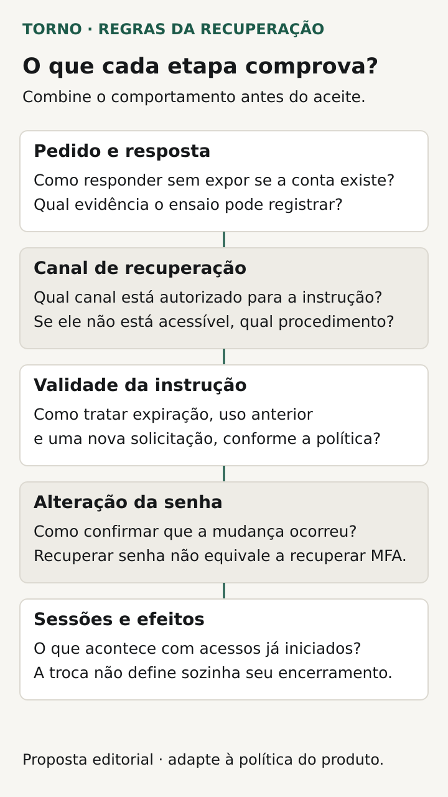
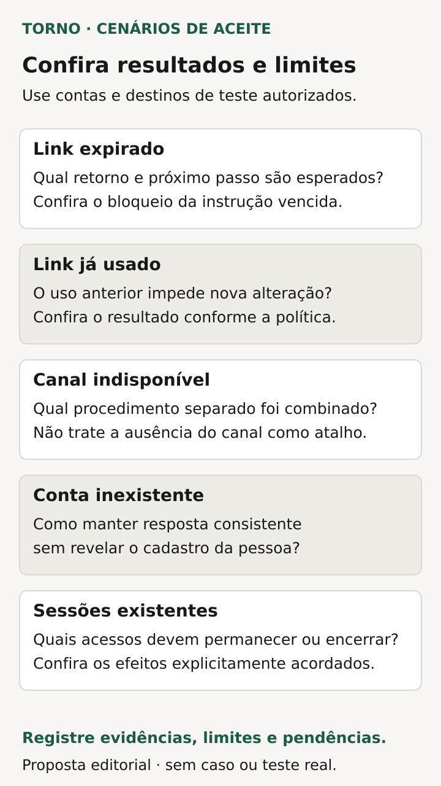

Antes de aceitar a recuperação de senha no sistema, combine **como a solicitação será respondida, quando o link poderá ser usado e qual estado confirma a conclusão**. Inclua o que acontece se o canal de recuperação estiver indisponível e o que ocorre com as sessões que já estavam abertas.

Para o comprador de um portal ou ferramenta interna, o fluxo precisa permitir que a pessoa retome o acesso nas condições previstas. Mostrar uma mensagem de envio não demonstra que a senha mudou; trocar a senha também não explica, sozinho, o estado das outras sessões.

Este roteiro propõe decisões e evidências para a conversa de escopo. A implementação e os controles técnicos dependem da solução adotada, do risco da conta e dos serviços envolvidos.

## Delimite qual problema o fluxo resolve

Comece pelos usuários e pelo modo de entrada no produto. A senha é administrada pelo próprio sistema ou por um serviço de identidade externo? Quem controla o canal de recuperação? O responsável técnico precisa identificar onde cada etapa acontece e quais condições dependem de outro provedor.

Separe senha esquecida, perda do canal e perda de outros meios de autenticação. Esses casos podem exigir caminhos diferentes. O [NIST SP 800-63B](https://pages.nist.gov/800-63-4/sp800-63b.html) distingue recuperação de conta de substituição de senha quando a pessoa ainda consegue autenticar-se por outro meio. Sua diretriz tem contexto próprio; não escolha um procedimento empresarial apenas copiando um método da referência.

Registre quais situações a entrega contemplará e o encaminhamento das demais. Se a conta exigir outro fator, recuperar a senha não deve ser apresentado como recuperação automática de todos os meios de acesso.

## Combine a resposta da solicitação sem expor contas

A [OWASP recomenda respostas consistentes para contas existentes e inexistentes](https://cheatsheetseries.owasp.org/cheatsheets/Forgot_Password_Cheat_Sheet.html), incluindo o cuidado com o tempo de resposta. Isso reduz a exposição de quais identificadores pertencem ao serviço. Uma resposta genérica também precisa orientar a próxima ação sem afirmar que a mensagem foi entregue.

Peça ao fornecedor que explique como essa exigência será verificada e quais controles adicionais limitam solicitações indevidas. Não basta conferir o texto de uma única tela. O responsável técnico deve definir a avaliação pertinente, com contas de teste e sem coletar identificadores de usuários reais.

Para a experiência do produto, combine o caminho de retorno ao login, a orientação para quem não recebeu a mensagem e a informação exibida durante o processamento. Se houver limites para novas solicitações, peça que o tratamento seja compreensível, sem presumir um prazo universal.

## Especifique o ciclo do link

A [OWASP orienta que tokens de recuperação sejam de uso único e expirem após um período apropriado](https://cheatsheetseries.owasp.org/cheatsheets/Forgot_Password_Cheat_Sheet.html). O contrato precisa traduzir essas propriedades em condições que possam ser demonstradas. O responsável técnico justifica a validade e define os detalhes; o comprador valida se o caminho de retomada atende ao processo.

Registre o que o usuário verá quando o link estiver expirado, já tiver sido usado ou não puder ser aceito. Defina uma próxima ação que não dependa de adivinhar o problema. Peça também a regra para mais de uma solicitação: o que acontece com os links anteriores e como orientar quem abriu uma mensagem antiga?

Uma nova solicitação e uma troca concluída são acontecimentos diferentes. A evidência deve mostrar quando a mudança foi confirmada e como o usuário prossegue depois dela. Não guarde links completos ou segredos em relatórios compartilhados de aceite.

## Trate entrega da mensagem e recuperação separadamente

Se o canal for e-mail, combine o vínculo entre a solicitação e a mensagem correspondente. O roteiro de [e-mails do sistema](https://tornostudio.com/blog/emails-sistema-envio-entrega-falha/) explica as fronteiras entre envio, entrega ao servidor destinatário e falha. Nenhuma dessas etapas equivale à conclusão da troca de senha.

Pergunte o que acontece quando há atraso. Um link pode chegar depois das condições em que seria aceito; a pessoa precisa ter um caminho compreensível para continuar. O fornecedor deve relacionar o tratamento da mensagem ao ciclo do link, com os limites conhecidos do provedor.

No caso de perda do canal, defina um procedimento próprio e quem pode conduzi-lo. Um contato com suporte não deve ser tratado como autorização suficiente para alterar credenciais. Identificação, responsabilidades e evidências necessárias precisam de avaliação específica; este artigo não propõe um atalho universal para recuperar contas.

## Decida o efeito sobre sessões existentes

Uma pessoa pode trocar a senha enquanto o sistema está aberto em outro navegador ou dispositivo. Peça que o responsável explique quais sessões serão encerradas ou exigirão nova autenticação, em que momento e com quais limitações. Inclua dependências de provedores externos, quando existirem.

A [OWASP Session Management recomenda reautenticação após eventos de risco](https://cheatsheetseries.owasp.org/cheatsheets/Session_Management_Cheat_Sheet.html), incluindo mudança de senha e recuperação. Essa orientação não comprova o comportamento do seu produto. A demonstração precisa avaliar as sessões previstas no escopo e mostrar o resultado observado.

Separe esse acordo das [permissões de acesso](https://tornostudio.com/blog/permissoes-acesso-software-regras-negocio/). Recuperar o meio de entrada não redefine quais registros e ações a pessoa está autorizada a usar. Se houver outra consequência administrativa, ela precisa de regra própria.

## Faça uma ficha antes de aceitar o fluxo

Use a tabela para localizar decisões pendentes. O detalhe técnico pode ficar em documentação referenciada, desde que o resultado esperado seja compreensível para quem confere a entrega.

| Decisão | Pergunta a responder |
|---|---|
| Escopo da recuperação | Qual meio de acesso e quais usuários o fluxo atende? |
| Resposta inicial | Como orientar sem confirmar publicamente a existência da conta? |
| Canal | Quem o administra e qual caminho existe se ele falhar ou for perdido? |
| Link | Quais condições de validade, uso e nova solicitação serão aplicadas? |
| Conclusão | Qual evidência confirma a troca e qual ação vem depois? |
| Sessões | O que acontece com acessos já estabelecidos? |
| Limites | O que exige outro procedimento ou avaliação especializada? |

*Defina o comportamento e os limites de cada etapa; trocar a senha não define sozinho os efeitos sobre sessões. Diagrama original Torno Studio, 2026.*

## Veja um exemplo de mensagem que chega tarde

**Exemplo inteiramente fictício:** uma conta de teste solicita recuperação por e-mail. A mensagem chega quando o link já não é aceito pela política definida. O resultado esperado é uma orientação de continuidade, sem alterar a senha naquela tentativa.

A pessoa inicia outra solicitação e conclui a troca com o link aceito nas condições do ensaio. O relatório confere o acesso com a nova credencial e o comportamento da sessão que permanecia aberta em outro navegador, conforme a regra contratada.

O caso também identifica o que foi simulado: se a mensagem foi capturada num ambiente de teste, o resultado não demonstra sua entrega num serviço real de e-mail. **Fim do exemplo fictício; não representa cliente, implementação ou teste da Torno.**

## Demonstre caminhos de sucesso e interrupção

Prepare contas fictícias e canais controlados no [ambiente de homologação](https://tornostudio.com/blog/ambiente-homologacao-conferir-antes-testar-sistema/). O responsável técnico deve definir um ensaio autorizado, com proteção dos segredos e sem interferir em contas reais.

Transforme a ficha em [critérios de aceite](https://tornostudio.com/blog/criterios-aceite-mvp/), registrando o resultado esperado antes de cada execução. Uma seleção inicial para discutir é:

| Cenário | Evidência a conferir |
|---|---|
| Solicitações com contas de teste existentes e inexistentes | Resposta e avaliação técnica coerentes com o requisito de não exposição |
| Link aceito nas condições definidas | Troca concluída e continuidade correspondente ao contrato |
| Link expirado ou já utilizado | Mudança não realizada e caminho de retomada compreensível |
| Mais de uma solicitação | Tratamento dos links conforme a política escolhida |
| Canal atrasado ou indisponível | Estado conhecido, orientação e procedimento previsto |
| Sessão aberta antes da troca | Comportamento de encerramento ou reautenticação demonstrado |

*Confira resultados com contas e destinos de teste autorizados e registre evidências, limites e pendências. Diagrama original Torno Studio, 2026.*

Guarde versão, contas e ambientes usados, resultados e limites, sem senhas ou links ativos na evidência. Essa conferência delimita o que foi demonstrado; não substitui avaliação de segurança do conjunto da autenticação.

Para a [conversa inicial com Henrique](https://tornostudio.com/diagnostico/), leve os perfis de usuários, o serviço de identidade e os casos em que o acesso precisa ser retomado. Isso permite delimitar fluxo, dependências e evidências da entrega, sem presumir um produto de autenticação pronto ou suporte contínuo incluído.

*Fontes consultadas em 28 de outubro de 2026. A ficha e o exemplo são propostas editoriais originais para adaptação ao produto.*
