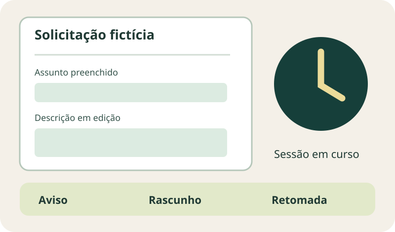
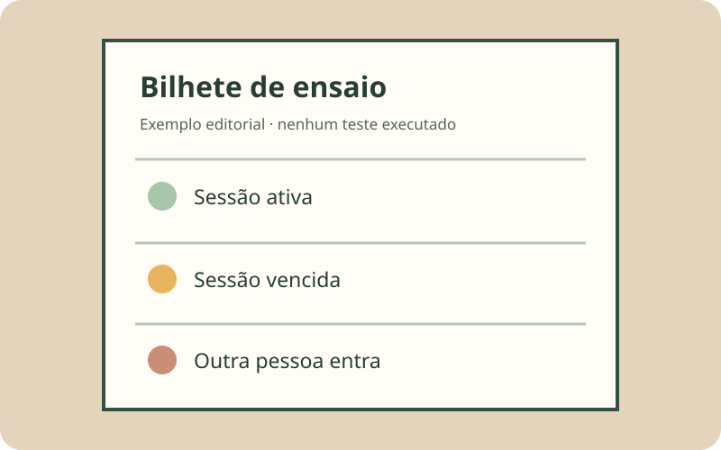

**Ao especificar um formulário interno, defina o que acontece se a sessão vencer antes de a pessoa clicar em salvar.** O requisito precisa dizer quando o acesso termina, como a pessoa é avisada, quais dados podem ser preservados e o que ocorre depois do novo login. Um botão que apenas mostra “sessão expirada” deixa essas decisões em aberto.

O [NIST SP 800-63B distingue dois relógios](https://pages.nist.gov/800-63-4/sp800-63b/session/): um limite total da sessão e outro por inatividade. A referência não impõe um prazo único a todo sistema privado; os limites dependem do risco, do ambiente e do tipo de aplicação. Para o comprador, a pergunta útil é qual comportamento será demonstrado em cada situação.

## Que informação pode ser perdida?

**Exemplo fictício:** uma pessoa preenche uma solicitação interna, consulta um documento fora da tela e volta depois de a sessão vencer. Há campos preenchidos, um anexo ainda não enviado e uma ação de “enviar” pendente. A tela pode continuar aberta mesmo que o servidor já não aceite a operação. O que deve acontecer com o rascunho e com o anexo? Quem poderá vê-los depois?

Faça um inventário curto: campos simples, dados sensíveis, anexos, seleção de opções e etapa atual. Especifique o que fica somente no navegador, o que pode virar rascunho no servidor e por quanto tempo. Uma regra de preservação que ignora privacidade, dispositivo compartilhado ou troca de usuário pode criar outro problema. A decisão depende dos dados e do contexto da organização.

*Cena conceitual fictícia para discutir requisitos; não representa tela de um produto. Ilustração original Torno Studio, 2026.*

## O aviso chega a tempo de agir?

O [W3C explica no critério WCAG 2.2, 2.2.6](https://www.w3.org/WAI/WCAG22/Understanding/timeouts.html) que a pessoa deve ser informada sobre a duração da inatividade capaz de causar perda de dados, salvo a condição de preservação descrita no critério. Esse é um critério de nível AAA, e citá-lo aqui não é declarar conformidade do sistema.

No escopo do projeto, defina quando o aviso aparece, o que diz e o que a pessoa pode fazer: continuar a sessão, salvar um rascunho, terminar a tarefa ou autenticar-se novamente. Confira se a mensagem funciona com teclado e leitor de tela. Não presuma que um contador visual isolado seja compreendido por todas as pessoas.

Há uma diferença entre avisar e realmente proteger o trabalho. Se o aviso surge quando a sessão já venceu, a ação de “continuar” pode falhar. Se o botão apenas reinicia um contador na interface, sem renovar a sessão válida no servidor, a pessoa só descobrirá o problema ao enviar. O aceite deve verificar a resposta real do sistema.

## Como retomar depois do login?

O [W3C, no critério 2.2.5](https://www.w3.org/WAI/WCAG22/Understanding/re-authenticating.html), aborda a continuação da atividade sem perda de dados após a reautenticação. Também é um critério de nível AAA; o desenho concreto precisa considerar o tipo de dado e as regras de acesso. Combine se a pessoa volta à mesma etapa, se precisa revisar o rascunho e se algum dado terá de ser informado novamente.

A retomada não pode entregar o rascunho à conta errada. Teste o caso em que outra pessoa entra no mesmo navegador depois do vencimento. Campos sensíveis, anexos e ações pendentes devem respeitar a identidade e as permissões vigentes. A [recuperação de senha](https://tornostudio.com/blog/recuperacao-senha-sistema-aceite/) é outro fluxo; conseguir entrar novamente não prova que os dados da tarefa foram preservados corretamente.

*Bilhete de ensaio fictício; os resultados esperados devem ser definidos para o sistema real. Ilustração original Torno Studio, 2026.*

## Cinco ensaios para o aceite

Use contas e dados fictícios no ambiente autorizado. Registre o instante, o estado do formulário e a resposta do servidor:

1. Preencha alguns campos e deixe a sessão inativa até pouco antes do limite. Confira o aviso e a ação disponível.
2. Deixe vencer por inatividade sem interagir. Tente salvar e confira mensagem, rascunho e acesso no servidor.
3. Mantenha a pessoa ativa até o limite total definido. Confira se a regra é distinta da inatividade.
4. Reautentique a mesma pessoa e confira etapa, valores, anexos e necessidade de revisão antes do envio.
5. Entre com outra conta no mesmo navegador e confirme que não recebe o rascunho anterior nem executa uma ação pendente.

Os critérios para [campos condicionais](/blog/campos-condicionais-formulario-sistema-aceite/) ajudam a testar outra parte do formulário: quais respostas mudam os dados exigidos. Neste artigo, o foco é a continuidade e a proteção da tarefa quando a sessão termina.

Se você está especificando um sistema interno, [uma conversa de diagnóstico](https://tornostudio.com/diagnostico/) pode transformar esses cenários em requisitos para seus usuários e dados reais. O roteiro acima não substitui uma análise de segurança e acessibilidade do projeto.
