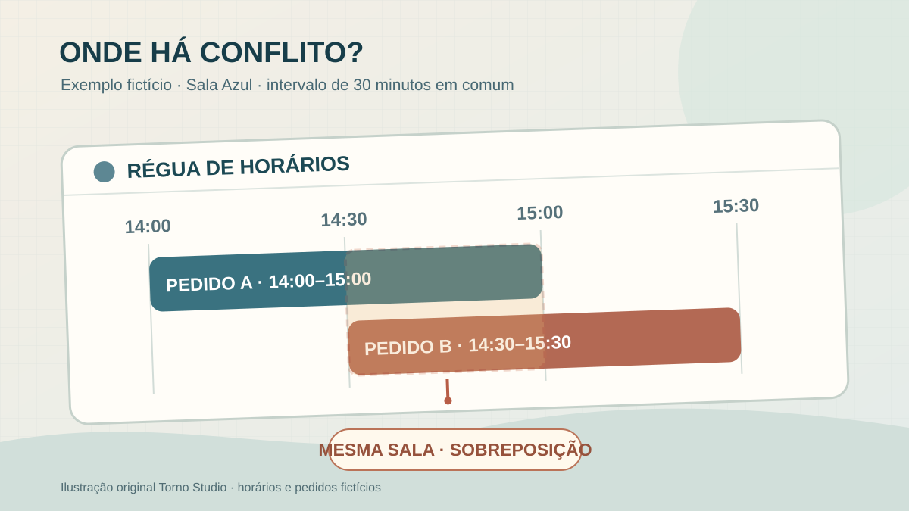
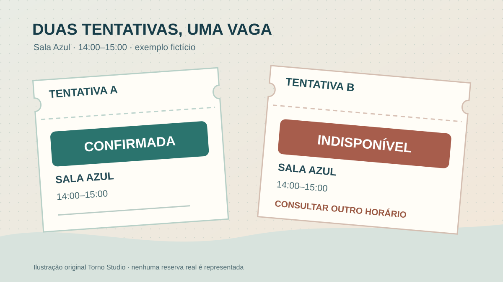

**Para impedir reserva dupla, defina o que é um conflito e teste duas tentativas de confirmação para o mesmo recurso e intervalo.** Mostrar um horário livre na tela não basta: outra pessoa pode escolhê-lo antes de a primeira concluir. O sistema precisa informar qual pedido foi aceito, qual foi recusado e o que cada pessoa deve fazer em seguida.

Este roteiro serve a quem contrata um agendamento para salas, equipamentos ou horários de atendimento. As regras precisam vir da operação: uma sala admite uma reserva por vez; um profissional pode atender em mais de uma unidade? Um horário inclui preparação ou limpeza? Sem essas respostas, “evitar conflitos” fica amplo demais para orçar e aceitar a entrega.

## Primeiro, nomeie o recurso e o intervalo

Uma reserva precisa indicar **o que está sendo reservado**, início e fim, quem solicitou e em que estado está. Diferencie sala, equipamento e profissional: se o serviço depende dos três, não basta verificar apenas a sala. Se dois atendimentos podem usar espaços diferentes no mesmo horário, o sistema não deve bloquear toda a empresa por engano.

Combine se o fim de uma reserva pode tocar o início da seguinte. Às vezes, das 9h às 10h e das 10h às 11h são compatíveis; se houver dez minutos de preparo, não são. O tempo de preparo deve entrar na regra de disponibilidade e aparecer para quem gerencia a agenda. O guia sobre [datas, horários e fusos](https://tornostudio.com/blog/datas-fusos-sistema-prazos-relatorios/) ajuda a não confundir o horário local escolhido com o instante armazenado.

*Defina o intervalo que bloqueia o recurso, inclusive preparo quando aplicável. Horários e sala são fictícios; ilustração original Torno Studio, 2026.*

## Quando o horário deixa de estar livre?

Escreva os estados: **solicitado, temporariamente reservado, confirmado, cancelado e concluído**, se todos fizerem sentido no seu processo. Uma solicitação aguardando pagamento bloqueia o recurso? Por quanto tempo? Uma reserva cancelada libera imediatamente o horário? Quem pode reabrir uma vaga? Essas escolhas alteram o que as pessoas veem como disponível.

**Exemplo inteiramente fictício:** uma empresa reserva a Sala Azul das 14h às 15h. Ana e Bruno abrem a agenda enquanto ela aparece livre. Ana confirma primeiro. Bruno tenta confirmar segundos depois; o sistema recusa a segunda confirmação, mostra que a vaga deixou de estar disponível e oferece uma nova consulta. Se o processo admite uma retenção temporária, o prazo e a expiração dessa retenção também precisam ser testados. O exemplo não descreve cliente ou sistema implantado pela Torno. **Fim do exemplo fictício.**

A [documentação do PostgreSQL mostra um mecanismo para impedir intervalos sobrepostos na mesma sala](https://www.postgresql.org/docs/current/rangetypes.html). É uma possibilidade de implementação, não uma exigência de tecnologia. O requisito do comprador é o resultado observável mesmo quando duas pessoas tentam reservar ao mesmo tempo. Uma checagem feita apenas quando a página carrega não prova esse resultado.

## Se houver calendário externo, combine a fonte de verdade

Pergunte qual agenda governa a confirmação: o sistema novo, um calendário externo ou outra ferramenta operacional. A [API FreeBusy do Google Calendar retorna intervalos ocupados](https://developers.google.com/workspace/calendar/api/v3/reference/freebusy/query), mas a resposta de uma consulta representa aquele momento; a documentação também prevê erros. Portanto, consultar “livre/ocupado” não deve ser confundido com confirmar uma reserva no seu sistema. O projeto precisa explicitar como tratar mudanças posteriores e falhas de consulta, se essa integração fizer parte do escopo.

Defina o que acontece se a agenda externa estiver indisponível: bloquear novas confirmações, permitir solicitação pendente ou seguir outra regra escolhida pelo negócio. Em todos os casos, a interface deve distinguir **confirmado** de **aguardando verificação**. Se a operação também cadastra compromissos por telefone, combine onde essa reserva manual entra e como chega à mesma regra de conflito.

*Duas pessoas podem ver a vaga; só o resultado de confirmação decide a reserva. Cena fictícia; ilustração original Torno Studio, 2026.*

## Prove o comportamento no aceite

Peça demonstração com dados fictícios e duas sessões de usuário. Anote horário, recurso, estado inicial, ações de cada sessão e resultado esperado. Inclua também o que o operador verá para resolver uma falha; não basta que o banco rejeite uma operação se a pessoa recebe uma mensagem incompreensível.

| Ensaio | Resultado a conferir |
|---|---|
| Dois pedidos para a mesma sala e intervalo | Apenas um chega ao estado confirmado; o outro recebe orientação clara |
| Intervalos encostados e intervalo de preparo | Bloqueio segue a regra combinada, sem impedir horário legítimo |
| Reserva cancelada ou retenção expirada | A vaga volta a aparecer conforme a política definida |
| Sala diferente no mesmo horário | Reserva válida não é recusada por conflito de outro recurso |
| Calendário externo indisponível | Não aparece confirmação sem a verificação exigida pelo processo |
| Reenvio de uma tentativa após falha de rede | O sistema não cria duas reservas confirmadas para a mesma solicitação |

Guarde o registro das tentativas, os estados finais e a mensagem exibida em cada sessão. A conversa sobre [edição simultânea](https://tornostudio.com/blog/edicao-simultanea-sistema-conflitos/) ajuda a discutir disputas entre usuários; o guia de [critérios de aceite de MVP](https://tornostudio.com/blog/criterios-aceite-mvp/) ajuda a organizar a evidência. Não use apenas um teste em sequência: ele não reproduz a disputa real entre confirmações.

Para [conversar com Henrique sobre um sistema de agendamento](https://tornostudio.com/diagnostico/), leve os recursos reserváveis, a regra de duração e preparo, os canais que hoje recebem reservas e um caso de conflito que sua operação precisa evitar. Isso permite delimitar o primeiro fluxo e sua prova antes de escolher telas ou ferramentas.

*Fontes técnicas consultadas em 4 de novembro de 2026. Sala, horários e ensaios são editoriais; nenhuma implantação ou resultado de cliente foi alegado.*
