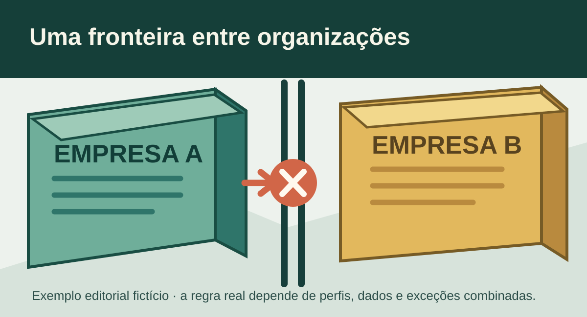
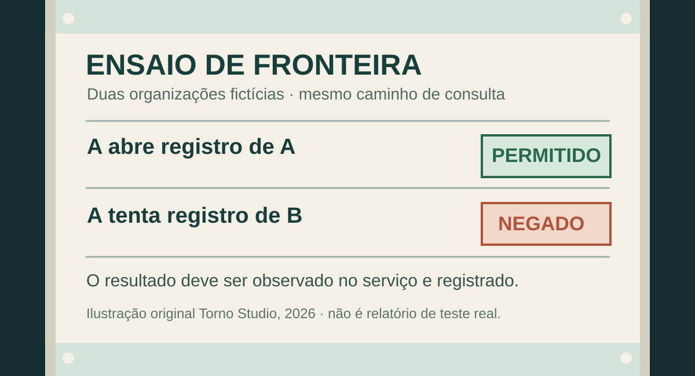

**Para aceitar um sistema multiempresa, peça uma demonstração com duas empresas fictícias e usuários separados.** Cada pessoa deve encontrar os próprios registros e deixar de encontrar os da outra organização — na tela, em links diretos, exportações, arquivos e chamadas de API previstas no projeto. Esconder uma opção na interface não comprova que o servidor impede o acesso.

Esse ensaio exige uma definição anterior: quais dados pertencem a cada empresa, quais podem ser compartilhados legitimamente e quem pode atravessar essa fronteira. Sem isso, “isolamento” vira uma promessa difícil de conferir.

## Defina a fronteira antes do teste

Num portal para clientes, uma empresa pode ter pedidos, documentos e usuários próprios. Em outro produto, uma holding pode precisar consultar várias unidades. Os dois casos têm regras diferentes. Registre quem pode consultar, alterar, baixar e exportar cada tipo de informação, incluindo as exceções autorizadas.

O artigo sobre [permissões de acesso](https://tornostudio.com/blog/permissoes-acesso-software-regras-negocio/) ajuda a formular perfil, ação e alcance dos dados. Aqui, o recorte é mais específico: verificar se o produto respeita a fronteira **entre organizações**, inclusive nos caminhos que não aparecem na tela principal.

A [orientação da OWASP para aplicações multiempresa](https://cheatsheetseries.owasp.org/cheatsheets/Multi_Tenant_Security_Cheat_Sheet.html) cobre identificação da organização e separação em dados, cache, arquivos e tarefas. Isso mostra por que o comprador deve pedir evidências além de uma lista filtrada. A arquitetura concreta continua sendo decisão do projeto.

*Cada empresa deve encontrar seus dados dentro do alcance contratado; a figura não representa um produto existente. Ilustração original Torno Studio, 2026.*

## Use o mesmo registro por caminhos diferentes

**Exemplo inteiramente fictício:** a Empresa A tem o pedido A-104 e um comprovante; a Empresa B tem o pedido B-205. Uma pessoa da Empresa A consulta A-104 normalmente. Depois, ela tenta abrir B-205 por pesquisa, por link direto e por uma exportação que inclua pedidos. O resultado esperado é o acesso negado ou a ausência do registro, conforme a regra acordada, sem revelar dados da Empresa B.

Repita a conferência para uma alteração. Uma pessoa da Empresa B não deve conseguir mudar A-104 apenas por conhecer seu identificador. O [OWASP API1:2023](https://api-security.owasp.org/editions/2023/en/0xa1-broken-object-level-authorization/) explica que operações de API com identificadores de objetos devem verificar se a pessoa tem autorização para agir naquele objeto. A rejeição precisa ocorrer no serviço que atende a requisição; ocultar o botão não basta.

Inclua o comprovante. Se houver um link de download, confira se a pessoa da outra empresa consegue usá-lo ou gerar outro. Para arquivos, a [OWASP recomenda verificar acesso ao objeto e à operação antes de servi-lo ou criar uma URL assinada](https://cheatsheetseries.owasp.org/cheatsheets/Multi_Tenant_Security_Cheat_Sheet.html). O comportamento específico deve constar no escopo, inclusive o que acontece com links já emitidos.

**Fim do exemplo fictício.** Não é relato de um sistema da Torno nem evidência de uma implantação real.

## Peça uma folha de aceite que registre o resultado

Uma demonstração útil identifica versão, ambiente, usuários de teste, registros sintéticos, ação tentada, resultado esperado e resultado observado. Separe o caso **permitido** do caso **negado**: se tudo for negado, o sistema pode simplesmente estar quebrado. Se apenas o caminho normal for testado, uma falha entre empresas pode passar despercebida.

| Ensaio fictício | Resultado a conferir |
|---|---|
| A consulta seu pedido | O registro autorizado aparece |
| A tenta abrir pedido de B por link | Nenhum dado de B é entregue |
| B tenta alterar pedido de A pela API | A mudança é recusada no servidor |
| A exporta seus pedidos | O arquivo não inclui registros de B |
| B tenta baixar anexo de A | O objeto não é entregue |

*A folha organiza perguntas para o aceite; não é prova de teste executado. Ilustração original Torno Studio, 2026.*

Faça esses ensaios em [ambiente de homologação autorizado](https://tornostudio.com/blog/ambiente-homologacao-conferir-antes-testar-sistema/), usando dados sintéticos. Registre também contas com acesso legítimo a mais de uma empresa quando essa função existir; elas precisam obedecer à regra própria, sem virar uma exceção implícita para todos os usuários.

## Refaça a prova quando o produto mudar

Uma liberação correta hoje não garante que uma mudança em consulta, cache ou exportação preserve o mesmo limite amanhã. A [OWASP descreve testes de regressão entre duas organizações](https://cheatsheetseries.owasp.org/cheatsheets/Authorization_Regression_Testing_Cheat_Sheet.html): semeia dados de uma, consulta como usuário da outra e verifica que a resposta não contém registros da primeira. Combine quais cenários ficarão automatizados e quando serão executados novamente.

Se a equipe usar isolamento por políticas de banco, o [guia técnico de RLS multiempresa](https://tornostudio.com/guias/rls-multiempresa/) aprofunda uma técnica possível. A prova de aceite continua necessária: uma política de banco não demonstra sozinha o comportamento de arquivos, cache, exportações e demais caminhos do produto.

Antes de contratar ou liberar o sistema, leve ao fornecedor dois exemplos de organizações, seus tipos de registro e uma exceção legítima, se houver. Isso permite definir a fronteira e pedir uma demonstração observável. Para avaliar o escopo de um portal ou ferramenta interna, [converse com Henrique](https://tornostudio.com/diagnostico/).

*Fontes consultadas em 2 de novembro de 2026. Os exemplos e figuras são editoriais; nenhum resultado de cliente foi alegado.*
