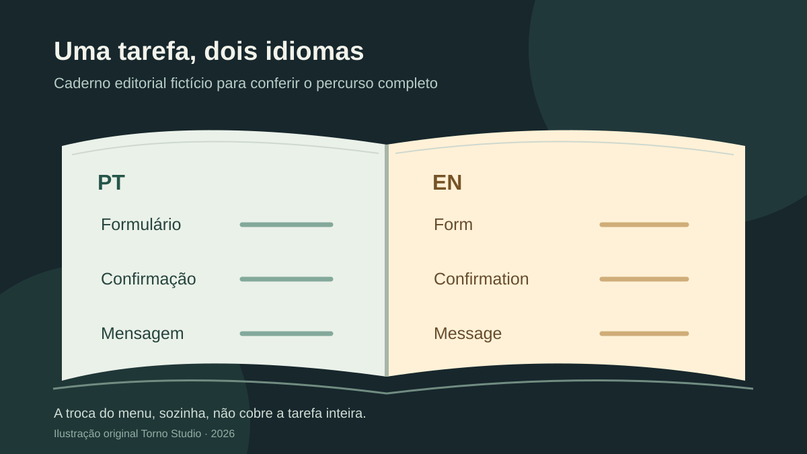

*Leitura estimada: 6 minutos.*

**Para contratar um sistema em mais de um idioma, defina primeiro quais pessoas precisam concluir quais tarefas em cada idioma.** Depois combine quem fornece e revisa o texto, como datas e números serão apresentados, o que acontece quando falta tradução e como cada fluxo será testado. Um botão para trocar o idioma não prova que o serviço inteiro funciona para o novo público.

O [W3C distingue localização de simples tradução](https://www.w3.org/International/questions/qa-i18n): conforme o público e o produto, também podem mudar formatos de datas e números, endereços, ordenação e referências culturais. Essa lista é um mapa de perguntas, não um pacote obrigatório para todo projeto.

## Quais partes precisam funcionar em cada idioma?

Faça um inventário por tarefa, não só por tela. **Exemplo fictício:** uma pessoa abre uma solicitação, recebe confirmação por e-mail e volta depois para consultar o estado. A experiência inclui formulário, erros, ajuda, confirmação, mensagem enviada e histórico. Se apenas o formulário tiver tradução, a tarefa pode terminar em outro idioma.

Anote para cada fluxo o idioma inicial, a opção de troca, os textos envolvidos e quem aprova a redação. Inclua conteúdo criado por usuários e documentos anexos na discussão: traduzir rótulos da interface não traduz automaticamente esses materiais. Também defina se uma pessoa poderá salvar uma preferência de idioma e como alterá-la.

*O percurso representa uma pergunta de escopo, não uma tela de sistema existente. Ilustração original Torno Studio, 2026.*

## Idioma e formato local são a mesma escolha?

Não necessariamente. O [rascunho técnico do W3C sobre tags de idioma e identificadores de localidade](https://www.w3.org/TR/ltli/) separa usos como linguagem da interface e apresentação de datas, horas, números e listas. Alguém pode querer ler em português e ver valores em uma moeda de operação específica. O projeto precisa escolher essas regras em vez de inferi-las de uma bandeira ou do endereço de rede.

Para o aceite, peça exemplos de um valor, uma data e uma mensagem em cada configuração combinada. A [API Intl documentada pelo W3C](https://www.w3.org/International/articles/intl/index) oferece recursos de formatação sensível à localidade. Ela ajuda a apresentar valores; **não decide qual moeda a empresa cobra, não converte dinheiro e não traduz conteúdo**.

Se o produto lida com prazo, especifique separadamente instante, fuso e calendário de negócio. O guia sobre [datas e fusos em sistemas](https://tornostudio.com/blog/datas-fusos-sistema-prazos-relatorios/) trata dessa regra. Trocar a aparência de “06/11” para outro formato não deve alterar o momento em que uma ação vence.

## Quem mantém a tradução quando o produto muda?

Novas funções criam novos textos. Combine quem entrega a versão inicial, quem aprova termos do negócio e o que acontece quando uma tradução está ausente ou desatualizada. Defina um idioma de fallback, indique claramente quando ele aparece e registre a pendência para correção. Uma tradução automática pode servir de apoio em algum contexto, mas não deve ser tratada como revisão humana implícita.

Uma ficha simples de contratação pode conter:

| Decisão | Evidência a pedir |
|---|---|
| Idiomas e público | Lista de fluxos disponíveis em cada idioma |
| Conteúdo | Responsável por texto, revisão e atualizações |
| Formatos | Exemplos de datas, números e valores em cada configuração |
| Falta de tradução | Regra de fallback e forma de registrar a pendência |
| Aceite | Tarefas completas executadas em cada idioma previsto |

Essa ficha é uma proposta editorial, não um relato de projeto de cliente. Ajuste-a ao fluxo real. Os [critérios de aceite de MVP](https://tornostudio.com/blog/criterios-aceite-mvp/) ajudam a transformar cada linha em cenário observável, com resultado esperado e evidência.

## Como testar antes de aceitar?

Execute a mesma tarefa ponta a ponta em cada idioma acordado. Confira rótulos, mensagens de erro, e-mails e retorno ao sistema. Use dados de exemplo declarados como fictícios; teste texto curto e longo para detectar cortes e mudanças de layout. Inclua mobile se ele fizer parte do escopo. Registre exatamente qual idioma, navegador, perfil e versão foram observados.

Quando surgir um texto em outro idioma, identifique se é fallback esperado, conteúdo do usuário ou tradução faltante. Essa distinção evita aceitar uma falha por engano e também evita cobrar do fornecedor tradução de um material que nunca entrou no escopo.

Se você está avaliando um sistema sob medida para públicos em mais de um idioma, leve os fluxos e idiomas desejados para uma [conversa de diagnóstico com a Torno](https://tornostudio.com/diagnostico/). Posso ajudar a delimitar o trabalho de software; textos especializados e requisitos legais locais precisam de profissionais apropriados quando fizerem parte do projeto.

## Perguntas frequentes

### Traduzir os menus torna o sistema multilíngue?

Só se o escopo exigido terminar nos menus, o que é raro em uma tarefa completa. Combine também formulários, erros, confirmações, mensagens e manutenção do conteúdo pertinente.

### Trocar o idioma muda a moeda cobrada?

Não por si só. Idioma, formato de exibição e moeda de cobrança são decisões diferentes que precisam ser especificadas.

### Como tratar uma frase ainda não traduzida?

Defina o fallback, mostre a pendência de modo identificável e combine quem entregará a tradução. O comportamento precisa ser testado no fluxo em que a frase aparece.
