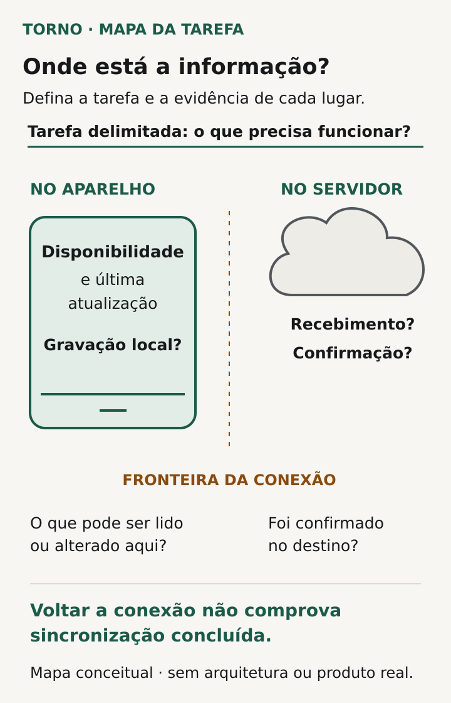
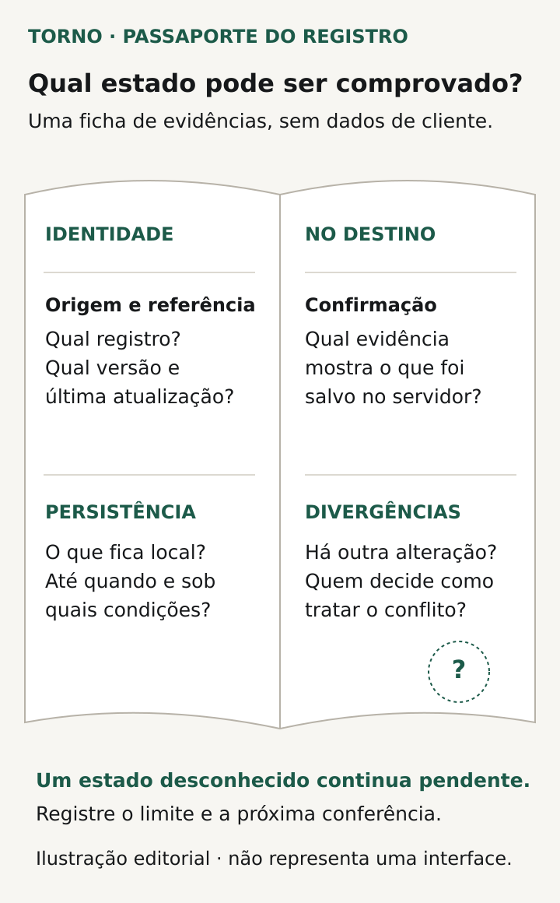

Um **sistema sem internet precisa ter tarefas e dados delimitados**: o que a pessoa consegue consultar ou alterar, o que permanece apenas no aparelho e como reconhecer a confirmação posterior no servidor. Uma mensagem de “salvo” ou o retorno do ícone de conexão não demonstra, por si só, que o trabalho está disponível para outras pessoas.

Antes de contratar essa capacidade para um portal ou ferramenta interna, descreva a atividade que precisa continuar durante a falta de rede. O aceite deve cobrir a preparação, a execução desconectada e a retomada, com limites conhecidos. Este roteiro ajuda a formular esse acordo sem escolher uma tecnologia para todo projeto.

## Comece pela tarefa que precisa continuar

Troque “o sistema deve funcionar offline” por uma descrição verificável. A pessoa precisa consultar registros previamente selecionados, preencher um rascunho ou concluir uma ação que depende de outro serviço? São compromissos diferentes. Decida quais etapas podem esperar e quais precisam de uma resposta atualizada para prosseguir.

Liste também os dispositivos e formas de acesso previstos. O comportamento demonstrado num aplicativo de celular não comprova o mesmo resultado num navegador, em outro aparelho ou na primeira abertura. Peça ao responsável técnico que indique as condições suportadas e as que exigem conexão.

A [documentação do Power Apps para aplicativos canvas](https://learn.microsoft.com/en-us/power-apps/mobile/limitations-canvas-apps) enumera limitações específicas de conectores, fluxos e outros recursos no modo offline. Esse exemplo de produto mostra por que a conferência precisa ser feita por ação. Não significa que seu software use Power Apps ou tenha aquelas mesmas restrições.

## Defina quais dados estarão no aparelho

Para consultar um registro desconectado, combine como ele se torna disponível antes da falta de rede. Quais registros e campos entram no conjunto local? A seleção corresponde ao trabalho da pessoa? O que acontece se ela procurar um item que nunca foi preparado naquele dispositivo?

A [visão geral do modo offline do Power Apps](https://learn.microsoft.com/en-us/power-apps/mobile/mobile-offline-overview) descreve configuração de tabelas e acesso inicial à rede para baixar dados, além da necessidade de conexão para sincronizar com o Dataverse. É o contrato daquele produto. No seu projeto, peça a descrição equivalente das condições de preparação, sem presumir uma cópia de todo o sistema.

Diferencie ausência local de inexistência no servidor. “Não disponível neste aparelho” pode exigir uma orientação diferente de “registro não encontrado”. Defina também o que a pessoa verá quando a preparação inicial estiver incompleta ou tiver falhado.

Inclua o destino dos dados locais ao sair da conta, trocar de usuário ou mudar de aparelho. Quem pode usar o dispositivo e quais dados podem permanecer nele são decisões de escopo. Peça comportamento e evidência próprios; a possibilidade de consultar algo offline não autoriza disponibilizá-lo a qualquer pessoa.

## Mostre quando a informação pode estar desatualizada

Uma consulta local pode refletir uma versão anterior à que está no servidor. Combine como a pessoa reconhecerá a origem e a referência de atualização dos dados, sem interpretar uma consulta antiga como confirmação atual.

Pergunte quais decisões podem ser tomadas com essa informação. Se uma etapa exige conhecer uma condição atual do serviço central, defina se ficará indisponível, se poderá ser preparada como rascunho ou se terá outro comportamento contratado. Evite deixar essa escolha implícita numa tela que parece igual à versão conectada.

O acordo também precisa explicar quando novos dados serão buscados e como uma falha nessa atualização será apresentada. Mostrar um horário ajuda a contextualizar a informação; não prova que todos os registros necessários foram atualizados com sucesso.

| Parte da tarefa | Definição para o aceite |
|---|---|
| Consulta | Conjunto local disponível e referência de atualização |
| Preenchimento | Campos permitidos e dependências que exigem rede |
| Gravação local | Confirmação visível e condições de preservação |
| Envio ao servidor | Como reconhecer pendência, falha e confirmação |
| Continuidade | Comportamento ao fechar, reabrir ou trocar de conta |
| Limites | Ações e condições excluídas do funcionamento offline |

*Delimite a tarefa e confira a evidência em cada lugar; voltar a conexão não comprova sincronização concluída. Ilustração original Torno Studio, 2026.*

## Separe gravação local de confirmação no servidor

Defina estados compreensíveis para a operação. Uma alteração pode estar gravada no aparelho, aguardando envio, com problema identificado ou confirmada no destino. A interface e as instruções de uso precisam permitir distinguir essas situações conforme a solução contratada.

Peça que “concluído” tenha significado explícito. Uma tarefa concluída localmente já permite iniciar a próxima atividade? Outra pessoa consegue vê-la? Algum processamento externo ainda precisa ocorrer? O comprador deve conseguir explicar essas respostas sem depender de uma leitura técnica dos registros do sistema.

Teste também fechar e reabrir nas condições previstas. Registre o que permanece disponível e quais ações podem afetar dados ainda não enviados. Não transforme um ensaio bem-sucedido em garantia de preservação sob perda, limpeza ou substituição do aparelho: cada condição precisa estar incluída ou declarada como limite.

## Confira a retomada pela operação, não pelo ícone

A [MDN explica que Navigator.onLine usa heurísticas](https://developer.mozilla.org/en-US/docs/Web/API/Navigator/onLine): uma rede local pode ser considerada conectada mesmo sem acesso à internet. Assim, um indicador de conexão pode orientar a pessoa, mas não demonstra que o serviço necessário recebeu sua alteração.

No aceite, acompanhe uma tarefa identificável até a confirmação acordada no servidor. Confira os dados no destino autorizado e o estado apresentado no aparelho. Se a rede voltar e cair novamente, a pessoa precisa saber o que continua pendente e qual ação cabe a ela.

Combine quem acompanha as pendências que não se resolvem e quais informações permitem pedir ajuda sem expor dados desnecessários. A mensagem deve orientar o próximo passo previsto, em vez de induzir a repetir indefinidamente a mesma operação.

Se a retomada encontrar outra alteração no mesmo registro, defina a regra e remeta aos [conflitos de edição simultânea](https://tornostudio.com/blog/edicao-simultanea-sistema-conflitos/). A sequência de mudanças externas tem outro recorte, tratado em [eventos fora de ordem](https://tornostudio.com/blog/integracao-eventos-fora-ordem/). A capacidade offline precisa considerar essas dependências quando existirem, sem presumir que qualquer divergência será resolvida automaticamente.

*Registre o que pode ser comprovado, as condições de preservação e as pendências; a ficha não representa uma interface de produto. Ilustração original Torno Studio, 2026.*

## Veja um exemplo de escopo delimitado

**Exemplo inteiramente fictício:** uma ferramenta interna permite preparar uma solicitação a partir de cadastros disponibilizados previamente no aparelho. Sem rede, a pessoa consulta esse conjunto e preenche um rascunho. A confirmação da solicitação depende de recebimento e validação no servidor.

O acordo exige distinguir rascunho local de solicitação confirmada. Um cadastro que não foi disponibilizado não pode parecer inexistente no sistema inteiro. Se a conexão retornar, mas a validação apontar uma pendência, o registro permanece identificável e a orientação de correção precisa estar visível.

A demonstração inclui fechar e reabrir o acesso nas condições suportadas, retomar a conexão e conferir o resultado no destino. **Fim do exemplo fictício; não representa cliente, funcionalidade ou teste realizado pela Torno.**

## Monte uma conferência com condições registradas

Prepare os ensaios em [ambiente de homologação autorizado](https://tornostudio.com/blog/ambiente-homologacao-conferir-antes-testar-sistema/), com dados fictícios, dispositivos e versão identificados. Registre a condição inicial e o resultado esperado antes de executar cada cenário.

- Primeira abertura sem preparação: a limitação aparece com orientação adequada.
- Dados preparados e rede indisponível: consultas e alterações seguem o escopo.
- Dado local antigo: a pessoa reconhece a referência disponível.
- Fechamento e reabertura: o trabalho preserva o comportamento contratado.
- Retorno instável da rede: pendências e confirmações continuam distinguíveis.
- Falha no destino: a tarefa não aparece como confirmada indevidamente.
- Confirmação: o conteúdo esperado é conferido no servidor autorizado.

Guarde evidências, diferenças, responsável pela correção e nova verificação. Um teste de desconexão demonstra as condições exercitadas; não comprova todos os aparelhos, durações ou falhas possíveis.

## Perguntas frequentes

### Salvo no aparelho significa sincronizado?

Não. O aceite precisa distinguir a gravação local da confirmação no destino e mostrar o que permanece pendente. A terminologia depende do produto, mas o significado deve ser compreensível para quem executa a tarefa.

### O sistema inteiro precisa funcionar sem internet?

O escopo pode ser uma tarefa ou parte dela. Defina os dados necessários, as dependências de rede e o que será bloqueado ou preparado para depois; a viabilidade depende da aplicação.

### Voltar a conexão confirma o envio?

Não por si só. Confira o resultado da operação e a evidência no destino acordado, incluindo o tratamento de falhas e de pendências.

Para a [conversa inicial com Henrique](https://tornostudio.com/diagnostico/), leve a tarefa afetada, os dispositivos previstos e exemplos das situações de falta de conexão. Isso ajuda a delimitar viabilidade, implementação e aceite, sem presumir uma plataforma offline pronta ou garantia de ausência de perdas.

*Fontes consultadas em 30 de outubro de 2026. A ficha, os cenários e o exemplo são propostas editoriais para adaptação ao projeto.*
