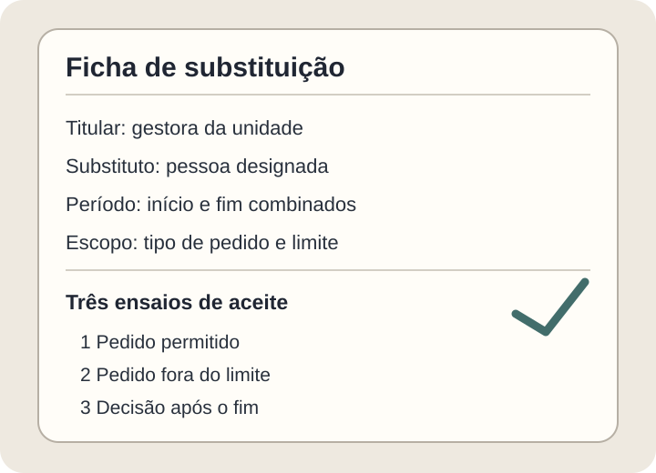

**Se um aprovador sai de férias, o sistema precisa saber quem pode decidir em seu lugar, por quanto tempo e sobre quais pedidos.** Sem essa regra, solicitações podem parar; com uma regra ampla demais, alguém pode decidir fora de sua autoridade. O aceite deve verificar tanto a continuidade do trabalho quanto os limites da substituição.

Este guia serve a quem contrata um sistema interno de compras, despesas ou solicitações. Trata especificamente da **ausência temporária** de quem aprova. O [guia de fluxo de aprovação](https://tornostudio.com/blog/fluxo-aprovacao-sistema-regras/) cobre a sequência geral de decisões; aqui a pergunta é o que muda quando a pessoa responsável não está disponível.

## Substituir, reatribuir ou escalar?

Essas palavras podem representar regras diferentes. **Reatribuir** é mover uma solicitação concreta para outra pessoa. A [documentação do Power Automate mostra a reatribuição de uma aprovação recebida](https://learn.microsoft.com/en-us/power-automate/approvals-howto). **Delegar por período** pode encaminhar novas solicitações durante uma ausência: a [Oracle descreve delegação com datas de início e fim](https://docs.oracle.com/en/cloud/saas/netsuite/ns-online-help/bridgehead_1506060872.html). **Escalar** pode significar enviar um pedido parado ao responsável seguinte. Esses exemplos mostram possibilidades de produto; não definem como seu sistema deve funcionar.

Antes de pedir uma tela, decida qual evento muda o destino da solicitação. A regra vale somente para pedidos novos? Os que já aguardavam aprovação também mudam? Quem pode ativá-la: o próprio aprovador, o gestor ou um administrador? E quem pode cancelá-la antes do prazo?

*Agenda editorial fictícia. A faixa ilustra início e fim de uma delegação, sem representar um produto existente. Ilustração original Torno Studio, 2026.*

Na sua especificação, ausências planejadas e inesperadas podem pedir caminhos distintos: férias conhecidas permitem configurar o período antes da saída; uma ausência inesperada exige definir quem tem autoridade para agir depois. Essa separação é uma decisão de projeto a validar com a organização.

## Limite o alcance do substituto

**Exemplo fictício:** uma empresa aprova compras pequenas na unidade local e envia valores maiores à direção. Uma pessoa cobre férias da gestora local por cinco dias. O requisito não deve ser apenas “pode aprovar”: diga se ela recebe pedidos da unidade, até qual limite, em quais etapas e se pode aprovar pedido que ela mesma abriu. Essas decisões são da organização, não de uma ferramenta genérica.

Uma ficha de escopo útil registra **titular, substituto, início, fim, tipos de solicitação, limites, pedidos pendentes e responsável por cancelar**. Acompanhe também o que ocorre se o substituto estiver ausente, perder acesso ou deixar a empresa. O guia de [permissões por regra de negócio](https://tornostudio.com/blog/permissoes-acesso-software-regras-negocio/) ajuda a separar visualizar, preparar e aprovar.

*Ficha para discutir critérios de aceite, não registro de delegação real. Ilustração original Torno Studio, 2026.*

## O que testar antes do aceite

Peça uma demonstração em ambiente de teste, com dados fictícios e resultados observáveis:

1. **Antes do início:** o substituto não recebe poder de decisão antecipado.
2. **Durante o período:** um pedido dentro do escopo chega à pessoa correta, e um pedido fora dele segue a regra normal.
3. **Pedido já pendente:** o sistema aplica exatamente o tratamento que foi combinado, sem deixar o item invisível.
4. **Conflito de papéis:** teste um pedido criado pelo próprio substituto e confirme a regra definida pela organização.
5. **Depois do fim ou cancelamento:** novas decisões voltam ao fluxo normal; confirme o destino dos pedidos que permaneceram abertos.

Em cada ensaio, guarde o identificador do pedido, quem recebeu, quem decidiu, data, resultado e motivo de qualquer reatribuição. A [trilha de auditoria](https://tornostudio.com/blog/trilha-auditoria-sistema-requisitos-negocio/) ajuda a formular essa evidência. O histórico deve mostrar a pessoa que efetivamente decidiu e a regra que lhe deu acesso; não atribua a decisão ao titular ausente.

## Perguntas frequentes

### O substituto herda todas as permissões do titular?

Não precisa. Defina o escopo mínimo para os pedidos cobertos e teste as ações que devem ser recusadas.

### O que ocorre com um pedido que já estava parado?

Isso deve constar do requisito: encaminhar, manter com o titular ou escalar são decisões diferentes. Teste a opção escolhida com um pedido fictício aberto antes da ausência.

### A delegação termina automaticamente?

Defina uma data de fim e verifique o comportamento depois dela. Também combine como encerrar antes, como tratar pedidos pendentes e como registrar a mudança.

Se você estiver especificando um fluxo assim, leve à [conversa de diagnóstico](https://tornostudio.com/diagnostico/) os tipos de pedido, os limites de decisão e um exemplo fictício de ausência. Isso permite discutir escopo e aceite sem presumir que exista um módulo pronto.
