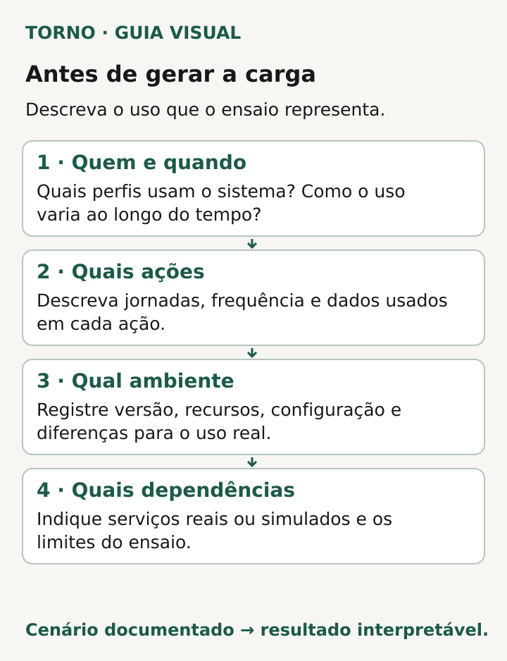
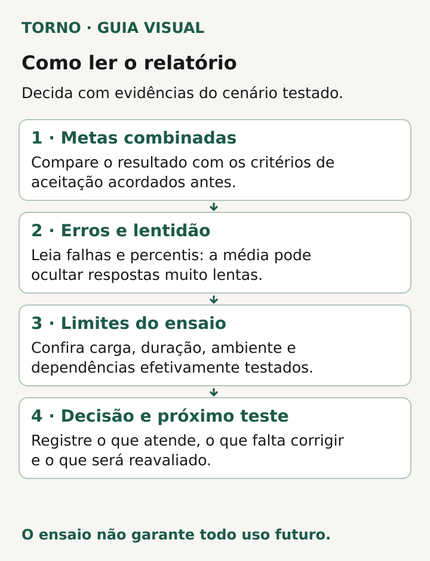

Antes de liberar um sistema, peça um relatório que mostre **qual atividade foi simulada, em quais condições, com quais critérios e qual resultado**. “Aguenta muitos usuários” ou uma captura de um gráfico não bastam para relacionar o ensaio à sua operação. Você precisa reconhecer o uso que pretende liberar e entender o que a evidência cobre.

O gestor não precisa escrever o teste de carga do software. Precisa conseguir perguntar se o relatório sustenta aquela decisão de liberação. O roteiro abaixo é uma proposta editorial para essa leitura; ambiente autorizado, limites, custos e execução devem ser definidos pelo responsável técnico antes do ensaio.

## Comece pela atividade, não pelo total de cadastros

Uma base de pessoas cadastradas não informa quantas estarão ativas ao mesmo tempo, quais ações executarão ou com que frequência. Peça que o fornecedor traduza “usuários simultâneos no sistema” em comportamento observável: consultar uma lista, abrir um registro, salvar uma alteração, enviar um arquivo ou concluir outro fluxo relevante.

A [documentação de testes de API do Grafana k6](https://grafana.com/docs/k6/latest/testing-guides/api-load-testing/) distingue testes de um componente, APIs integradas e fluxos completos. Também apresenta modelagem por usuários virtuais e por taxa de requisições. São formas de descrever carga; nenhuma substitui a explicação do que cada participante simulado faz.

Pergunte de onde veio o perfil de uso. Se ainda não há operação real, aceite que existe uma estimativa, mas peça que seja identificada como tal. Registre quem a validou e qual lançamento ela pretende representar. Uma hipótese explícita permite rever o teste quando o uso observado trouxer informações diferentes.

## Procure a identidade do ensaio

Peça versão do software, data e horário, ambiente, configuração relevante e descrição dos dados utilizados. O relatório deve permitir ao responsável localizar aquela execução e explicar as diferenças para o ambiente previsto de operação. Guarde referências aos anexos técnicos em canal apropriado, sem circular credenciais ou dados pessoais desnecessários.

Inclua a duração e a evolução da carga. O [guia de carga típica do k6](https://grafana.com/docs/k6/latest/testing-guides/test-types/load-testing/) descreve aumento gradual e sustentação da atividade para observar o comportamento ao longo do ensaio. Não copie suas durações de exemplo como regra de contratação. Peça a justificativa de por que o tempo escolhido responde à dúvida do seu produto.

Dados, permissões e etapas também precisam ser reconhecíveis. Uma consulta simples numa base pequena pode ser o escopo de um teste válido, mas o relatório deve dizer isso. Se a liberação inclui relatórios extensos ou gravações concorrentes, pergunte onde essas ações aparecem na evidência.

## Leia o relatório com uma ficha de perguntas

Use a tabela para localizar informações e lacunas. Não é necessário receber todos os detalhes em um único documento, desde que as referências estejam acessíveis ao responsável pela decisão.

| Pergunta | Evidência a localizar | O que pedir se faltar |
|---|---|---|
| Qual uso foi representado? | Fluxos, perfis, ritmo de ações e origem da estimativa | Descrição do cenário e sua relação com o lançamento |
| Onde e em qual versão? | Identificação da execução, configuração e dados | Diferenças relevantes para a operação prevista |
| Qual carga foi atingida? | Atividade efetivamente gerada ao longo do tempo | Explicação de interrupções ou do alvo não alcançado |
| O que significava passar? | Critérios por métrica e fluxo, definidos antes da leitura do resultado | Metas justificadas pelo uso e pelo impacto |
| O que aconteceu? | Erros, durações e verificações do resultado das ações | Dados que sustentem a conclusão do resumo |
| Quais são os limites? | Dependências simuladas, exclusões e condições não exercitadas | Lacunas, responsável e próxima verificação |

*Diagrama original: descreva o cenário antes de interpretar a carga. Crédito: Torno, 2026.*

Uma linha preenchida com “aprovado” não substitui os dados que justificam a aprovação. Pergunte também se o gerador conseguiu produzir a carga planejada: um ensaio interrompido ou que não atingiu o cenário proposto precisa ser explicado antes de receber uma conclusão abrangente.

## Compare erros e tempos com critérios combinados

Na documentação do k6, [thresholds são critérios de aprovação ou reprovação de métricas](https://grafana.com/docs/k6/latest/using-k6/thresholds/). A referência usa, entre outras medidas, taxa de erros e percentis de duração. Os números dos exemplos pertencem aos exemplos: não existe ali uma meta universal para qualquer MVP.

Se aparecer **p95 da duração das requisições**, leia como o valor abaixo do qual ficam aproximadamente 95% das durações observadas naquele conjunto de requisições. Não significa que 95% dos usuários tiveram uma experiência aprovada. Peça o conjunto medido, o período e o fluxo a que o indicador se refere.

Ao revisar, peça que o fornecedor explique tanto as falhas quanto as respostas mais lentas e compare esses resultados com os critérios acordados. Consulte separadamente o que foi medido no fluxo crítico; um resumo agregado pode deixar sem resposta a pergunta sobre aquela tarefa específica. A média também pode ocultar respostas muito lentas; peça a distribuição das durações ou percentis pertinentes ao fluxo.

Confira ainda o resultado das ações. O [guia de testes de API do k6 inclui verificações das respostas](https://grafana.com/docs/k6/latest/testing-guides/api-load-testing/), além das métricas de desempenho. Para a decisão de negócio, pergunte qual conferência demonstrou que a operação prevista aconteceu. A velocidade registrada não responde sozinha se o pedido ou a alteração ficou correto.

## Leia as dependências como parte do limite

Pergunte quais serviços externos foram exercitados e quais foram simulados. Se uma integração não participou, registre a exclusão na conclusão. Para sistemas que dependem de ERP, o [briefing de integração](https://tornostudio.com/blog/integracao-erp-briefing-orcamento/) ajuda a localizar sistemas, acessos e responsáveis que precisam entrar nessa conversa.

**Exemplo inteiramente fictício:** um portal de pedidos recebe um relatório com consultas a catálogo e salvamento de rascunhos. O envio ao ERP foi substituído por uma resposta simulada. Mesmo que os critérios dessas operações tenham sido atendidos, a evidência não demonstra o comportamento do envio real sob a mesma atividade. O gestor pede que a conclusão identifique a simulação e que o fornecedor proponha a verificação pendente, com ambiente e limites autorizados. **Fim do exemplo fictício; não representa cliente ou ensaio da Torno.**

*Diagrama original: relacione resultados, limites e próxima decisão. Crédito: Torno, 2026.*

## Registre a decisão e quando a evidência precisa ser revista

Termine com uma conclusão delimitada: cenário avaliado, versão, critérios atendidos, falhas, exclusões e pendências. Se algo essencial ficou sem demonstração, peça responsável e condição para completar a avaliação antes da liberação correspondente. Se o cenário foi atendido, preserve a evidência que sustenta essa decisão.

Combine o que exigirá reavaliação. O [guia de carga típica](https://grafana.com/docs/k6/latest/testing-guides/test-types/load-testing/) inclui verificar desempenho após alterações de código ou infraestrutura. Na sua operação, discuta também mudanças relevantes do fluxo, dos dados e do perfil de uso. O relatório documenta um ensaio; não garante desempenho futuro em produção.

Os [critérios de aceite de MVP](https://tornostudio.com/blog/criterios-aceite-mvp/) ajudam a relacionar essa avaliação à entrega. Se o problema é uma falha ocasional já observada, use o roteiro de [evidências de erro intermitente](https://tornostudio.com/blog/erro-intermitente-software-evidencias/) para registrar a ocorrência e iniciar a investigação.

Para conversar com Henrique sobre o sistema, traga o perfil de uso esperado, o relatório disponível e as lacunas que ficaram. Isso permite delimitar o que precisa ser demonstrado antes de decidir a liberação.
