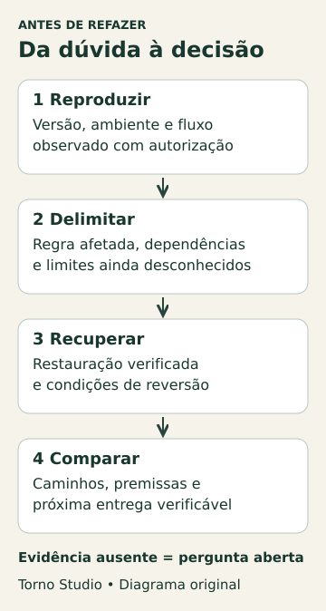
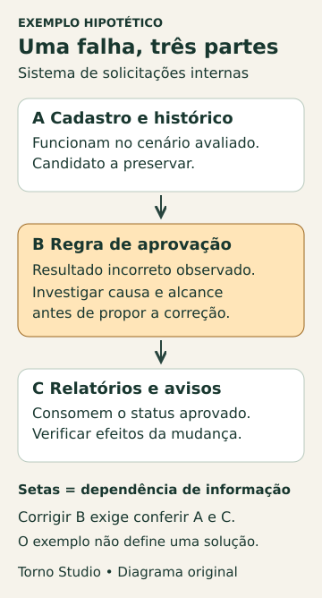

Seu sistema funciona em parte, mas cada mudança parece abrir outro problema. Um fornecedor recomenda corrigir. Outro diz que é melhor começar do zero. Antes de comparar os preços, peça as evidências que sustentam cada recomendação.

Um diagnóstico de software existente deve ajudar a responder três perguntas: o que ainda atende à operação, o que impede a próxima entrega e quais riscos precisam ser esclarecidos antes de investir. A idade da tecnologia, a aparência das telas ou a origem do código, sozinhas, não resolvem essa decisão.

Este roteiro serve para donos e gestores que precisam avaliar uma proposta de recuperação ou reconstrução. Você pode reunir o contexto do negócio; as verificações técnicas devem ser feitas por alguém autorizado, em ambiente adequado e com escopo combinado.

## Primeiro, escolha o fluxo que está custando caro

“Nosso sistema é ruim” abre espaço para um diagnóstico sem fim. Prefira uma situação observável: “a operação precisa conferir manualmente as aprovações porque algumas solicitações aparecem com status incorreto”.

Registre quem sofre o problema, quando ele acontece, como a operação contorna a falha e o que precisa voltar a funcionar. Separe defeitos de necessidades novas. Se a empresa passou a operar com filiais, por exemplo, a ausência de separação entre unidades pode ser uma mudança de requisito, mesmo que o sistema anterior funcionasse como combinado.

Escolha também um responsável do negócio para esclarecer regras. Código, telas e registros mostram comportamentos; alguém precisa dizer quais deles continuam corretos.

## As 7 evidências que vale pedir

### 1. Controle dos ativos e permissão para trabalhar

Peça um inventário do repositório, hospedagem, banco, domínio e serviços externos. Para cada item, registre quem administra, quem pode conceder acesso e o que está disponível.

Ter uma cópia do código não significa conseguir publicar ou recuperar o sistema. Se faltam acessos, a recomendação técnica deve explicitar essa limitação. Compartilhe convites com permissões adequadas; não envie senhas, chaves ou dados de clientes no primeiro contato.

### 2. Uma versão reproduzível fora da produção

Solicite uma demonstração de que a versão avaliada pode ser instalada ou executada em ambiente separado, com dependências e configuração identificadas. Registre a versão do código e os serviços necessários.

Se isso ainda não for possível, peça a lista dos bloqueios. Um ambiente que só funciona no computador de quem desenvolveu aumenta a incerteza de qualquer orçamento. A primeira entrega pode ser tornar o sistema reproduzível, antes de alterar funcionalidades.

### 3. O fluxo crítico observado de ponta a ponta

Para a situação escolhida, peça o caminho percorrido, o resultado esperado e o observado. Inclua pelo menos uma exceção relevante: permissão negada, interrupção de serviço ou repetição de uma ação.

A evidência pode reunir teste, registro técnico e validação do responsável pela operação. Use dados fictícios sempre que possível. A orientação do [Google SRE sobre testes de confiabilidade](https://sre.google/sre-book/testing-reliability/) ajuda a entender por que diferentes testes revelam diferentes falhas; nenhum teste isolado comprova o sistema inteiro.

### 4. Dependências e fronteiras da mudança

Peça um mapa pequeno: qual parte recebe a ação, onde a regra é aplicada, onde o dado é gravado e quem o consome depois. Inclua tarefas automáticas e serviços externos envolvidos no fluxo.

Esse mapa permite discutir se uma correção fica concentrada ou exige mudanças coordenadas. “O problema está no módulo de aprovação” ainda é uma hipótese se relatórios e notificações dependem diretamente dos mesmos dados.

### 5. Dados recuperáveis e retorno possível

Peça evidência de restauração em ambiente isolado, com verificação do conteúdo recuperado e do tempo necessário. A [AWS recomenda testar periodicamente a recuperação dos backups](https://docs.aws.amazon.com/wellarchitected/latest/framework/rel_backing_up_data_periodic_recovery_testing_data.html) para conferir integridade e objetivos de recuperação.

Peça também as condições de reversão de uma mudança. Voltar à versão anterior do código pode não desfazer uma alteração no banco. O plano precisa tratar os dados escritos depois da publicação e indicar quando o retorno deixa de ser simples.

### 6. Restrições que realmente impedem continuar

Solicite a lista de componentes sem suporte, dependências indisponíveis, limitações de plataforma e problemas conhecidos que afetam o fluxo. Cada item precisa apontar impacto, evidência e alternativa.

“Tecnologia antiga” é uma descrição incompleta. A pergunta útil é: qual mudança necessária ela impede, ou qual risco concreto permanece? Uma verificação delimitada também não equivale a pentest, certificação ou auditoria integral de segurança.

### 7. Alternativas comparáveis, com incertezas visíveis

Peça que a recomendação compare o resultado operacional de cada caminho, o que será preservado, as dependências, a migração de dados e o esforço de validação. Inclua a opção de adiar uma mudança quando seu benefício ainda não estiver claro.

As estimativas devem identificar premissas e pontos que podem alterar o escopo. Se uma informação essencial está ausente, vale contratar uma investigação delimitada antes de assumir o preço de uma reconstrução completa.

*Figura 1. Evidências que conectam o problema operacional à decisão de investimento. Diagrama original Torno Studio.*

## Como essas evidências mudam a decisão

Corrigir um defeito, refatorar e reconstruir são trabalhos diferentes. Na definição de [Martin Fowler](https://martinfowler.com/bliki/RefactoringBoundary.html), refatoração reorganiza o código preservando seu comportamento observável. Corrigir uma regra errada altera esse comportamento e exige validar o resultado esperado.

Considere um exemplo hipotético: um sistema de solicitações internas registra pedidos e mantém o histórico, mas aplica incorretamente uma regra de aprovação. A evidência pode apontar uma correção localizada, seguida de testes do fluxo afetado. Refazer cadastro, histórico e relatórios só faria sentido se houvesse justificativas adicionais.

Se a regra depende de várias partes difíceis de separar, uma substituição gradual pode entrar na comparação. O [padrão Strangler Fig, documentado pela Microsoft](https://learn.microsoft.com/en-us/azure/architecture/patterns/strangler-fig), descreve a troca progressiva de funcionalidades. Essa convivência exige tratar dependências, dados e custos temporários. Ela nem sempre é viável ou conveniente para um sistema pequeno.

Reconstruir pode ser adequado quando as limitações inviabilizam o objetivo e os caminhos de preservação foram examinados. Mesmo assim, entram no orçamento a descoberta das regras, migração, validação e transição da operação.

*Figura 2. Exemplo hipotético, sem dados de clientes: o limite da correção depende das relações entre os módulos. Diagrama original Torno Studio.*

## Checklist para revisar a proposta

Antes de aprovar o próximo passo, confira:

- [ ] O fluxo prioritário e o impacto estão descritos.
- [ ] A versão e o ambiente avaliados estão identificados.
- [ ] Cada conclusão aponta uma evidência verificável.
- [ ] Lacunas e hipóteses estão separadas dos fatos observados.
- [ ] Preservar, corrigir ou substituir tem justificativa por parte afetada.
- [ ] Dados, integrações, validação e transição aparecem no escopo.
- [ ] Há responsáveis pelas decisões pendentes.
- [ ] A próxima etapa tem uma entrega delimitada e condições de parada.

Para cada pendência, use uma linha: **pergunta → evidência necessária → responsável → decisão que ela libera**. Essa ficha ajuda a evitar que dúvidas sejam transformadas silenciosamente em promessas.

## Quer avaliar o próximo passo?

Na Torno, você conversa diretamente com Henrique Pett, fundador e responsável técnico pelo trabalho. Veja como funciona a [recuperação de projeto de software](https://tornostudio.com/recuperacao-de-projeto/) ou [agende uma conversa gratuita de 45 minutos](https://calendly.com/henriquepett/45min).

Traga o fluxo travado, o impacto na operação e quais acessos sua empresa controla. A conversa serve para entender contexto e enquadramento. Revisão de repositório, investigação técnica e definição aprofundada de escopo dependem de contratação; o Product Sprint também não equivale a auditoria técnica integral.

*Referências técnicas consultadas em 15 de outubro de 2026. O checklist e os exemplos são uma síntese editorial original para apoiar a conversa de contratação.*
