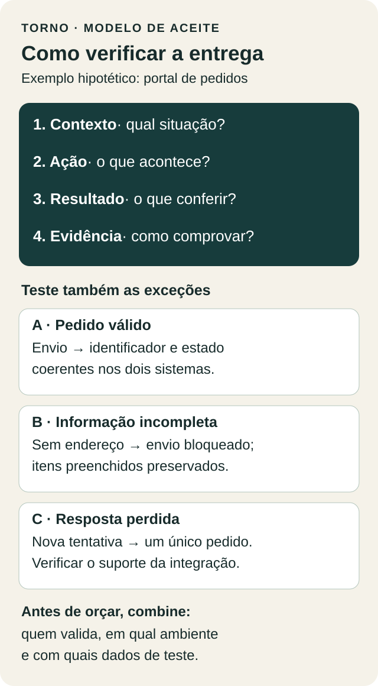

Antes de pedir um orçamento de MVP, escolha um fluxo e escreva como você vai verificar que ele funciona. Quem usa? Em qual situação? O que deve acontecer? O que acontece quando algo dá errado? Essas respostas formam os critérios de aceite e ajudam a transformar uma ideia em uma entrega verificável.

Uma proposta que promete “portal de pedidos com integração ao ERP” ainda deixa decisões importantes abertas. O pedido entra automaticamente? Pode ser enviado duas vezes? Quem recebe o aviso quando o ERP está indisponível? Sem essas definições, fornecedores podem orçar trabalhos diferentes usando a mesma descrição.

Este roteiro serve para quem vai contratar um MVP, uma integração ou uma ferramenta interna e precisa conversar sobre escopo sem escrever uma especificação técnica completa.

## O que é um critério de aceite?

É uma condição observável que uma entrega precisa cumprir para ser considerada aceita. “A tela deve ser intuitiva” expressa uma intenção, mas deixa a avaliação subjetiva. “Ao enviar um pedido sem endereço, o sistema informa o campo pendente e preserva os itens preenchidos” descreve um comportamento que pode ser testado.

Uma estrutura útil é: dado um contexto, quando uma ação acontece, então um resultado deve ser observado. A [documentação do Cucumber](https://cucumber.io/docs/gherkin/reference/) usa essa organização para descrever cenários. Você pode aproveitar a lógica em português comum, sem instalar ferramentas ou escrever código.

Critérios de aceite também ajudam a separar uma falha do comportamento combinado de uma solicitação nova. Essa distinção precisa estar alinhada à proposta e ao processo de mudanças do projeto.

## Comece pela decisão que o MVP precisa permitir

Imagine um exemplo hipotético: uma distribuidora quer testar se clientes conseguem enviar pedidos pelo portal sem precisar confirmar cada item por mensagem. O primeiro fluxo vai da seleção de produtos ao recebimento de uma confirmação identificável.

A primeira versão poderia incluir um perfil de cliente, um perfil de operação, consulta de catálogo e envio do pedido ao ERP. Negociação de preços, aplicativo nativo e faturamento automático poderiam ficar fora. Essas são escolhas deste exemplo, não uma receita para toda distribuidora.

Registre também como avaliar o uso depois do lançamento: quantos pedidos exigiram intervenção, onde os clientes desistiram e por quê. Essas observações ajudam a decidir a próxima versão. Já os critérios de aceite verificam o comportamento acordado do software antes de aceitar a entrega. Um fluxo pode passar nos testes e ainda precisar de mudanças para ser adotado pelos clientes.

## Escreva três cenários para cada fluxo importante

Para começar, descreva o caminho esperado, uma entrada inválida e uma interrupção ou repetição. A quantidade final depende do risco e das regras do produto.

### 1. Pedido válido

Dado um cliente autorizado, produtos disponíveis e endereço preenchido, quando o pedido for enviado, o portal deverá exibir um identificador e um estado coerente com a resposta da integração. A operação deverá conseguir localizar esse mesmo pedido.

A evidência pode ser uma execução em homologação com dados de teste e a conferência do identificador nos dois sistemas. Se o ERP ainda não confirmou o recebimento, o portal deverá mostrar “aguardando confirmação”, conforme a regra acordada.

### 2. Informação incompleta

Dado um pedido sem endereço, quando o cliente tentar enviá-lo, o portal deverá indicar o campo obrigatório, manter os itens selecionados e impedir o envio ao ERP.

Esse cenário esclarece uma regra que poderia passar despercebida em uma demonstração com todos os campos preenchidos. O comprador consegue validá-lo sem conhecer a implementação.

### 3. Resposta perdida e nova tentativa

Dado um pedido recebido pelo ERP cuja confirmação não chegou ao portal, quando houver uma nova tentativa de envio, o resultado esperado deverá ser um único pedido no destino e um estado consultável na origem.

Esse comportamento precisa ser investigado com a documentação do ERP. A [Stripe documenta chaves de idempotência para repetir com segurança requisições de criação ou atualização em sua API após erro de conexão, sem criar um segundo objeto nem repetir a atualização](https://docs.stripe.com/api/idempotent_requests). Isso é um exemplo de mecanismo, não uma garantia de que seu ERP o oferece. Se ele não oferecer, o fornecedor deverá explicitar a solução e os limites antes de assumir esse compromisso.

*Diagrama original preparado para este artigo. Os cenários são hipotéticos.*

## Use uma ficha curta para pedir orçamento

Copie esta ficha e preencha uma para cada fluxo prioritário:

- **Objetivo:** qual problema o fluxo precisa resolver?
- **Usuário e permissão:** quem pode iniciar, consultar e alterar?
- **Início e fim:** o que dispara o fluxo e qual resultado encerra a etapa?
- **Regras:** quais dados, estados e exceções precisam ser respeitados?
- **Cenários de aceite:** o que será testado e qual resultado será conferido?
- **Evidência e responsável:** quem valida, em qual ambiente e com quais dados?
- **Dependências:** quais acessos, serviços e decisões precisam estar disponíveis?
- **Fora do escopo:** o que fica para outra etapa?

No exemplo do portal, uma dependência seria o acesso autorizado ao ambiente de testes do ERP. Outra seria a definição de qual sistema mantém o catálogo. Se essas informações faltarem, registre a pendência e peça que o orçamento explicite a premissa usada.

Essa ficha é um ponto de partida para a conversa. Produtos com pagamentos, dados sensíveis ou exigências regulatórias precisam de avaliação específica.

## Combine como a entrega será validada

Antes de começar, definam quem representa o negócio na validação, quando os testes acontecem e como registrar divergências. Usem dados sintéticos sempre que possível. Guardem o cenário executado, o resultado esperado, o resultado observado e a versão testada.

Também explicitem requisitos que atravessam vários fluxos: controle de acesso, recuperação de dados, monitoramento e documentação de operação. O [Scrum Guide](https://scrumguides.org/scrum-guide.html#increment) atribui aos Developers a responsabilidade por instilar qualidade ao aderir a uma Definição de Pronto. Na contratação, vale registrar o padrão geral de qualidade e os critérios específicos de cada entrega, mesmo quando o projeto não usa Scrum.

Evite metas vagas como “carregar rápido”. Quando desempenho importar, combinem uma condição mensurável com volume de dados, quantidade de usuários, ambiente e limite esperado. Esses números devem vir da necessidade e da viabilidade do projeto.

## O que levar para a primeira conversa

Leve um fluxo prioritário, três cenários de aceite, as dependências conhecidas e uma lista do que pode esperar. Peça ao fornecedor que aponte ambiguidades e explique como demonstrará cada resultado. Isso ajuda a comparar propostas e a identificar decisões ainda abertas antes da construção.

Na Torno, o Product Sprint inclui escopo com critérios de aceite, exclusões e protótipo navegável; a construção é uma etapa separada. [Veja as etapas na página da Torno](https://tornostudio.com/#precos) ou [agende um diagnóstico de 45 minutos, grátis](https://calendly.com/henriquepett/45min), para conversar sobre o fluxo que você precisa colocar de pé.
