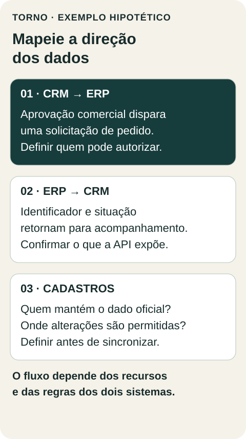
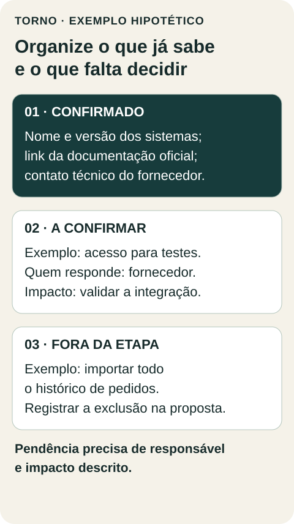

Para pedir um orçamento de integração com ERP, reúna o nome e a versão dos sistemas, a documentação disponível, os dados que precisam circular e quem responde por cada decisão. Não é necessário chegar com a arquitetura pronta. O importante é mostrar o que já se sabe e o que ainda depende do fornecedor do ERP.

“Conectar o comercial ao ERP” pode significar consultar um cadastro, criar um pedido ou atualizar dados nos dois sentidos. Cada opção envolve permissões, regras e responsabilidades diferentes. Um briefing útil transforma essa frase em perguntas que podem ser verificadas antes de estimar a construção.

Este roteiro ajuda quem já decidiu investigar uma integração e precisa organizar a conversa com uma pessoa desenvolvedora ou equipe de software.

## 1. Identifique o sistema que existe de verdade

Anote o produto, a versão quando aplicável, os módulos contratados e se há personalizações. Inclua o contato técnico do fornecedor e o endereço da documentação oficial. Um nome comercial sozinho não confirma quais operações estão disponíveis na sua instalação ou no seu plano.

Peça a confirmação de que a integração pretendida é suportada. Existe API, um meio documentado para sistemas trocarem informações? Ela permite consultar, criar e alterar os registros necessários? Há conector oficial que já resolva o caso? Quais habilitações ou custos adicionais precisam ser considerados?

O [portal de desenvolvimento do Omie](https://developer.omie.com.br/), por exemplo, separa autenticação, webhooks e documentação de módulos e serviços. A utilidade desse exemplo é mostrar onde procurar informação verificável. Não significa que todo ERP tenha os mesmos recursos.

## 2. Desenhe o caminho de cada informação

Considere um exemplo hipotético: uma empresa usa um CRM para acompanhar oportunidades e quer enviar negócios aprovados ao ERP. Antes de falar em sincronização, separe três decisões:

- Qual evento autoriza o envio: mudança de etapa, revisão de um responsável ou outra condição?
- Qual sistema mantém o cadastro oficial e qual apenas recebe uma cópia?
- Que informação precisa voltar para o comercial acompanhar o andamento?

Neste exemplo, o CRM registra a aprovação comercial, o ERP recebe a solicitação de pedido e devolve seu identificador e a situação disponível. A equipe ainda precisa definir o que ocorre quando alguém altera o cadastro nos dois sistemas. A última alteração não deve vencer por acidente.

*Exemplo hipotético. Direção dos dados e permissões devem ser confirmadas para os sistemas envolvidos.*

## 3. Separe dados disponíveis de dados que faltam

Prepare uma amostra fictícia dos campos envolvidos: código do cliente, código do produto, quantidade, unidade e condição comercial, conforme o fluxo. Compare os campos exigidos no destino com os que existem na origem.

Se o CRM usa um nome de produto e o ERP exige um código, alguém precisa definir como relacioná-los. Se um campo obrigatório não existe, a integração não deve inventar seu conteúdo. A decisão pode ser complementar o cadastro, mudar o processo ou limitar a primeira etapa.

Registre também quem corrige divergências. O time comercial pode saber qual cliente está sendo atendido; a operação pode conhecer a unidade de venda correta. Essas decisões pertencem ao negócio, mesmo quando a aplicação automática da regra fica no software.

Use dados sintéticos no levantamento inicial. Não envie uma base real inteira nem credenciais junto do pedido de orçamento.

## 4. Informe volume, frequência e tolerância a atraso

“Atualizar automaticamente” ainda deixa aberta a frequência. Anote o volume habitual, os picos conhecidos, o tamanho do histórico que precisa ser carregado e quanto atraso a operação tolera. Se não houver medição, identifique os números como estimativas e diga como serão conferidos.

A [documentação de limites do Bling](https://developer.bling.com.br/limites) informa que os limites de requisições se aplicam à conta, considerando os módulos utilizados. Assim, avaliar uma integração isoladamente pode deixar de fora outros consumidores da mesma capacidade. Confirme a regra vigente do seu fornecedor em vez de copiar números de outro ERP.

Também pergunte como as mudanças chegam ao outro sistema. A [documentação de webhooks do Bling](https://developer.bling.com.br/webhooks) distingue notificações por evento de consultas periódicas e informa que a entrega dos eventos não tem ordem garantida. Isso ajuda a explicar por que “em tempo real” precisa ser detalhado. O desenho depende do que a API oferece e do que a operação realmente necessita.

## 5. Liste acessos e responsáveis, sem compartilhar segredos

No briefing, registre quais acessos serão necessários e quem pode autorizar cada um. Verifique se existe ambiente separado para testes, quais dados podem ser usados e como obter apoio do fornecedor. Não presuma que uma conta administrativa de produção seja necessária para começar.

As credenciais devem ser tratadas por um canal seguro, com permissões adequadas, quando houver autorização e necessidade. O documento de orçamento pode registrar a dependência sem incluir senhas, tokens ou chaves de API.

Reserve também um responsável do negócio para esclarecer campos e regras. Uma dúvida sobre faturamento ou cadastro pode depender dessa pessoa, não da equipe que escreve a integração.

## 6. Leve as pendências para dentro da proposta

Organize as informações em três grupos: confirmado, a confirmar e fora da primeira etapa. Para cada pendência, indique quem responde e o que ela pode mudar. Uma proposta pode partir de uma premissa, desde que ela esteja visível e tenha um caminho de verificação.

*Modelo de organização do briefing. Os itens são ilustrativos, sem relação com um cliente real.*

Peça que a proposta esclareça construção, dependências externas e operação após a entrada em produção. Quem acompanha erros? Quem atende uma mudança de API? O que depende do suporte do ERP? Identifique também eventuais custos de licença, infraestrutura ou manutenção, sem presumir que estejam incluídos.

Para definir como demonstrar a entrega, complemente esse levantamento com [critérios de aceite verificáveis](https://tornostudio.com/blog/criterios-aceite-mvp/). O briefing revela dependências; o aceite estabelece o comportamento a conferir.

## O que levar para a conversa

Leve os links oficiais, um desenho do fluxo, uma amostra fictícia dos campos, estimativas de volume e a lista de pendências com responsáveis. Se parte disso ainda não existe, leve as perguntas. Elas ajudam a identificar o que precisa ser investigado antes de assumir escopo e prazo.

Na Torno, a conversa inicial pode ajudar a organizar esse próximo passo. [Agende um diagnóstico de 45 minutos, grátis](https://calendly.com/henriquepett/45min) para discutir a integração e as informações que você já tem.
