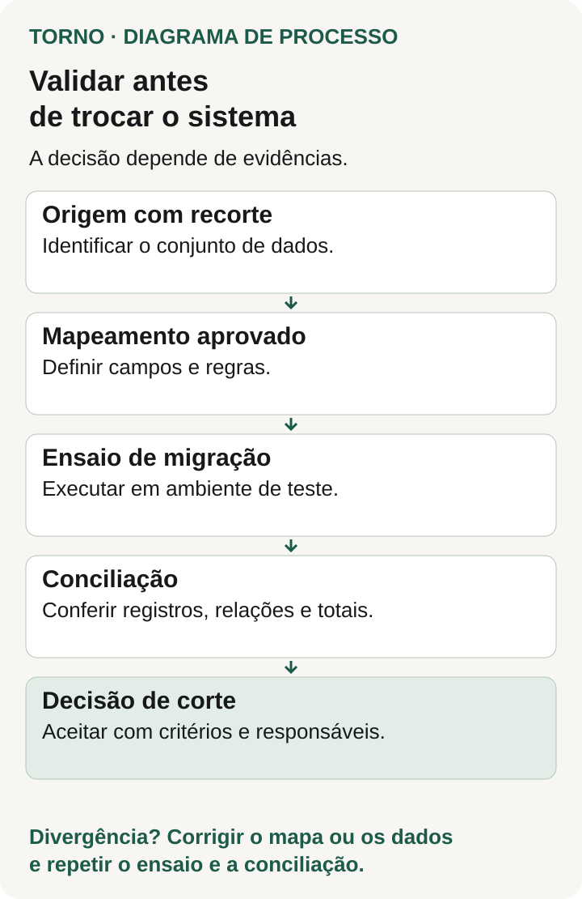
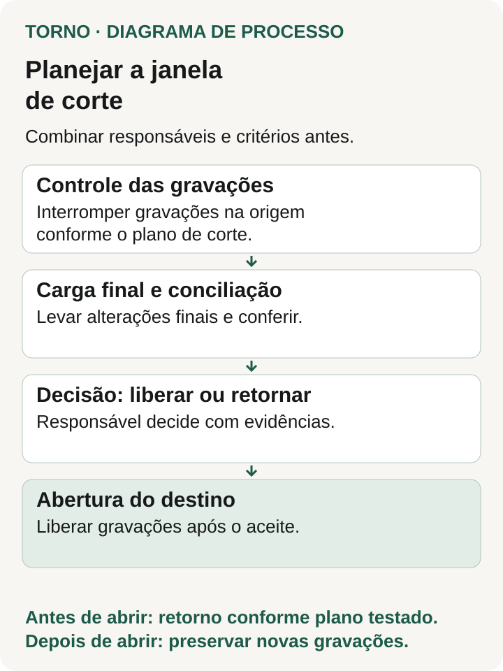

Antes de trocar de sistema, peça evidências de que os dados necessários chegaram completos, com as relações e os significados preservados, e de que a operação consegue usá-los. Combine também quem libera a entrada no novo sistema, quando as alterações no antigo param e o que acontece se a conferência falhar.

Uma importação concluída ainda deixa perguntas abertas. Os atendimentos continuam ligados ao cliente correto? Um chamado encerrado manteve seu histórico? O relatório usa a mesma data de referência? É essa conferência que permite decidir se a operação pode mudar.

Este roteiro serve para quem já planeja a troca e precisa organizar a validação com o fornecedor. Se a decisão de substituir ainda está aberta, comece pelas [evidências para avaliar se vale refazer um sistema](https://tornostudio.com/blog/antes-de-refazer-sistema-evidencias/).

## Defina o que precisa atravessar a troca

Liste os conjuntos de dados, sua origem, o período coberto e o destino esperado. Separe cadastros, registros em andamento, histórico e arquivos anexos. Para cada conjunto, indique quem conhece as regras e quem executa a migração.

Em um **exemplo hipotético**, uma empresa troca seu portal de atendimento. Ela decide levar clientes ativos, chamados abertos e os anexos desses chamados; o histórico encerrado ficará disponível para consulta em um arquivo separado. Essa escolha só está completa quando há um responsável, um meio de consulta testado e uma regra para localizar o registro antigo.

Não deixe “histórico fora do escopo” virar perda silenciosa de acesso. O que não será importado precisa ter destino, forma de recuperação e decisão documentados. Requisitos de retenção devem ser confirmados por quem responde por eles na empresa.

A [orientação de migração da Microsoft para Dynamics 365](https://learn.microsoft.com/en-us/dynamics365/guidance/implementation-guide/data-management-configuration-data-migration) inclui origens, conjuntos de dados, dependências, responsabilidades e atividades antes e depois do corte. Embora seja específica dessa plataforma, oferece uma referência para organizar essas perguntas em outros projetos.

## Registre como cada informação será transformada

Peça um mapa entre os campos de origem e destino. Ele deve mostrar o que é copiado, transformado, combinado ou excluído, com uma decisão para os casos sem correspondência.

No portal hipotético, o status antigo “aguardando” pode significar espera pelo cliente ou pela equipe interna. Se o novo sistema distingue esses estados, alguém do negócio precisa aprovar como separá-los. A ferramenta pode aplicar a regra; ela não conhece por conta própria a intenção do cadastro antigo.

Confira identificadores, datas e fusos, valores vazios, unidades e vínculos entre registros. Peça que duplicidades e campos obrigatórios ausentes apareçam em uma lista de exceções. Corrigir a origem, transformar durante a carga ou separar para análise são decisões diferentes; cada uma precisa deixar um registro rastreável.

## Combine a conciliação antes de executar a carga

Conciliação é a comparação entre o que deveria chegar e o que foi encontrado no destino. Para ser útil, precisa usar o mesmo recorte: período, filtros, versão da extração e momento de referência.

A ficha abaixo é um modelo editorial. Preencha os critérios com a operação e o responsável técnico antes do ensaio.

| Conferência | Evidência a pedir | Condição para decidir |
|---|---|---|
| Cobertura | Quantidade esperada, carregada, rejeitada e excluída por conjunto | Toda diferença tem explicação e destino aprovado |
| Conteúdo | Comparação dos campos críticos, conforme as transformações aprovadas | Divergências nesses campos são corrigidas ou bloqueiam a liberação |
| Relações | Conferência de chamados, clientes e anexos vinculados | Nenhum vínculo necessário fica sem correspondência explicada |
| Totais relevantes | Totais por categoria ou período, quando fizerem sentido para o negócio | Diferenças respeitam apenas regras explicitamente aprovadas |
| Uso pela operação | Execução de consultas e atividades críticas com os dados migrados | O responsável pelo processo confirma o resultado observado |

Contagens iguais não provam que o conteúdo é igual: um registro ausente e outro duplicado podem se compensar. Da mesma forma, uma amostra aprovada demonstra o que foi examinado; não comprova todos os registros. Peça que o relatório declare a cobertura e as limitações de cada verificação.

O [AWS DMS documenta a comparação de linhas entre origem e destino](https://docs.aws.amazon.com/dms/latest/userguide/CHAP_Validating.html), com registro de divergências. Também distingue itens pendentes e suspensos. Esses estados precisam ser investigados, pois não equivalem a dados conferidos. A documentação informa ainda que a validação exige tempo e recursos adicionais. São características da ferramenta nos cenários suportados, e devem entrar no planejamento quando ela for usada.

## Faça um ensaio que produza uma decisão

Combine uma execução em ambiente apropriado, com acesso autorizado aos dados necessários e proteção compatível com seu conteúdo. Dados sintéticos ajudam a testar regras; o ensaio também precisa esclarecer como serão verificados volume, qualidade e exceções da base que realmente será migrada.

Peça que a equipe registre a versão das regras, a extração usada, o tempo de cada etapa, os erros e a conciliação. Se a transformação mudar depois, identifique o que precisa ser repetido. O relatório anterior continua sendo evidência da versão anterior.

O [checklist de gestão de dados da Microsoft](https://learn.microsoft.com/en-us/dynamics365/guidance/implementation-guide/data-management-check-list) inclui fontes, mapeamento, ambientes, testes e planejamento do corte no plano de migração. No seu projeto, transforme esses itens em entregas com responsáveis.

*A decisão de corte depende do ensaio e da conciliação; divergências pedem nova validação. Crédito: Torno.*

## Planeje a janela de corte com as mudanças em andamento

**Cutover**, ou corte, é a passagem da operação para o novo sistema. O plano precisa mostrar onde cada alteração será registrada durante essa transição.

Se o sistema antigo continua recebendo chamados enquanto a base é copiada, a primeira extração ficará desatualizada. A equipe deve definir como levar as alterações posteriores e como confirmar que elas chegaram antes da abertura. Se houver uma pausa de gravação, registre seu início, quem a aplica, quem verifica sua eficácia e como a operação trabalha durante a pausa.

Inclua integrações, importações agendadas e outros caminhos que escrevem dados. Parar a tela principal pode deixar uma rotina automática alterando a origem. Quando existir integração com ERP, reúna suas dependências usando o [roteiro de briefing de integração](https://tornostudio.com/blog/integracao-erp-briefing-orcamento/) e detalhe aqui o comportamento durante o corte.

A janela deve reservar tempo para a carga final, a conciliação, a decisão e um eventual retorno. Use o ensaio como base da estimativa e registre suas diferenças para produção. Não derive o prazo apenas do tempo de copiar arquivos.

## Defina até quando é possível voltar

Peça ao responsável técnico que descreva e teste o retorno nas condições do projeto. O plano deve indicar o estado recuperável da origem, a sequência de ações, o tempo necessário e quem autoriza a execução.

Antes de abrir o destino para gravação, o retorno pode ter um procedimento. Depois que usuários criam chamados ou alteram cadastros no novo sistema, surge outra pergunta: como preservar essas mudanças se a operação voltar ao antigo? Restaurar uma cópia anterior pode descartá-las. O plano precisa explicitar como serão reconciliadas, ou indicar que o retorno exigirá intervenção adicional e quanto isso pode afetar a operação.

Registre o ponto a partir do qual a equipe precisa de uma nova decisão para voltar. Se não houver retorno viável, essa restrição deve estar visível antes da autorização da troca, acompanhada do procedimento de contingência disponível.

*Combine checagens, liberação e condições de retorno antes da troca. Crédito: Torno.*

## Leve uma ficha de liberação para a troca

Antes da janela, preencha uma ficha com:

- **Escopo e versão:** quais dados, extração e regras serão usados.
- **Evidências:** onde estão a conciliação, as exceções e o resultado do ensaio.
- **Bloqueios:** quais diferenças impedem a abertura, quem corrige e quem verifica novamente.
- **Decisão:** quem confirma os dados pelo negócio e quem confirma a execução técnica.
- **Corte e retorno:** quando as gravações mudam de lugar, qual o limite para decidir e como preservar alterações.
- **Primeira conferência:** quem verifica os registros e fluxos prioritários assim que a operação abre.

Uma pendência sem explicação deve continuar visível. Se houver uma exceção aceita, registre seu impacto, responsável e tratamento; “liberado com ressalvas” sozinho não informa o que a operação vai enfrentar.

Peça ao fornecedor essa ficha junto do plano de migração. Ela permite discutir a troca com base em dados conferidos, regras aprovadas e condições conhecidas para interromper a transição.

*Referências técnicas consultadas em 16 de outubro de 2026. O roteiro, a ficha e o exemplo são síntese editorial original; devem ser adaptados ao sistema e ao risco da operação.*
