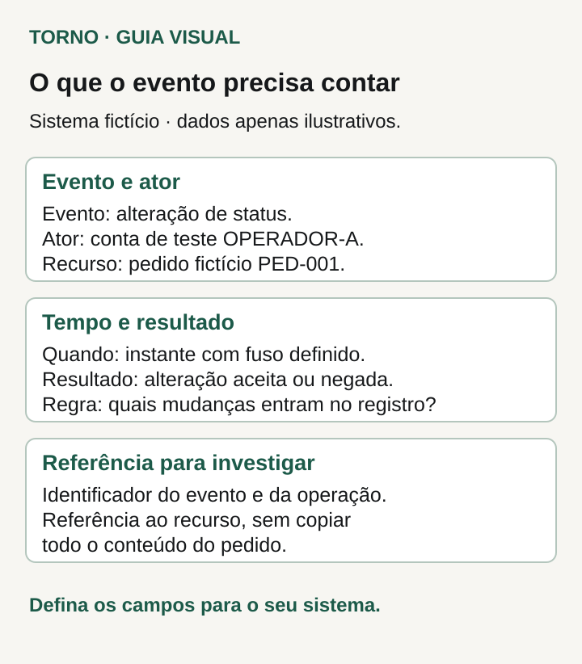
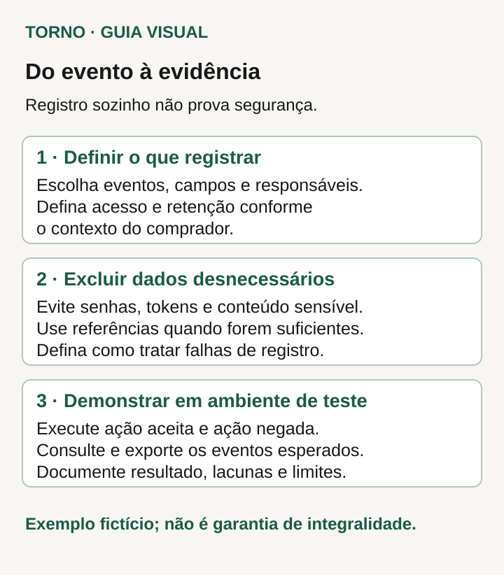

Antes de contratar uma trilha de auditoria no sistema, escreva **qual acontecimento você precisa conseguir explicar depois**. “Quem mudou o estado deste pedido, quando e com qual resultado?” permite discutir uma entrega concreta. “O sistema precisa ter logs” ainda deixa em aberto o que será registrado, quem conseguirá encontrar a informação e por quanto tempo ela estará disponível.

Comece por uma pergunta importante para a operação e descreva os eventos necessários para respondê-la. O roteiro abaixo é uma proposta editorial para essa conversa. Ter um histórico, por si só, não demonstra segurança, imutabilidade ou validade jurídica.

## Comece pela pergunta que o histórico precisa responder

Reúna as situações em que hoje falta contexto: uma aprovação sem responsável identificado, um cancelamento cujo motivo não aparece ou uma alteração atribuída genericamente a uma integração. Escolha uma delas e descreva o que seria necessário consultar para entender o ocorrido.

Depois, delimite o objeto: pedido, cadastro, documento ou relatório. “Histórico completo” pode significar coisas diferentes para quem compra e para quem desenvolve. Se a prioridade é explicar mudanças de estado de pedidos, escreva isso. Outras necessidades podem entrar como decisões separadas, com prioridade e responsável.

A [OWASP Logging Cheat Sheet](https://cheatsheetseries.owasp.org/cheatsheets/Logging_Cheat_Sheet.html) orienta escolher eventos conforme a finalidade e registrar contexto sobre quando, onde, quem e o que aconteceu. Também trata da exclusão de dados sensíveis, proteção, verificação e descarte dos registros. É uma referência técnica geral, voltada principalmente a registros de segurança; a ficha de negócio deste artigo é uma adaptação editorial para preparar o escopo.

## Liste acontecimentos e resultados relevantes

Para cada pergunta, descreva quais acontecimentos interessam: criação, alteração de estado, aprovação, cancelamento ou exportação, por exemplo. Considere também tentativas negadas quando forem necessárias à finalidade definida. Uma tentativa não deve aparecer como alteração concluída.

O [artigo sobre permissões de acesso](https://tornostudio.com/blog/permissoes-acesso-software-regras-negocio/) ajuda a definir quem pode executar uma ação. Aqui, a decisão é o que precisa ficar registrado quando a ação é tentada ou concluída. Use a regra de permissão como contexto para interpretar o resultado, sem transformar a trilha em outra matriz de perfis.

**Exemplo inteiramente fictício:** o pedido PED-001 começa em rascunho. A conta de teste OPERADOR-A o aprova. Depois, o processo automático JOB-02 tenta alterar um campo que a regra não permite modificar naquele estado. O histórico esperado precisa distinguir a aprovação concluída da alteração negada. Nenhum nome, documento pessoal ou credencial real é necessário para discutir esse exemplo.

## Defina o conteúdo de cada evento

Combine nomes que o responsável pelo processo consiga interpretar. Um código pode ser útil para o sistema, mas a demonstração precisa mostrar como ele será entendido na consulta. Se duas ações tiverem nomes parecidos, peça exemplos que deixem clara a diferença.

| Decisão | Exemplo fictício para discutir |
|---|---|
| Evento e objeto | Aprovação do pedido PED-001 |
| Ator | Conta OPERADOR-A, diferenciada de processo automático |
| Momento | Data, horário e fuso explicitamente definidos |
| Resultado | Concluído ou negado, com motivo adequado à consulta |
| Mudança necessária | Estado anterior rascunho; estado posterior aprovado |
| Ligação com a operação | Referência que permita relacionar tentativa e pedido |

*Campos ilustrativos para discutir o registro de eventos; o exemplo usa um sistema fictício. Crédito: Torno Studio.*

A ficha reúne evento, objeto, ator, momento e resultado. Cada campo precisa de significado acordado. O identificador do pedido permite encontrar o objeto; o ator distingue uma pessoa de um processo; o momento precisa ser interpretável; o resultado informa se houve efeito. **Fim do exemplo fictício; não representa implementação ou ensaio realizado pela Torno.**

## Escolha o que fica de fora

Pedir “antes e depois de tudo” pode incluir conteúdo que não é necessário para responder à pergunta inicial. Se a questão é uma mudança de estado, discuta se basta registrar os estados envolvidos e a referência do objeto. Não presuma que copiar o cadastro inteiro seja a melhor solução.

Defina exclusões expressas, como senhas, tokens e informações pessoais sem necessidade para aquela finalidade. Pergunte ao responsável técnico como o registro será produzido e como evitar que um campo livre receba conteúdo indevido. O comprador deve indicar a necessidade do negócio; a solução técnica e seus limites precisam ser explicados por quem a implementará.

## Combine consulta, proteção e retenção

Diga quem precisa consultar o histórico e para qual tarefa. “O gestor vê os eventos do pedido que está analisando” é um começo; ainda faltam alcance, filtros, campos exibidos e eventual exportação. Se houver arquivo exportado, defina quem pode obtê-lo e o que ele contém.

Pergunte também quem administra os registros e quais medidas serão usadas para limitar alterações e acessos indevidos. Solicite explicação sobre os limites do mecanismo. Uma tela chamada “auditoria” não permite concluir que seu conteúdo nunca será alterado.

A retenção precisa de responsável, finalidade e prazo aplicável ao contexto. Combine quando o período começa a contar, o que acontece ao terminar e como cópias e exportações serão tratadas. Se houver obrigação legal ou contratual a interpretar, encaminhe essa definição a quem tem essa responsabilidade. Não escolha um número de dias apenas porque aparece como padrão em uma ferramenta.

## Peça uma demonstração que responda à pergunta inicial

Transforme a ficha em [critérios de aceite](https://tornostudio.com/blog/criterios-aceite-mvp/). Em ambiente autorizado e com dados de teste, peça uma ação concluída, uma negada e uma executada por processo automático, conforme os eventos incluídos no escopo. Para cada caso, descreva o resultado esperado antes da demonstração.

Depois, procure o objeto no histórico e confira ator, momento, ação e resultado. Verifique se a tentativa negada permaneceu distinguível de uma mudança efetiva. Se consulta ou exportação fazem parte da entrega, inclua esses caminhos na conferência, com o perfil previsto.

*Roteiro ilustrativo para pedir uma demonstração com evidências e limites documentados. Crédito: Torno Studio.*

O fluxo pede três conjuntos de decisões: definir eventos, campos, acesso e retenção; excluir dados desnecessários e combinar o tratamento de falhas; demonstrar consulta e exportação previstas, distinguindo ações concluídas e negadas. A imagem resume o roteiro, sem apresentar teste já executado.

Pergunte o que acontece quando o registro falha. O responsável técnico deve propor o comportamento adequado à operação, incluindo como detectar e encaminhar o problema. Deixe a decisão explícita no escopo, em vez de pressupor que toda ação sempre produzirá um registro disponível.

## Leve as pendências para a contratação

Uma ficha útil pode terminar com dúvidas abertas, desde que tenham responsável e momento de decisão. Priorize uma pergunta de rastreabilidade, os eventos necessários para respondê-la e o modo de demonstrar a consulta. Depois amplie o escopo conforme a necessidade real.

Para a [conversa de escopo com Henrique](https://tornostudio.com/contact/), fundador e responsável técnico da Torno Studio, leve essa pergunta, os eventos prioritários e as pendências de acesso e retenção. Isso oferece uma base concreta para discutir a entrega e seus limites antes da contratação.
