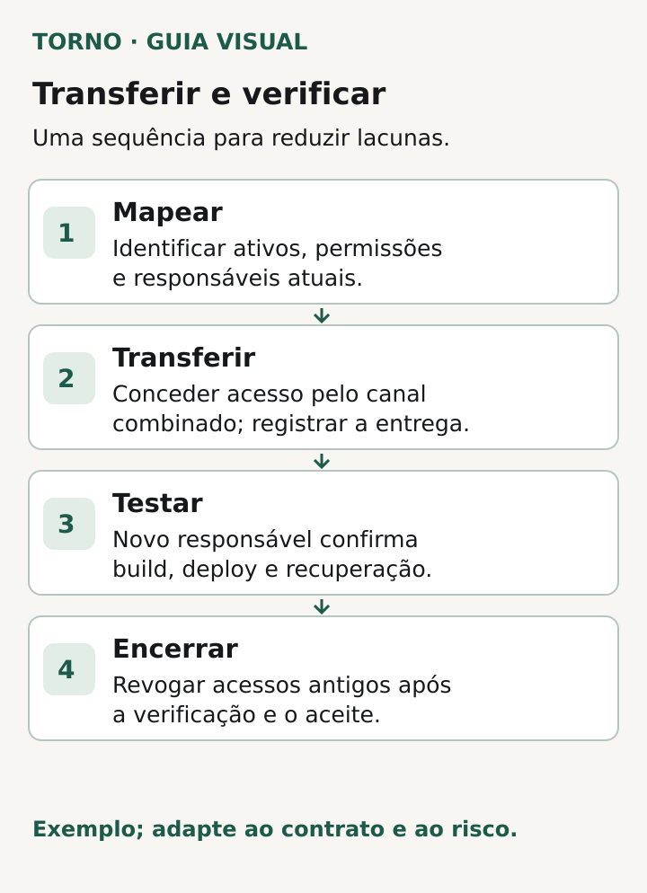

Ao trocar o fornecedor de um software, peça mais do que um link para o repositório. A passagem técnica só está pronta quando a empresa sabe **quais ativos sustentam o produto, quem controla cada conta, como a operação continua e quais acessos foram testados**. Um documento entregue sem demonstração pode esconder dependências que só aparecem no próximo deploy ou incidente.

Este roteiro é para quem manterá o *mesmo produto* com outro responsável técnico. Se a decisão de [refazer o sistema ainda está aberta](https://tornostudio.com/blog/antes-de-refazer-sistema-evidencias/), examine primeiro as evidências para essa escolha. Se a operação vai passar para **outro sistema**, há também uma [validação própria da migração de dados](https://tornostudio.com/blog/migracao-dados-validacao-troca-sistema/). A troca de fornecedor pode exigir ambos os trabalhos, mas eles não são o mesmo aceite.

## Faça um inventário que mostre titularidade e acesso

Liste cada ativo necessário para desenvolver, publicar e operar o produto. Comece pelo domínio e DNS, repositório de código, hospedagem, banco de dados, armazenamento, automações de deploy, monitoramento, backups e serviços externos usados pelo produto. Inclua contas de faturamento e contatos de recuperação. Um nome de ferramenta na lista não responde quem é o titular da conta nem quem consegue administrá-la.

Para cada ativo, registre:

| Campo | Pergunta de verificação |
|---|---|
| Serviço e finalidade | O que deixa de funcionar se este ativo ficar indisponível? |
| Titular da conta e faturamento | Em nome de quem está a conta e quem pode alterar pagamento? |
| Administrador atual e futuro | Quem concede, reduz e revoga permissões? |
| Acesso demonstrado | O futuro responsável entrou com a própria identidade e executou uma ação autorizada? |
| Dependências | Que deploy, integração, chave ou rotina usa este ativo? |
| Pendência e responsável | O que falta, quem resolve e qual evidência encerra a linha? |

Não preencha “acesso entregue” porque alguém enviou uma captura de tela. Peça uma demonstração no ambiente apropriado: o responsável nomeado entra com a própria conta, encontra o recurso e confirma a permissão de que precisa. Uma pessoa com acesso de leitura ao código pode continuar sem permissão para publicar ou recuperar o serviço.

*Inventário ilustrativo dos ativos a localizar e verificar na passagem técnica. Diagrama original Torno Studio, 2026.*

## Confirme o código e o caminho até a produção

Peça o endereço do repositório, a branch usada para produção, as regras de proteção, o histórico necessário e as instruções para configurar o projeto. Depois, percorra o caminho de uma mudança pequena em ambiente de teste: como ela é revisada, quais testes rodam, quem aprova e onde o resultado do deploy aparece. O ensaio deve ser planejado para não afetar usuários nem sobrescrever alterações em andamento.

Se o repositório GitHub for **transferido de proprietário**, não presuma que integrações e acessos desapareçam. A [documentação do GitHub informa que webhooks, secrets e deploy keys permanecem associados ao repositório transferido](https://docs.github.com/en/repositories/creating-and-managing-repositories/transferring-a-repository), e que colaboradores podem continuar com acesso. A transferência muda o titular; a revisão das permissões e dependências é uma tarefa separada. Em outra plataforma, confira a regra dela antes de agir.

Identifique também onde moram a configuração de produção, os comandos de build, as variáveis necessárias, as migrações e o procedimento para reverter uma versão. Não peça que o fornecedor copie senhas ou chaves para uma planilha de passagem. Registre **o nome, a finalidade, o serviço e o responsável por cada segredo**, sem o valor. O [GitHub documenta segredos em níveis de repositório, ambiente e organização no Actions](https://docs.github.com/en/actions/how-tos/write-workflows/choose-what-workflows-do/use-secrets); esse é um exemplo concreto de configuração que pode ficar fora do código. O responsável técnico deve conferir o mecanismo usado no produto real e planejar a substituição de credenciais em canal apropriado.

## Saiba quem mantém a operação de pé

Uma passagem útil explica onde aparecem alertas e logs, quem recebe cada alerta, como verificar a saúde do serviço, onde está o backup e como se testa a restauração sem expor dados desnecessários. Inclua o caminho para acionar provedores externos e a lista de tarefas recorrentes. O [Google SRE Workbook descreve plantão, alertas e escalonamento como trabalho organizado](https://sre.google/workbook/on-call/); ter uma ferramenta de monitoramento contratada não define, por si só, quem atende nem quando.

Combine por escrito o último dia de responsabilidade do fornecedor atual e o primeiro do novo, com um ponto de contato para a transição. Veja o [roteiro de custo de manutenção após o lançamento](https://tornostudio.com/blog/custo-manutencao-software-apos-lancamento/) para separar serviços de terceiros, suporte e evolução. O documento de passagem deve apontar o acordo real, sem inferir cobertura contínua de um acesso administrativo.

## Revise acessos sem interromper o serviço

Faça uma lista de usuários humanos, contas de serviço, aplicativos autorizados, chaves de deploy e integrações que ainda podem agir no produto. Para cada item, decida manter, reduzir, substituir ou revogar e identifique a dependência. A [orientação do GitHub para deploy keys](https://docs.github.com/en/authentication/keeping-your-account-and-data-secure/reviewing-your-deploy-keys) recomenda revisar chaves existentes e remover as não reconhecidas ou desatualizadas. Remover tudo de uma vez pode quebrar o deploy; testar primeiro a alternativa evita que o controle novo venha acompanhado de indisponibilidade.

Faça a sequência de forma verificável: crie o acesso do novo responsável, confirme que ele funciona, substitua o que depende da credencial antiga, teste o fluxo e só então revogue o acesso que saiu. Em caso de suspeita de comprometimento, trate a urgência com o responsável por segurança e com o plano de resposta aplicável. A ficha pública ou compartilhada entre fornecedores deve guardar decisões e evidências, nunca valores de segredos.

*Sequência ilustrativa de transferência e verificação, a adaptar ao contrato e ao risco. Diagrama original Torno Studio, 2026.*

## Encerre com uma ficha de aceite, não com “documentação enviada”

Antes de aceitar a passagem, peça que o responsável pelo negócio e o técnico revisem juntos uma ficha como esta. É um **modelo editorial**, a adaptar ao contrato e ao risco do seu produto.

| Ativo ou capacidade | Titular confirmado | Acesso demonstrado por | Evidência sem segredo | Pendência, responsável e prazo | Condição de aceite |
|---|---|---|---|---|---|
| Domínio e DNS | Nome da conta titular | Administrador futuro | Registro de acesso e configuração consultada | Preencher se houver | Renovação e alteração autorizada são possíveis |
| Código e deploy | Organização ou conta titular | Responsável técnico futuro | Execução de teste e histórico do pipeline | Preencher se houver | Uma versão de teste pode ser publicada e verificada |
| Dados e backup | Titular da infraestrutura | Responsável técnico futuro | Localização e teste controlado de restauração | Preencher se houver | Recuperação segue procedimento aprovado |
| Alertas e suporte | Titular das ferramentas e contrato | Responsável por operação | Alerta de teste e contato escalonado | Preencher se houver | Há responsável e caminho de acionamento definidos |
| Integrações e segredos | Titular de cada serviço | Administrador autorizado | Inventário de nomes e teste funcional, sem valores | Preencher se houver | Dependências funcionam e acessos antigos são tratados |

“Preencher se houver” impede transformar ausência de informação em aceite tácito. Cada linha precisa de um resultado observado, de uma exceção aprovada ou de uma pendência bloqueadora. Guarde o registro da versão do produto e da data do ensaio, para que a evidência não seja confundida com o estado de semanas depois.

A pergunta final é: **se o fornecedor anterior deixar de operar hoje, quem consegue fazer o próximo deploy, responder a um alerta e recuperar o serviço?** Se não houver resposta demonstrada para uma capacidade necessária, mantenha a pendência visível e combine uma transição assistida. O inventário reduz suposições; a demonstração mostra o controle que realmente foi assumido.

*Fontes técnicas consultadas em 19 de outubro de 2026. A ficha e os critérios são uma síntese editorial original e devem ser adaptados ao produto e ao contrato.*
